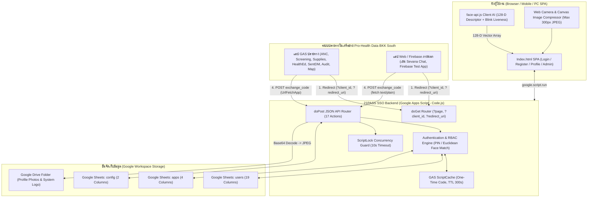
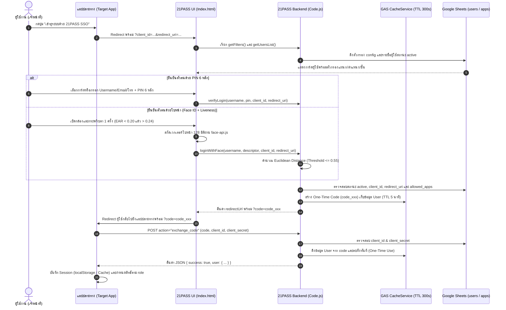
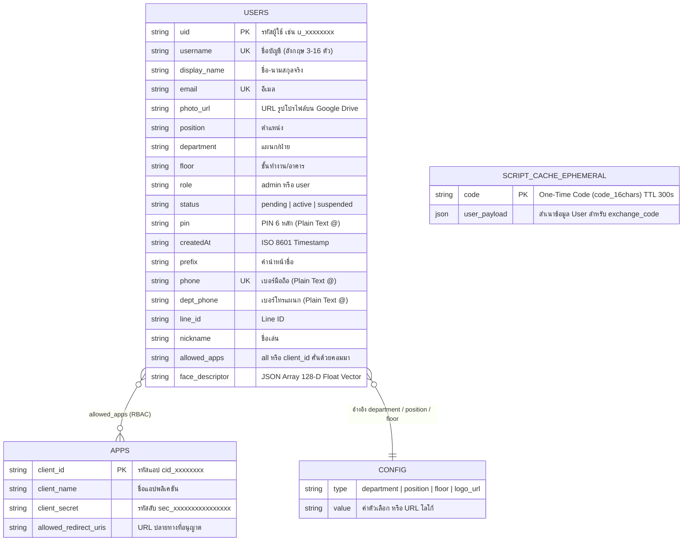

# รายงานชี้แจงข้อมูลทางเทคนิค สถาปัตยกรรม และแนวทางการเชื่อมต่อระบบ 21PASS (Central SSO)
**โครงการ:** Pro-Health Data BKK South — ระบบยืนยันตัวตนรวมศูนย์ (**21PASS Single Sign-On**)  
**จัดทำโดย:** ทีมพัฒนาและเจ้าของนวัตกรรม Pro-Health Data BKK South  
**วัตถุประสงค์:** เอกสารประกอบการประสานงานทีม IT, ทีม UX Audit และผู้บริหาร เพื่อตอบชุดคำถามทางเทคนิค 5 ประการ พร้อมชุด Demo Mock-up สำหรับทดสอบระบบ  

> [!IMPORTANT]
> **นโยบายความปลอดภัยของเอกสาร (Security & Redaction Notice)**  
> เพื่อความปลอดภัยของระบบปฏิบัติการจริง เอกสารฉบับนี้และไฟล์ในโฟลเดอร์ `Demo_21PASS/` **ไม่มีการเปิดเผย** API Key, URL จริงของระบบ Production, Google Drive Folder ID, Google Sheet ID, Client ID / Client Secret จริง, Firebase Config หรือรหัส PIN/รหัสผ่านที่ใช้งานจริงแต่อย่างใด ค่าตัวแปรเชื่อมต่อทั้งหมดถูกแทนที่ด้วย Placeholder (เช่น `<REDACTED_WEBAPP_URL>`) และบัญชีทั้งหมดใน Demo เป็น **ข้อมูลจำลอง (Mock Data)** เพื่อการสาธิตและการทำ UX Audit เท่านั้น

---

## บทสรุปนวัตกรรมและจุดแข็งของระบบ (Innovation Highlights)

**21PASS SSO** ถูกออกแบบและพัฒนาขึ้นเพื่อแก้ไขปัญหา "การแยกส่วนบัญชีผู้ใช้งาน" (Fragmented Identity) ของระบบบริการสุขภาพและงานสนับสนุนภายในเครือข่าย **Pro-Health Data BKK South** ซึ่งเดิมแต่ละระบบ (เช่น งานฝากครรภ์ ANC, คัดกรองสุขภาพ, คลังเวชภัณฑ์, แผนที่ชุมชน, การสื่อสารองค์กร) ต่างมีหน้าจอล็อกอินแยกจากกัน หรือใช้ปุ่มเลือกชื่อแบบคงที่

จุดแข็งสำคัญของนวัตกรรม 21PASS ที่สกัดจากสถาปัตยกรรมโค้ดจริง ได้แก่:
1. **Zero-Infrastructure / Low-Cost Core:** พัฒนาบน Google Apps Script (GAS) + Google Sheets + Google Drive + CacheService ทำให้หน่วยงานสาธารณสุขระดับศูนย์บริการฯ สามารถติดตั้งและดูแลได้ด้วยต้นทุนโครงสร้างพื้นฐานเป็นศูนย์
2. **One-Tap + Biometric UX สำหรับงานหน้างาน:** ออกแบบหน้าจอแบบ Card-based Visual Login พร้อมตัวกรองตาม **แผนก / ตำแหน่ง / ชั้นทำงาน** และรองรับการยืนยันตัวตนด้วย **PIN 6 หลัก** (ผ่าน Numpad หรือคีย์บอร์ด) ควบคู่กับ **Face Recognition + Liveness Detection (ตรวจจับการกระพริบตา)** ผ่าน Web Camera โดยประมวลผลเวกเตอร์ใบหน้าฝั่ง Client
3. **Centralized RBAC & App Ecosystem:** รองรับการลงทะเบียนแอปพลิเคชันปลายทาง (`client_id`, `client_secret`, `allowed_redirect_uris`) และการกำหนดสิทธิ์รายบุคคลว่าผู้ใช้คนใดเข้าถึงระบบย่อยใดได้บ้าง (`allowed_apps`) จากศูนย์กลางเพียงจุดเดียว
4. **Cross-Platform SSO Bridge:** เชื่อมต่อได้ทั้งแอปพลิเคชันบน **Google Apps Script** และ **Web App ภายนอก / Firebase (SPA)** ผ่านโปรโตคอล One-Time Authorization Code Flow

---

## คำถามข้อที่ 1: User Manual & Specs (คู่มือการใช้งาน ผังระบบ และรายการฟังก์ชัน)

### 1.1 ผังสถาปัตยกรรมระบบ (System Architecture)



### 1.2 ลำดับการทำงานของระบบยืนยันตัวตน (SSO & Biometric Sequence Diagram)



### 1.3 รายการฟังก์ชันทั้งหมดของระบบ (Functional List)

สกัดจากไฟล์ `Code.js`, `Index.html` และชุดเอกสาร `sso_prompt_guide_for_*.md`:

| หมวดหมู่ | รหัสฟังก์ชัน | ชื่อฟังก์ชัน / ความสามารถ | รายละเอียดการทำงานจริงจากโค้ด |
| :--- | :--- | :--- | :--- |
| **Authentication (User)** | `FN-AUTH-01` | Card-Based Visual Login & Filter | แสดงการ์ดผู้ใช้งานที่สถานะ `active` พร้อมฟิลเตอร์ 3 มิติ (แผนก, ตำแหน่ง, ชั้นทำงาน) และสัญลักษณ์ `📷` สำหรับผู้ลงทะเบียนใบหน้าแล้ว |
| **Authentication (User)** | `FN-AUTH-02` | Manual Multi-Identifier Login | พิมพ์เข้าสู่ระบบได้ด้วย `Username`, `Email` หรือ `เบอร์โทรศัพท์` คู่กับ PIN 6 หลัก |
| **Authentication (User)** | `FN-AUTH-03` | PIN Keypad & Accessibility | รองรับ Numpad บนหน้าจอ, แป้นพิมพ์ตัวเลขบนคีย์บอร์ด, ปุ่ม `Enter`/`Esc` และปุ่มเปิด/ปิดการมองเห็น PIN (`👁️`) |
| **Biometric (Face ID)** | `FN-BIO-01` | Face Enrollment (Pin-Gated) | ลงทะเบียนเวกเตอร์ใบหน้า 128 มิติ โดยต้องยืนยัน PIN 6 หลักก่อนเปิดกล้องและผ่านการกระพริบตา |
| **Biometric (Face ID)** | `FN-BIO-02` | Face Login + Blink Liveness | ตรวจจับใบหน้าผ่าน `@vladmandic/face-api` พร้อมเช็ค Eye Aspect Ratio (EAR `< 0.20` -> `> 0.24`) ป้องกันการใช้ภาพนิ่ง และเทียบ 1:1 ด้วย Euclidean Distance (`THRESHOLD = 0.55`) |
| **Biometric (Face ID)** | `FN-BIO-03` | Self Face Deletion | ผู้ใช้งานสามารถลบข้อมูลเวกเตอร์ใบหน้าของตนเองได้ในหน้าแก้ไขโปรไฟล์ (ต้องยืนยันตัวตนด้วย PIN) |
| **User Lifecycle** | `FN-USR-01` | Self-Registration | สมัครสมาชิกใหม่พร้อมอัปโหลดรูปโปรไฟล์ (บีบอัด JPEG สูงสุด 300px บนเบราว์เซอร์) สถานะเริ่มต้นเป็น `pending` รอแอดมินอนุมัติ |
| **User Lifecycle** | `FN-USR-02` | Self-Service Profile & PIN Edit | ยืนยันตัวตนด้วย PIN เดิม เพื่อแก้ไขข้อมูลส่วนตัว เปลี่ยนรูปโปรไฟล์ และเปลี่ยนรหัส PIN 6 หลักใหม่ |
| **UI / UX** | `FN-UI-01` | Mobile / PC Responsive Toggle | ปุ่มสลับมุมมองระหว่าง `📱 Mobile` (max-width 440px) และ `💻 PC View` (max-width 950px, ฟิลเตอร์ 3 คอลัมน์) |
| **Admin Console** | `FN-ADM-01` | Admin Authentication | เข้าสู่ระบบหลังบ้านด้วย Admin PIN (ตรวจสอบ `role === 'admin'` ในตาราง `users`) |
| **Admin Console** | `FN-ADM-02` | User Approval & Suspension | อนุมัติบัญชีใหม่ (`pending` -> `active`) หรือระงับสิทธิ์การใช้งาน (`active` -> `suspended`) และรีเซ็ตข้อมูลใบหน้าผู้ใช้ (`admin_reset_face`) |
| **Admin Console** | `FN-ADM-03` | Per-App RBAC Management | กำหนดสิทธิ์การเข้าถึงแอปพลิเคชันรายบุคคล (`all` หรือเลือกเฉพาะ `client_id` ที่อนุญาต) |
| **Admin Console** | `FN-ADM-04` | Master Data & Branding Config | เพิ่ม/ลบตัวเลือก แผนก (`department`), ตำแหน่ง (`position`), ชั้นทำงาน (`floor`) และอัปโหลดโลโก้ระบบทรง 6 เหลี่ยม |
| **Admin Console** | `FN-ADM-05` | SSO Client App Registration | ลงทะเบียนแอปพลิเคชันใหม่ สร้าง `client_id` (`cid_...`), `client_secret` (`sec_...`) และกำหนด `allowed_redirect_uris` |
| **SSO API & Ecosystem** | `FN-API-01` | One-Time Code Exchange API | `doPost` action `exchange_code` ตรวจสอบ `client_id`/`client_secret` และแลก `code` (อายุ 5 นาที ใช้ครั้งเดียว) เป็น JSON User Profile |

#### ระบบปลายทางในเครือข่าย Pro-Health Data BKK South ที่ออกแบบคู่มือเชื่อมต่อไว้แล้ว (8 ระบบ)
จากการตรวจสอบไฟล์ `sso_prompt_guide_for_*.md` ในคลังโค้ด มีระบบที่รองรับการเชื่อมต่อกับ 21PASS SSO ดังนี้:
1. **ระบบดูแลและบันทึกการฝากครรภ์ (ANC)** (`sso_prompt_guide_for_ANC.md`) — ซิงก์ชื่อผู้ตรวจ ตำแหน่ง แผนก และ Role ลงฟอร์มอัตโนมัติ
2. **ระบบบันทึกคะแนนการตรวจเยี่ยมศูนย์สุขภาพชุมชน** (`sso_prompt_guide_for_CommunityHealthAudit.md`)
3. **ระบบคลังสื่อสุขศึกษา (Health Education System)** (`sso_prompt_guide_for_HealthEducation.md`)
4. **ระบบข้อมูลสุขภาพและคัดกรอง (Health Screening System)** (`sso_prompt_guide_for_HealthScreening.md`)
5. **ระบบเบิกจ่ายเวชภัณฑ์ (Medical Supplies Inventory System)** (`sso_prompt_guide_for_MedicalSupplies.md`)
6. **ระบบส่งต่อเบาหวาน (SentDM)** (`sso_prompt_guide_for_SentDM.md`)
7. **ระบบสื่อสารองค์กร Sevana (TeamConnect 21 Chat App)** (`sso_prompt_guide_for_SevanaChat.md`) — รองรับ First-Time Department Mapping 21 แผนก และซิงก์ลง Firestore
8. **ระบบแผนที่ชุมชนเขตวัฒนา (Vadhana Community Map)** (`sso_prompt_guide_for_VadhanaCommunityMap.md`)

### 1.4 แนวทางการใช้งานระบบ (User Manual)

#### ก. สำหรับผู้ใช้งานทั่วไป (End-User)
1. **การเข้าสู่ระบบ:** เปิดหน้าเว็บ 21PASS (หรือกดปุ่ม `🔑 เข้าสู่ระบบด้วย 21PASS SSO` จากแอปปลายทาง) -> ใช้ตัวกรองแผนก/ตำแหน่ง/ชั้น หรือกดปุ่ม `⌨️ พิมพ์ล็อกอิน` -> คลิกการ์ดชื่อตนเอง -> ป้อน PIN 6 หลัก หรือกด `📷 สแกนใบหน้าเข้าสู่ระบบ` แล้วมองกล้องพร้อมกระพริบตา 1 ครั้ง
2. **การสมัครสมาชิกใหม่:** ไปที่แท็บ `📝 สมัครสมาชิก` -> อัปโหลดรูปโปรไฟล์ (ไม่เกิน 10MB) -> กรอกข้อมูลที่มีเครื่องหมาย `*` ให้ครบถ้วน -> กดลงทะเบียน -> แจ้งผู้ดูแลระบบเพื่ออนุมัติสถานะจาก `pending` เป็น `active`
3. **การแก้ไขโปรไฟล์ / เปลี่ยน PIN / จัดการ Face ID:** ไปที่แท็บ `👤 แก้ไขโปรไฟล์` -> ยืนยันตัวตนด้วย Username/Email/เบอร์โทร และ PIN ปัจจุบัน -> แก้ไขข้อมูลหรือลงทะเบียน/ลบข้อมูลสแกนใบหน้า -> กดบันทึก

#### ข. สำหรับผู้ดูแลระบบ (Administrator)
1. ไปที่แท็บ `🛡️ แอดมิน` และป้อน Admin PIN
2. **แท็บจัดการผู้ใช้งาน:** ตรวจสอบผู้สมัครใหม่ กด `อนุมัติ` เพื่อเปิดใช้งาน, กด `บล็อก` เพื่อระงับสิทธิ์, กดปุ่ม `🔑` เพื่อจำกัดแอปที่ผู้ใช้เข้าถึงได้ และคลิกที่ Badge `📷 ใบหน้า: มี ✖` เพื่อล้างข้อมูลใบหน้ากรณีผู้ใช้เปลี่ยนอุปกรณ์หรือมีปัญหาสแกนไม่ผ่าน
3. **แท็บจัดการตัวเลือก & โลโก้:** อัปโหลดโลโก้หน่วยงานและเพิ่ม/ลบรายการแผนก ตำแหน่ง ชั้นทำงาน
4. **แท็บจัดการแอปเชื่อมต่อ (SSO):** กรอกชื่อแอปและ Redirect URI เพื่อสร้าง `client_id` และ `client_secret` สำหรับส่งให้นักพัฒนาแอปปลายทาง

#### ค. สำหรับนักพัฒนาแอปปลายทาง (Developer Integration)
- **Step 1 (Redirect):** ส่งผู้ใช้ไปยัง `<REDACTED_21PASS_WEBAPP_URL>?client_id=<CLIENT_ID>&redirect_uri=<ENCODED_CALLBACK_URL>`
- **Step 2 (Receive Code):** รับพารามิเตอร์ `?code=code_xxx` ที่ถูกส่งกลับมา
- **Step 3 (Exchange Token):** ส่ง HTTP `POST` (`Content-Type: text/plain;charset=utf-8` สำหรับ Browser หรือ `application/json` สำหรับ GAS `UrlFetchApp`) ไปยัง URL ของ 21PASS พร้อม Payload:
  `{ "action": "exchange_code", "code": "...", "client_id": "...", "client_secret": "..." }`

---

## คำถามข้อที่ 2: Demo Account & Staging Environment (บัญชีทดสอบและวิธีรันระบบจำลอง)

### 2.1 ระบบ Demo Mock-up พร้อมใช้งานสำหรับ UX Audit
ทีมพัฒนาได้จัดทำ **Interactive Demo Mock-up** แบบทำงานได้ครบทุกหน้าจอ (Offline Sandbox ผ่าน `localStorage`) ไว้ในโฟลเดอร์ `Demo_21PASS/index.html` โดยจำลองการทำงานของ Google Apps Script Backend ครบทั้ง 4 แท็บ พร้อมเครื่องมือ **SSO Client Simulator** สำหรับทดสอบขั้นตอน Redirect และ Exchange Code

#### วิธีรันระบบทดสอบ (Local Demo)
1. **วิธีที่ 1 (เปิดไฟล์โดยตรง):** เปิดไฟล์ `Demo_21PASS/index.html` ด้วยเบราว์เซอร์ (Chrome / Edge / Safari) ได้ทันที
2. **วิธีที่ 2 (ผ่าน Local Web Server — แนะนำสำหรับทดสอบกล้อง):** เปิด Terminal ในโฟลเดอร์ `Demo_21PASS` แล้วรัน:
   ```bash
   python3 -m http.server 8080
   ```
   จากนั้นเปิดเบราว์เซอร์ไปที่ `http://localhost:8080`
3. สามารถกดปุ่ม **"🔗 จำลองการเชื่อมแอปปลายทาง (Test SSO Flow)"** ที่แถบเครื่องมือด้านบนเพื่อจำลองการล็อกอินข้ามระบบ หรือกด **"♻️ รีเซ็ตข้อมูล Demo"** เพื่อคืนค่าข้อมูลทดสอบเริ่มต้น

### 2.2 บัญชีทดสอบจำลองและข้อมูล Mock Seed Data

> [!WARNING]
> ข้อมูลบัญชี, รหัส PIN, `client_id` และ `client_secret` ด้านล่างนี้เป็น **ข้อมูลจำลอง (Mock Data)** ที่สร้างขึ้นใหม่สำหรับไฟล์ `Demo_21PASS/index.html` เท่านั้น **ไม่ใช่** ข้อมูลผู้ใช้งานจริงหรือรหัสผ่านจริงในระบบ Production

| ลำดับ | บทบาท / สถานะ | Username (Mock) | PIN (Mock) | ชื่อ-นามสกุล (Mock) | แผนก / ตำแหน่ง | สิทธิ์แอป / Face ID | วัตถุประสงค์ในการทดสอบ UX |
| :---: | :--- | :--- | :--- | :--- | :--- | :--- | :--- |
| 1 | `admin` / `active` | `admin_demo` | `888888` | ผู้ดูแลระบบ สาธิต | ไอทีและข้อมูลสุขภาพ / นักวิชาการคอมพิวเตอร์ | `all` / มี Face ID จำลอง | ทดสอบเข้าแท็บ **🛡️ แอดมิน** เพื่ออนุมัติผู้ใช้, ตั้งค่า RBAC, เพิ่มแอป |
| 2 | `user` / `active` | `somchai_demo` | `123456` | สมชาย สุขภาพดี | อนามัยชุมชน / นักวิชาการสาธารณสุข | `all` / มี Face ID จำลอง | ทดสอบล็อกอินผ่านการ์ด, PIN, สแกนใบหน้าจำลอง และแก้ไขโปรไฟล์ |
| 3 | `user` / `active` | `malee_anc` | `246810` | มาลี รักษ์ครรภ์ | งานส่งเสริมสุขภาพ (ANC) / พยาบาลวิชาชีพ | จำกัด 3 แอป / ยังไม่มี Face | ทดสอบ Flow แจ้งเตือนลงทะเบียนใบหน้าครั้งแรก และทดสอบสิทธิ์แอปที่อนุญาต vs ไม่อนุญาต |
| 4 | `user` / `active` | `kanya_pharm` | `654321` | กัญญา เภสัชกิจ | เภสัชกรรมและเวชภัณฑ์ / เภสัชกร | จำกัด 2 แอป / ยังไม่มี Face | ทดสอบการเข้าแอปคลังเวชภัณฑ์ (ผ่าน) เทียบกับแอป ANC (ถูกบล็อกสิทธิ์) |
| 5 | `user` / `pending` | `niran_new` | `112233` | นิรันดร์ ทดสอบใหม่ | คลินิก OPD / แพทย์ | `all` / ยังไม่มี Face | ทดสอบสถานะรออนุมัติ (ไม่แสดงในการ์ดล็อกอินจนกว่าแอดมินจะกดอนุมัติ) |

#### แอปพลิเคชันปลายทางจำลองใน Demo Sandbox (Mock Client Apps)
| ชื่อแอปพลิเคชันจำลอง | Mock Client ID | Mock Client Secret | Mock Redirect URI |
| :--- | :--- | :--- | :--- |
| ระบบดูแลการฝากครรภ์ (ANC) | `cid_demo_anc01` | `sec_demo_anc_mock_001` | `https://demo-anc.local/callback` |
| ระบบคัดกรองสุขภาพ (Health Screening) | `cid_demo_scr02` | `sec_demo_scr_mock_002` | `https://demo-screening.local/callback` |
| ระบบคลังเวชภัณฑ์ (Medical Supplies) | `cid_demo_med03` | `sec_demo_med_mock_003` | `https://demo-supplies.local/callback` |
| ระบบแผนที่ชุมชนเขตวัฒนา | `cid_demo_map04` | `sec_demo_map_mock_004` | `https://demo-map.local/callback` |
| ระบบสื่อสารองค์กร (Sevana Chat) | `cid_demo_chat05` | `sec_demo_chat_mock_005` | `https://demo-chat.local/callback` |

### 2.3 ช่องสำหรับกรอกข้อมูล Staging Environment จริง (กรอกเพิ่มเติมเมื่อ Deploy Staging แล้ว)
*หมายเหตุ: ส่วนนี้เว้นไว้เฉพาะสำหรับ URL และบัญชีทดสอบบนระบบ Staging จริง เพื่อความปลอดภัยไม่นำค่า Production มาใส่ในเอกสารนี้*

| รายการข้อมูล Staging | ค่าสำหรับทีม UX / QA (รอทีม IT/เจ้าของระบบระบุ) | หมายเหตุ |
| :--- | :--- | :--- |
| **Staging Web App URL** | `[กรอก URL Web App สำหรับ Staging ที่นี่]` | ห้ามใช้ URL ของระบบ Production จริง |
| **Staging Demo User (Username / PIN)** | `[กรอก Username / PIN ทดสอบ Staging]` | ควรเป็นบัญชี Sandbox ที่ไม่ใช่ข้อมูลบุคคลจริง |
| **Staging Admin PIN** | `[กรอก Admin PIN สำหรับ Staging]` | แยกจากระบบจริง |
| **Staging Client ID / Secret (สำหรับ Test App)** | `[กรอก Client ID / Secret สำหรับทดสอบ]` | ใช้ทดสอบกับ `Test_Client_App.html` |

---

## คำถามข้อที่ 3: Database & Data Dictionary (โครงสร้างฐานข้อมูลและ Form Fields)

### 3.1 ภาพรวมการจัดเก็บข้อมูล (Database & Storage Schema)
ระบบ 21PASS ใช้ Google Sheets เป็นฐานข้อมูลเชิงตารางหลัก 3 ชีต ร่วมกับ GAS `CacheService` และ Google Drive:



### 3.2 Data Dictionary (สกัดจาก `Code.js` ครบทุกตาราง)

#### ตารางที่ 1: `users` (Google Sheet: 19 คอลัมน์ A–S)
| ลำดับ (Col) | ชื่อฟิลด์ | ชนิดข้อมูล & Sheets Format | กฎ / รูปแบบ / ค่าเริ่มต้น | คำอธิบาย |
| :---: | :--- | :--- | :--- | :--- |
| 1 (A) | `uid` | String | Primary Key (`'u_' + uuid8`) | รหัสประจำตัวผู้ใช้แบบไม่ซ้ำ |
| 2 (B) | `username` | String | Unique, Regex `^[a-zA-Z][a-zA-Z0-9]{2,15}$` | ชื่อบัญชีสำหรับเข้าสู่ระบบ |
| 3 (C) | `display_name` | String | Required | ชื่อ-นามสกุลจริง |
| 4 (D) | `email` | String | Unique, Required, Email format | อีเมลติดต่อและใช้ล็อกอิน |
| 5 (E) | `photo_url` | String (URL) | Optional (`https://drive.google.com/thumbnail?id=...&sz=w300`) | ลิงก์ภาพโปรไฟล์บน Google Drive |
| 6 (F) | `position` | String | Required (อ้างอิง `config.position`) | ตำแหน่งงาน |
| 7 (G) | `department` | String | Required (อ้างอิง `config.department`) | แผนก / ฝ่าย |
| 8 (H) | `floor` | String | Required (อ้างอิง `config.floor`) | ชั้นทำงาน / อาคาร |
| 9 (I) | `role` | Enum String | `'user'` (default) หรือ `'admin'` | บทบาทสิทธิ์ในระบบและแอปปลายทาง |
| 10 (J) | `status` | Enum String | `'pending'` (default), `'active'`, `'suspended'` | สถานะบัญชี (ต้อง `active` จึงล็อกอินได้) |
| 11 (K) | `pin` | String (`@` Text) | Required, ตัวเลข 6 หลัก (ตั้ง Format `@` กันเลข 0 ตัวหน้าหาย) | รหัส PIN สำหรับเข้าสู่ระบบและยืนยันตัวตน |
| 12 (L) | `createdAt` | String (ISO Date) | `new Date().toISOString()` | วันเวลาที่สมัครสมาชิก |
| 13 (M) | `prefix` | String | `'นาย'`, `'นาง'`, `'นางสาว'`, `'อื่นๆ'` | คำนำหน้าชื่อ |
| 14 (N) | `phone` | String (`@` Text) | Unique, Required, Plain Text `@` | เบอร์โทรศัพท์มือถือหลัก (ใช้ล็อกอินได้) |
| 15 (O) | `dept_phone` | String (`@` Text) | Optional, Plain Text `@` | เบอร์โทรศัพท์ภายในแผนก |
| 16 (P) | `line_id` | String | Optional | Line ID สำหรับติดต่อประสานงาน |
| 17 (Q) | `nickname` | String | Optional | ชื่อเล่น (นำไปต่อท้ายชื่อในการ์ดล็อกอิน) |
| 18 (R) | `allowed_apps` | String | Default `'all'` หรือ CSV ของ `client_id` | รายการแอปที่ได้รับอนุญาตให้เข้าใช้งาน |
| 19 (S) | `face_descriptor` | JSON String (`@` Text) | Optional, Array Float ความยาว >= 120 (128-D) | เวกเตอร์ลักษณะใบหน้าสำหรับเทียบ Euclidean Distance |

#### ตารางที่ 2: `apps` (Google Sheet: 4 คอลัมน์ A–D)
| ลำดับ (Col) | ชื่อฟิลด์ | ชนิดข้อมูล | กฎ / รูปแบบ | คำอธิบาย |
| :---: | :--- | :--- | :--- | :--- |
| 1 (A) | `client_id` | String | Primary Key (`'cid_' + uuid8`) | รหัสระบุตัวตนของแอปปลายทาง |
| 2 (B) | `client_name` | String | Required | ชื่อแอปพลิเคชันที่ลงทะเบียน |
| 3 (C) | `client_secret` | String | Auto-generated (`'sec_' + 16 hex`) | รหัสลับฝั่ง Server ของแอปปลายทางสำหรับ `exchange_code` |
| 4 (D) | `allowed_redirect_uris` | String (CSV URL) | Cleaned URI (ตัด query/hash และ trailing slash) | Redirect URI ที่อนุญาตให้ส่ง `code` กลับ |

#### ตารางที่ 3: `config` (Google Sheet: 2 คอลัมน์ A–B)
| ลำดับ (Col) | ชื่อฟิลด์ | ชนิดข้อมูล | ค่าเริ่มต้น / ตัวอย่าง | คำอธิบาย |
| :---: | :--- | :--- | :--- | :--- |
| 1 (A) | `type` | Enum String | `'department'`, `'position'`, `'floor'`, `'logo_url'` | ประเภทของค่าตั้งค่า Master Data |
| 2 (B) | `value` | String | ชื่อแผนก/ตำแหน่ง/ชั้น หรือ URL โลโก้ | ค่าตัวเลือกใน Dropdown หรือลิงก์โลโก้ระบบ |

#### โครงสร้างข้อมูลชั่วคราวใน `CacheService.getScriptCache()`
- **Key:** `code_<16_char_random>` (อายุ **300 วินาที / 5 นาที**, ถูกลบทันทีหลังเรียก `exchange_code`)
- **Value (JSON User Object):** `{ uid, username, displayName, email, photoURL, position, department, floor, role, prefix, phone, deptPhone, lineId, nickname, allowedApps }` *(หมายเหตุ: ไม่ส่ง `pin` และ `face_descriptor` ออกไปใน Token Payload)*

### 3.3 รายการ Form Fields ทั้งหมดในระบบ (สกัดจาก `Index.html`)

#### 1) ฟอร์มสมัครสมาชิก (`view-register` — 13 Fields)
| ลำดับ | Element ID | Label | Input Type | บังคับ (`*`) | Validation / เงื่อนไขในโค้ด |
| :---: | :--- | :--- | :--- | :---: | :--- |
| 1 | `reg-photo-file` | รูปภาพโปรไฟล์ผู้ใช้ | `file (image/*)` | - | ขนาด <= 10MB, Canvas resize สูงสุด 300px, แปลง JPEG quality `0.85` เป็น Base64 |
| 2 | `reg-username` | Username (อังกฤษ) | `text` | * | Regex `^[a-zA-Z][a-zA-Z0-9]{2,15}$` (3-16 ตัว, ห้ามอักขระพิเศษ, ห้ามซ้ำ) |
| 3 | `reg-pin` | รหัส PIN 6 หลัก | `password` (`numeric`) | * | `maxlength="6"`, ต้องเป็นตัวเลข 6 หลักเท่านั้น |
| 4 | `reg-prefix` | คำนำหน้าชื่อ | `select` | * | ตัวเลือก: นาย, นาง, นางสาว, อื่นๆ |
| 5 | `reg-nickname` | ชื่อเล่น | `text` | - | ข้อความอิสระ |
| 6 | `reg-displayName` | ชื่อ - นามสกุลจริง | `text` | * | ข้อความอิสระ |
| 7 | `reg-email` | อีเมล (Email) | `email` | * | ตรวจสอบไม่ซ้ำในตาราง `users` (case-insensitive) |
| 8 | `reg-phone` | เบอร์โทรศัพท์ (มือถือหลัก) | `tel` | * | ตรวจสอบไม่ซ้ำในตาราง `users` |
| 9 | `reg-deptPhone` | เบอร์โทรแผนก | `tel` | - | ข้อความอิสระ (เก็บแบบ Plain Text) |
| 10 | `reg-lineId` | Line ID | `text` | - | ข้อความอิสระ |
| 11 | `reg-department` | แผนก / ฝ่าย | `select` | * | โหลดจากตาราง `config` (`type='department'`) |
| 12 | `reg-position` | ตำแหน่ง | `select` | * | โหลดจากตาราง `config` (`type='position'`) |
| 13 | `reg-floor` | ชั้นทำงาน / ตึก | `select` | * | โหลดจากตาราง `config` (`type='floor'`) |

#### 2) ฟอร์มเข้าสู่ระบบ (`view-login`, `pin-overlay`, `manual-overlay`, `modal-enroll-prompt`)
| หน้าจอ / Modal | Element ID | Label | Input Type | การทำงาน / Validation |
| :--- | :--- | :--- | :--- | :--- |
| Filter Bar | `filter-dept`, `filter-pos`, `filter-floor` | แผนก / ตำแหน่ง / ชั้นทำงาน | `select` | กรองรายชื่อการ์ดผู้ใช้ฝั่ง Client ทันที |
| PIN Modal | `modal-pin-input` | พิมพ์ PIN 6 หลัก | `password`/`text` | ตัวเลข 6 หลัก Auto-submit เมื่อครบ 6 หลัก (รองรับ Numpad & Keyboard) |
| Enroll Prompt | `enroll-confirm-pin` | ยืนยัน PIN ก่อนเปิดกล้อง | `password` (`numeric`) | ตรวจสอบ PIN 6 หลัก ก่อนเข้าสู่โหมดกล้องลงทะเบียนใบหน้า |
| Manual Modal | `manual-username` | Username / Email / เบอร์โทร | `text` | จับคู่กับ `username`, `email`, หรือ `phone` ในตาราง `users` |
| Manual Modal | `manual-pin` | รหัส PIN 6 หลัก | `password` (`numeric`) | ตรวจสอบกับ `pin` ของผู้ใช้ที่สถานะ `active` |

#### 3) ฟอร์มแก้ไขโปรไฟล์ (`view-profile` — Auth 2 Fields + Edit 13 Fields)
- **ส่วนยืนยันตัวตน (`profile-auth-box`):** `edit-auth-username` (`text`, *), `edit-auth-pin` (`password` 6 หลัก, *)
- **ส่วนแก้ไขข้อมูล (`profile-edit-box`):** `edit-photo-file`, `edit-prefix` (*), `edit-nickname`, `edit-displayName` (*), `edit-email` (*), `edit-phone` (*), `edit-deptPhone`, `edit-lineId`, `edit-department` (*), `edit-position` (*), `edit-floor` (*), `edit-new-pin` (Optional 6 หลัก), `edit-confirm-pin` (ต้องตรงกับ `edit-new-pin`) พร้อมปุ่มจัดการ Face ID (`openProfileFaceEnroll`, `deleteMyFace`)

#### 4) ฟอร์มผู้ดูแลระบบ (`view-admin` & `app-permission-overlay`)
- **Admin Login:** `admin-pin-input` (`password`, 6 หลัก)
- **จัดการตัวเลือก & โลโก้:** `logo-file-input` (`file`), `new-dept` (`text`), `new-pos` (`text`), `new-floor` (`text`)
- **ลงทะเบียนแอป SSO:** `new-app-name` (`text`), `new-app-redirect` (`url`)
- **กำหนดสิทธิ์รายแอป:** `perm-check-all` (`checkbox`), `.perm-app-checkbox` (`checkbox[]` ต่อ `client_id`)

---

## คำถามข้อที่ 4: Current Pain Points & Tech Constraints (ข้อจำกัดเชิงเทคนิคและจุดที่ต้องเฝ้าระวัง)

จากการวิเคราะห์โครงสร้างโค้ดจริง (`Code.js` และ `Index.html`) ในมุมมองของทีมพัฒนา พบข้อจำกัดเชิงเทคนิค (Technical Bottlenecks) และประเด็นด้านความปลอดภัยที่ควรทราบดังนี้:

### 4.1 ข้อจำกัดด้านสถาปัตยกรรมและประสิทธิภาพ (Google Apps Script & Sheets Bottlenecks)
1. **Full-Table Scan (`O(N)`) ในทุก Request:** ฟังก์ชัน `getUsersList()`, `verifyLogin()`, `loginWithFace()` และ `getAdminData()` ใช้คำสั่ง `userSheet.getDataRange().getValues()` ดึงข้อมูลทั้งตารางขึ้นมาวนลูปในหน่วยความจำทุกครั้ง หากจำนวนผู้ใช้งานขยายเกิน 1,500–3,000 บัญชี หรือมีการจัดเก็บ `face_descriptor` (JSON Array ยาว ~1.5–2 KB/คน) จำนวนมาก เวลาตอบสนอง (Latency) ของ Google Sheets API จะเพิ่มขึ้นอย่างชัดเจน
2. **ขีดจำกัด Concurrency & Lock Timeout:** Google Apps Script มีขีดจำกัดการทำงานพร้อมกัน (Simultaneous Executions) และฟังก์ชัน `registerUser()` / `updateUserProfile()` ใช้ `LockService.getScriptLock().waitLock(10000)` หากมีเจ้าหน้าที่ลงทะเบียนพร้อมกันจำนวนมากในช่วงอบรมหรือเปิดระบบวันแรก อาจเกิด Timeout 10 วินาที
3. **ข้อจำกัดของ `CacheService` (One-Time Code):** รหัส `code_` อายุ 300 วินาทีถูกเก็บใน `CacheService.getScriptCache()` ซึ่งไม่รับประกันความคงทน (อาจถูก Evict ก่อนหมดอายุได้หากระบบมีการใช้งาน Cache หนาแน่น) และไม่สามารถตรวจสอบย้อนหลัง (Audit Log) ได้หากไม่มีการเขียน Log เพิ่ม
4. **การโหลดโมเดล AI บนฝั่ง Client:** ไลบรารี `@vladmandic/face-api` และไฟล์โมเดล (`tinyFaceDetector`, `faceLandmark68Net`, `faceRecognitionNet`) ถูกโหลดจาก CDN ภายนอก (`cdn.jsdelivr.net`) เมื่อกดสแกนใบหน้าครั้งแรก ซึ่งอาจใช้เวลา 3–10 วินาทีบนเครือข่ายอินเทอร์เน็ตมือถือของเจ้าหน้าที่ภาคสนาม

### 4.2 ข้อจำกัดด้านความปลอดภัยและการควบคุมสิทธิ์ (Security Observations from Code)
1. **การเก็บรหัส PIN แบบ Plain Text ใน Google Sheets:** คอลัมน์ `pin` (Column K) ถูกเก็บเป็นข้อความธรรมดา (แม้จะป้องกันการตัดเลขศูนย์ด้วย Format `@` แล้ว) ยังไม่มีการทำ Salted Hash (เช่น SHA-256 / bcrypt / PBKDF2) รวมถึงมีการกำหนด Fallback Admin PIN แบบ Hardcode ไว้ในโค้ดหลังบ้าน (ควรย้ายไปเก็บใน `PropertiesService.getScriptProperties()` และเข้ารหัส Hash)
2. **ช่องโหว่การตรวจสอบสิทธิ์ในฟังก์ชัน `adminDeleteConfig`:** จากการตรวจสอบ `Code.js` พบว่า `adminAddConfig()` มีการเรียก `getAdminData({ admin_pin })` เพื่อตรวจสิทธิ์แอดมินก่อนแก้ไข แต่ฟังก์ชัน `adminDeleteConfig()` เรียก `deleteConfigItem(type, value)` โดยตรงโดยไม่ได้ตรวจสอบ `admin_pin` ซ้ำฝั่ง Server (เป็นจุดที่ต้องเร่งแก้ไขก่อนนำขึ้น Production เต็มรูปแบบ)
3. **การเปิดเผยรายชื่อผู้ใช้ในหน้า Card Login (`getUsersList`):** เพื่อให้เจ้าหน้าที่หน้างานจิ้มเลือกการ์ดชื่อตนเองได้สะดวก ระบบส่งรายชื่อผู้ใช้ที่ `status === 'active'` ทั้งหมดพร้อม metadata (`department`, `position`, `floor`, `hasFace`) มายังหน้า Client ซึ่งเหมาะสำหรับระบบภายในองค์กร/Intranet แต่ไม่เหมาะหากเปิดหน้าเว็บสู่สาธารณะโดยไม่มี Network Restriction (เสี่ยงต่อ User Enumeration)
4. **การแชร์รูปภาพโปรไฟล์และโลโก้บน Google Drive:** `uploadImageToDrive()` ตั้งสิทธิ์ไฟล์เป็น `DriveApp.Access.ANYONE_WITH_LINK` (`VIEW`) เพื่อให้ Tag `` บนเบราว์เซอร์แสดงผลได้ หาก Google Workspace ของหน่วยงานมีนโยบายปิดกั้นการแชร์ไฟล์ออกภายนอก ภาพโปรไฟล์อาจโหลดไม่ขึ้น
5. **ยังไม่มี Single Logout (SLO) และ Token Revocation:** เมื่อแลก `code` สำเร็จ แอปปลายทางจะเก็บ Session ไว้ใน `localStorage` หรือ `CacheService.getUserCache()` ของตนเอง การกดบล็อกผู้ใช้ (`suspended`) ที่ 21PASS Admin จะป้องกันการล็อกอินครั้งถัดไปได้ แต่ยังไม่ตัด Session ที่ค้างอยู่ในแอปปลายทางทันที

### 4.3 ข้อจำกัดด้าน UX บนอุปกรณ์หน้างาน (Browser & Iframe Permissions)
- **Camera Permission ภายใน GAS Iframe:** เนื่องจาก GAS Web App รันหน้าเว็บภายใน `<iframe>` ของ Google หากผู้ใช้เปิดผ่าน In-App Browser (เช่น LINE หรือ Facebook) หรือเบราว์เซอร์บล็อกสิทธิ์กล้องใน Cross-Origin Iframe ฟีเจอร์สแกนใบหน้าจะไม่สามารถเปิดกล้องได้ (ใน `Index.html` ปัจจุบันจึงออกแบบกล่อง `#camera-perm-box` และปุ่มสลับกลับไปใช้ PIN ไว้รองรับแล้ว)

---

## คำถามข้อที่ 5: API & Integration (ความพร้อมการเชื่อมต่อระบบภายนอก กทม. / สปสช.)

### 5.1 สถานะปัจจุบัน: ส่วนที่ระบบรองรับแล้วในโค้ดจริง
ปัจจุบัน 21PASS **รองรับการทำหน้าที่เป็น Identity Provider (IdP) แบบ Custom Authorization Code Flow** ผ่าน HTTP/HTTPS แล้ว ดังนี้:
1. **HTTP Endpoint (`doGet` & `doPost`):**
   - `GET` รองรับ Authorization Request ผ่าน Query Parameters `?client_id=...&redirect_uri=...`
   - `POST` รองรับ JSON API Router จำนวน 17 Actions รวมถึง `exchange_code` เพื่อยืนยัน `client_id` + `client_secret` และส่งคืนข้อมูลโปรไฟล์ผู้ใช้ (`uid`, `username`, `displayName`, `email`, `position`, `department`, `floor`, `role`, `phone`, `allowedApps` ฯลฯ)
2. **ความเข้ากันได้ข้ามแพลตฟอร์ม (Verified in Codebase):**
   - **GAS-to-GAS:** เชื่อมต่อด้วย `UrlFetchApp.fetch()` (มีตัวอย่างใน `SSO_Integration_Template.js`, `gas_sso_template.js`, `Test_Client_Code.js`)
   - **External SPA / Firebase Web App:** เชื่อมต่อด้วย `fetch()` โดยส่ง `Content-Type: text/plain;charset=utf-8` เพื่อหลีกเลี่ยง CORS Preflight ของ Google Apps Script และรองรับการ Sync ข้อมูลผู้ใช้ลง Cloud Firestore (`firebase_test_app.html`)
3. **Security Controls ที่มีอยู่แล้ว:** Redirect URI Whitelisting (`redirectUriClean`), Client Secret Verification, One-Time Code TTL 300 วินาที, และ Per-App User Authorization (`allowed_apps`)

### 5.2 ช่องว่างและจุดที่ต้องพัฒนาต่อเพื่อเชื่อมต่อกับระบบของ กทม. (BMA) และ สปสช. (NHSO)
ระบบปัจจุบัน **ยังไม่สามารถเชื่อมต่อกับระบบแกนกลางของ กทม. หรือ สปสช. ได้โดยตรงในทันที** เนื่องจากมีช่องว่างทางเทคนิคและมาตรฐานที่ต้องพัฒนาต่อยอดดังนี้:

| มิติการเชื่อมต่อ | สถานะปัจจุบันของ 21PASS (Demo/Codebase) | ข้อกำหนดมาตรฐานของระบบ กทม. / สปสช. | แนวทางพัฒนาต่อ (Phase 2 Integration Roadmap) |
| :--- | :--- | :--- | :--- |
| **Authentication Protocol** | Custom Authorization Code (`code_` + JSON response) | มาตรฐาน **OAuth 2.0 / OpenID Connect (OIDC)** ต้องมี `state`, `nonce`, **PKCE**, Signed **JWT (`id_token`)**, `access_token`, `refresh_token` และ Endpoint มาตรฐาน (`/.well-known/openid-configuration`, `/jwks.json`) | พัฒนา Auth Gateway Layer (เช่น Node.js / Cloud Run / Firebase Functions) เพื่อออก Signed JWT และรองรับพารามิเตอร์ `state` + PKCE |
| **External IdP Federation** | ใช้บัญชี Local (`users` sheet) ของ 21PASS เป็นหลัก | การเชื่อม **Provider ID** (สธ./สปสช.), **ThaiD (DOPA)**, **NHSO Authen** หรือ **BMA SSO** เพื่อทำ Single Sign-On กับฐานข้อมูลบุคลากรภาครัฐ | เพิ่มโมดูล OIDC Client / Broker ใน 21PASS ให้เจ้าหน้าที่กด "เข้าสู่ระบบด้วย Provider ID / BMA SSO" แล้วทำ Account Linking กับ `uid` เดิม |
| **Identity Data Mapping** | ยังไม่มีฟิลด์เลขบัตรประชาชน 13 หลัก, เลขใบประกอบวิชาชีพ หรือรหัสหน่วยบริการ (HCode) | ระบบ สปสช. (เช่น Authen / Claim / 43 แฟ้ม) และ กทม. ต้องใช้ **CID (13 หลัก)**, **HCode (5/9 หลัก)**, และ **เลขที่ใบอนุญาตประกอบวิชาชีพ** ในการอ้างอิงตัวตนผู้ให้บริการ | ขยาย Schema ตาราง `users` เพิ่มฟิลด์ `cid_hash` (หรือ Encrypted CID), `license_no`, `hcode` เพื่อส่ง Claim ไปยังระบบปลายทางอย่างปลอดภัย |
| **Network, CORS & HTTP Protocol** | รันบน `script.google.com` ซึ่งตอบ HTTP 200 เสมอ (ไม่มี HTTP 401/403), มี Redirect 302 ของ Google, ไม่มี Static IP และไม่รองรับ mTLS | API ภาครัฐ (สปสช. / กทม.) มักบังคับ **IP Whitelisting**, **VPN / Private Link**, **mTLS Certificate**, หรือ Custom Header `Authorization: Bearer <token>` | ย้าย Backend API ออกจาก GAS ไปยัง Cloud Hosting / Server ที่มี **Static Outbound IP**, รองรับ TLS/mTLS และ HTTP Status Codes มาตรฐาน |
| **Audit Trail & Compliance (PDPA)** | เก็บเฉพาะ `createdAt` ในตาราง `users` (ยังไม่มีตาราง Login/Access Audit Log) | พรบ. คุ้มครองข้อมูลส่วนบุคคล (PDPA) และมาตรฐานความปลอดภัยสาธารณสุขกำหนดให้บันทึก **Access Log / Consent Log** (ใคร เข้าแอปใด เมื่อไร ผลลัพธ์) | เพิ่มตาราง/Collection `audit_logs` และ `user_consents` เพื่อบันทึกประวัติการเข้าถึงข้อมูลสุขภาพและแลกเปลี่ยน Token ทุกครั้ง |

---

## สรุปภาพรวมความพร้อมส่งมอบให้ทีม UX และทีม IT

1. **พร้อมทดสอบทันที (Demo Sandbox):** ทีม UX สามารถเปิดไฟล์ `Demo_21PASS/index.html` เพื่อ Audit หน้าจอทั้ง 4 มุมมอง (Login, Register, Profile, Admin), Responsive Mobile/PC, PIN Numpad, Face Scan Flow และ SSO Client Simulator ได้ทันทีโดยไม่ติด Dependency ภายนอก
2. **ข้อมูลสกัดจากโค้ดจริง 100%:** Data Dictionary (19+4+2 Fields), Form Validations, API Actions (17 Actions) และข้อสังเกตเชิงเทคนิคทั้งหมดอ้างอิงตรงจากซอร์สโค้ดปัจจุบันของ 21PASS
3. **ความปลอดภัยครบถ้วน:** ไม่มีการแนบคีย์ลับ ลิงก์จริง ID ของ Google Drive/Sheets หรือบัญชีจริงลงในชุดส่งมอบนี้
