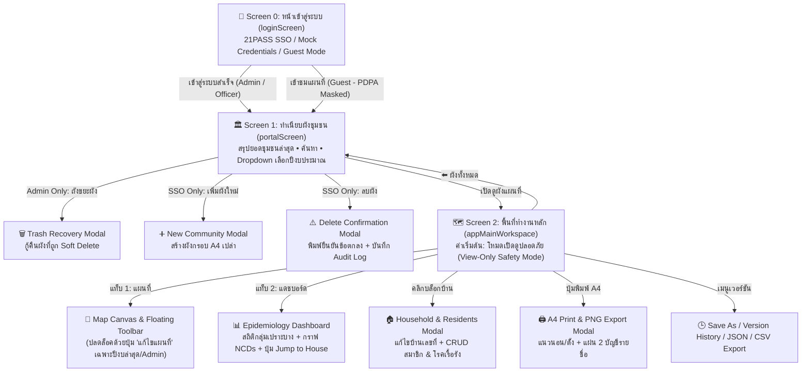
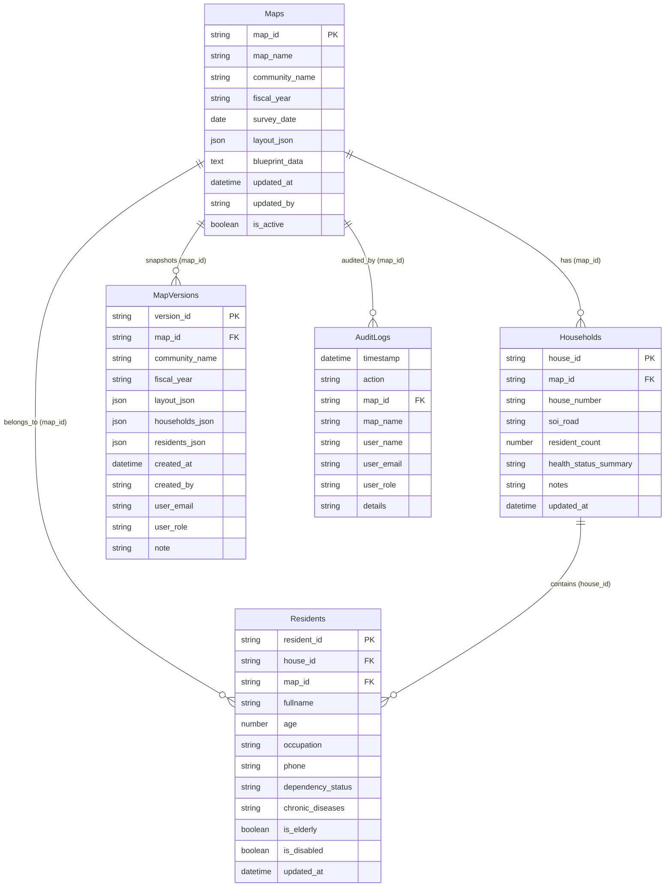

# เอกสารชี้แจงทางเทคนิคและข้อมูลประกอบการตรวจสอบระบบ (IT & UX Audit Response)

**ชื่อนวัตกรรม:** ระบบแผนที่ชุมชนเขตวัฒนา (Digital Community Health Map GIS)  
**กลุ่มงาน / โครงการ:** ทีมพัฒนาและเจ้าของนวัตกรรม **Pro-Health Data BKK South** (ศูนย์บริการสาธารณสุข 21 วัดธาตุทอง)  
**สถานะเอกสาร:** ฉบับส่งมอบพร้อมชุดสาธิตจำลอง (`Demo_Digital_Community_Health_Map_GIS`) เพื่อรวบรวมส่งต่อทีม IT, ทีม UX และผู้บริหาร  
**วันที่จัดทำ:** 16 พฤศจิกายน 2569 (2026-11-16)

> [!IMPORTANT]
> **ประกาศด้านความปลอดภัยและการปกปิดข้อมูลสำคัญ (Security & Sanitization Notice)**  
> เอกสารฉบับนี้และไฟล์ Demo Mock-up (`index.html`) **ไม่มี** การแนบ API Key, Client Secret, URL ระบบ Production, Google Sheet ID, Google Drive Folder ID, ข้อมูลส่วนบุคคลจริงของประชาชน หรือรหัสผ่าน (ID/Password) ที่ใช้งานจริงแต่อย่างใด  
> บัญชีผู้ใช้งานและข้อมูลสุขภาพทั้งหมดในชุด Demo เป็น **ข้อมูลจำลอง (Mock / Seed Data)** ที่สร้างขึ้นเพื่อการสาธิตและตรวจสอบ UX/UI เท่านั้น

---

## บทสรุปผู้บริหารและจุดแข็งของนวัตกรรม

**ระบบแผนที่ชุมชนเขตวัฒนา (Digital Community Health Map GIS)** พัฒนาขึ้นเพื่อยกระดับการจัดทำ **"แผนที่เดินดิน"** จากกระดาษหรือไฟล์ภาพนิ่ง ให้กลายเป็นเว็บแอปพลิเคชันสารสนเทศภูมิศาสตร์ระดับชุมชนที่เชื่อมโยง **ผังโครงสร้างทางกายภาพ (บ้าน, ซอย, คลอง, สะพาน, สถานที่สำคัญ)** เข้ากับ **ทะเบียนสุขภาพรายหลังคาเรือนและรายบุคคล (ผู้ป่วยติดบ้าน, ติดเตียง, ผู้สูงอายุ, ผู้พิการ และโรคเรื้อรัง NCDs)** แบบเรียลไทม์

**จุดแข็งหลักของนวัตกรรมที่สกัดได้จากสถาปัตยกรรมโค้ดจริง:**
1. **Canva-Style Vector + Precision 0.5 Subgrid GIS:** รองรับทั้งการวางบล็อกตารางความละเอียด `0.5` ช่อง (สำหรับทาวน์เฮาส์/ซอยแคบ) และการวาดเส้นทางเอียง/ดัดโค้งแบบเวกเตอร์อิสระ (`Vector Ribbon Paths`) พร้อมระบบลบมุมโค้งบล็อกบ้าน (`TL/TR/BL/BR`), สะพานข้ามคลองอัตโนมัติ (`Auto-bridge`) และป้องกันการเผลอขยับวัตถุด้วย `View-Only Safety Mode` และ `Object Locking`
2. **แผนที่สุขภาพเชิงระบาดวิทยา (Health Map & Chronic Disease Dots):** แสดงจุดสีโรคเรื้อรัง 8 กลุ่มโรคบนหลังคาบ้านอัตโนมัติ, ปักลูกศรนำทางเยี่ยมบ้านแบบมีลำดับขั้น, และวางการ์ดสัญลักษณ์ลงบนผังเพื่อพิมพ์แบบ **WYSIWYG 100%**
3. **การคุ้มครองข้อมูลส่วนบุคคล (PDPA By Design) และการกำกับดูแลรายปีงบประมาณ:** รองรับสิทธิ์ 3 ระดับ (`Admin`, `Officer (ศบส.21 SSO)`, `Guest`) โดยโหมด `Guest` จะพรางชื่อ-นามสกุล เบอร์โทร และการค้นหาผู้ป่วย แต่คงสถิติอายุ/กลุ่มโรคเพื่อการวิจัย พร้อมกลไก **Fiscal Year Lock** ป้องกันการแก้ไขทับข้อมูลปีงบเก่า, **Version History Snapshot**, **Soft Delete + Trash Recovery**, และ **Audit Logs**
4. **Dual-Environment Architecture (ทำงานได้ทั้ง Online บน Google Apps Script และ Offline Demo):** มีระบบสลับใช้ `localStorage` อัตโนมัติเมื่อเปิดไฟล์ `index.html` แบบออฟไลน์ ทำให้ทีม UX และผู้บริหารสามารถทดลองใช้งานได้ทันทีโดยไม่ต้องพึ่งพาเซิร์ฟเวอร์ Production

---

## ข้อที่ 1: User Manual & Specs (คู่มือการใช้งาน ผังระบบ และรายการฟังก์ชัน)

### 1.1 ผังสถาปัตยกรรมระบบ (System Architecture Diagram)

สถาปัตยกรรมของระบบแบ่งออกเป็น 3 ชั้นหลัก ได้แก่ **Client SPA (HTML5 Canvas + Tailwind CSS)**, **Dual-Environment Data Adapter** (สลับระหว่าง Google Apps Script RPC กับ Offline Mock `localStorage`), และ **Backend Services (Google Apps Script, 21PASS SSO, Google Sheets, Google Drive)** ดังแผนภาพ:

```mermaid
flowchart TB
    subgraph Client["🖥️ Client Browser (Single-Page Web App)"]
        UI["UI Screens: Login / Portal / Workspace / Dashboard"]
        Canvas["HTML5 2D Canvas Engine<br/>(Grid 0.5 Snap + Vector Ribbon + Print PNG)"]
        PDPA["Client-Side PDPA Filter & RBAC UI Guard"]
        LocalMock["Offline Demo Adapter<br/>(localStorage + Mock Seed Data)"]
    end

    subgraph EnvSwitch{"Runtime Environment Check<br/>isGasEnvironment()"}
        GASRun["google.script.run (RPC)"]
        DemoRun["Mock LocalStorage Mode"]
    end

    subgraph Backend["☁️ Google Apps Script Backend (Code.gs)"]
        Entry["doGet(e) & HtmlService Template"]
        Auth["verifySSOCode(code)<br/>(UrlFetchApp POST)"]
        MapSvc["Map & Version Services<br/>(getMapList, getMapData, saveMapData,<br/>create/delete/restoreCommunityMap,<br/>getMapVersions, restoreMapVersion)"]
        DBMgr["Database Self-Healing<br/>(ensureDatabaseStructure + Seed)"]
        MediaSvc["uploadImageToDrive(base64, filename)"]
    end

    subgraph External["🔗 External & Storage Services"]
        SSO["21PASS SSO Server<br/>(Centralized Authentication)"]
        Sheets["Google Sheets Database (5 Tables)<br/>Maps | Households | Residents |<br/>MapVersions | AuditLogs"]
        Drive["Google Drive Folder<br/>(Sticker & Blueprint Assets)"]
    end

    UI --> Canvas
    UI --> PDPA
    UI --> EnvSwitch
    EnvSwitch -->|"Production / GAS"| GASRun
    EnvSwitch -->|"Demo / Offline"| DemoRun --> LocalMock

    GASRun --> Entry
    GASRun --> Auth
    GASRun --> MapSvc
    GASRun --> DBMgr
    GASRun --> MediaSvc

    Auth <-->|"exchange_code"| SSO
    MapSvc <-->|"LockService + Read/Write"| Sheets
    DBMgr -->|"Auto-Create / Seed"| Sheets
    MediaSvc -->|"DriveApp"| Drive
```

---

### 1.2 ผังการไหลของหน้าจอระบบ (Screen Flow & Navigation)



---

### 1.3 รายการฟังก์ชันการทำงานทั้งหมด (Functional List & RBAC Matrix)

สกัดจากโค้ดจริงใน `Index.html` และ `Code.gs` แบ่งตามโมดูลและสิทธิ์ผู้ใช้งาน 3 ระดับ:

| รหัส | โมดูล | ฟังก์ชันการทำงาน (อ้างอิงจากโค้ดจริง) | Admin | Officer (ศบส.21 SSO) | Guest (ผู้เข้าชม) |
| :--- | :--- | :--- | :---: | :---: | :---: |
| **F-01** | **Auth & Session** | เข้าสู่ระบบผ่าน 21PASS SSO (`verifySSOCode`) / Mock Login และจำ Session ใน `localStorage` | ✅ | ✅ | ✅ (โหมด Guest) |
| **F-02** | **Auth & Session** | ออกจากระบบ (`logoutUser`) และล้าง Session จากเครื่อง | ✅ | ✅ | ✅ |
| **F-03** | **Community Portal** | ดูสรุปภาพรวม (จำนวนชุมชน, หลังคาเรือน, ประชากรเฉพาะปีงบล่าสุด ไม่นับซ้ำ) | ✅ | ✅ | ✅ |
| **F-04** | **Community Portal** | ค้นหาผังชุมชนตามชื่อชุมชน/ปีงบ และสลับดูผังหลายปีงบประมาณผ่าน Dropdown | ✅ | ✅ | ✅ |
| **F-05** | **Community Portal** | สร้างผังชุมชนใหม่ (`createCommunityMap`) พร้อมกรอบ A4 เริ่มต้น | ✅ | ✅ | ❌ |
| **F-06** | **Community Portal** | ลบผังชุมชนแบบปลอดภัย (Soft Delete `is_active = false` + พิมพ์ข้อความยืนยัน + Audit Log) | ✅ | ✅ | ❌ |
| **F-07** | **Community Portal** | ถังขยะและกู้คืนผังชุมชน (`getDeletedCommunityMapsList`, `restoreCommunityMap`) | ✅ | ❌ | ❌ |
| **F-08** | **Fiscal Governance** | ล็อคผังปีงบประมาณเก่าอัตโนมัติ (Read-Only Lock พร้อมปุ่มสลับไปปีงบล่าสุด) | 🔓 แก้ไขได้ | 🔒 ดูอย่างเดียว | 🔒 ดูอย่างเดียว |
| **F-09** | **Fiscal Governance** | คำนวณปีงบประมาณไทยอัตโนมัติ (ต.ค.–ธ.ค. = ปี พ.ศ.+1) และแตกสาขาปีงบใหม่เมื่อ Save | ✅ | ✅ | ❌ |
| **F-10** | **Map Workspace** | โหมดเปิดดูปลอดภัย (`View-Only` ค่าเริ่มต้น) ต้องกด `แก้ไขแผนที่` ก่อนจึงวาด/ย้ายวัตถุได้ | ✅ | ✅ | 🔒 ถาวร |
| **F-11** | **Map Workspace** | ซูม (`30%–300%`), แพน (`Cmd/Ctrl + Drag`, Middle Click, Trackpad), Fit to A4 | ✅ | ✅ | ✅ |
| **F-12** | **Map Workspace** | ค้นหาด่วน (`quickSearchInput`): ค้นหาบ้านเลขที่ (ทุกสิทธิ์) / ค้นหาชื่อผู้ป่วย-โรค (เฉพาะ SSO) | ✅ | ✅ | ⚠️ เฉพาะเลขที่บ้าน |
| **F-13** | **GIS Drawing Tools** | วางบล็อกบ้าน (`0.5_col`, `0.5_row`, `1x1`, `2x1`, `2x2`), Auto-fit ฟอนต์บ้านเลขที่, ปรับสีสถานะสำรวจ, ลบมุมโค้ง (`TL/TR/BL/BR`) | ✅ | ✅ | ❌ |
| **F-14** | **GIS Drawing Tools** | วาดเส้นทางแบบบล็อกตาราง (`Grid`) และแบบเวกเตอร์เอียง/โค้ง Bezier (`Vector Ribbon`) 6 ประเภท (ถนนสายหลัก, ซอย, ซอยแคบ, คลอง, ทางรถไฟ, รถไฟฟ้า) + Auto-bridge + Snap 45° + Endcaps | ✅ | ✅ | ❌ |
| **F-15** | **GIS Drawing Tools** | ปักสถานที่สำคัญ (`Landmarks`) 11 ประเภท, ลูกศรนำทางผู้ป่วย (`Route Arrows`), ป้ายชื่อถนน (`Text Labels`), สติกเกอร์ PNG, และภาพฉากหลังดราฟต์ผัง (`Blueprint Overlay` + ปรับความจาง) | ✅ | ✅ | ❌ |
| **F-16** | **GIS Editing UX** | ลากครอบหลายวัตถุ (`Marquee Multi-Selection`), เลื่อนกลุ่ม, Copy/Paste (`Cmd+C/V`), Lock/Unlock (`Cmd+L`), Undo/Redo (สูงสุด 30 ขั้น), ยางลบลากต่อเนื่อง รองรับคีย์ลัดแป้นพิมพ์ไทย | ✅ | ✅ | ❌ |
| **F-17** | **Health & PDPA** | สลับโหมด `ผังทั่วไป` / `แผนที่สุขภาพ` (แสดงจุดสี 8 โรค NCDs บนบ้าน + การ์ดสัญลักษณ์ลากวางบนผัง) | ✅ | ✅ | ✅ |
| **F-18** | **Health & PDPA** | บันทึก/แก้ไข/ลบข้อมูลหลังคาเรือนและสมาชิกในบ้าน (`Households` & `Residents`) | ✅ | ✅ (เฉพาะปีงบล่าสุด) | ❌ (PDPA Masked) |
| **F-19** | **Dashboard & Export** | แดชบอร์ดสถิติประชากร 5 การ์ด + กราฟแท่งสัดส่วนโรค NCDs + ตารางกลุ่มเปราะบาง + Jump to House | ✅ | ✅ | ⚠️ พรางชื่อ (PDPA) |
| **F-20** | **Dashboard & Export** | พิมพ์ A4 แนวนอน/ตั้ง (`50%–300%`) + ตัวเลือก Header/Legend/Stats/Grid/แผ่น 2 รายชื่อ + ดาวน์โหลด PNG ความละเอียดสูง | ✅ | ✅ | ⚠️ แผ่น 2 พราง PDPA |
| **F-21** | **Dashboard & Export** | ส่งออกรายงานสุขภาพ `Excel/CSV (UTF-8 BOM)` และส่งออก/นำเข้าโครงสร้างผัง `JSON` | ✅ | ✅ (ส่งออก) / ✅ (นำเข้าปีล่าสุด) | ⚠️ CSV พราง PDPA |
| **F-22** | **Versioning & Audit** | บันทึกผังพร้อมสร้าง Snapshot ใน `MapVersions` และลง `AuditLogs` อัตโนมัติ + เมนู Save As | ✅ | ✅ (ดูประวัติอย่างเดียว) | ❌ |
| **F-23** | **Versioning & Audit** | กู้คืนเวอร์ชันย้อนหลัง (`restoreMapVersion`) กลับมาเป็นฉบับปัจจุบัน | ✅ | ❌ | ❌ |

---

### 1.4 แนวทางการใช้งานเบื้องต้น (User Manual Summary)

1. **การเข้าสู่ระบบ:** เปิดเว็บแอปพลิเคชัน เลือกเข้าสู่ระบบด้วย **21PASS SSO** (สำหรับเจ้าหน้าที่ ศบส.21 / Admin) หรือ **เข้าชมแผนที่ (Guest)** (สำหรับผู้สังเกตการณ์ภายนอก)
2. **การเลือกหรือสร้างผังชุมชน (Portal):**
   - ใช้ช่องค้นหาเพื่อกรองชื่อชุมชน หรือเลือกปีงบประมาณจาก Dropdown บนการ์ดชุมชน
   - กด **"เปิดดูผังแผนที่"** เพื่อเข้าสู่พื้นที่ทำงาน หรือกด **"เพิ่มผังชุมชนใหม่"** เพื่อสร้างผังใหม่
3. **การสำรวจและแก้ไขแผนที่ (Workspace):**
   - เมื่อเปิดผัง ระบบจะอยู่ใน **โหมดเปิดดู (View-Only)** เสมอ เพื่อให้คลิกดูข้อมูลบ้านเลขที่และประวัติผู้ป่วยได้อย่างปลอดภัยโดยไม่เผลอขยับผัง
   - หากต้องการวาดถนน บ้าน หรือแก้ไขผัง (เฉพาะผังปีงบประมาณล่าสุด หรือสิทธิ์ Admin) ให้กดปุ่ม **`✏️ แก้ไขแผนที่`** ที่แถบด้านบน เครื่องมือวาดด้านซ้ายจะปรากฏขึ้น
   - คลิกเลือกวัตถุใดๆ เพื่อเปิด **Floating Action Bar** สำหรับหมุน 90°, ปรับขนาดฟอนต์ (`A-`/`A+`), เปลี่ยนสีบ้าน, ดัดโค้งเส้นทางเวกเตอร์, ล็อควัตถุ (`Cmd+L`), คัดลอก (`Cmd+C`/`Cmd+V`) หรือลบ
   - กดปุ่ม **`บันทึก`** ด้านบนขวาเพื่อบันทึกลงฐานข้อมูลและสร้าง Version Snapshot ใหม่
4. **การบันทึกข้อมูลสุขภาพและการพิมพ์รายงาน:**
   - คลิกที่บล็อกบ้านบนผังเพื่อเปิดหน้าต่างข้อมูลหลังคาเรือน และเพิ่ม/แก้ไขสมาชิก พร้อมระบุภาวะพึ่งพิงและโรคประจำตัว
   - สลับไปยังแท็บ **แดชบอร์ด** เพื่อดูยอดผู้ป่วยติดเตียง/ติดบ้าน และกด **"ดูบนผัง"** เพื่อกระโดดไปยังตำแหน่งบ้านพร้อมไฟกะพริบนำสายตา
   - กด **"พิมพ์ A4"** เพื่อปรับแต่งหน้าพิมพ์ ดาวน์โหลดภาพ PNG หรือกด **"ส่งออก Excel / CSV"** เพื่อนำข้อมูลไปวิเคราะห์ต่อ

---

## ข้อที่ 2: Demo Account & Staging Access (บัญชีทดสอบและข้อมูลจำลอง)

### 2.1 วิธีรันระบบทดสอบแบบออฟไลน์ (Demo Mock-up)

ชุดสาธิตจำลองถูกจัดทำไว้ในโฟลเดอร์นี้เรียบร้อยแล้ว โดยตัดการเชื่อมต่อกับ Production Google Apps Script / Google Sheets / 21PASS SSO ออกทั้งหมด และทำงานผ่าน **Mock LocalStorage Engine** ในเบราว์เซอร์:

1. **เปิดใช้งานทันที (Direct File):** เปิดไฟล์ `Demo_Digital_Community_Health_Map_GIS/index.html` ด้วยเบราว์เซอร์ Google Chrome, Safari หรือ Microsoft Edge (หมายเหตุ: แนะนำให้เชื่อมต่ออินเทอร์เน็ตเพื่อให้โหลด Tailwind CSS, Lucide Icons และ Google Fonts ได้ครบถ้วน)
2. **หรือรันผ่าน Local Web Server (แนะนำสำหรับการ Audit):**
   ```bash
   cd Demo_Digital_Community_Health_Map_GIS
   python3 -m http.server 8080
   # จากนั้นเปิดเบราว์เซอร์ไปที่ http://localhost:8080
   ```
3. **ปุ่มรีเซ็ตข้อมูลทดสอบ:** บนหน้า Portal มีปุ่ม **`รีเซ็ต Demo`** เพื่อล้างค่า `localStorage` และคืนค่าข้อมูลจำลองตั้งต้นได้ทุกเมื่อ

---

### 2.2 บัญชีผู้ใช้งานจำลองสำหรับทดสอบ (Mock Credentials — ไม่ใช่รหัสผ่านจริง)

> [!NOTE]
> บัญชีด้านล่างทั้งหมดเป็น **Mock ID / Mock Password ที่จำลองขึ้นเฉพาะในไฟล์ Demo `index.html`** เท่านั้น เพื่อให้ทีม UX และทีม IT สามารถสลับทดสอบสิทธิ์ครบทั้ง 3 บทบาทได้ทันที (มีทั้งช่องกรอก Mock Credentials และปุ่มเข้าด่วน 1 คลิก)

| บทบาท (Role) | Mock Username (ID) | Mock Password | สิทธิ์และขอบเขตที่ทดสอบได้ใน Demo |
| :--- | :--- | :--- | :--- |
| **🛡️ Admin (ผู้ดูแลระบบ)** | `demo_admin` | `DemoAdmin@2026` | เข้าถึงทุกฟังก์ชัน, แก้ไขผังปีงบเก่า (`2568`) ได้, กู้คืนผังจาก **ถังขยะผัง**, กู้คืนเวอร์ชันใน **ประวัติเวอร์ชัน**, ดูข้อมูลผู้ป่วยเต็ม (ไม่พราง PDPA) |
| **👨‍⚕️ Officer (เจ้าหน้าที่ ศบส.21)** | `demo_officer` | `DemoOfficer@2026` | สร้าง/แก้ไขผังปีงบล่าสุด (`2569`), บันทึกข้อมูลผู้ป่วย, ดูประวัติเวอร์ชันแบบ Read-Only, ลบผังแบบ Soft Delete; **ถูกบล็อกการแก้ไขผังปีงบเก่า (`2568`)** และซ่อนเมนูถังขยะ/กู้คืนเวอร์ชัน |
| **👁️ Guest (ผู้เข้าชมภายนอก)** | *(ไม่ต้องใช้รหัส — คลิกปุ่ม Guest)* | *(ไม่มี)* | โหมดอ่านอย่างเดียวถาวร, ซ่อนเครื่องมือวาดและปุ่มบันทึก, **พรางชื่อ-นามสกุลและเบอร์โทรตาม PDPA** ในตาราง/ค้นหา/CSV/A4 แผ่นที่ 2 (ยังคงแสดงสถิติอายุและกลุ่มโรค) |

---

### 2.3 ข้อมูลจำลองตั้งต้นที่มีในระบบ Demo (Pre-loaded Seed Data)

เมื่อเปิดไฟล์ Demo ครั้งแรก ระบบจะสร้างข้อมูลจำลองตั้งต้นลงใน `localStorage` โดยอัตโนมัติ (อ้างอิงโครงสร้างจาก `seedDemoCommunityData` ใน `Code.gs` และขยายเพิ่มสำหรับทดสอบทุกกรณี):

1. **ชุมชนร่วมใจพัฒนา (ปีงบ 2569 — ฉบับล่าสุด, `MAP-DEMO-001-2569`):**
   - องค์ประกอบผัง: ถนนสายหลัก, ซอย, ซอยแคบ, คลองบล็อกตาราง, สะพานข้ามคลอง (`8,18`), ทางรถไฟฟ้า, คลองเวกเตอร์ดัดโค้ง (`คลองบางมะเขือ (จำลอง)`), สถานที่สำคัญ 4 แห่ง (วัด, ศบส.21, ลานจอดรถ, คอนโด), บล็อกบ้าน 7 หลัง (รวมบ้านขนาด `0.5` ช่อง `14/1`, `14/2` และสีสถานะสำรวจ เขียว/ส้ม/ขาว), ลูกศรนำทางผู้ป่วย 1 เส้น
   - ข้อมูลประชากรจำลอง: **5 ราย** (ครอบคลุมกลุ่ม `ติดเตียง` 2 ราย, `ติดบ้าน` 1 ราย, `ติดสังคม` 2 ราย, `ผู้สูงอายุ` 5 ราย, `ผู้พิการ` 1 ราย และกลุ่มโรค NCDs เช่น เบาหวาน, ความดันโลหิตสูง, โรคไตเรื้อรัง, โรคหัวใจ, หลอดเลือดสมอง, โรคปอด/หอบหืด)
   - ประวัติเวอร์ชันจำลอง (`VERSIONS_MAP-DEMO-001-2569`): **2 เวอร์ชัน** สำหรับทดสอบการเปิดดูย้อนหลังและกู้คืน (Admin)
2. **ชุมชนร่วมใจพัฒนา (ปีงบ 2568 — ฉบับปีงบเก่า, `MAP-DEMO-001`):**
   - มีไว้สำหรับทดสอบกลไก **Older Fiscal Year Read-Only Lock** (เปรียบเทียบพฤติกรรมระหว่างสิทธิ์ `demo_officer` ที่ถูกล็อก กับ `demo_admin` ที่ปลดล็อกแก้ไขได้)
3. **ชุมชนสุเหร่าบ้านดอน (ปีงบ 2568, `MAP-DEMO-002`):**
   - ผังชุมชนชุดที่ 2 พร้อมมัสยิด, โรงเรียน, สะพานข้ามคลอง, บ้าน 3 หลัง และผู้ป่วยจำลอง 2 ราย
4. **รายการในถังขยะ (`DELETED_COMMUNITY_MAPS`):**
   - `ผังชุมชนคลองตันพัฒนา (ปีงบ 2567)` (`MAP-DEMO-TRASH-001`) สำหรับทดสอบปุ่ม **🗑️ ถังขยะผัง** และฟีเจอร์กู้คืนของสิทธิ์ Admin

---

### 2.4 ช่องสำหรับกรอกข้อมูล Staging Environment (กรณีทีมงาน Deploy ขึ้น Google Apps Script แล้ว)

> *[หมายเหตุ: เว้นว่างไว้สำหรับกรอกเมื่อทีม IT/ผู้ดูแลระบบ Deploy ขึ้น Google Workspace Staging เรียบร้อยแล้ว — ห้ามนำ URL หรือ Credential จริงมาวางในไฟล์สาธารณะโดยไม่จำกัดสิทธิ์]*

| รายการ Staging Environment | ค่าสำหรับตรวจสอบ (กรอกเพิ่มเติมเมื่อพร้อม) |
| :--- | :--- |
| **Staging Web App URL (GAS Deployment)** | `[ระบุ URL ของ Google Apps Script Web App สำหรับ Staging]` |
| **21PASS SSO Staging Portal / Redirect** | `[ระบุสภาพแวดล้อมทดสอบของ 21PASS SSO หากเชื่อมต่อจริง]` |
| **Staging Test Account (SSO)** | `[ระบุบัญชีทดสอบสำหรับทีม UX (ถ้ามี) เช่น Staging Officer / Staging Admin]` |
| **Google Sheets Staging Reference** | `[ระบุชื่อไฟล์ Google Sheets ทดสอบ — ไม่แนะนำให้เผยแพร่ Sheet ID ในเอกสารทั่วไป]` |

---

## ข้อที่ 3: Database & Data Dictionary (โครงสร้างฐานข้อมูลและรายการ Form Fields)

### 3.1 แผนภาพความสัมพันธ์ข้อมูล (Entity-Relationship Diagram)

ระบบใช้ **Google Sheets 1 ไฟล์ (5 ชีต/ตาราง)** เป็นฐานข้อมูลหลัก และ **Google Drive Folder** สำหรับจัดเก็บไฟล์สื่อภาพประกอบ:



---

### 3.2 พจนานุกรมข้อมูล (Data Dictionary — 5 ตารางหลักใน `Code.gs`)

#### ตารางที่ 1: `Maps` (ทะเบียนผังชุมชนและโครงสร้างเรขาคณิต)
| คอลัมน์ | ชื่อฟิลด์ | ชนิดข้อมูล | ข้อกำหนด / ตัวอย่างค่า | คำอธิบาย |
| :---: | :--- | :--- | :--- | :--- |
| 1 | `map_id` | String (PK) | `MAP-DEMO-001` หรือ `MAP-<timestamp>` | รหัสอ้างอิงผังชุมชนเฉพาะตัว |
| 2 | `map_name` | String | `ผังชุมชนร่วมใจพัฒนา (ปีงบ 2569)` | ชื่อผังฉบับเต็ม (มักรวมชื่อชุมชนและปีงบ) |
| 3 | `community_name` | String | `ชุมชนร่วมใจพัฒนา` | ชื่อชุมชน (ใช้จัดกลุ่มการ์ด Multi-Fiscal-Year บน Portal) |
| 4 | `fiscal_year` | String | `2568`, `2569` | ปีงบประมาณ พ.ศ. (คำนวณอัตโนมัติตามรอบ ต.ค.–ก.ย.) |
| 5 | `survey_date` | String (YYYY-MM-DD) | `2026-01-15` | วันที่สำรวจข้อมูล |
| 6 | `layout_json` | JSON String | `{ blocks, paths, vectorPaths, ... }` | โครงสร้างผังทั้งหมดบน Canvas (รายละเอียดในข้อ 3.3) |
| 7 | `blueprint_data` | String (Base64 / URL) | `data:image/png;base64,...` หรือว่าง | ภาพแบบแปลนดราฟต์ฉากหลัง |
| 8 | `updated_at` | ISO Datetime String | `2026-01-15T09:30:00.000Z` | วันเวลาที่แก้ไขล่าสุด |
| 9 | `updated_by` | String | `เจ้าหน้าที่ ศบส.21 วัดธาตุทอง` | ชื่อผู้บันทึกล่าสุด |
| 10 | `is_active` | Boolean | `TRUE` / `FALSE` | สถานะใช้งาน (`FALSE` = Soft Delete อยู่ในถังขยะ) |

#### ตารางที่ 2: `Households` (ทะเบียนหลังคาเรือน)
| คอลัมน์ | ชื่อฟิลด์ | ชนิดข้อมูล | ข้อกำหนด / ตัวอย่างค่า | คำอธิบาย |
| :---: | :--- | :--- | :--- | :--- |
| 1 | `house_id` | String (PK) | `H-1` หรือ `H-<timestamp>` | รหัสบ้าน เชื่อมตรงกับ `block.id` ใน `layout_json.blocks` |
| 2 | `map_id` | String (FK) | อ้างอิง `Maps.map_id` | รหัสผังชุมชนเจ้าของข้อมูลบ้าน |
| 3 | `house_number` | String | `10/1`, `14/2` | บ้านเลขที่ |
| 4 | `soi_road` | String | `ซอย 1`, `ถนนร่วมใจพัฒนา` | ซอย / ถนน / โซนที่ตั้งบ้าน |
| 5 | `resident_count` | Number | `0`, `2`, `4` | จำนวนสมาชิกในบ้าน (คอลัมน์ในชีต ฝั่ง Frontend นับจริงจาก `Residents`) |
| 6 | `health_status_summary` | String | `ปกติ`, `ติดบ้าน`, `ผู้สูงอายุ/ติดเตียง` | สรุปสถานะสุขภาพระดับหลังคาเรือน |
| 7 | `notes` | String | `บ้านไม้ 2 ชั้น`, `ร้านขายของชำ` | หมายเหตุลักษณะบ้านหรือข้อสังเกต |
| 8 | `updated_at` | ISO Datetime String | `2026-01-15T09:30:00.000Z` | วันเวลาที่บันทึกล่าสุด |

#### ตารางที่ 3: `Residents` (ทะเบียนประชากรและข้อมูลสุขภาพรายบุคคล)
| คอลัมน์ | ชื่อฟิลด์ | ชนิดข้อมูล | ข้อกำหนด / ตัวอย่างค่า | คำอธิบาย |
| :---: | :--- | :--- | :--- | :--- |
| 1 | `resident_id` | String (PK) | `R-1` หรือ `R-<timestamp>` | รหัสอ้างอิงสมาชิกในบ้าน |
| 2 | `house_id` | String (FK) | อ้างอิง `Households.house_id` | รหัสบ้านที่อาศัยอยู่ |
| 3 | `map_id` | String (FK) | อ้างอิง `Maps.map_id` | รหัสผังชุมชน |
| 4 | `fullname` | String | ชื่อ-นามสกุล (Guest ถูกพราง) | ชื่อ-นามสกุลสมาชิก/ผู้ป่วย |
| 5 | `age` | Number / Empty | `72`, `85` | อายุ (ปี) |
| 6 | `occupation` | String | `เกษียณ`, `ค้าขาย` | อาชีพ |
| 7 | `phone` | String | `08x-xxx-xxxx` (Guest ถูกพราง) | เบอร์โทรศัพท์ติดต่อ |
| 8 | `dependency_status` | Enum String | `ปกติ` / `ติดสังคม` / `ติดบ้าน` / `ติดเตียง` / `ผู้พิการ` | ภาวะพึ่งพิง (Dependency Status) |
| 9 | `chronic_diseases` | Comma-separated String | `เบาหวาน, ความดันโลหิตสูง, โรคไตเรื้อรัง` | รายการโรคประจำตัวเรื้อรัง (NCDs) คั่นด้วยจุลภาค |
| 10 | `is_elderly` | Boolean | `TRUE` (อัตโนมัติเมื่อ `age >= 60`) | สถานะผู้สูงอายุ (60 ปีขึ้นไป) |
| 11 | `is_disabled` | Boolean | `TRUE` (อัตโนมัติเมื่อ `dependency_status === 'ผู้พิการ'`) | สถานะผู้พิการ |
| 12 | `updated_at` | ISO Datetime String | `2026-01-15T09:30:00.000Z` | วันเวลาที่บันทึกล่าสุด |

#### ตารางที่ 4: `MapVersions` (Snapshot ประวัติการบันทึกทุกเวอร์ชัน)
| คอลัมน์ | ชื่อฟิลด์ | ชนิดข้อมูล | คำอธิบาย |
| :---: | :--- | :--- | :--- |
| 1 | `version_id` | String (PK) | รหัสเวอร์ชัน (`VER-<timestamp>`) |
| 2 | `map_id` | String (FK) | รหัสผังชุมชน |
| 3 | `community_name` | String | ชื่อชุมชน ณ เวลานั้น |
| 4 | `fiscal_year` | String | ปีงบประมาณ ณ เวลานั้น |
| 5 | `layout_json` | JSON String | Snapshot ของ `layout_json` ทั้งก้อน |
| 6 | `households_json` | JSON String | Snapshot ของอาเรย์ `households` ทั้งหมดในผัง |
| 7 | `residents_json` | JSON String | Snapshot ของอาเรย์ `residents` ทั้งหมดในผัง |
| 8 | `created_at` | ISO Datetime String | วันเวลาที่กดบันทึก |
| 9 | `created_by` | String | ชื่อผู้บันทึก |
| 10 | `user_email` | String | อีเมลผู้บันทึก (จาก Session) |
| 11 | `user_role` | String | บทบาทผู้บันทึก (`admin` / `officer`) |
| 12 | `note` | String | หมายเหตุเวอร์ชัน (เช่น จำนวนหลังคาเรือน/ประชากร หรือข้อความการกู้คืน) |

#### ตารางที่ 5: `AuditLogs` (ประวัติการกระทำเพื่อความปลอดภัย)
| คอลัมน์ | ชื่อฟิลด์ | ชนิดข้อมูล | คำอธิบาย |
| :---: | :--- | :--- | :--- |
| 1 | `timestamp` | String (`yyyy-MM-dd HH:mm:ss` Asia/Bangkok) | วันเวลาที่เกิดเหตุการณ์ |
| 2 | `action` | String | ประเภทเหตุการณ์ (`สร้างผังใหม่`, `บันทึก/แก้ไขผัง`, `ลบผังชุมชน (Soft Delete)`, `กู้คืนผังชุมชน`, `กู้คืนเวอร์ชัน`) |
| 3 | `map_id` | String | รหัสผังที่ถูกกระทำ |
| 4 | `map_name` | String | ชื่อผังที่ถูกกระทำ |
| 5 | `user_name` | String | ชื่อผู้ปฏิบัติงาน |
| 6 | `user_email` | String | อีเมลผู้ปฏิบัติงาน |
| 7 | `user_role` | String | สิทธิ์ผู้ปฏิบัติงาน (`admin` / `officer`) |
| 8 | `details` | String | รายละเอียดเพิ่มเติม (เช่น จำนวนหลังคาเรือน/ประชากร หรือข้อความยืนยันการลบ) |

---

### 3.3 โครงสร้าง JSON ภายใน `Maps.layout_json`

โครงสร้างออบเจ็กต์ที่บันทึกและโหลดบน Canvas (`saveCurrentMap` & `applyLoadedMapData`):

| Key | Type | โครงสร้างฟิลด์ย่อย | คำอธิบาย |
| :--- | :--- | :--- | :--- |
| `blocks` | Array\<Object\> | `id`, `type` (`'house'`\|`'landmark'`), `house_number`, `landmarkType`, `name`, `gx`, `gy`, `w`, `h`, `fillColor`, `fontSize`, `locked`, `corners` (`{tl,tr,bl,br}`) | บล็อกบ้าน (รองรับพิกัด/ขนาดทศนิยม `0.5`) และสถานที่สำคัญ 11 ชนิด |
| `paths` | Object (Map) | Key `"gx,gy"` ➔ `{ type, underlay, corners, locked }` | เส้นทางแบบบล็อกตาราง (`main_road`, `alley`, `narrow_alley`, `canal`, `railway`, `skytrain`) พร้อม `underlay: 'canal'` สำหรับสะพานข้ามคลอง |
| `vectorPaths` | Array\<Object\> | `id`, `type`, `x1`, `y1`, `x2`, `y2`, `cx`, `cy`, `width`, `label`, `fontSize`, `isCurved`, `cap`, `capStart`, `capEnd`, `locked` | เส้นทางเวกเตอร์อิสระและเส้นโค้ง Quadratic Bezier (`cx, cy`) |
| `routeArrows` | Array\<Object\> | `id`, `x1`, `y1`, `x2`, `y2`, `label`, `color`, `step`, `showBadge`, `fontSize`, `locked` | ลูกศรชี้ทางไปบ้านผู้ป่วยพร้อมลำดับขั้นตอน |
| `textLabels` | Array\<Object\> | `id`, `x`, `y`, `w`, `h`, `text`, `rotation`, `fontSize`, `locked` | ป้ายชื่อถนน/ซอยบน Canvas |
| `stickers` | Array\<Object\> | `id`, `x`, `y`, `w`, `h`, `rotation`, `dataUrl`, `locked` | รูปภาพสติกเกอร์ PNG/JPEG (Base64 DataURL) |
| `canvasLegend` | Object \| null | `id`, `x`, `y`, `w`, `h`, `scale`, `locked` | การ์ดสัญลักษณ์แผนที่สุขภาพที่ผู้ใช้วางบน Canvas เพื่อการพิมพ์ |
| `a4Bounds` | Object | `{ gx, gy, gw, gh }` | ขอบเขตกรอบกระดาษ A4 บนตารางกริด |
| `a4Orientation` | String | `'landscape'` \| `'portrait'` | ทิศทางกระดาษ A4 |
| `a4Scale` | Number | `0.5` – `3.0` | สเกลขยาย/ย่อกรอบ A4 |
| `gridSize` | Number | ค่าเริ่มต้น `30` (พิกเซล/ช่อง) | ขนาด 1 ช่องกริด |
| `nextHouseNo` | Number | เช่น `18` | เลขที่บ้านถัดไปสำหรับช่วยรันอัตโนมัติ |

---

### 3.4 รายการ Form Fields ทั้งหมดในระบบ (สกัดจาก `Index.html`)

| หน้าจอ / โมดอล | Element ID | ชื่อฟิลด์ที่แสดงบน UI | Type / Options | บังคับ |
| :--- | :--- | :--- | :--- | :---: |
| **Portal Toolbar** | `#portalSearchInput` | ค้นหาชื่อชุมชน หรือปีงบประมาณ | Text | - |
| **Portal Card** | `#selFY_<idx>` | Dropdown เลือกปีงบประมาณ | Select (รายการปีงบของชุมชนนั้น) | - |
| **สร้างผังชุมชนใหม่** | `#inputNewComName` | ชื่อชุมชน | Text | * |
| **สร้างผังชุมชนใหม่** | `#inputNewComYear` | ปีงบประมาณ (พ.ศ.) | Text (Default: `2569`) | * |
| **สร้างผังชุมชนใหม่** | `#inputNewComDate` | วันที่สำรวจ | Date (`YYYY-MM-DD`) | * |
| **Workspace Navbar** | `#inputCommunityName` | ชื่อชุมชน (แก้ไข Inline) | Text | - |
| **Workspace Navbar** | `#quickSearchInput` | ค้นหาบ้านเลขที่, ชื่อผู้ป่วย | Text (Auto-dropdown สูงสุด 8 รายการ) | - |
| **House Tool Panel** | `#size-*` / `#btnHalf*` | ขนาดบล็อกบ้าน & ตำแหน่ง 0.5 | Buttons (`0.5_col`, `0.5_row`, `1x1`, `2x1`, `2x2` / `left, right, top, bottom`) | - |
| **House Tool Panel** | `#chkRoundTL/TR/BL/BR` | มุมโค้งถนน (เลือกลบเหลี่ยม) | 4 Checkboxes | - |
| **House Tool Panel** | `#inputNextHouseNo` | บ้านเลขที่ถัดไป | Text | - |
| **Path Tool Panel** | `#tabPathGrid` / `#tabPathVector` | โหมดวาดเส้นทาง | Toggle (`grid` \| `vector`) + ประเภท 6 ชนิด | - |
| **Path Tool Panel** | `#chkVectorSnap`, `#btnToggleVectorLock45`, `#inputVectorLabel` | ตั้งค่าเส้นเวกเตอร์ | Checkbox Snap, Toggle 45°, Width (+/- 3px), Endcap (`butt`/`round`), Label Text | - |
| **Landmark Panel** | `#lm-*`, `#inputLandmarkName` | ประเภทและชื่อสถานที่สำคัญ | 11 ประเภท (วัด, มัสยิด, โรงเรียน, ศบส./อนามัย, ลานจอดรถ, คอนโด, หอพัก/อพาร์ต, ร้านค้า, ตลาด, สะพาน, สวนสาธารณะ) + Text | - |
| **Arrow / Text / Media** | `#inputArrowLabel`, `#inputTextLabelContent`, `#stickerFileInput`, `#blueprintFileInput`, `#sliderOpacity` | ลูกศร, ข้อความ, สติกเกอร์, ดราฟต์ผัง | Text, Color (4 สี), Rotation (`0°`/`90°`), File Upload (PNG/JPG/Image), Opacity Range (`0–100`) | - |
| **House Detail Modal** | `#modalInputHouseNo` | บ้านเลขที่ | Text | * |
| **House Detail Modal** | `#modalInputSoi` | ซอย / โซน | Text | - |
| **House Detail Modal** | `#modalInputHouseNotes` | หมายเหตุของบ้าน | Text | - |
| **Resident Inline Form** | `#formResidentId` | รหัสสมาชิก (Hidden) | Hidden (`R-<timestamp>`) | - |
| **Resident Inline Form** | `#formResName` | ชื่อ - นามสกุล | Text | * |
| **Resident Inline Form** | `#formResAge` | อายุ (ปี) | Number (`>= 60` ตั้งค่า `is_elderly = true`) | - |
| **Resident Inline Form** | `#formResOccupation` | อาชีพ | Text | - |
| **Resident Inline Form** | `#formResPhone` | เบอร์โทรศัพท์ติดต่อ | Text | - |
| **Resident Inline Form** | `#formResDependency` | ภาวะพึ่งพิง (Dependency Status) | Select (`ปกติ`, `ติดสังคม`, `ติดบ้าน`, `ติดเตียง`, `ผู้พิการ`) | * |
| **Resident Inline Form** | `input[name="diseaseChk"]` | โรคประจำตัว (เลือกได้หลายข้อ) | 8 Checkboxes (`เบาหวาน`, `ความดันโลหิตสูง`, `โรคไตเรื้อรัง`, `โรคหัวใจ`, `หลอดเลือดสมอง`, `โรคมะเร็ง`, `โรคปอด/หอบหืด`, `เก๊าท์/ข้อเสื่อม`) | - |
| **Resident Inline Form** | `#formResOtherDisease` | โรคประจำตัวอื่นๆ | Text (คั่นด้วยจุลภาค) | - |
| **Save As Modal** | `#inputSaveAsName`, `#inputSaveAsYear`, `#inputSaveAsDate` | บันทึกเป็นผังฉบับใหม่ | Text (`*`), Text, Date | * |
| **Delete Confirm Modal** | `#inputConfirmDeleteText` | พิมพ์ข้อความยืนยัน | Text (ต้องตรงกับ `"ยืนยันฉันยอมรับข้อตกลงนี้"`) | * |
| **Print A4 Modal** | `#chkPrintHeader/Legend/Stats/Grid/Page2`, `#rngA4Scale` | ตัวเลือกพิมพ์ A4 & สเกล | 5 Checkboxes + Scale Range (`0.5–3.0`) + Orientation (`landscape`/`portrait`) | - |
| **DB Setup Modal** | `#modalInputSheetId`, `#modalInputDriveId` | ตั้งค่า Google Sheet & Drive ID | Text (วาง ID หรือ URL เต็มได้ `extractCleanId` จะแยก ID อัตโนมัติ) | - |

---

## ข้อที่ 4: Current Pain Points & Technical Constraints (การวิเคราะห์ข้อจำกัดเชิงเทคนิคจากโค้ดจริง)

จากการวิเคราะห์สถาปัตยกรรมและซอร์สโค้ดจริงใน `Code.gs` และ `Index.html` ทีมพัฒนาขอสรุปแยกเป็น **(ก) ปัญหาหน้างานที่ระบบแก้ได้แล้วในปัจจุบัน/Demo** และ **(ข) ข้อจำกัดเชิงเทคนิค (Technical Bottlenecks) ที่ตรวจพบในโค้ดและควรวางแผนยกระดับในระยะถัดไป**:

### 4.1 ส่วนที่ระบบปัจจุบันและ Demo แก้ไข/รองรับแล้ว
- **ป้องกันการเผลอขยับผังหรือแก้ไขข้อมูลข้ามปีงบ:** แก้ปัญหาเดิมที่เจ้าหน้าที่มักเผลอลากบล็อกบ้านหลุดตำแหน่งด้วย `View-Only Safety Mode` เป็นค่าเริ่มต้น, ระบบ `Object Locking (Cmd+L)`, และ `Older Fiscal Year Read-Only Lock`
- **ความแม่นยำของผังซอยแคบและคลองโค้ง:** แก้ข้อจำกัดของตารางกริดแบบแข็งทื่อด้วย `0.5 Subgrid`, `Dynamic Font Auto-fit` (กันเลขที่บ้านยาวล้นช่อง) และ `Vector Ribbon Paths`
- **การทำงานบนพื้นที่อับสัญญาณ / ทดสอบได้ทันที:** รองรับโหมดออฟไลน์ผ่าน `localStorage` พร้อมรองรับคีย์ลัดแป้นพิมพ์ภาษาไทย (`Cmd+ผ/ฉ/อ/ส`)

### 4.2 ข้อจำกัดเชิงเทคนิค (Technical Bottlenecks) ที่พบจากโค้ดปัจจุบัน

| ด้าน | ข้อจำกัดที่พบในโค้ดจริง | ผลกระทบเชิงปฏิบัติ / ความเสี่ยง | แนวทางพัฒนาต่อที่แนะนำ |
| :--- | :--- | :--- | :--- |
| **1. Security & Server-Side Trust Boundary** | ใน `Code.gs` ฟังก์ชัน `saveMapData`, `deleteCommunityMap`, `restoreCommunityMap`, `restoreMapVersion` เชื่อถือค่า `user_role` จาก Payload ฝั่ง Client และ `getMapData` ส่งข้อมูล `Residents` ทั้งหมดกลับมายังเบราว์เซอร์ (การพราง PDPA และตรวจสิทธิ์ส่วนใหญ่ทำใน `Index.html` และเก็บ Session ใน `localStorage`) | ผู้ใช้ที่มีความรู้เชิงเทคนิคอาจเปิด Network/Console ดูข้อมูล `Residents` ในโหมด Guest หรือส่ง Payload ปลอมแปลง `user_role: 'admin'` ไปยังฟังก์ชันหลังบ้านได้ | ออก Signed Session Token (เช่น JWT/HMAC ใน `PropertiesService`/`CacheService`) หลัง `verifySSOCode`, ตรวจสอบ Token + Role ฝั่ง Server ทุก Endpoint และกรอง/พรางฟิลด์ PDPA ตั้งแต่ฝั่ง Server สำหรับ Guest |
| **2. Google Sheets 50,000-Char Cell Limit & Base64 Media** | ใน `Index.html` (`handleStickerUpload`, `handleBlueprintUpload`) เก็บภาพเป็น Base64 `dataUrl` ฝังลงใน `layout_json` และ `blueprint_data` เพื่อบันทึกลง 1 เซลล์ของ Google Sheets (แม้ `Code.gs` จะมีฟังก์ชัน `uploadImageToDrive()` อยู่แล้วแต่ยังไม่ถูกเรียกใช้จาก Frontend) | Google Sheets จำกัดขนาดข้อความ **ไม่เกิน 50,000 ตัวอักษรต่อ 1 เซลล์** หากผู้ใช้อัปโหลดภาพแปลนหรือสติกเกอร์ PNG ที่มีความละเอียดสูง จะทำให้ `saveMapData` หรือการเขียนลง `MapVersions` ล้มเหลวหรือถูกตัดข้อมูล | เชื่อมต่อ `handleStickerUpload` / `handleBlueprintUpload` ให้เรียก `uploadImageToDrive()` (หรือบีบอัดภาพฝั่ง Client ก่อน) แล้วเก็บเฉพาะ `fileId` / URL ใน Google Sheets แทน Base64 |
| **3. Database Concurrency & Latency บน Sheets** | `saveMapData` ใช้ `LockService.getScriptLock().waitLock(15000)` จากนั้นอ่านทั้งชีตและวนลูป `deleteRow()` ทีละแถวสำหรับ `Households` และ `Residents` ของ `map_id` นั้นแล้วเขียนใหม่ทั้งหมด | เมื่อมีหลายชุมชนและประชากรหลายพันราย การวน `deleteRow()` ทีละแถวบน Sheets API จะช้าลงมาก อาจชนขีดจำกัดเวลา 6 นาทีของ Google Apps Script หรือเกิด Lock Contention หากเจ้าหน้าที่บันทึกพร้อมกันหลายชุมชน | เปลี่ยนจากการลบทีละแถวเป็น Batch Upsert / Cloud Firestore หรือ PostgreSQL (เช่น Cloud SQL / Supabase) เมื่อขยายใช้งานระดับหลายศูนย์บริการฯ หรือทั้ง กทม. |
| **4. Monolithic Single-File Frontend (~493 KB)** | `Index.html` มีขนาดเกือบ 10,000 บรรทัดรวม HTML/CSS/JS ในไฟล์เดียว และพึ่งพา CDN ภายนอก (`cdn.tailwindcss.com`, `unpkg.com/lucide`, Google Fonts) | Cold start ของ `HtmlService` ค่อนข้างช้า, บำรุงรักษายากเมื่อโค้ดโตขึ้น, และในพื้นที่ที่ไม่มีอินเทอร์เน็ตเลย Tailwind/Icons จาก CDN จะไม่โหลด (แม้ Canvas จะยังทำงานได้) | แยกโมดูลโค้ด (Build pipeline เช่น Vite/TypeScript) หรือแยกไฟล์ Script ใน GAS และ Bundle Tailwind/Icons แบบ Local สำหรับงานภาคสนาม |
| **5. ความไม่สอดคล้องเล็กน้อยใน Offline Mode & Coordinates** | 1) `importJSON`, `previewMapVersion`, และ `COMMUNITY_MAP_GIS_CURRENT` ใน `Index.html` ยังไม่ได้โหลด/คืนค่า `vectorPaths` และ `canvasLegend` ครบเท่า `saveMapData`<br>2) ระบบพิกัดเป็น Schematic Grid (`gx, gy` หน่วย 30px) ยังไม่ผูกพิกัดภูมิศาสตร์จริง (`Lat/Lng` WGS84) | หากนำเข้า/ส่งออก JSON หรือ Preview เวอร์ชันในโหมด Offline อาจไม่เห็นเส้นทางเวกเตอร์ที่วาดไว้ และยังไม่สามารถซ้อนทับบนแผนที่ดาวเทียม (Google Maps / BMA GIS) ได้โดยตรง | ปรับปรุง `importJSON`/`previewMapVersion` ให้รองรับ `vectorPaths` + `canvasLegend` ครบถ้วน และเพิ่มฟิลด์ Optional `anchor_lat`, `anchor_lng`, `bearing` สำหรับอ้างอิงพิกัดจริงในอนาคต |

---

## ข้อที่ 5: API & Integration (การเชื่อมต่อระบบ กทม. / สปสช. และระบบภายนอก)

### 5.1 สถานะการเชื่อมต่อปัจจุบัน (สกัดจาก `Code.gs` และ `Index.html`)

| ระบบ / ช่องทาง | สถานะปัจจุบัน | รายละเอียดเชิงเทคนิคที่พบในโค้ด |
| :--- | :---: | :--- |
| **21PASS SSO** | ✅ **รองรับแล้ว (Production-ready pattern)** | `doGet(e)` รับ `?code=` แล้วเรียก `verifySSOCode(code)` ส่ง HTTP POST (`UrlFetchApp.fetch`) พร้อม `action: "exchange_code"`, `client_id`, `client_secret` ไปยัง `PASSPORT_SSO_URL` เพื่อรับข้อมูลผู้ใช้ (`displayName`, `prefix`, `role`, `department`, `email`) |
| **Google Sheets & Google Drive** | ✅ **รองรับแล้ว** | เชื่อมต่อผ่าน `SpreadsheetApp` (5 ตาราง) และ `DriveApp` (`uploadImageToDrive` เตรียมไว้ที่ฝั่ง Backend) |
| **ระบบของ กทม. (เช่น BMA HIS / ศบส. / ทะเบียนเขต)** | ❌ **ยังไม่รองรับ API อัตโนมัติ** | ปัจจุบันใช้การ **ส่งออกข้อมูลด้วยตนเอง (Manual Exchange)** ผ่านไฟล์ `Excel / CSV (UTF-8 BOM)` จาก `exportHealthReportCSV()` และไฟล์ `JSON` |
| **ระบบของ สปสช. (เช่น NHSO Authen / JHCIS / HOSxP / LTC / MOPH HDC)** | ❌ **ยังไม่รองรับ API อัตโนมัติ** | ยังไม่มี Webhook / REST API (`doPost` ยังไม่ได้พัฒนาใน `Code.gs`) และยังไม่มีฟิลด์รหัสอ้างอิงมาตรฐานระดับประเทศ เช่น เลขบัตรประชาชน 13 หลัก (`CID`) หรือรหัสโรค `ICD-10` |

### 5.2 ช่องว่างข้อมูลและแนวทางสถาปัตยกรรมเชื่อมต่อในระยะถัดไป (Integration Roadmap)

หากทีม IT ต้องการเชื่อมโยง **Pro-Health Data BKK South** เข้ากับระบบกลางของ **กทม.** หรือ **สปสช.** ในอนาคต จากโครงสร้างข้อมูลปัจจุบันมีจุดที่ต้องเตรียมรองรับดังนี้:

1. **การจับคู่ตัวตนผู้ป่วย (Identity & Standard Health Schema):**
   - ปัจจุบันตาราง `Residents` ใช้ `resident_id` ภายใน + `fullname` (ข้อความอิสระ) และ `chronic_diseases` (ข้อความคั่นจุลภาคภาษาไทย)
   - **ข้อเสนอแนะ:** เพิ่มฟิลด์ `cid_hash` (SHA-256 ของเลขบัตร 13 หลัก หรือ encrypted CID ตามมาตรฐาน PDPA), `hn` (Hospital Number), และรหัสโรคมาตรฐาน **ICD-10** / **43 แฟ้ม** (หรือ **HL7 FHIR Patient / Condition**) เพื่อ Sync ข้อมูลผู้ป่วยติดบ้าน-ติดเตียง (LTC) และ NCDs จาก JHCIS / BMA HIS ได้โดยไม่เกิดข้อมูลซ้ำซ้อน
2. **การเปิด API Gateway / REST Endpoint (`doPost` หรือ Cloud Middleware):**
   - ปัจจุบัน Google Apps Script มีเฉพาะ `doGet` และ `google.script.run` (RPC ภายในหน้าเว็บ)
   - **ข้อเสนอแนะ:** ใช้ **API Gateway (เช่น Google Cloud Run / Cloud Functions)** เป็นตัวกลางรับ-ส่ง REST API (OAuth 2.0 / mTLS) กับระบบ กทม./สปสช. แทนการให้ระบบภายนอกเรียกเข้า Google Apps Script โดยตรง เพื่อหลีกเลี่ยงข้อจำกัดด้าน Quota, CORS และการทำ Audit Trail ระดับองค์กร
3. **การคงไว้ซึ่งการส่งออกไฟล์มาตรฐาน (Immediate Bridge):**
   - ระหว่างรอเชื่อมต่อ API โดยตรง สามารถใช้ฟังก์ชัน `exportHealthReportCSV()` (UTF-8 BOM) ที่มีอยู่แล้ว เป็นสะพานข้อมูลนำเข้าระบบรายงานของ ศบส. / สำนักอนามัย กทม. ได้ทันที

---

## ภาคผนวก: รายการไฟล์ในชุดส่งมอบ (`Demo_Digital_Community_Health_Map_GIS`)

| ชื่อไฟล์ | วัตถุประสงค์ |
| :--- | :--- |
| `index.html` | เว็บแอป Demo Mock-up แบบ Stand-alone พร้อมบัญชีทดสอบ 3 บทบาท (`demo_admin`, `demo_officer`, `guest`) และ Seed Data ครบทุกฟีเจอร์ (ตัดค่า ID/URL/Secret จริงออกทั้งหมดแล้ว) |
| `REPORT_IT_RESPONSE.md` | เอกสารชี้แจงทางเทคนิคและตอบคำถาม 5 ข้อจากทีม IT ฉบับนี้ (พร้อมรองรับการอัปเดตเพิ่มเติม) |
| `README.md` | คู่มือย่อสำหรับการเปิดทดสอบ Demo Mock-up และสรุปข้อมูลบัญชีจำลอง |
