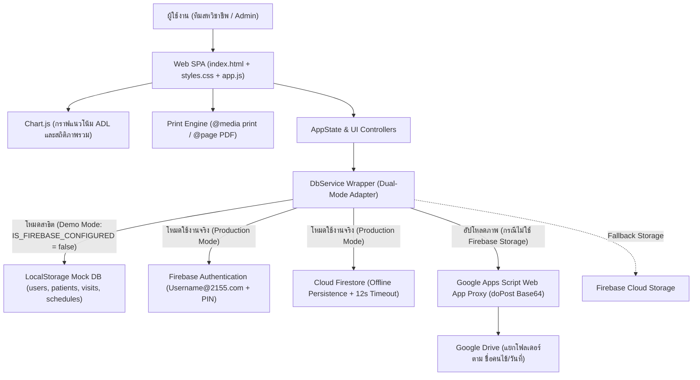
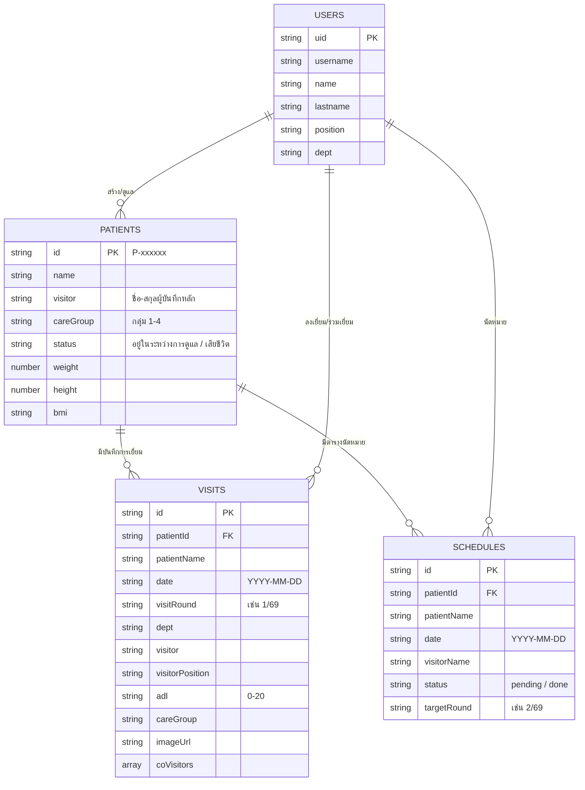

# เอกสารชี้แจงข้อมูลทางเทคนิคและชุดทดสอบระบบ (Technical & UX Audit Response)
**โครงการ:** นวัตกรรมระบบบันทึกและติดตามการเยี่ยมบ้านทีมสหวิชาชีพ (MDT Home Visit System)  
**กลุ่มงาน / หน่วยงาน:** Pro-Health Data BKK South  
**ผู้จัดทำ:** ทีมพัฒนาและเจ้าของนวัตกรรม Pro-Health Data BKK South  
**วัตถุประสงค์:** เอกสารประกอบการตอบชุดคำถามทีม IT, ทีม UX (สำหรับ UI/UX Audit) และผู้บริหาร เพื่อรวบรวมเข้าสู่ระบบกลางของโครงการ

> [!IMPORTANT]
> **หมายเหตุด้านความปลอดภัยของข้อมูล (Security & Privacy Notice)**  
> เอกสารฉบับนี้และโฟลเดอร์ชุดสาธิต (`Demo_MDT_Home_Visit/`) **ไม่มีการแนบ API Key, Firebase Config จริง, URL ของระบบ Production, Google Sheet ID, Google Drive Folder ID หรือรหัสผ่านใช้งานจริงแต่อย่างใด** โดยรหัสผ่านและบัญชีทั้งหมดที่แสดงในเอกสารนี้เป็น **ข้อมูลจำลอง (Mock Credentials)** สำหรับใช้ทดสอบในโหมด Demo Mock-up เท่านั้น

---

## บทสรุปจุดแข็งของนวัตกรรม (Innovation Highlights)

ระบบ **MDT Home Visit (Pro-Health Data BKK South)** ถูกออกแบบมาเพื่อแก้ปัญหาการทำงานซ้ำซ้อนและข้อมูลกระจัดกระจายของทีมสหวิชาชีพในการลงพื้นที่เยี่ยมบ้านผู้ป่วยที่มีภาวะพึ่งพิง (Long Term Care: LTC) โดยมีจุดแข็งสำคัญที่สกัดได้จากสถาปัตยกรรมและโค้ดจริงดังนี้:

1. **Dual-Mode Architecture (Cloud Real-time & Offline Demo Fallback):** ออกแบบ `DbService` เป็น Abstraction Layer กลาง ทำให้ระบบทำงานได้ทั้งบน Cloud (Firebase Auth + Cloud Firestore Offline Persistence) และสลับเข้าสู่โหมดฐานข้อมูลจำลองในเครื่อง (`localStorage`) ได้ทันทีเมื่อไม่ได้ตั้งค่าการเชื่อมต่อ Cloud ช่วยให้ทีม UX ทดสอบและ Audit ระบบได้โดยไม่ต้องเสี่ยงกระทบข้อมูลผู้ป่วยจริง
2. **ครอบคลุมมาตรฐานการประเมินทางคลินิกสหวิชาชีพ (Comprehensive Clinical & LTC Assessment):** รองรับการบันทึกข้อมูลตั้งแต่สัญญาณชีพ, **Barthel ADL Index (0–20)**, สัดส่วนร่างกายและคำนวณ **BMI อัตโนมัติ**, กำลังกล้ามเนื้อ (**Motor Power 4 จุด**), กลุ่มการดูแล (**Care Group 1–4**), แบบประเมิน **TAI (5 มิติ)**, แบบประเมิน **PPS (4 มิติ)** รวมถึง Checklist มาตรฐานทางการพยาบาลและแผนการดูแลครบ **6 หมวด (รวม 162 รายการย่อย)**
3. **การทำงานร่วมกันแบบสหวิชาชีพ (Multidisciplinary Co-Visitor & Smart Inheritance):** รองรับฟังก์ชัน **"ร่วมเยี่ยม" (`joinVisit`)** เพื่อให้เจ้าหน้าที่ต่างวิชาชีพลงชื่อร่วมในการเยี่ยมบ้านรอบเดียวกันได้โดยไม่ต้องกรอกข้อมูลผู้ป่วยใหม่ทั้งหมด และมีระบบ **Smart Inheritance** ดึงค่าประเมินทางคลินิกจากรอบเยี่ยมล่าสุดมาเติมให้อัตโนมัติ ลดภาระการกรอกข้อมูลซ้ำในภาคสนาม
4. **การติดตามแนวโน้มผู้ป่วยและออกรายงานพร้อมพิมพ์ (Trend Analytics & Print-Ready PDF):** มีหน้าแดชบอร์ดภาพรวมผู้บริหาร, ปฏิทินนัดหมายเยี่ยมบ้าน (สร้างนัดรอบถัดไปอัตโนมัติ), กราฟแนวโน้มคะแนน ADL รายบุคคล (Chart.js) เปรียบเทียบพัฒนาการตั้งแต่ครั้งแรกจนถึงปัจจุบัน และระบบจัดหน้าพิมพ์รายงานทางการแพทย์เป็น PDF (เลือกแนวตั้ง/แนวนอนได้)
5. **คำนึงถึง PDPA ตั้งแต่เริ่มต้นใช้งาน:** มีหน้าต่างขอความยินยอม **PDPA Consent Modal** (ตาม พ.ร.บ. คุ้มครองข้อมูลส่วนบุคคล พ.ศ. 2562) ก่อนเข้าถึงข้อมูลผู้ป่วยทุกครั้ง และจำกัดสิทธิ์การแก้ไข/ลบข้อมูลเฉพาะผู้บันทึกหลัก ผู้ร่วมเยี่ยม หรือผู้ดูแลระบบ

---

## คำตอบข้อที่ 1: User Manual & Specs (คู่มือการใช้งาน ผังระบบ และรายการฟังก์ชัน)

### 1.1 ผังสถาปัตยกรรมระบบ (System Architecture)

ระบบพัฒนาในรูปแบบ **Single-Page Application (SPA)** ฝั่ง Frontend ด้วย Vanilla HTML5/CSS3/JavaScript ทำงานร่วมกับชั้นบริการข้อมูลแบบ Dual-Mode (`DbService`) ดังแผนภาพต่อไปนี้



#### สรุปเทคโนโลยีที่ใช้ในระบบ (Technology Stack)
| ชั้นระบบ (Layer) | เทคโนโลยี / ไลบรารี | บทบาทหน้าที่ในโค้ดจริง |
|---|---|---|
| **Frontend UI** | HTML5, Custom CSS3 (`styles.css`), Font Awesome 6.4.0 | หน้าจอ SPA 16+ Screens, Responsive Sidebar (Desktop) + Bottom Nav (Mobile), Glassmorphism UI |
| **Client Logic** | Vanilla JavaScript ES6+ (`app.js`, `config.js`) | State Management (`AppState`), Auto-BMI, Auto-Visit Round, Smart Inheritance, Dynamic Checklists |
| **Data Visualization** | Chart.js (CDN) | กราฟเส้นแนวโน้ม ADL (10 ครั้งล่าสุด), กราฟโดนัท Care Group, กราฟแท่งจำนวนเยี่ยมรายแผนก |
| **Reporting / Print** | CSS `@media print` + Dynamic `@page` Injection | พิมพ์รายงานการเยี่ยมรายครั้ง, แดชบอร์ดคนไข้, ปฏิทิน, รายงานของฉัน เป็น PDF (Portrait/Landscape) |
| **Database & Auth (Prod)** | Firebase Compat SDK v10.8.0 (Auth, Firestore, Storage) | ยืนยันตัวตนและจัดเก็บข้อมูล NoSQL แบบ Real-time พร้อม `enablePersistence()` |
| **File Proxy (Prod)** | Google Apps Script Web App (`doPost`) | รับภาพ Base64 จากหน้าเว็บไปจัดเก็บใน Google Drive อัตโนมัติ (ทดแทน Firebase Storage Blaze Plan) |
| **Demo / Mock Engine** | Browser `localStorage` | จำลองฐานข้อมูลครบทุก CRUD Operations เพื่อการทดสอบและ Audit โดยไม่ต้องต่อ Backend จริง |
| **Legacy Reference** | Google Apps Script (`Code.gs`) + Google Sheets | โค้ดระบบรุ่นแรก (ก่อนย้ายมาเป็น Web SPA + Firebase) สำหรับเทียบเคียงโครงสร้างข้อมูลเดิม |

---

### 1.2 รายการฟังก์ชันการทำงานทั้งหมด (Functional List)

สกัดจากหน้าจอและฟังก์ชันจริงใน `index.html` และ `app.js`:

| รหัสโมดูล | หมวดหมู่ฟังก์ชัน | รายการฟังก์ชันย่อย (Features) | สิทธิ์ผู้ใช้งาน |
|---|---|---|---|
| **MOD-01** | **Authentication & PDPA** | • เข้าสู่ระบบด้วย Username + PIN 6 หลัก (ระบบเติม Suffix ภายในให้อัตโนมัติ)<br>• สมัครสมาชิกใหม่ + บังคับตั้งค่าโปรไฟล์ครั้งแรก (ชื่อ, นามสกุล, ตำแหน่ง, แผนก)<br>• หน้าต่างยืนยันข้อตกลง PDPA Consent Modal ก่อนเข้าสู่ระบบงาน<br>• เปลี่ยนรหัสผ่าน (PIN 6 หลัก)<br>• เข้าสู่ระบบผู้ดูแลระบบ (Admin Login Modal) | เจ้าหน้าที่ทั่วไป / Admin |
| **MOD-02** | **ศูนย์กลางระบบงาน & เมนูหลัก** | • เมนูนำทาง Sidebar (Desktop) และ Bottom Navigation (Mobile)<br>• หน้าศูนย์กลาง (Main Menu) เชื่อมไปยังทุกโมดูล<br>• ปุ่มรีเฟรชข้อมูลล่าสุด (`triggerRefresh`) | เจ้าหน้าที่ทั่วไป |
| **MOD-03** | **ฐานข้อมูลคนไข้ (Patient Database)** | • แสดงตารางรายชื่อคนไข้ เรียงตามตัวอักษรภาษาไทย<br>• ค้นหารายชื่อคนไข้แบบ Real-time (`p-search`)<br>• ตัวกรอง **"ที่เคยเยี่ยม"** (เฉพาะคนไข้ที่ผู้ใช้เคยลงเยี่ยม/ร่วมเยี่ยม)<br>• ตัวกรอง **"คนไข้ที่เสียชีวิต"** (แยกผู้ป่วยเสียชีวิตออกจากรายการปกติ)<br>• เพิ่มคนไข้ใหม่ (ตรวจสอบชื่อซ้ำอัตโนมัติ + สร้างรหัส `P-xxxxxx`)<br>• แก้ไขข้อมูลคนไข้ (ชื่อ, Care Group 1–4, สถานะ: อยู่ในระหว่างการดูแล / เสียชีวิต)<br>• ลบคนไข้พร้อมประวัติการเยี่ยมและนัดหมายที่เกี่ยวข้อง (เฉพาะผู้บันทึกหรือ Admin) | เจ้าหน้าที่ทั่วไป / Admin |
| **MOD-04** | **ฟอร์มบันทึกการเยี่ยมบ้าน (MDT Visit Form)** | • Searchable Dropdown เลือกคนไข้ พร้อมคำนวณ **รอบการเยี่ยม (`X/YY` พ.ศ.)** อัตโนมัติ<br>• **Smart Inheritance:** ดึงค่าคลินิกล่าสุด (สัญญาณชีพ, ADL, สัดส่วน, TAI, PPS, Checklist ฯลฯ) ของคนไข้รายนั้นมาเติมให้อัตโนมัติเมื่อลงเยี่ยมรอบใหม่<br>• คำนวณ **BMI** และแปลผล (ผอม / ปกติ / ท้วม / อ้วน 1 / อ้วน 2) อัตโนมัติ<br>• บันทึกแบบประเมิน **TAI (5 ด้าน)**, **PPS (4 ด้าน)**, **Motor Power (4 จุด)**<br>• Checklist สหวิชาชีพแบบพับเก็บได้ **6 หมวด (162 ข้อ)** พร้อมช่องกรอกระบุเพิ่มเติมแบบ Dynamic<br>• ตัวเลือกวันนัดครั้งต่อไป (ระบุวันที่เพื่อสร้างนัดในปฏิทินอัตโนมัติ หรือติ๊ก "ยังไม่ระบุ")<br>• แนบภาพถ่ายจากกล้อง/อัลบั้มพร้อมพรีวิวภาพ<br>• แก้ไขรายงานเยี่ยมย้อนหลัง (เฉพาะผู้ลงเยี่ยมหลัก, ผู้ร่วมเยี่ยม, หรือ Admin) | เจ้าหน้าที่ทั่วไป / Admin |
| **MOD-05** | **การทำงานร่วมกัน (Co-Visitor)** | • ปุ่ม **"ร่วมเยี่ยม"** (`handleJoinVisit`) บนแดชบอร์ดคนไข้ ให้เจ้าหน้าที่วิชาชีพอื่นเข้าร่วมเป็นทีมเยี่ยมในรอบนั้นๆ ได้<br>• บันทึกชื่อ ตำแหน่ง และแผนกของผู้ร่วมเยี่ยมลงใน `coVisitors` และแสดงในรายงาน PDF | เจ้าหน้าที่ทั่วไป |
| **MOD-06** | **แดชบอร์ดคนไข้รายบุคคล (Patient Hub)** | • แบนเนอร์ข้อมูลคนไข้ (เปลี่ยนสีเป็นสีแดงอัตโนมัติและปิดปุ่มเยี่ยมใหม่/นัดหมายหากสถานะเป็น "เสียชีวิต")<br>• แสดงรายชื่อทีมสหวิชาชีพที่เคยลงเยี่ยม และวันนัดครั้งถัดไป<br>• KPI Card: คะแนน ADL ล่าสุด, ค่าเปลี่ยนแปลงจากครั้งก่อน (Delta), ค่าเฉลี่ย ADL, แนวโน้มพัฒนาการสุขภาพ<br>• กราฟเส้นแนวโน้มคะแนน ADL สูงสุด 10 ครั้งล่าสุด (Chart.js)<br>• ตารางประวัติการเยี่ยมทุกรอบ พร้อมปุ่ม ดูรายงาน / ร่วมเยี่ยม / แก้ไข / ลบ | เจ้าหน้าที่ทั่วไป / Admin |
| **MOD-07** | **รายงานผลพร้อมพิมพ์ (Printable Report)** | • แสดงรายงานสรุปการเยี่ยมบ้านทีมสหวิชาชีพแบบเต็มรูปแบบ (รวมข้อมูลคลินิก, TAI, PPS, Checklist ที่เลือก, รูปภาพประกอบ)<br>• สั่งพิมพ์ / บันทึกเป็น PDF โดยเลือกแนวตั้ง (Portrait) หรือแนวนอน (Landscape) ได้ | เจ้าหน้าที่ทั่วไป / Admin |
| **MOD-08** | **ปฏิทินการเยี่ยม (Visit Calendar)** | • ปฏิทินรายเดือน แสดงจุดสถานะนัดหมาย (`pending` รอดำเนินการ / `done` เยี่ยมแล้ว)<br>• ตัวกรอง "การเยี่ยมทั้งหมด" / "เฉพาะการเยี่ยมของฉัน"<br>• คลิกวันที่เพื่อดูรายการนัดหมาย และกด **"บันทึกการเยี่ยม"** จากนัดหมายได้ทันที (เปลี่ยนสถานะนัดเป็น `done` อัตโนมัติเมื่อบันทึก)<br>• สร้างหมายนัดใหม่ผ่าน Modal และลบหมายนัด (ลบคู่บันทึกเยี่ยมได้หากสถานะเป็น `done`)<br>• พิมพ์ปฏิทินเป็น PDF | เจ้าหน้าที่ทั่วไป |
| **MOD-09** | **รายการเยี่ยมของฉัน (My Visits)** | • สรุปสถิติส่วนตัว: งานนัดหมายทั้งหมด, ดำเนินการสำเร็จแล้ว, รอดำเนินการ<br>• รายชื่อคนไข้ในความรับผิดชอบ (ทั้งที่ลงเยี่ยมหลัก, ร่วมเยี่ยม, และนัดหมาย) พร้อมจำนวนครั้งและ ADL สูงสุด<br>• พิมพ์รายงานสรุปประจำตัวเป็น PDF | เจ้าหน้าที่ทั่วไป |
| **MOD-10** | **แดชบอร์ดภาพรวม (Overview Dashboard)** | • KPI ภาพรวมระบบ: จำนวนคนไข้, แผนการเยี่ยม, เยี่ยมจริง, อัตราความสำเร็จ (%), ADL เฉลี่ย, งานค้าง<br>• กราฟโดนัทสัดส่วนคนไข้ตาม Care Group 1–4<br>• กราฟแท่งจำนวนการเยี่ยมแยกตามแผนก และตารางสัดส่วนแยกตามวิชาชีพผู้ลงเยี่ยม | เจ้าหน้าที่ทั่วไป |
| **MOD-11** | **ระบบจัดการผู้ดูแลระบบ (Admin Panel)** | • จัดการบัญชีสมาชิก: ดูรายชื่อสมาชิกทั้งหมด (บัญชี, ชื่อ-สกุล, ตำแหน่ง, แผนก) และลบบัญชี<br>• จัดการข้อมูลผู้ป่วย: ค้นหาและลบข้อมูลผู้ป่วยพร้อมประวัติและนัดหมายที่เกี่ยวข้องทั้งหมด | Admin เท่านั้น |

---

### 1.3 แนวทางการใช้งานเบื้องต้น (User Manual / Operational Workflow)

```mermaid
flowchart LR
    Step1["1. เข้าสู่ระบบ / สมัครสมาชิก"] --> Step2["2. ยอมรับข้อตกลง PDPA"]
    Step2 --> Step3["3. เลือก/เพิ่มรายชื่อคนไข้ ในฐานข้อมูลคนไข้"]
    Step3 --> Step4["4. เปิดแดชบอร์ดคนไข้ เพื่อดูประวัติและแนวโน้ม ADL"]
    Step4 --> Step5["5. กดบันทึกการเยี่ยมรอบใหม่ (ระบบดึงค่าเดิมมาช่วยกรอก)"]
    Step5 --> Step6["6. กรอกสัญญาณชีพ / TAI / PPS / Checklist และแนบรูป"]
    Step6 --> Step7["7. บันทึกและสั่งพิมพ์ PDF หรือสร้างนัดหมายครั้งถัดไปอัตโนมัติ"]
```



**ขั้นตอนการใช้งานสำหรับเจ้าหน้าที่ (ทีมสหวิชาชีพ):**
1. **เข้าสู่ระบบ:** กรอก `Username` และรหัสผ่านตัวเลข 6 หลัก (หากสมัครใหม่ ระบบจะบังคับกรอกชื่อ-นามสกุล ตำแหน่ง และแผนกก่อนใช้งานครั้งแรก) จากนั้นกด **"ยอมรับและยืนยันข้อตกลง"** บนหน้าต่าง PDPA
2. **จัดการทะเบียนคนไข้:** เข้าเมนู **ฐานข้อมูลคนไข้** เพื่อค้นหารายชื่อ หรือเพิ่มคนไข้ใหม่ทางด้านขวา (ระบุชื่อจริง นามสกุล และ Care Group) แล้วคลิกที่ชื่อคนไข้เพื่อเปิด **หน้าหลักคนไข้ (Patient Main Hub)**
3. **บันทึกการเยี่ยมบ้าน:** จากหน้าหลักคนไข้ กดปุ่ม **"บันทึกการเยี่ยมรอบใหม่"** ระบบจะคำนวณชื่อวงรอบ (เช่น `1/69`) และดึงค่าประเมินทางคลินิกล่าสุดมาเติมให้ จากนั้นปรับแก้ข้อมูลที่เปลี่ยนแปลง กรอกบันทึกเยี่ยม เลือก Checklist 6 หมวด (กดหัวข้อเพื่อกางออก) ระบุวันนัดครั้งต่อไป และกดบันทึก
4. **ลงชื่อร่วมเยี่ยม:** กรณีออกเยี่ยมเป็นทีมหลายวิชาชีพ เจ้าหน้าที่คนอื่นสามารถเปิดหน้าหลักคนไข้แล้วกดปุ่ม **"ร่วมเยี่ยม"** ในตารางประวัติรอบนั้นเพื่อเพิ่มชื่อตนเองเข้าในทีมผู้เยี่ยมได้ทันที
5. **ดูภาพรวมและพิมพ์รายงาน:** ตรวจสอบตารางงานได้ในเมนู **ปฏิทินการเยี่ยม**, ดูสถิติส่วนตัวใน **รายการเยี่ยมของฉัน**, ดูภาพรวมหน่วยงานใน **แดชบอร์ดภาพรวม** และสั่ง **พิมพ์ PDF** ได้จากทั้งหน้ารายงานรายครั้ง แดชบอร์ดคนไข้ ปฏิทิน และรายการเยี่ยมของฉัน

---

## คำตอบข้อที่ 2: Demo Account & วิธีรันระบบทดสอบ (UX Audit Environment)

ทีมพัฒนาได้จัดเตรียมโฟลเดอร์ **`Demo_MDT_Home_Visit/`** ซึ่งเป็นตัว Demo Mock-up ที่ตัดการเชื่อมต่อกับฐานข้อมูล Production และ Secrets ทั้งหมดออกแล้ว โดยทำงานบนฐานข้อมูลจำลองในเครื่อง (`localStorage`) พร้อมข้อมูลตัวอย่าง (Seed Data) ครบทุกหน้าจอ

### 2.1 บัญชีทดสอบจำลอง (Mock Demo Accounts)

> [!NOTE]
> **ข้อกำหนดด้านความปลอดภัย:** บัญชีและรหัสผ่านด้านล่างเป็น **บัญชีจำลอง (Simulated Mock Credentials)** ที่สร้างขึ้นเพื่อใช้ทดสอบในโหมด Demo Mock-up เท่านั้น **ไม่ใช่บัญชีและรหัสผ่านใช้งานจริง**

| ประเภทบัญชี | ชื่อผู้ใช้งาน (กรอกในช่อง Username) | ชื่อ-นามสกุลที่แสดงในระบบ | ตำแหน่ง / แผนก | รหัสผ่านจำลอง (Demo PIN) |
|---|---|---|---|---|
| **เจ้าหน้าที่ 1 (Seed User)** | `somchai` | สมชาย ใจดี | พยาบาลวิชาชีพ / แผนกอนามัยชุมชน | `123456` |
| **เจ้าหน้าที่ 2 (Seed User)** | `nurse_ying` | นารี รักการดี | พยาบาลวิชาชีพชำนาญการ / อนามัยโรงเรียน | `123456` |
| **เจ้าหน้าที่ 3 (Seed User)** | `physio_tum` | ปกรณ์ สมบัติ | นักกายภาพบำบัด / นักกายภาพบำบัด | `123456` |
| **สมัครใหม่ใน Demo** | *(ตั้งเองได้อิสระ)* | *(กรอกในหน้า Profile Setup)* | *(เลือกจาก Dropdown)* | *(ตัวเลข 6 หลักที่ตั้งเอง)* |
| **ผู้ดูแลระบบ (Admin Demo)** | *(คลิกปุ่ม "เข้าสู่ระบบสำหรับผู้ดูแลระบบ")* | ผู้ดูแลระบบ | ผู้ดูแลระบบ | `demo1234` |

*(หมายเหตุ: บนหน้าจอ Login ของตัว Demo Mock-up ได้เพิ่มปุ่มคลิกกรอกบัญชีจำลองอัตโนมัติ และปุ่ม **"รีเซ็ตข้อมูลจำลอง"** เพื่ออำนวยความสะดวกให้ทีม UX ทดลองได้อย่างรวดเร็ว)*

### 2.2 ข้อมูลจำลองตั้งต้นที่มีในระบบ (Seed / Mock Data)

เมื่อเปิดใช้งาน Demo ครั้งแรก ระบบจะสร้างข้อมูลตัวอย่างใน `localStorage` ดังนี้:
- **ผู้ป่วยจำลอง (`DEFAULT_PATIENTS` - 3 ราย):**
  1. `P-882711` — นายสมศักดิ์ รักสงบ (กลุ่ม 2, ผู้ดูแล: สมชาย ใจดี, มีประวัติเยี่ยม 2 รอบเพื่อทดสอบกราฟแนวโน้ม ADL เพิ่มจาก 8 → 9)
  2. `P-399102` — นางสมศรี สุขเกษม (กลุ่ม 3, ผู้ดูแล: นารี รักการดี, มีประวัติเยี่ยม 1 รอบ พร้อมค่าความดัน `135/85`)
  3. `P-112093` — นายบุญมี มั่งมี (กลุ่ม 1, ผู้ดูแล: ปกรณ์ สมบัติ, ยังไม่มีประวัติเยี่ยม เพื่อทดสอบสถานะ Empty State และนัดหมาย)
- **บันทึกการเยี่ยมจำลอง (`DEFAULT_VISITS` - 3 รายการ):** ข้อมูลการเยี่ยมย้อนหลังของ `P-882711` (2 ครั้ง) และ `P-399102` (1 ครั้ง)
- **ตารางนัดหมายจำลอง (`DEFAULT_SCHEDULES` - 3 รายการ):** นัดหมายสถานะ `pending` 2 รายการ (`S-1`, `S-2`) และสถานะ `done` 1 รายการ (`S-3`)

### 2.3 วิธีรันระบบทดสอบ (How to Run Demo Mock-up)

เนื่องจากตัว Demo Mock-up ทำงานแบบ Static Web App ร่วมกับ `localStorage` จึงสามารถรันได้ทันทีโดยไม่ต้องติดตั้ง Database หรือ Build Tool:

1. **วิธีที่ 1 (แนะนำ — ผ่าน Local HTTP Server):**
   ```bash
   cd Demo_MDT_Home_Visit
   python3 -m http.server 8080
   ```
   จากนั้นเปิดเบราว์เซอร์ไปที่ `http://localhost:8080`
2. **วิธีที่ 2 (ผ่าน VS Code):** คลิกขวาที่ไฟล์ `Demo_MDT_Home_Visit/index.html` แล้วเลือก **Open with Live Server**
3. **วิธีที่ 3 (เปิดไฟล์โดยตรง):** ดับเบิลคลิกไฟล์ `Demo_MDT_Home_Visit/index.html` เพื่อเปิดใน Chrome/Safari/Edge (การบันทึกและแก้ไขข้อมูลทั้งหมดจะคงอยู่ใน `localStorage` ของเบราว์เซอร์นั้น)

### 2.4 ข้อมูล Staging Environment (สำหรับกรอกเพิ่มเติมเมื่อ Deploy Staging)

| รายการ | ข้อมูลสำหรับทีม UX / IT |
|---|---|
| **Staging URL** | `[รอระบุ URL ของ Staging Environment หลังจาก Deploy]` |
| **Staging User Account** | `[รอระบุ Username / Temporary PIN สำหรับ Staging]` |
| **Staging Admin Account** | `[รอระบุ Admin Credentials เฉพาะ Staging (ถ้ามี)]` |
| **หมายเหตุการเข้าถึง** | ปัจจุบันสามารถใช้ชุด **`Demo_MDT_Home_Visit/`** ทดสอบ UX/UI และ Flow การทำงานทั้งหมดได้ทันที 100% |

---

## คำตอบข้อที่ 3: Database & Data Dictionary (โครงสร้างฐานข้อมูลและ Form Fields)

### 3.1 แผนภาพความสัมพันธ์ข้อมูล (Entity-Relationship Diagram)

ระบบปัจจุบันใช้ฐานข้อมูลแบบ NoSQL (**Cloud Firestore** ในโหมด Production และ **JSON Array ใน `localStorage`** ในโหมด Demo) ประกอบด้วย **4 Collections หลัก** ดังนี้:



*(หมายเหตุเปรียบเทียบกับระบบรุ่นเดิม: ในไฟล์อ้างอิงรุ่นเก่า `Code.gs` เคยออกแบบฐานข้อมูลบน Google Sheets 3 แท็บ ได้แก่ `Users` [3 คอลัมน์], `Patients` [3 คอลัมน์] และ `Visits` [42 คอลัมน์] ก่อนจะยกระดับมาใช้ Cloud Firestore 4 Collections เพื่อรองรับการนัดหมาย `schedules`, ผู้ร่วมเยี่ยม `coVisitors`, สถานะผู้ป่วย และ Checklist 6 หมวด)*

---

### 3.2 Data Dictionary ฉบับสมบูรณ์ (สกัดจากโค้ดจริง)

#### ตารางที่ 1: Collection `users` (ข้อมูลเจ้าหน้าที่ทีมสหวิชาชีพ)
| ชื่อฟิลด์ (Field Key) | ชนิดข้อมูล (Type) | UI Input ID / แหล่งที่มา | รายละเอียดและค่าที่รองรับ (Options / Validation) |
|---|---|---|---|
| `uid` | String (PK) | Firebase Auth UID / `u_<timestamp>` | รหัสประจำตัวผู้ใช้ (ค่าพิเศษ `"admin"` สำหรับผู้ดูแลระบบ) |
| `username` | String | `#reg-username` / `#login-username` | ชื่อผู้ใช้ (ระบบเติม Domain Suffix ภายในอัตโนมัติหากไม่ใส่ `@`) |
| `name` | String | `#prof-name` | ชื่อจริง (บังคับกรอกในหน้า Profile Setup) |
| `lastname` | String | `#prof-lastname` | นามสกุล (บังคับกรอกในหน้า Profile Setup) |
| `position` | String | `#prof-position` | ตำแหน่งงาน (10 ตัวเลือก: พยาบาลวิชาชีพ, พยาบาลวิชาชีพปฏิบัติการ, พยาบาลวิชาชีพชำนาญการ, พยาบาลวิชาชีพชำนาญการพิเศษ, นักสังคมสงเคราะห์, นักกายภาพบำบัด, นักวิชาการสาธารณสุข, พนักงานช่วยงานด้านสาธารณสุข, นักจิตวิทยาคลินิก, อื่นๆ) |
| `dept` | String | `#prof-dept` | แผนกปฏิบัติงาน (7 ตัวเลือก: แผนกอนามัยชุมชน, อนามัยโรงเรียน, นักสังคมสงเคราะห์, นักจิตวิทยา, นักกายภาพบำบัด, คลินิกก้าวใหม่พลัส, คลินิกรักปลอดภัย) |

#### ตารางที่ 2: Collection `patients` (ทะเบียนผู้ป่วยที่มีภาวะพึ่งพิง)
| ชื่อฟิลด์ (Field Key) | ชนิดข้อมูล (Type) | UI Input ID / แหล่งที่มา | รายละเอียดและค่าที่รองรับ |
|---|---|---|---|
| `id` | String (PK) | Auto-generated | รหัสผู้ป่วยรูปแบบ `"P-" + เลขสุ่ม 6 หลัก` |
| `name` | String | `#p-firstname` + `#p-lastname` / `#edit-patient-name` | ชื่อ-นามสกุลผู้ป่วย (ตรวจสอบชื่อซ้ำแบบ Case-insensitive) |
| `visitor` | String | Auto from `currentUser` | ชื่อ-นามสกุลเจ้าหน้าที่ผู้เพิ่มข้อมูลคนไข้ (ใช้ตรวจสิทธิ์ลบ) |
| `careGroup` | String | `#p-care-group` / `#edit-patient-care-group` | กลุ่มการดูแล: `กลุ่ม 1`, `กลุ่ม 2`, `กลุ่ม 3`, `กลุ่ม 4` (อัปเดตล่าสุดตามการเยี่ยมด้วย) |
| `status` | String | `#edit-patient-status` | สถานะผู้ป่วย: `อยู่ในระหว่างการดูแล` (Default) หรือ `เสียชีวิต` |
| `weight`, `height`, `bmi` | Number / String | Seed Data (Optional) | ข้อมูลสัดส่วนอ้างอิงเบื้องต้น (แสดงล่าสุดจากประวัติการเยี่ยมบนแดชบอร์ด) |

#### ตารางที่ 3: Collection `schedules` (ตารางนัดหมายเยี่ยมบ้าน)
| ชื่อฟิลด์ (Field Key) | ชนิดข้อมูล (Type) | UI Input ID / แหล่งที่มา | รายละเอียดและค่าที่รองรับ |
|---|---|---|---|
| `id` | String (PK) | Firestore Doc ID / `S-<timestamp>` | รหัสหมายนัดหมาย |
| `patientId` | String (FK) | `patObj.id` | อ้างอิงรหัสผู้ป่วย (`patients.id`) |
| `patientName` | String | `#sched-form-patient` / Visit Form | ชื่อ-นามสกุลผู้ป่วย |
| `date` | String | `#sched-form-date` / `#f-nextvisit` | วันที่นัดหมายรูปแบบ `YYYY-MM-DD` |
| `visitorName` | String | Auto from `currentUser` | ชื่อ-นามสกุลเจ้าหน้าที่ผู้นัดหมาย |
| `status` | String | System Controlled | สถานะนัด: `pending` (รอดำเนินการ) หรือ `done` (เยี่ยมแล้ว) |
| `targetRound` | String | Auto-calculated | วงรอบเป้าหมายสำหรับการเยี่ยมครั้งถัดไป (เช่น `2/69`) |

#### ตารางที่ 4: Collection `visits` และรายการ Form Fields ทั้งหมด (`#page-form`)
ข้อมูลบันทึกการเยี่ยมบ้าน 1 เอกสารประกอบด้วย **44 ฟิลด์หลัก + 6 อาเรย์เช็กลิสต์** ดังนี้:

| หมวดหมู่ | Field Key | ชนิดข้อมูล | UI Input ID | รายละเอียด / ตัวเลือก (Options) |
|---|---|---|---|---|
| **1. ข้อมูลทั่วไป** | `date` | String | `#f-date` | วันที่ลงพื้นที่เยี่ยมบ้าน (`YYYY-MM-DD`) |
| | `patientId` | String (FK) | Lookup from `#f-patient` | รหัสคนไข้ (`P-xxxxxx`) |
| | `patientName` | String | `#f-patient` | ชื่อ-นามสกุลคนไข้ (Searchable Dropdown, บังคับกรอก) |
| | `visitRound` | String | `#f-visit-round` | ชื่อวงรอบการเยี่ยม คำนวณอัตโนมัติ เช่น `1/69` (แก้ไขได้, บังคับกรอก) |
| | `dept` | String | `#f-dept` (Disabled) | แผนกของผู้บันทึก (ดึงจากโปรไฟล์ผู้ใช้) |
| | `visitor` | String | `#f-visitor` (Disabled) | ชื่อ-นามสกุลผู้บันทึกหลัก |
| | `visitorPosition` | String | Auto from `currentUser` | ตำแหน่งของผู้บันทึกหลัก |
| | `coVisitors` | Array\<Object\> | ปุ่ม "ร่วมเยี่ยม" | รายชื่อผู้ร่วมเยี่ยม: `[{ name, position, dept }]` |
| | `timestamp` | String | System (Mock Mode) | วันที่บันทึกข้อมูล (`YYYY-MM-DD`) |
| **2. สัญญาณชีพ & ADL** | `consciousness` | String | `#f-consc` | ระดับความรู้สึกตัว: `รู้สึกตัวดี`, `สับสน`, `ง่วงซึม`, `ซึมลึก`, `ไม่รู้สึกตัว` |
| | `adl` | String | `#f-adl` | คะแนน Barthel ADL Index: `0` ถึง `20` |
| | `temp` | String/Number | `#f-temp` | อุณหภูมิร่างกาย (°C) |
| | `pulse` | String/Number | `#f-pulse` | ชีพจร (ครั้ง/นาที) |
| | `resp` | String/Number | `#f-resp` | อัตราการหายใจ (ครั้ง/นาที) |
| | `bp` | String | `#f-bp` | ความดันโลหิต (mmHg) เช่น `120/80` (ใช้ตรวจแจ้งเตือน Systolic > 140) |
| **3. สัดส่วน & BMI** | `waist` | String/Number | `#f-waist` | รอบเอว (ซม.) |
| | `arm` | String/Number | `#f-arm` | รอบแขน (ซม.) |
| | `calf` | String/Number | `#f-calf` | รอบน่อง (ซม.) |
| | `weight` | String/Number | `#f-weight` | น้ำหนัก (กก.) (Trigger `calculateBMI()`) |
| | `height` | String/Number | `#f-height` | ส่วนสูง (ซม.) (Trigger `calculateBMI()`) |
| | `bmi` | String | `#f-bmi` (Readonly) | ค่า BMI พร้อมผลแปลอัตโนมัติ (ผอม / ปกติ / ท้วม / อ้วน 1 / อ้วน 2) |
| **4. กำลังกล้ามเนื้อ** | `motorRA`, `motorLA`, `motorRL`, `motorLL` | String | `#f-motor-ra`, `-la`, `-rl`, `-ll` | แขนขวา / แขนซ้าย / ขาขวา / ขาซ้าย: `Grade 0` – `Grade 5` |
| **5. กลุ่มการดูแล** | `careGroup` | String | `#f-care-group` | `กลุ่ม 1`, `กลุ่ม 2`, `กลุ่ม 3`, `กลุ่ม 4` |
| **6. ประเมิน TAI (5 ด้าน)** | `taiMobility` | String | `#f-tai-mob` | การเคลื่อนไหว (5 ระดับ: เคลื่อนไหวปกติ – อยู่บนเตียงตลอดเวลา) |
| | `taiActivity` | String | `#f-tai-act` | การทำกิจกรรม (8 ระดับ) |
| | `taiSelfCare` | String | `#f-tai-self` | การดูแลตนเอง (5 ระดับ: ทำได้เอง – ต้องการการดูแลทั้งหมด) |
| | `taiEating` | String | `#f-tai-eat` | การรับประทานอาหาร (4 ระดับ: ปกติ – รับประทานไม่ได้) |
| | `taiConscious` | String | `#f-tai-consc` | ความรู้สึกตัว (4 ระดับ) |
| **7. ประเมิน PPS (4 ด้าน)** | `ppsMobility` | String | `#f-pps-mob` | การเคลื่อนไหว (6 ระดับ) |
| | `ppsMental` | String | `#f-pps-ment` | จิตใจและปัญญา (6 ระดับ) |
| | `ppsEating` | String | `#f-pps-eat` | การรับประทานอาหาร (6 ระดับ) |
| | `ppsExcretion` | String | `#f-pps-exc` | การขับถ่าย (6 ระดับ) |
| **8. อาการและประวัติ** | `symptoms` | String | `#f-symptoms` | อาการ / อาการแสดง (Textarea) |
| | `drugAllergy` | String | `#f-drug` | ประวัติแพ้ยา: `ไม่มีประวัติแพ้ยา`, `มี`, `ไม่ทราบประวัติ` |
| | `foodAllergy` | String | `#f-food` | ประวัติแพ้อาหาร: `ไม่มีประวัติแพ้อาหาร`, `มี`, `ไม่ทราบประวัติ` |
| **9. บันทึกและผลประเมิน** | `visitNote` | String | `#f-note` | บันทึกการเยี่ยมบ้าน |
| | `evaluation` | String | `#f-eval` | ผลการประเมินสุขภาพ |
| | `followUp` | String | `#f-follow` | เรื่องเร่งด่วนที่ต้องติดตาม (Follow-Up) |
| | `others` | String | `#f-others` | เรื่องแจ้งอื่น ๆ เพิ่มเติม |
| **10. เช็กลิสต์ 6 หมวด** | `nursingDiagnosis` | Array\<Object\> | `.f-nursing-diag-cb` | การวินิจฉัยการพยาบาล (**41 ตัวเลือก**, เก็บ `{ id, text? }`) |
| *(รวม 162 รายการ)* | `servicePrecautions` | Array\<Object\> | `.f-service-pre-cb` | ข้อควรระวังในการให้บริการ (**26 ตัวเลือก**, เก็บ `{ id, text? }`) |
| | `shortTermGoals` | Array\<Object\> | `.f-short-goal-cb` | เป้าหมายระยะสั้น (**26 ตัวเลือก**, เก็บ `{ id, text? }`) |
| | `longTermGoals` | Array\<Object\> | `.f-long-goal-cb` | เป้าหมายระยะยาว (**27 ตัวเลือก**, เก็บ `{ id, text? }`) |
| | `patientProblems` | Array\<Object\> | `.f-patient-prob-cb` | ปัญหาของผู้ที่มีภาวะพึ่งพิง/ญาติ/ครอบครัว (**24 ตัวเลือก**, เก็บ `{ id, text? }`) |
| | `patientNeeds` | Array\<Object\> | `.f-patient-need-cb` | ความต้องการของผู้มีภาวะพึ่งพิง/ญาติ/ครอบครัว (**18 ตัวเลือก**, เก็บ `{ id, text? }`) |
| **11. นัดหมาย & รูปภาพ** | `docAppt` | String | `#f-docappt` | วันนัดพบแพทย์ ณ โรงพยาบาล (Free-text) |
| | `nextVisit` | String | `#f-nextvisit` | วันนัดหมายลงเยี่ยมครั้งต่อไป (`YYYY-MM-DD` หรือว่างเมื่อติ๊ก `#f-nextvisit-unspecified`) |
| | `imageUrl` | String | `#f-image` | URL รูปภาพจาก Google Drive/Firebase Storage (หรือ Base64 ในโหมด Demo) |

---

## คำตอบข้อที่ 4: Current Pain Points / Technical Constraints (ข้อจำกัดเชิงเทคนิคและจุดที่ควรพัฒนาต่อ)

จากการวิเคราะห์โครงสร้างโค้ดและสถาปัตยกรรมจริงของระบบปัจจุบัน ทีมพัฒนาขอสรุปสถานะสิ่งที่รองรับแล้วเทียบกับข้อจำกัดเชิงเทคนิค (Technical Bottlenecks) และประเด็นด้าน UX/Security ดังนี้:

| ด้านที่วิเคราะห์ | สิ่งที่รองรับแล้วในระบบปัจจุบัน / Demo | ข้อจำกัดเชิงเทคนิค / Pain Points ที่พบจากโค้ดจริง | แนวทางพัฒนาต่อที่แนะนำ |
|---|---|---|---|
| **1. สถาปัตยกรรมโหลดข้อมูล (Scalability & Query)** | มี `withTimeout(12000)` ป้องกันหน้าจอค้าง และเปิด Firestore Offline Persistence (`enablePersistence`) | `AppState.loadInitialData()` ดึงข้อมูล `visits`, `patients`, `schedules` **ทั้งหมดใน Collection** มาเก็บใน RAM ฝั่ง Client ทุกครั้งที่ Login หรือกด Refresh หากใช้งานต่อเนื่องจนมีข้อมูลหลายพันรายการ จะเกิดปัญหาโหลดช้าและสิ้นเปลือง Read Quota | เพิ่ม Pagination, Lazy Loading และ Server-side Query Filter ตามช่วงเวลาหรือแผนก |
| **2. การอ้างอิงผู้ใช้ (Referential Integrity)** | มี `normalizeName()` ช่วยลดปัญหาเว้นวรรค/ตัวพิมพ์ในการจับคู่ชื่อผู้บันทึก | ใน `visits` และ `schedules` ใช้ **ชื่อ-นามสกุล (`visitor` / `visitorName`)** เป็นตัวเชื่อมสิทธิ์แก้ไข/ลบ และกรอง "ของฉัน" แทนการใช้ `uid` หากเจ้าหน้าที่เปลี่ยนชื่อ-นามสกุลหรือมีบุคคลชื่อซ้ำกัน จะกระทบการแสดงผลและสิทธิ์แก้ไข | จัดเก็บ `visitorUid` และ `coVisitorUids` คู่กับชื่อแสดงผล เพื่อใช้อ้างอิงสิทธิ์อย่างแม่นยำ |
| **3. ความปลอดภัยและสิทธิ์เข้าถึง (Security & Auth)** | มี PDPA Consent Modal, จำกัดสิทธิ์แก้ไข/ลบบน UI ตามผู้บันทึก, และแยก Auth ผ่าน Firebase Auth | • การเข้าสู่ระบบ Admin (`handleAdminLogin`) ตรวจสอบรหัสผ่านฝั่ง Client-side<br>• ไฟล์ `config.js` เก็บค่า Config และ Endpoint ฝั่ง Client<br>• ภาพที่อัปโหลดผ่าน Apps Script Proxy ตั้งสิทธิ์ `ANYONE_WITH_LINK` เพื่อแสดงใน `` ได้ ซึ่งมีความเสี่ยงหากลิงก์หลุดภายนอก | ย้ายสิทธิ์ Admin ไปใช้ Firebase Auth Custom Claims + Firestore Rules และเปลี่ยนการจัดเก็บรูปภาพเป็น Signed URL หรือ Authenticated Cloud Storage |
| **4. การอัปโหลดรูปภาพ (Storage & Bandwidth)** | แก้ข้อจำกัดเรื่องค่าใช้จ่าย Firebase Storage (Blaze Plan) ด้วยการสร้าง Apps Script Proxy แยกโฟลเดอร์ Google Drive ตามชื่อคนไข้และวันที่ให้อัตโนมัติ | ระบบอ่านไฟล์ภาพเป็น Base64 ขนาดเต็มส่งผ่าน `fetch()` ไปยัง Google Apps Script ซึ่งจำกัด 1 ไฟล์ต่อครั้ง ไม่มี Client-side Resize/Compress และอาจติด Timeout ของ Apps Script เมื่อเจ้าหน้าที่ใช้งานผ่านเน็ตมือถือ 4G ในพื้นที่อับสัญญาณ | เพิ่มการย่อขนาด/บีบอัดภาพ (Canvas Compression) ฝั่ง Client ก่อนอัปโหลด และรองรับการแนบภาพหลายภาพ |
| **5. การแก้ไขพร้อมกันและสร้างรหัส (Concurrency & IDs)** | รองรับการกด "ร่วมเยี่ยม" (`joinVisit`) เพื่อให้หลายวิชาชีพร่วมบันทึกในรอบเดียวได้ | • `joinVisit` ใช้วิธีอ่านอาเรย์ `coVisitors` แล้วเขียนทับทั้งก้อน (อาจเกิด Race Condition หากกดพร้อมกัน)<br>• รหัสคนไข้ `P-xxxxxx` สุ่มจาก `Math.random()` 6 หลัก โดยไม่ได้ตรวจซ้ำระดับ Atomic | เปลี่ยน `joinVisit` เป็น `firebase.firestore.FieldValue.arrayUnion()` และใช้ Auto-ID ของ Firestore หรือ Sequence Transaction |
| **6. ประสบการณ์ใช้งานภาคสนาม (Field UX)** | มีระบบพับ/กาง Checklist, ดึงค่าเก่าอัตโนมัติ (Smart Inheritance), Searchable Dropdown และ Responsive Mobile Bottom Nav | • แบบฟอร์มมี Checklist รวม **162 ข้อ** (6 หมวด) แม้จะพับเก็บได้ แต่บนจอมือถือยังต้องเลื่อนยาวและยังไม่มีช่องค้นหาภายใน Checklist<br>• ฟิลด์วันนัดโรงพยาบาล (`docAppt`) เป็น Text ธรรมดา จึงแจ้งเตือนไม่ได้<br>• ระบบแจ้งเตือนยังใช้ `alert()` / `confirm()` ของ Browser<br>• ไม่มีปุ่ม Export ข้อมูลเป็น Excel/CSV สำหรับทำรายงานราชการ (มีเฉพาะ Print PDF) | ให้ทีม UX ออกแบบ Search/Quick-Tag ใน Checklist, แยก Date Picker สำหรับวันนัดแพทย์, เปลี่ยน `alert` เป็น Custom Toast/Modal และเพิ่มฟังก์ชัน Export Excel/CSV |

---

## คำตอบข้อที่ 5: API & Integration (การเชื่อมต่อระบบภายนอก เช่น กทม. และ สปสช.)

จากการตรวจสอบโค้ดและสถาปัตยกรรมระบบทั้งหมดในปัจจุบัน ขอสรุปสถานะการเชื่อมต่อ API และความพร้อมในการ Integrate กับหน่วยงานภายนอก ดังนี้:

### 5.1 สถานะการเชื่อมต่อที่มีอยู่แล้วในปัจจุบัน (Current Integrations)
| ระบบ / บริการที่เชื่อมต่อ | รูปแบบการเชื่อมต่อในโค้ดจริง | สถานะใน Demo Mock-up |
|---|---|---|
| **Firebase Auth & Cloud Firestore** | Client-side SDK (`firebase-app-compat`, `firebase-auth-compat`, `firebase-firestore-compat`) | ปิดไว้ (`IS_FIREBASE_CONFIGURED = false`) และใช้ LocalStorage Mock DB แทน |
| **Google Apps Script Image Proxy** | HTTP `POST` ส่ง JSON Payload (`{ imageBlob, patientId, patientName, date }`) ไปยัง Web App `doPost(e)` เพื่อบันทึกลง Google Drive | ปิดไว้ (`IS_DRIVE_UPLOADER_CONFIGURED = false`) และจำลองเป็น Base64 ในเครื่อง |
| **Google Sheets Legacy (`Code.gs`)** | มีสคริปต์ฝั่ง Apps Script รุ่นเดิมที่เขียน/อ่านลง Google Sheets โดยตรง | เก็บไว้เป็น Reference (ไม่ได้ใช้งานร่วมกับ SPA ปัจจุบัน) |

### 5.2 การเชื่อมต่อกับระบบของ กทม. (BMA) และ สปสช. (NHSO)
* **สถานะปัจจุบัน:** **ยังไม่รองรับการเชื่อมต่อ API กับระบบของ กทม. และ สปสช. โดยตรง** (ทั้งในระบบ Production ปัจจุบันและในชุด Demo Mock-up)
* **ความพร้อมด้านมาตรฐานข้อมูลที่รองรับแล้ว:** โครงสร้างฟอร์มและโมเดลข้อมูล (`visits`) ได้ออกแบบชุดข้อมูลให้สอดคล้องกับเกณฑ์การดูแลผู้ป่วยภาวะพึ่งพิง (LTC) ของ สปสช. และงานอนามัยชุมชนไว้แล้ว ได้แก่ **Barthel ADL Index (0–20)**, **TAI Assessment**, **PPS Assessment**, **Care Group 1–4**, และ **Care Plan Checklists 6 หมวด**

### 5.3 ช่องว่างเชิงเทคนิค (Integration Gaps) และแนวทางต่อยอดสู่ API ภาครัฐ
1. **ขาดตัวระบุตัวตนมาตรฐานระดับประเทศ (National Identifier):** ปัจจุบันตาราง `patients` ใช้รหัสภายใน `P-xxxxxx` และ `ชื่อ-นามสกุล` เท่านั้น ยังไม่มีฟิลด์ **เลขบัตรประจำตัวประชาชน 13 หลัก (CID)** หรือ **HN โรงพยาบาล/ศูนย์บริการสาธารณสุข** สำหรับจับคู่ข้อมูลข้ามระบบกับ กทม. / สปสช. *(หากเพิ่มต้องเข้ารหัส/Mask ตาม PDPA)*
2. **ยังไม่มี Middleware / API Gateway ฝั่ง Server:** เนื่องจากแอปพลิเคชันปัจจุบันเป็น Static Frontend SPA ล้วน จึงไม่สามารถเก็บรักษา Client Secret, API Key, OAuth2 Token หรือ Mutual TLS (mTLS) Certificate ที่จำเป็นสำหรับการเชื่อมต่อ API ภาครัฐได้อย่างปลอดภัย
3. **แนวทางการเชื่อมต่อที่แนะนำ (Roadmap):**
   * **ระยะสั้น (Quick Win):** พัฒนาโมดูล Export ข้อมูล (CSV / Excel / JSON) ที่ Map คอลัมน์ตรงตาม Template รายงานของ กทม. และโปรแกรม LTC ของ สปสช. เพื่อลดการคีย์ข้อมูลซ้ำซ้อน
   * **ระยะกลาง–ยาว (Full API Integration):** เพิ่มชั้น **Backend API / Cloud Functions** (เช่น Firebase Cloud Functions หรือ Node.js API Gateway) เพื่อทำหน้าที่แปลงข้อมูลเป็นมาตรฐาน **HL7 FHIR / 43 แฟ้ม / NHSO LTC API Schema** และจัดการ Authentication กับระบบกลางของ กทม. และ สปสช. อย่างปลอดภัย
