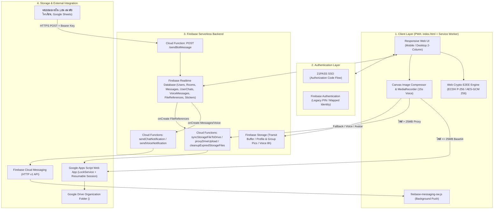

# รายงานชี้แจงข้อมูลทางเทคนิคและสถาปัตยกรรมระบบ (IT Technical Response Report)
**โครงการ:** SeVaNa21 / TeamConnect21 (สาธารณสุข 21)  
**หน่วยงาน / นวัตกรรม:** Pro-Health Data BKK South  
**วัตถุประสงค์:** เอกสารประกอบการส่งมอบข้อมูลทางเทคนิคตอบชุดคำถามทีม IT, ทีม UX/UI และผู้บริหาร พร้อมชุดทดสอบ **Demo Mock-up (Offline Sandbox)**  
**สถานะความปลอดภัยเอกสาร:** ✅ **ผ่านการคัดกรองข้อมูลสำคัญ (Redacted)** — ไม่มีการระบุ API Key, Token, URL จริง, Google Drive/Sheet ID หรือบัญชีผู้ใช้งานจริงในเอกสารและโฟลเดอร์ Demo นี้

---

## บทสรุปผู้บริหารและจุดแข็งของนวัตกรรม (Executive Summary & Innovation Highlights)

**SeVaNa21 (TeamConnect21)** คือระบบสื่อสารและประสานงานภายในองค์กรแบบเรียลไทม์ (Progressive Web App: PWA) ที่พัฒนาขึ้นเพื่อยกระดับการประสานงานข้ามคลินิกและกลุ่มงานทั้ง **21 แผนก** ของศูนย์บริการสาธารณสุข 21 โดยออกแบบภายใต้แนวคิด **"Zero-Friction, High-Privacy, Low-Cost Infrastructure"**:

1. **ความปลอดภัยระดับ End-to-End Encryption (E2EE) อัตโนมัติ:** เข้ารหัสข้อความแชทแบบ 1-on-1 (DM) และห้องกลุ่มด้วย Web Crypto API (`ECDH P-256` + `AES-GCM 256-bit` + `PBKDF2-SHA256`) โดยจัดการกุญแจในเบื้องหลังเพื่อไม่รบกวนผู้ใช้หน้างาน
2. **สถาปัตยกรรม Dual-Path Transit Sync (คืนพื้นที่ Cloud Storage สู่ 0 MB):** ผสานการทำงานระหว่าง Client Smart Compression, Google Apps Script Resumable Upload (รองรับไฟล์ใหญ่สูงสุด 300 MB) และ Firebase Storage Buffer + Cloud Functions เพื่อย้ายไฟล์เข้าสู่คลัง Google Drive องค์กรและลบบัฟเฟอร์บน Firebase ทันที ช่วยประหยัดค่าใช้จ่าย Cloud Storage ระยะยาว
3. **Voice Mini-Chat ข้อความเสียงด่วน 15 วินาที (Auto-Expire 8 ชม.):** รองรับการสั่งงาน/สื่อสารเร่งด่วนหน้างานคลินิก พร้อมระบบลบไฟล์เสียงและประวัติอัตโนมัติหลังครบ 8 ชั่วโมง เพื่อไม่ให้เกิดขยะข้อมูลสะสม
4. **ศูนย์รวม Bot & Webhook Gateway:** มี Endpoint กลาง (`POST /sendBotMessage`) รองรับการเชื่อมต่อแจ้งเตือนจากระบบย่อยภายใน (เช่น งานอนามัยโรงเรียน, Google Sheets, ระบบปฏิทินงาน) เข้าสู่ห้องแชทได้ทันทีพร้อมปุ่ม Action URL
5. **รองรับการยืนยันตัวตนกลาง 21PASS SSO & Multi-Platform PWA:** ใช้งานได้ทั้งบนมือถือ (iOS/Android PWA พร้อม Push Notification ผ่าน FCM HTTP v1) และหน้าจอคอมพิวเตอร์แบบ Responsive 2-Column Split Layout

---

## คำถามข้อที่ 1: User Manual & Specs (คู่มือการใช้งาน ผังระบบ และรายการฟังก์ชัน)

### 1.1 ผังสถาปัตยกรรมระบบ (System Architecture)



### 1.2 รายการฟังก์ชันทั้งหมดของระบบ (Functional List)

สกัดจากซอร์สโค้ดจริงของระบบ (`index.html`, `functions/index.js`, `google_apps_script_code.js`):

| หมวดหมู่ (Module) | รหัสฟังก์ชัน | ชื่อฟังก์ชัน / ความสามารถ | รายละเอียดการทำงานตามโค้ดจริง |
| :--- | :---: | :--- | :--- |
| **การยืนยันตัวตน (Auth & SSO)** | FN-01 | เข้าสู่ระบบด้วย 21PASS SSO | ส่งผู้ใช้ไปยืนยันตัวตนที่ระบบกลาง แล้วรับ `code` กลับมาแลกข้อมูลผ่าน `exchange_code` พร้อม Popup เลือกแผนกครั้งแรก (`first-time-dept-modal`) |
| | FN-02 | เข้าสู่ระบบเดิม (Legacy Login) | ล็อกอินด้วย `Username` + `PIN 6 หลัก` (แปลงเป็น Identity `@center21.com` บน Firebase Auth) |
| | FN-03 | ลงทะเบียนสมาชิกใหม่ | กรอกข้อมูลส่วนตัว, เลือก 1 ใน 21 แผนก, อัปโหลดรูปโปรไฟล์ (บีบอัดเหลือ `150x150` px อัตโนมัติ) |
| | FN-04 | เปลี่ยนรหัสผ่าน & Re-encrypt Key | เปลี่ยน PIN 6 หลัก และเข้ารหัส E2EE Private Key ใหม่ด้วย Master Key ชุดใหม่โดยไม่เสียประวัติการถอดรหัสเดิม |
| **การเข้ารหัสและความปลอดภัย** | FN-05 | E2EE Key Management | สร้างคู่กุญแจ ECDH P-256 และเข้ารหัส Private Key ด้วย PBKDF2-SHA256 (100,000 รอบ) + AES-GCM 256-bit |
| | FN-06 | E2EE DM & Group Encryption | ห้อง DM ใช้ Shared Key จาก ECDH; ห้องกลุ่มใช้ Room AES Key และรองรับการขอ/แจกจ่ายกุญแจอัตโนมัติ (`keyRequests`) |
| **รายการแชทและทำเนียบ** | FN-07 | Chat List & Smart Sorting | แสดงห้องแชทล่าสุด เรียงตามสถานะปักหมุด (`pinned`) และเวลาล่าสุด พร้อม Unread dot, ปิดเสียงรายห้อง (`muted`), ซ่อนแชท (`hidden`) |
| | FN-08 | ทำเนียบ 21 แผนก & สถานะเรียลไทม์ | แบ่งสมาชิกตาม 21 แผนกของ ศบส.21 แสดงสถานะ (`ออนไลน์`, `ออฟไลน์`, `ลาหยุด`, `ออกนอกศูนย์`) พร้อม Auto-Offline เมื่อหลุดการเชื่อมต่อ (`onDisconnect`) |
| | FN-09 | สร้างและเข้าร่วมกลุ่มด้วยรหัส 6 หลัก | สร้างกลุ่มใหม่พร้อมสุ่มรหัสเชิญ 6 หลัก (`Group_XXXXXX`), เข้าร่วมด้วยรหัส 6 หลัก, แก้ไขชื่อ/ไอคอน/รูปกลุ่ม, ออกจากกลุ่ม |
| **ห้องสนทนา (Chat Room)** | FN-10 | ส่งข้อความ/ตอบกลับ/คัดลอก/ยกเลิกส่ง | รองรับ Quoted Reply (กดเลื่อนกลับไปยังข้อความต้นฉบับได้), คัดลอกข้อความ/รูปภาพลง Clipboard, Unsend ข้อความ, แถบคั่นวันที่ภาษาไทย |
| | FN-11 | โหลดข้อความแบบ Pagination + Smart Search | โหลดทีละ 50 ข้อความล่าสุด + Infinite Scroll ดึงข้อความเก่า และค้นหาข้อความ/ชื่อไฟล์ทั้งห้องอัตโนมัติ |
| | FN-12 | สถานะอ่านแล้ว & Lightbox | แสดงสถานะ `อ่านแล้ว` ในห้อง DM และเปิดดูรูปภาพขยายเต็มจอ (`imageLightboxModal`) |
| **ไฟล์ รูปภาพ และสื่อ** | FN-13 | ระบบอัปโหลดไฟล์แบบ Queue & Dual-Path | รองรับเลือกหลายไฟล์, ถ่ายภาพ, Drag & Drop, Ctrl+V วางภาพจาก Clipboard; บีบอัดภาพ (`1920px`, JPEG 0.82); ส่งผ่าน GAS (<25MB), Resumable Proxy (25–300MB) หรือ Firebase Storage Transit Sync |
| | FN-14 | คลังไฟล์และรูปภาพประจำห้อง (`📁`) | แยกแท็บ "รูปภาพ" (Grid 3 คอลัมน์) และ "ไฟล์เอกสาร" (ค้นหาชื่อไฟล์ได้) |
| | FN-15 | ระบบสติกเกอร์ & คลังจัดการสติกเกอร์ | ส่งสติกเกอร์ในห้องแชท และมี Modal เพิ่ม/ลบสติกเกอร์ (PNG/GIF) สำหรับผู้ดูแล |
| **ข้อความเสียง (Voice Mini-Chat)** | FN-16 | อัดและส่งข้อความเสียงด่วน | อัดเสียงสูงสุด 15 วินาทีจากแถบแชทหรือ Voice Modal เล่นเสียงได้ทั้งในบับเบิลและ Modal ปรับความเร็ว `1.0x / 1.5x / 2.0x` หมดอายุและลบอัตโนมัติใน 8 ชม. |
| **การแจ้งเตือนและตั้งค่าผู้ใช้** | FN-17 | Push Notification (FCM HTTP v1) | แจ้งเตือนเมื่อมีข้อความ/เสียงใหม่ทั้ง DM และ Group (ซ่อนเนื้อหาจริงหากเป็น E2EE) พร้อมล้าง Token ที่หมดอายุอัตโนมัติ |
| | FN-18 | โหมดสมาธิ (Focus Mode) & 6 ธีมสี | ปิดเสียง Push Notification ทุกห้องชั่วคราว (`focusMode`) และเปลี่ยนธีมได้ 6 สี (`black`, `green`, `red`, `blue`, `pink`, `orange`) |
| **บอทและการเชื่อมต่อภายนอก** | FN-19 | Bot & Webhook Manager & API | Endpoint `POST /sendBotMessage` ส่งข้อความบอทพร้อมปุ่ม Action Link เข้าห้องกลุ่ม และหน้า UI สร้างตัวอย่างโค้ด (JS, GAS, cURL) + ทดสอบส่ง |

### 1.3 แนวทางการใช้งานระบบเบื้องต้น (User Manual Summary)

1. **การเข้าสู่ระบบ:** กดปุ่ม **"เข้าสู่ระบบด้วย 21PASS SSO"** (หากใช้งานครั้งแรก ระบบจะให้เลือกแผนกจาก 21 แผนก) หรือใช้ Username + PIN 6 หลักในส่วน Legacy Login
2. **การเริ่มสนทนา:**
   - เลือกเพื่อนร่วมงานจากแท็บ **"สมาชิกและกลุ่ม"** เพื่อเปิดแชทส่วนตัว (DM) หรือกดดูข้อมูลติดต่อ (มือถือ/เบอร์แผนก/LINE)
   - กด **"+ กลุ่ม/ห้องใหม่"** ในแท็บแชท เพื่อสร้างกลุ่มใหม่ (ได้รหัส 6 หลักสำหรับส่งให้เพื่อน) หรือกรอกรหัส 6 หลักเพื่อเข้าร่วมกลุ่ม
3. **การส่งข้อมูลในห้องแชท:**
   - พิมพ์ข้อความ กดปุ่ม `+` แนบไฟล์/ลากวาง/Ctrl+V วางภาพ, กด `📷` ถ่ายภาพ, กด `🎙️` อัดเสียงด่วน (สูงสุด 15 วิ), กด `⭐` เลือกสติกเกอร์
   - คลิกไอคอน `↩️` เพื่อตอบกลับข้อความเฉพาะเจาะจง, `📋` เพื่อคัดลอก, `🗑️` เพื่อยกเลิกการส่ง
4. **การจัดการการแจ้งเตือนและคลังไฟล์:**
   - มุมขวาบนของห้องแชท: `🎙️` เปิดห้องรวมข้อความเสียงด่วน, `📁` เปิดคลังรูปภาพและเอกสาร, `🔔/🔕` เปิด/ปิดเสียงแจ้งเตือนเฉพาะห้อง
   - ในแท็บ **"โปรไฟล์"**: เปิด **"โหมดสมาธิ"** เพื่อระงับ Push Notification ชั่วคราว หรือเลือกเปลี่ยนธีมสี 6 แบบ

---

## คำถามข้อที่ 2: Demo Account (บัญชีทดสอบและวิธีรันระบบ Demo Mock-up)

> [!IMPORTANT]
> **ข้อกำหนดด้านความปลอดภัย (Security Notice):**
> บัญชี รหัสผ่าน (PIN), รหัสผ่านแอดมินจำลอง และข้อมูลผู้ใช้งานทั้งหมดในโฟลเดอร์ `Demo_SeVaNa21/` เป็น **ข้อมูลสมมติ (Mock/Seed Data) สำหรับใช้ทดสอบ UX/UI และ Audit หน้าจอแบบ Offline Sandbox เท่านั้น** ไม่มีการนำ ID/Password, API Key, URL หรือ Google Drive/Sheet ID ของระบบจริงมาใส่ไว้แต่อย่างใด

### 2.1 บัญชีทดสอบจำลองในชุด Demo Mock-up (`Demo_SeVaNa21/mock-data.js`)

| ลำดับ | Username (จำลอง) | รหัสผ่าน PIN (จำลอง) | ชื่อ-นามสกุล (สมมติ) | แผนก / บทบาท | จุดเด่นข้อมูลสำหรับทดสอบ |
| :---: | :--- | :---: | :--- | :--- | :--- |
| 1 | `demo_opd` | `123456` | พว.สมใจ ใจดี (Demo) | คลินิกOPD (บัญชีหลักแนะนำ) | มีครบทั้งกลุ่มปักหมุด, แชท Bot อนามัยโรงเรียน, DM เข้ารหัส, รูปภาพ, ไฟล์ PDF, Voice |
| 2 | `demo_nurse` | `123456` | พว.วิภา รักษาสุข (Demo) | หัวหน้าพยาบาล | ทดสอบสลับมุมมองฝั่งผู้ส่ง / หัวหน้างาน |
| 3 | `demo_pharma` | `123456` | ภก.ธนกร ปรุงยา (Demo) | แผนกเภสัช | ทดสอบห้องกลุ่มคลังยาและ DM 1-on-1 |
| 4 | `demo_admin` | `123456` | นายปิติ ธุรการ (Demo) | ธุรการศูนย์ | ทดสอบมุมมองงานธุรการและ Bot Sandbox |

*หมายเหตุ:* หน้า Login ของ Demo Mock-up มีปุ่ม **คลิกสลับบัญชีทดสอบด่วน** และจำลองปุ่ม **21PASS SSO** ให้กดเข้าใช้งานได้ทันทีโดยไม่ต้องพิมพ์รหัส รวมถึงสามารถกด **"รีเซ็ตข้อมูลจำลอง"** ที่มุมจอได้ตลอดเวลา

### 2.2 วิธีรันระบบ Demo Mock-up บนเครื่อง (Local Run Instructions)

ตัว Demo Mock-up ทำงานได้แบบ **100% Standalone Offline** (เก็บสถานะการทดลองไว้ใน `localStorage` ของเบราว์เซอร์ ไม่ต่ออินเทอร์เน็ตหรือฐานข้อมูลจริง):
1. **วิธีที่ 1 (เปิดไฟล์โดยตรง):** เปิดไฟล์ `Demo_SeVaNa21/index.html` ด้วยเบราว์เซอร์ (Chrome, Safari, Edge) ได้ทันที
2. **วิธีที่ 2 (รันผ่าน Local Web Server - แนะนำสำหรับทดสอบ PWA/Viewport):**
   ```bash
   cd Demo_SeVaNa21
   python3 -m http.server 8080
   # จากนั้นเปิดเบราว์เซอร์ไปที่ http://localhost:8080
   ```

### 2.3 ช่องสำหรับกรอกข้อมูล Staging Environment (กรณีทีม IT ต้องการ Deploy Staging แยกภายหลัง)

| รายการ | ข้อมูลสำหรับ Staging Environment (กรอกเพิ่มเติมเมื่อ Deploy จริง) |
| :--- | :--- |
| **Staging Web URL** | `[กรอก URL ของ Staging Environment ที่นี่ เช่น https://<staging-domain>]` |
| **Staging Test Account** | `[กรอก Username / PIN ทดสอบบน Staging แยกต่างหากจาก Production]` |
| **Staging 21PASS SSO** | `[กรอกสถานะ/ลิงก์ทดสอบ SSO Sandbox ของ Staging หากเปิดใช้งาน]` |

---

## คำถามข้อที่ 3: Database & Data Dictionary (โครงสร้างฐานข้อมูลและรายการ Form Fields)

ระบบใช้ฐานข้อมูล **Firebase Realtime Database (NoSQL JSON Tree)** ร่วมกับ **Firebase Storage** และ **Google Drive (Long-term File Archive)** โดยมีโครงสร้างสกัดจากโค้ดจริงดังนี้:

### 3.1 โครงสร้างฐานข้อมูล (Database Schema / Nodes)

#### 1) `/Users/{username}` — ข้อมูลบัญชีผู้ใช้งานและกุญแจเข้ารหัส
| Field Name | Data Type | Required | คำอธิบาย |
| :--- | :--- | :---: | :--- |
| `uid` | String | Yes | รหัสอ้างอิงจาก Firebase Auth หรือ 21PASS SSO |
| `username` | String | Yes | ชื่อผู้ใช้งานตัวพิมพ์เล็ก (คีย์หลัก) |
| `fullname` | String | Yes | ชื่อ-นามสกุลจริง |
| `nickname` | String | Yes | ชื่อเล่นที่แสดงในห้องแชท |
| `department` | String | Yes | ชื่อแผนก (อ้างอิงจากรายการ 21 แผนก) |
| `position` | String | No | ตำแหน่งงาน |
| `lineid` | String | No | LINE ID สำหรับปุ่มลิงก์ติดต่อภายนอก |
| `mobile` | String | No | เบอร์โทรศัพท์มือถือ |
| `office_phone` | String | No | เบอร์โทรศัพท์ภายในแผนก |
| `profile_url` | String | Yes | URL รูปโปรไฟล์ (Storage หรือ Avatar fallback) |
| `icon` | String | No | อิโมจิโปรไฟล์ (1–2 ตัวอักษร แสดงแทนรูปภาพเมื่อกำหนด) |
| `status` | String | Yes | สถานะปฏิบัติงาน (`ออนไลน์`, `ออฟไลน์`, `ลาหยุด`, `ออกนอกศูนย์`) |
| `themeColor` | String | No | ธีมสีที่เลือก (`black`, `green`, `red`, `blue`, `pink`, `orange`) |
| `focusMode` | Boolean | No | เปิด/ปิดโหมดสมาธิ (`true` = งดส่ง FCM Push) |
| `fcmToken` | String | No | Device Push Token สำหรับ Firebase Cloud Messaging |
| `role` | String | No | บทบาทผู้ใช้จาก SSO (ค่าเริ่มต้น `user`) |
| `publicKey` | String (JSON) | Auto | E2EE Public Key (ECDH P-256 รูปแบบ JWK) |
| `cryptoSalt` | String (Base64) | Auto | Salt 16-byte สำหรับ PBKDF2 |
| `encryptedPrivateKey` | String (Base64) | Auto | E2EE Private Key ที่ถูกเข้ารหัสด้วย AES-GCM |
| `privIv` | String (Base64) | Auto | IV 12-byte สำหรับถอดรหัส Private Key |
| `createdAt` | Number (Timestamp) | Yes | เวลาที่สร้างบัญชี (Server Timestamp) |

#### 2) `/Rooms/{roomId}` — ข้อมูลห้องแชทกลุ่มและการแจกจ่ายกุญแจกลุ่ม
| Path / Field Name | Data Type | คำอธิบาย |
| :--- | :--- | :--- |
| `name` | String | ชื่อห้องกลุ่ม |
| `code` | String (6 digits) | รหัสเชิญเข้ากลุ่ม 6 หลัก (เช่น `Group_123456` มี `code: "123456"`) |
| `icon` | String | อิโมจิประจำกลุ่ม |
| `groupImageUrl` | String | URL รูปภาพประจำกลุ่ม (`group_pics/{roomId}.jpg`) |
| `members/{username}` | Boolean | สมาชิกในห้อง (`true`) |
| `keys/{username}` | Object | กุญแจห้อง AES-GCM ที่เข้ารหัสไว้ให้สมาชิกแต่ละคน (`sender`, `iv`, `encryptedKey`, `timestamp`) |
| `keyRequests/{username}` | Number | Timestamp คำขอรับกุญแจกลุ่มของสมาชิกที่เพิ่งเข้าร่วมใหม่ |

#### 3) `/UserChats/{username}/{roomId}` — รายการห้องแชทล่าสุดของแต่ละคน (Inbox Index)
| Field Name | Data Type | คำอธิบาย |
| :--- | :--- | :--- |
| `roomId` | String | รหัสห้อง (`DM_{u1}_{u2}` หรือ `Group_{code}` หรือ Custom ID เช่น `school_health`) |
| `type` | String | ประเภทห้อง (`dm` หรือ `group`) |
| `roomName` | String | ชื่อห้อง (กรณี `group`) |
| `targetUsername` | String | Username คู่สนทนา (กรณี `dm`) |
| `lastMessage` | String | ตัวอย่างข้อความล่าสุด (หรือ `🔒 ได้ส่งข้อความใหม่` กรณี E2EE) |
| `timestamp` | Number | เวลาอัปเดตล่าสุด (ใช้เรียงลำดับ) |
| `unread` | Boolean | สถานะยังไม่อ่าน (ใช้แสดงจุดแดง และฝั่ง DM ใช้ตรวจสถานะ `อ่านแล้ว`) |
| `pinned` | Boolean | ปักหมุดห้องแชทไว้บนสุด |
| `muted` | Boolean | ปิดเสียงแจ้งเตือนเฉพาะห้องนี้ |
| `hidden` | Boolean | ซ่อนห้องแชทชั่วคราว (จะกลับมาแสดงเมื่อมีข้อความเข้าใหม่) |

#### 4) `/Messages/{roomId}/{messageId}` — ข้อความในห้องแชท
| Field Name | Data Type | คำอธิบาย |
| :--- | :--- | :--- |
| `text` | String | เนื้อหาข้อความ (เมื่ออยู่ในโหมด E2EE จะย้ายเข้าไปอยู่ใน `ciphertext`) |
| `messageType` / `type` | String | ประเภท: `text` (ค่าปริยาย), `image`, `file`, `sticker`, `voice`, `bot`, `uploading`, `error` |
| `senderUsername` | String | Username ผู้ส่ง (หรือ `bot_{botId}` สำหรับบอท) |
| `senderNickname` | String | ชื่อเล่นที่แสดงบนบับเบิล |
| `timestamp` | Number | เวลาที่ส่งข้อความ |
| `e2ee` | Boolean | `true` หากข้อความถูกเข้ารหัส E2EE |
| `iv` | String (Base64) | AES-GCM Initialization Vector (กรณี `e2ee: true`) |
| `ciphertext` | String (Base64) | ก้อนข้อมูล JSON ของข้อความที่เข้ารหัสแล้ว (กรณี `e2ee: true`) |
| `replyTo` | Object | ข้อมูลข้อความที่อ้างอิง (`id`, `senderNickname`, `text`) |
| `fileUrl` / `fileName` / `fileType` / `fileSize` | String / Number | ข้อมูลไฟล์แนบและรูปภาพ |
| `fileRefId` | String | รหัสอ้างอิงไปยัง `/FileReferences/{fileId}` เมื่ออัปโหลดผ่าน Firebase Transit Buffer |
| `stickerUrl` | String | URL ของรูปภาพสติกเกอร์ |
| `audioUrl` / `storagePath` / `duration` / `expiresAt` | String / Number | ข้อมูลคลิปเสียง (เฉพาะ `voice` หมดอายุใน 8 ชม.) |
| `isBot` / `botAvatar` / `actionUrl` / `actionText` | Boolean / String | ข้อมูลเพิ่มเติมสำหรับข้อความแจ้งเตือนจาก Webhook Bot |

#### 5) โหนดเสริมอื่นๆ และ Firebase Storage Paths
| Node / Storage Path | โครงสร้างฟิลด์หลัก | หน้าที่การทำงาน |
| :--- | :--- | :--- |
| `/VoiceMessages/{roomId}/{voiceId}` | `id`, `audioUrl`, `storagePath`, `duration`, `mimeType`, `senderUsername`, `senderNickname`, `senderAvatar`, `timestamp`, `expiresAt` | รองรับ Voice Mini-Chat Modal และการตรวจจับข้อความเสียงหมดอายุ 8 ชม. |
| `/FileReferences/{fileId}` | `fileId`, `roomId`, `fileName`, `fileType`, `fileSize`, `storagePath`, `url`, `storageType` (`firebase`/`drive`), `status` (`pending_sync`/`syncing`/`synced`/`failed_sync`/`expired`), `driveId`, `retryCount`, `lastError`, `uploadedAt`, `syncedAt`, `expiresAt` | ตารางเชื่อมโยงไฟล์ระหว่าง Firebase Storage Buffer กับ Google Drive ถาวร |
| `/Stickers/{stickerId}` | `name`, `url`, `filename`, `createdAt` | คลังสติกเกอร์กลางของระบบ |
| **Firebase Storage** | `profile_pics/{username}.jpg`, `group_pics/{roomId}.jpg`, `stickers/{ts}_{name}`, `uploads/{roomId}/{msgId}_{name}`, `voice_messages/{roomId}/{voiceId}.{ext}` | เก็บรูปโปรไฟล์/กลุ่ม, สติกเกอร์, คลิปเสียงชั่วคราว 8 ชม., และบัฟเฟอร์ไฟล์ก่อนย้ายเข้า Drive |

### 3.2 รายการ Form Fields ทั้งหมดในระบบ (Extracted from UI Forms)

| หน้าจอ / Modal | Form ID | Field ID / Name | Label (ภาษาไทย) | Type & Validation Rules |
| :--- | :--- | :--- | :--- | :--- |
| **เข้าสู่ระบบ** | `loginForm` | `loginUsername` | Username | `text`, required |
| | | `loginPassword` | รหัสผ่าน (PIN 6 หลัก) | `password`, `maxlength="6"`, required |
| **ลงทะเบียนสมาชิก** | `registerForm` | `regUsername` | Username | `text`, `maxlength="8"`, regex `^[a-z0-9]{1,8}$`, required |
| | | `regPassword` | รหัสผ่าน (PIN 6 หลัก) | `password`, `maxlength="6"`, regex `^[0-9]{6}$`, required |
| | | `regFullname` | ชื่อ-นามสกุล | `text`, required |
| | | `regNickname` | ชื่อเล่น (แสดงในห้องแชท) | `text`, required |
| | | `regDepartment` | แผนก | `select` (21 แผนก), required |
| | | `regPosition` | ตำแหน่ง (ระบุภายหลังได้) | `text`, optional |
| | | `regLineid` | LINE ID (ระบุภายหลังได้) | `text`, optional |
| | | `regMobile` | เบอร์โทรศัพท์มือถือ | `tel`, optional |
| | | `regOfficePhone` | เบอร์โทรศัพท์แผนก | `tel`, optional |
| | | `regProfilePic` | รูปภาพโปรไฟล์ | `file` (`accept="image/*"`), optional |
| | | `regStatus` | สถานะเริ่มต้น | `select` (`ออนไลน์`, `ออฟไลน์`), required |
| **เลือกแผนก SSO ครั้งแรก** | `first-time-dept-modal` | `first-time-dept-select` | แผนกในการเข้าใช้งานแชต | `select` (21 แผนก), required |
| **แก้ไขโปรไฟล์** | `editProfileForm` | `editNick` | ชื่อเล่น | `text`, required |
| | | `editProfilePic` | รูปภาพโปรไฟล์ใหม่ | `file` (`accept="image/*"`), optional |
| | | `editIcon` | อิโมจิ/ไอคอนโปรไฟล์ | `text`, `maxlength="2"`, optional |
| | | `editDept` | แผนก | `select` (21 แผนก), required |
| | | `editPos`, `editLineid`, `editMobile`, `editOfficePhone` | ตำแหน่ง, LINE ID, มือถือ, เบอร์แผนก | `text` / `tel`, optional |
| | | `editStat` | สถานะ | `select` (`ออนไลน์`, `ออฟไลน์`, `ลาหยุด`, `ออกนอกศูนย์`), required |
| **เปลี่ยนรหัสผ่าน** | `changePasswordForm` | `newPassword`, `confirmNewPassword` | รหัสผ่านใหม่ / ยืนยัน (PIN 6 หลัก) | `password`, `maxlength="6"`, regex `^[0-9]{6}$`, required |
| **ส่งข้อความ & สื่อ** | `chatForm` | `chatMessageInput` | พิมพ์ข้อความ | `text`, required |
| | | `chatFileInput`, `chatCameraInput` | แนบไฟล์ (multiple) / ถ่ายภาพ (`capture="environment"`) | `file` |
| **ค้นหา** | - | `chatSearchInput`, `roomMessageSearchInput`, `sharedFilesSearchInput` | ค้นหาห้องแชท / ข้อความในห้อง / ชื่อไฟล์เอกสาร | `text` (real-time filter) |
| **กลุ่ม** | `openGroupModal` / `editGroupForm` | `joinGroupCode`, `editGroupNameInput`, `editGroupPicInput`, `editGroupIconInput` | รหัสกลุ่ม 6 หลัก / ชื่อกลุ่ม / รูปกลุ่ม / อิโมจิกลุ่ม | `text` / `file` |
| **จัดการสติกเกอร์** | - | `newStickerName`, `newStickerFile` | ชื่อสติกเกอร์ / ไฟล์รูปภาพหรือ GIF | `text` / `file` (`accept="image/*"`) |
| **Bot & Webhook** | - | `botAdminPassInput`, `botAdminRememberDevice`, `webhookTestMsgInput` | รหัสผ่านแอดมิน / จดจำเครื่อง / ข้อความทดสอบ Webhook | `password` / `checkbox` / `text` |

---

## คำถามข้อที่ 4: Current Pain Points & Technical Constraints (ข้อจำกัดเชิงเทคนิคและจุดที่พบปัญหา)

จากการวิเคราะห์สถาปัตยกรรมและโค้ดจริงของระบบปัจจุบัน พบข้อจำกัดเชิงเทคนิคและประเด็นที่ควรปรับปรุงเพื่อยกระดับสู่ระบบระดับองค์กร (Production Hardening) ดังนี้:

1. **โครงสร้าง Frontend แบบ Monolithic Single-File (`index.html` ~7,278 บรรทัด):**
   - โค้ด HTML, CSS และ JavaScript ทั้งหมดรวมอยู่ในไฟล์เดียว ทำให้การแบ่งงานพัฒนาหลายคน การทำ Automated Test และการทำ Code Splitting/Caching ทำได้ยากเมื่อฟีเจอร์เพิ่มขึ้น
2. **การจัดการสิทธิ์และความปลอดภัยระดับ Client-Side & Storage Rules:**
   - ใน `storage.rules` ปัจจุบันกำหนด `allow read: if true;` (อนุญาตให้อ่านไฟล์ผ่าน URL ได้โดยไม่ต้องแนบ Auth token) และยังไม่มีไฟล์ `database.rules.json` ในคลังโค้ดสำหรับควบคุมสิทธิ์อ่าน/เขียนระดับ Node ของ Realtime Database (เช่น การจำกัดให้อ่านเฉพาะห้องที่ตนเป็นสมาชิก)
   - ค่า Passcode ของเมนูแอดมิน (จัดการสติกเกอร์, ศูนย์รวม Bot & Webhook), `CLIENT_SECRET` ของ 21PASS SSO และ Fallback Key บางส่วนยังถูกตรวจสอบหรือเก็บอยู่ในฝั่ง Client JavaScript ซึ่งในระยะ Production ควรย้ายไปตรวจสอบผ่าน Cloud Functions และ Firebase Custom Claims (RBAC)
3. **ข้อจำกัดของ E2EE ข้ามอุปกรณ์และประเภทข้อมูลสื่อ (Media E2EE Gap):**
   - ปัจจุบันระบบเข้ารหัสเฉพาะ Payload ข้อความ (รวมถึง URL และชื่อไฟล์ที่อยู่ในข้อความ) แต่ตัวไฟล์ไบนารีบน Google Drive/Storage และไฟล์เสียงใน `VoiceMessages` ยังไม่ได้เข้ารหัสระดับไฟล์
   - หากผู้ใช้เข้าสู่ระบบด้วย 21PASS SSO หรือเปลี่ยนอุปกรณ์ใหม่ กุญแจห้องกลุ่มต้องรอให้สมาชิกคนอื่นในกลุ่มออนไลน์เพื่อตอบสนอง `keyRequests` จึงจะถอดรหัสข้อความย้อนหลังในกลุ่มได้
   - การถอดรหัสข้อความทั้งหมดในห้องอาจกระทบต่อการทำ Full-Text Search ฝั่ง Server (ปัจจุบันแก้ปัญหาโดยดึงข้อความมาถอดรหัสและค้นหาบน Client ซึ่งอาจช้าลงเมื่อห้องแชทมีข้อความหลายพันรายการ)
4. **คอขวดของ Google Apps Script (GAS) เมื่อส่งไฟล์พร้อมกันจำนวนมาก:**
   - GAS Web App ใช้ `LockService.getScriptLock()` รอคิว 30 วินาทีต่อคำขอ และจำกัดการอัปโหลดปกติที่ < 25 MB แบบ Base64 แม้ระบบจะแก้ปัญหาด้วยการเพิ่ม Resumable Upload Proxy และ Transit Sync ผ่าน Firebase Storage แล้ว แต่ยังคงพึ่งพาโควตา Execution Time และ Drive API ของบัญชีเจ้าของสคริปต์
5. **รูปแบบ DM Room ID และการบริหารจัดการระบบส่วนกลาง:**
   - ห้องแชทส่วนตัวใช้รูปแบบ `DM_{user1}_{user2}` คั่นด้วย `_` หากในอนาคตบัญชีจาก SSO มีอักขระ `_` ปะปนจะทำให้ `split("_")` แยกชื่อผู้รับผิดพลาด (ปัจจุบันมีการ sanitize ลบอักขระพิเศษออกจากชื่อ SSO เหลือเฉพาะ `a-z0-9`)
   - ยังไม่มี Back-office Admin Dashboard สำหรับผู้ดูแลระบบ IT (เช่น ดู Audit Log, ลบ/ระงับบัญชี, จัดการสมาชิกแผนก หรือตรวจสอบรายการ `failed_sync` ของไฟล์)
6. **รายละเอียดเล็กน้อยใน UI (UI/Code Consistency):**
   - ข้อความเสียงในโค้ดจริงตั้งค่าหมดอายุที่ **8 ชั่วโมง** (`8 * 60 * 60 * 1000` ms) แต่ข้อความ Placeholder เมื่อห้องว่างใน `index.html` ยังระบุว่า "หมดอายุใน 1 ชม." รวมถึงระบบลบไฟล์เสียงหมดอายุอาศัย Trigger เมื่อมีผู้ใช้เปิดห้องหรือส่งเสียงใหม่ (ยังไม่มี Scheduled Cron Cleanup)

---

## คำถามข้อที่ 5: API & Integration (ความพร้อมการเชื่อมต่อกับระบบ กทม. / สปสช. และระบบภายนอก)

### 5.1 ส่วนที่รองรับแล้วในสถาปัตยกรรมปัจจุบัน (Implemented Capabilities)

| จุดเชื่อมต่อ (Integration Point) | รูปแบบ / โปรโตคอล | สถานะในโค้ดจริง | บทบาทและการใช้งาน |
| :--- | :--- | :---: | :--- |
| **Inbound Bot Webhook (`sendBotMessage`)** | HTTPS `POST` (JSON Payload + `Authorization: Bearer <TOKEN>`) | ✅ **พร้อมใช้งาน** | รับข้อความแจ้งเตือนจากระบบภายนอก (เช่น แอปอนามัยโรงเรียน, Google Sheets, ระบบนัดหมาย) ยิงเข้าห้องแชทกลุ่มที่กำหนด พร้อมรองรับ `botName`, `botAvatar`, `actionUrl`, `actionText` และอัปเดต Unread/Push Notification อัตโนมัติ |
| **21PASS SSO Integration** | Redirect + `POST` Authorization Code Exchange (`exchange_code`) | ✅ **พร้อมใช้งาน** | เชื่อมต่อระบบยืนยันตัวตนกลางของศูนย์ฯ เพื่อใช้บัญชีเดียวข้ามระบบย่อยภายใน |
| **Google Drive Transit Sync** | Cloud Function + Google Apps Script + Drive v3 Resumable API | ✅ **พร้อมใช้งาน** | ส่งต่อและจัดเก็บไฟล์ขนาดสูงสุด 300 MB เข้าคลัง Google Drive องค์กรแบบอัตโนมัติ |
| **Push Notification Gateway** | Firebase Cloud Messaging (FCM HTTP v1 API) | ✅ **พร้อมใช้งาน** | กระจายการแจ้งเตือนไปยังอุปกรณ์ PWA (Desktop / Android / iOS Safari) |

### 5.2 การประเมินความพร้อมเชื่อมต่อระบบ กทม. (BMA) และ สปสช. (NHSO)

- **สถานะปัจจุบัน:** ระบบ **ยังไม่มีการเชื่อมต่อ API โดยตรงกับระบบเวชระเบียนกลางของ กทม. (เช่น BMA HIS/Portal) หรือ API ของ สปสช. (เช่น NHSO Authen / e-Claim / MOPH-IC)** เนื่องจากขอบเขตของ SeVaNa21 ถูกออกแบบให้เป็น **แพลตฟอร์มสื่อสารและประสานงานภายในองค์กร (Internal Coordination & Notification Platform)** มิใช่ระบบฐานข้อมูลเวชระเบียนผู้ป่วย (EMR/HIS)
- **แนวทาง Integration ที่เหมาะสมและจุดที่ควรพัฒนาต่อ (Recommended Integration Roadmap):**
  1. **ใช้งาน SeVaNa21 เป็น Notification & Alert Layer:** ระบบของ กทม. หรือ Middleware ของคลินิกสามารถเรียก `POST /sendBotMessage` เพื่อแจ้งเตือนเจ้าหน้าที่เมื่อมีเหตุการณ์สำคัญ (เช่น แจ้งเตือนเวร/นัดหมาย, แจ้งผลตรวจผิดปกติแบบ **ไม่เปิดเผยข้อมูลส่วนบุคคลผู้ป่วย PII/PHI ในข้อความแชท** แต่แนบ `actionUrl` ลิงก์กลับไปยังระบบ HIS ที่ต้องยืนยันตัวตนก่อนดูข้อมูล)
  2. **ยกระดับความปลอดภัย API Gateway ก่อนเชื่อมระบบสาธารณสุขระดับเมือง/ชาติ:**
     - เปลี่ยนจาก Static Bearer Key เป็น **OAuth 2.0 / Signed JWT (RS256) + IP Allowlist / API Gateway**
     - เพิ่ม **Rate Limiting, Idempotency Key และ Audit Logging** ทุกคำขอที่เข้า-ออก
     - ปฏิบัติตาม **PDPA และมาตรฐานความปลอดภัยข้อมูลสุขภาพ (พรบ. คุ้มครองข้อมูลส่วนบุคคล)**: ห้ามส่งเลขบัตรประชาชน 13 หลัก หรือข้อมูลการวินิจฉัยโรคผ่าน Push Notification Preview และจัดทำ Consent/Retention Policy ให้ชัดเจน
  3. **เพิ่ม Webhook ขาออก (Outbound Events / FHIR Adapter):** หากต้องการให้ข้อมูลจากหน้าแชท (เช่น การยืนยันรับเคสเยี่ยมบ้าน หรือการรายงานอนามัยโรงเรียน) ไหลกลับเข้าสู่ Dashboard กลางของ Pro-Health Data BKK South หรือ กทม. ควรพัฒนา **Integration Middleware (REST / HL7 FHIR JSON)** คั่นกลางระหว่าง SeVaNa21 กับระบบปลายทาง
