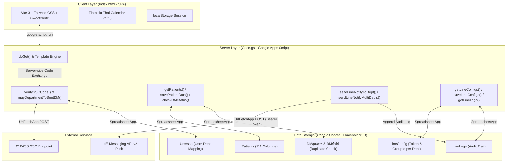
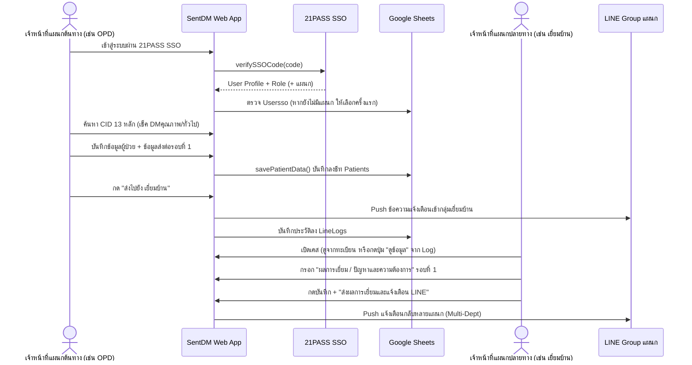
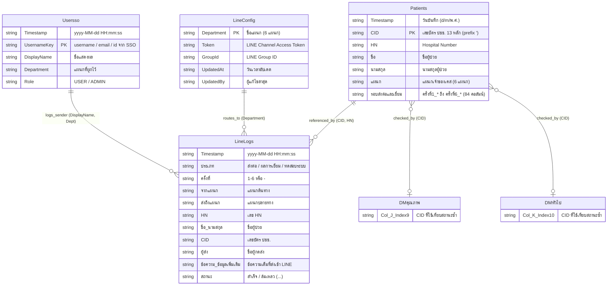

# รายงานคำชี้แจงทางเทคนิคและเอกสารประกอบระบบ (IT & UX Technical Response)

**โครงการ:** Pro-Health Data BKK South — ระบบส่งต่อผู้ป่วยสหวิชาชีพ คลินิกเบาหวาน (**SentDM / Refer system(DM)**)  
**จัดทำโดย:** ทีมพัฒนาและเจ้าของนวัตกรรม Pro-Health Data BKK South  
**วัตถุประสงค์:** ใช้ตอบชุดคำถามทางเทคนิคจากทีม IT สนับสนุนการตรวจสอบหน้าจอ (UX Audit) และประกอบการส่งต่อผู้บริหาร  
**เวอร์ชันเอกสาร:** 1.0 (สกัดข้อมูลจริงจากซอร์สโค้ดต้นฉบับและชุด Demo Mock-up)

> [!IMPORTANT]
> **นโยบายความปลอดภัยและข้อมูลจำลอง (Security & Sanitization Notice)**  
> เพื่อความปลอดภัยของข้อมูลส่วนบุคคล (PDPA) และโครงสร้างพื้นฐาน Production เอกสารฉบับนี้และโฟลเดอร์ `Demo_SentDM` **ได้ตัดทอนและแทนที่ข้อมูลสำคัญทั้งหมด** ได้แก่ Google Sheet ID จริง, URL ของระบบ 21PASS SSO จริง, LINE Channel Access Token จริง, LINE Group ID จริง รวมถึงบัญชีผู้ใช้และรหัสผ่านจริง โดยใช้ค่าสมมติ (`PLACEHOLDER` / `MOCK_*`) และข้อมูลผู้ป่วยจำลองทั้งหมด

---

## บทสรุปจุดแข็งของนวัตกรรม (Innovation Highlights)

**SentDM** เป็นเว็บแอปพลิเคชันส่งต่อผู้ป่วยสหวิชาชีพสำหรับผู้ป่วยโรคเบาหวาน (DM) ที่ออกแบบมาเพื่อลดรอยต่อระหว่าง **6 แผนกหลัก** ได้แก่ `OPD`, `เยี่ยมบ้าน`, `กายภาพบำบัด`, `สังคมสงเคราะห์`, `ก้าวใหม่พลัส` และ `สุขภาพจิต` โดยมีจุดแข็งสำคัญจากสถาปัตยกรรมปัจจุบันดังนี้:

1. **Zero-Infrastructure Deployment:** พัฒนาบน Google Apps Script + Google Sheets + Vue 3 (Single-Page Application) ทำให้ทีมคลินิกเริ่มต้นใช้งานได้ทันทีโดยไม่มีค่าเซิร์ฟเวอร์รายเดือน
2. **Real-Time Multidisciplinary Alert (LINE Messaging API):** แจ้งเตือนข้ามแผนกแบบทันทีทั้งขา **"ส่งต่อ"** และขา **"รายงานผลการเยี่ยม"** (เลือกส่งหลายแผนกพร้อมกันได้) พร้อมบันทึก Log ตรวจสอบย้อนกลับได้ทุกข้อความ
3. **Clinical Decision Support & Duplicate Prevention:** คำนวณอายุอัตโนมัติจากวันเกิด พ.ศ., แปลผลความดันโลหิต (`BP`) และระดับน้ำตาลปลายนิ้ว (`DTX NPO` / `DTX หลังอาหาร`) พร้อมสีเตือนอัตโนมัติ และตรวจสอบความซ้ำซ้อนกับทะเบียน `DMคุณภาพ` และ `DMทั่วไป` ด้วยเลขบัตรประชาชน 13 หลัก
4. **Role & Ownership Separation:** แยกสิทธิ์ชัดเจนระหว่าง **แผนกเจ้าของเคส** (บันทึก/แก้ไขข้อมูลส่งต่อ) และ **แผนกปลายทาง** (บันทึกผลการเยี่ยมและความต้องการต่อเนื่อง) ลดการแก้ไขข้อมูลทับกันโดยไม่ตั้งใจ
5. **Responsive & Thai-First UX:** รองรับปฏิทินปี พ.ศ. (`ThaiDatePicker`) และมีปุ่มสลับมุมมอง Desktop / Mobile (`400px`) สำหรับทีมออกเยี่ยมบ้านภาคสนาม

---

## คำถามข้อที่ 1: User Manual & Specs (คู่มือการใช้งาน ผังระบบ และรายการฟังก์ชัน)

### 1.1 ผังสถาปัตยกรรมระบบ (System Architecture)

ระบบทำงานแบบ Client-Server ภายใน Google Apps Script Runtime (`HtmlService` IFRAME Sandbox) สื่อสารผ่าน `google.script.run` ไปยัง Backend (`Code.gs`) เพื่อจัดการฐานข้อมูล Google Sheets และเชื่อมต่อ API ภายนอก 2 ระบบ คือ **21PASS SSO** และ **LINE Messaging API**

### 1.2 ผังการทำงานหลัก (Core Referral & Visit Workflow)

### 1.3 รายการฟังก์ชันทั้งหมดของระบบ (Functional List)

สกัดจากซอร์สโค้ดจริง (`Code.gs` และ `Index.html`) แบ่งตามโมดูลและสิทธิ์การใช้งาน (`ADMIN`, `USER`, `GUEST`):

| รหัส | โมดูล / หน้าจอ | ชื่อฟังก์ชัน (Code Symbol) | รายละเอียดการทำงาน | สิทธิ์ที่เข้าถึงได้ |
| :--- | :--- | :--- | :--- | :--- |
| **F-01** | ยืนยันตัวตน (Auth) | `doGet`, `verifySSOCode`, `mapDepartmentToSentDM` | รับ One-Time Code จาก 21PASS SSO แลกเปลี่ยนข้อมูลผู้ใช้และแปลงชื่อแผนกเข้าสู่ 6 แผนกมาตรฐาน (รองรับทั้ง Server-side Instant Exchange และ Client Fallback) | ทุกคน |
| **F-02** | เลือกแผนกครั้งแรก | `promptFirstTimeDepartmentSelection`, `saveUserSSODepartment` | หากผู้ใช้งานใหม่ยังไม่มีข้อมูลแผนกในชีท `Usersso` ระบบจะแสดง Popup ให้เลือก 1 ใน 6 แผนกและบันทึกถาวร | `USER`, `ADMIN` (ครั้งแรก) |
| **F-03** | โหมดผู้เยี่ยมชม | `guestLogin` | เข้าใช้งานแบบ Read-only เฉพาะหน้า Dashboard สรุปภาพรวม (ซ่อนเมนูทะเบียน, ฟอร์ม, ค้างเยี่ยม, ประวัติแจ้งเตือน) | `GUEST` |
| **F-04** | ทะเบียนรายชื่อ (`list`) | `getPatients`, `filteredPatients`, `countReferrals`, `countVisits` | แสดงรายชื่อผู้ป่วยทั้งหมด ค้นหาด้วย `CID`, `HN`, `ชื่อ`, `นามสกุล` กรองตาม 6 แผนก และนับจำนวนครั้งส่งต่อ/ครั้งเยี่ยมต่อราย | `USER`, `ADMIN` |
| **F-05** | ค้นหา/สร้างผู้ป่วย (`form`) | `loadPatientByCid`, `checkDMStatus`, `resetForm` | ค้นหาด้วยเลขบัตรประชาชน 13 หลัก หากพบจะโหลดข้อมูลเดิมและล็อก `HN` + `แผนก` เจ้าของเคส พร้อมตรวจสถานะ `ใหม่`/`ซ้ำ` จากชีท `DMคุณภาพ` และ `DMทั่วไป` | `USER`, `ADMIN` |
| **F-06** | คำนวณทางคลินิกอัตโนมัติ | `calculateAge`, `calcBP`, `calcDtxNpo`, `calcDtxPost` | คำนวณอายุจากวันเกิด พ.ศ. และแปลผลระดับความรุนแรงของ `BP`, `DTX_NPO`, `DTX_หลังอาหาร` พร้อมไฮไลต์สีเตือนทันที | `USER`, `ADMIN` |
| **F-07** | ส่งต่อสหวิชาชีพ (รอบ 1–6) | `confirmLineNotify`, `sendLineNotifyToDept` | แสดงปุ่มส่งต่อ 5 ปุ่ม (ทุกแผนกยกเว้นแผนกตนเอง) แสดงตัวอย่างข้อความยืนยัน และยิง LINE Push ไปยังกลุ่มแผนกปลายทาง **(เปิดให้กรอกเฉพาะแผนกเจ้าของเคส)** | เจ้าของเคส (`user.dept === form.แผนก`) |
| **F-08** | บันทึกผลการเยี่ยม (รอบ 1–6) | `confirmLineNotifyVisit`, `sendLineNotifyMultiDepts` | บันทึกวันที่เยี่ยม กิจกรรมพยาบาล ผู้รายงาน และ Checkboxes ปัญหา/ความต้องการ 7 รายการ พร้อมส่ง LINE แจ้งเตือนกลับได้หลายแผนกพร้อมกัน **(แผนกเจ้าของเคสดูได้อย่างเดียว)** | แผนกอื่น (`user.dept !== form.แผนก`) |
| **F-09** | บันทึกข้อมูลผู้ป่วย | `savePatientData` | บันทึก/อัปเดตแถวข้อมูลลงชีท `Patients` ป้องกันการสร้าง CID ซ้ำ และเก็บค่าผลการแปล BP/DTX ลงชีท | `USER`, `ADMIN` |
| **F-10** | ผู้ป่วยที่รอผลการเยี่ยม (`pending`) | `pendingVisits` | แสดงรายการผู้ป่วยที่มี `วันที่ส่งต่อ` แต่ยังไม่มี `วันที่เยี่ยม` โดยตรวจจากรอบล่าสุด (รอบ 6 ลงมารอบ 1) | `USER`, `ADMIN` |
| **F-11** | ประวัติการแจ้งเตือน (`logs`) | `getLineLogs`, `showLogDetail`, `openPatientFromLog` | แสดงตาราง Log การส่ง LINE ย้อนหลัง กรองตามแผนก/ประเภท (`ส่งต่อ`, `ผลการเยี่ยม`, `ทดสอบระบบ`) และกดปุ่ม **"ดูข้อมูล"** เพื่อเปิดฟอร์มผู้ป่วยตรงรอบนั้นทันที | `USER`, `ADMIN` |
| **F-12** | สรุปข้อมูลการส่งต่อ (`dashboard`) | `dashboardStats` | สรุปจำนวนผู้ป่วยทั้งหมด (แยกตาม 6 แผนก), จำนวนการส่งต่อรวม, จำนวนการเยี่ยมรวม และแยกตามรอบครั้งที่ 1–6 กรองตามช่วงวันที่ พ.ศ. และแผนก | `GUEST`, `USER`, `ADMIN` |
| **F-13** | ตั้งค่า LINE แผนก (`lineConfig`) | `getLineConfigs`, `saveLineConfigs`, `testSendLine` | จัดการ `Channel Access Token` และ `Group ID` ของทั้ง 6 แผนก พร้อมปุ่ม **"ทดสอบส่ง"** เข้ากลุ่ม LINE จริง | `ADMIN` เท่านั้น |
| **F-14** | โหมดมือถือ / คอมฯ | `toggleMode` | สลับขนาด Viewport เป็น `400px` เพื่อจำลองและใช้งานบนหน้าจอมือถือได้สะดวก | ทุกคน |

### 1.4 แนวทางการใช้งานระบบเบื้องต้น (User Manual Summary)

1. **การเข้าสู่ระบบ:** เปิด URL ของระบบ กดปุ่ม **"เข้าสู่ระบบด้วย 21PASS SSO"** (หรือเลือก **"เข้าสู่ระบบแบบผู้เยี่ยมชม"** หากต้องการดูเฉพาะ Dashboard) หากเข้าครั้งแรกให้เลือกแผนกประจำของตนเอง
2. **การลงทะเบียน/ส่งต่อผู้ป่วย (โดยแผนกเจ้าของเคส):**
   - ไปที่เมนู **บันทึกข้อมูล** -> กรอกเลขบัตรประชาชน 13 หลัก -> กด **ตรวจสอบ**
   - กรอกประวัติทั่วไป การติดต่อ และประวัติทางการแพทย์ (ระบบจะคำนวณอายุ และแปลผล BP / DTX ให้อัตโนมัติ)
   - เปิดหัวข้อ **ครั้งที่ 1** -> ระบุวันที่ส่งต่อและข้อมูลเพิ่มเติม -> กดปุ่ม **ส่งไปยัง [ชื่อแผนกปลายทาง]** เพื่อยืนยันและส่งแจ้งเตือน LINE -> กดปุ่ม **บันทึกข้อมูล** ด้านล่าง
3. **การรับเคสและรายงานผลการเยี่ยม (โดยแผนกปลายทาง):**
   - เมื่อได้รับแจ้งเตือนทาง LINE ให้เข้าเมนู **ผู้ป่วยที่รอผลการเยี่ยม** หรือ **รายงานการแจ้งเตือน** -> กด **ดูข้อความ** -> กด **ดูข้อมูล** ระบบจะเปิดฟอร์มผู้ป่วยตรงรอบนั้นให้ทันที
   - เลื่อนไปที่ส่วนสีม่วง **"ผลการเยี่ยม / การดูแลต่อเนื่อง"** -> กรอกวันที่เยี่ยม กิจกรรมพยาบาล ผู้รายงาน และติ๊กปัญหา/ความต้องการ -> กด **บันทึกข้อมูล** และกด **ส่งผลการเยี่ยมและแจ้งเตือน LINE** เพื่อแจ้งกลับแผนกเจ้าของเคสหรือแผนกที่เกี่ยวข้อง

---

## คำถามข้อที่ 2: Demo Account & Staging Access (บัญชีทดสอบ ข้อมูลจำลอง และวิธีรัน)

### 2.1 ระบบ Demo Mock-up ที่จัดเตรียมไว้สำหรับ UX Audit

ทีมพัฒนาได้สร้างชุด **Standalone Demo Mock-up** ไว้ในโฟลเดอร์นี้ (`Demo_SentDM/index.html`) ซึ่งจำลองการทำงานของ `Code.gs` และ `Index.html` ครบทั้ง 6 หน้าจอ โดยทำงานบน Browser ได้ทันทีแบบ Offline และเก็บสถานะจำลองไว้ใน `localStorage` ของเบราว์เซอร์

**วิธีรันระบบทดสอบ (Demo Mock-up):**
1. เปิดไฟล์ `Demo_SentDM/index.html` ด้วยเว็บเบราว์เซอร์สมัยใหม่ (Chrome, Edge, Safari) โดยตรง หรือรันผ่าน Local Web Server เช่น `python3 -m http.server 8080` แล้วเข้า `http://localhost:8080/Demo_SentDM/`
2. บนหน้าจอ Login สามารถกรอก **บัญชีจำลอง** ด้านล่าง หรือคลิกปุ่ม **"เลือกเข้าสู่ระบบด่วนตามบทบาท"** เพื่อทดสอบแต่ละแผนกได้ทันที
3. ขณะใช้งาน สามารถกดปุ่ม **"สลับแผนก/บทบาททดสอบ"** บนแถบ Demo ด้านบนเพื่อสลับจากแผนกต้นทาง (`OPD`) ไปเป็นแผนกปลายทาง (`เยี่ยมบ้าน`) เพื่อตรวจสิทธิ์การแก้ไขฟอร์ม (Read-only vs Editable) และสามารถกด **"รีเซ็ตข้อมูลจำลอง"** เพื่อคืนค่าเริ่มต้นได้ทุกเมื่อ

### 2.2 รายการบัญชีทดสอบจำลอง (Simulated Mock Accounts)

> [!NOTE]
> บัญชี Username และ Password ด้านล่างทั้งหมดเป็น **ข้อมูลจำลองที่สร้างขึ้นเฉพาะใน Demo Mock-up (`Demo_SentDM/index.html`) เท่านั้น** ไม่ใช่บัญชีจริงของระบบ 21PASS SSO หรือ Production

| ลำดับ | บทบาท (Role) | แผนก (Department) | Username (จำลอง) | Password (จำลอง) | ขอบเขตการทดสอบ UX |
| :---: | :--- | :--- | :--- | :--- | :--- |
| 1 | `ADMIN` | `OPD` | `demo_admin` | `demo_admin_pw` | ทดสอบได้ทุกเมนู รวมถึงเมนู **ตั้งค่า LINE แผนก** |
| 2 | `USER` | `OPD` | `demo_opd` | `demo1234` | สร้าง/ส่งต่อเคส OPD และดูผลการเยี่ยมของแผนกอื่นแบบ Read-only |
| 3 | `USER` | `เยี่ยมบ้าน` | `demo_home` | `demo1234` | รับเคสส่งต่อจาก OPD เพื่อกรอกผลการเยี่ยมและส่ง LINE กลับหลายแผนก |
| 4 | `USER` | `กายภาพบำบัด` | `demo_pt` | `demo1234` | ทดสอบธีมสี Teal และ Flow ส่งต่อ/รับเยี่ยมแผนกกายภาพฯ |
| 5 | `USER` | `สังคมสงเคราะห์` | `demo_social` | `demo1234` | ทดสอบธีมสี Amber และ Flow แผนกสังคมสงเคราะห์ |
| 6 | `USER` | `ก้าวใหม่พลัส` | `demo_kaomai` | `demo1234` | ทดสอบธีมสี Indigo และเคสส่งต่อเร่งด่วน |
| 7 | `USER` | `สุขภาพจิต` | `demo_mental` | `demo1234` | ทดสอบธีมสี Rose และ Flow แผนกสุขภาพจิต |
| 8 | `GUEST` | `GUEST` | *(ปุ่มผู้เยี่ยมชม)* | *(ไม่ต้องใช้รหัส)* | ทดสอบสิทธิ์จำกัดการเข้าถึง (ดูได้เฉพาะหน้า Dashboard) |
| 9 | `NEW_USER` | *(ยังไม่มีแผนก)* | *(ปุ่มเข้าครั้งแรก)* | *(ไม่ต้องใช้รหัส)* | ทดสอบ Popup เลือกแผนกครั้งแรก (`promptFirstTimeDepartmentSelection`) |

### 2.3 ข้อมูลจำลองเริ่มต้น (Mock Seed Data ใน Demo)

- **ผู้ป่วยจำลอง 6 ราย** (`1100100000001` – `1100100000006`, `HN690001` – `HN690006`) ครอบคลุมทุกแผนกทั้ง 6 แผนก มีครบทั้งเคสความดันปกติ-Stage2-วิกฤต, น้ำตาลปกติ-IFG-DM, เคสมีสาย NG/Foley's cath, เคสเยี่ยมเสร็จแล้ว และเคสค้างส่งต่อ (Pending Visits)
- **สถานะทะเบียน DM จำลอง:** เลขบัตร `1100100000001` และ `1100100000003` จะจำลองสถานะ `"ซ้ำ"` ใน `DMคุณภาพ`; เลขบัตร `1100100000002` และ `1100100000005` จะจำลองสถานะ `"ซ้ำ"` ใน `DMทั่วไป`
- **ประวัติ LINE Logs จำลอง 4 รายการ** และ **LINE Config จำลอง 6 แผนก** (ตั้งค่า Mock Token ไว้ 3 แผนก และเว้นว่างไว้ 3 แผนก เพื่อใช้ทดสอบทั้งกรณีส่งสำเร็จและกรณีแจ้งเตือนว่ายังไม่ตั้งค่า)

### 2.4 ข้อมูลสภาพแวดล้อม Staging (สำหรับทีมงานเติมข้อมูลเมื่อ Deploy จริง)

หากทีมงานต้องการ Deploy Google Apps Script + Google Sheet ชุด Staging แยกออกจาก Production ให้กรอกรายละเอียดในตารางด้านล่างก่อนส่งต่อให้ทีม UX (ห้ามใส่ Credential ของ Production):

| รายการ (Staging Environment) | ค่าสำหรับใช้งานทดสอบ (กรอกเพิ่มเติม) | หมายเหตุ |
| :--- | :--- | :--- |
| **Staging Web App URL** | `[รอระบุ URL ของ Apps Script /exec สำหรับ Staging]` | ต้องใช้คนละ Deployment กับ Production |
| **Staging Google Sheet ID** | `[รอระบุ Sheet ID ของฐานข้อมูลจำลองบน Staging]` | ต้องไม่ชี้ไปยังชีทข้อมูลผู้ป่วยจริง |
| **21PASS SSO (Staging Account)** | `Username: [รอระบุ]` / `Password: [รอระบุ]` | ใช้บัญชีทดสอบของระบบ 21PASS Staging |
| **LINE Test Group / Bot** | `Bot Name: [รอระบุ]` / `Test Group: [รอระบุ]` | ใช้ LINE OA/กลุ่มทดสอบเพื่อไม่รบกวนกลุ่มงานจริง |

---

## คำถามข้อที่ 3: Database & Data Dictionary (โครงสร้างฐานข้อมูลและฟิลด์ทั้งหมด)

### 3.1 แผนภาพโครงสร้างฐานข้อมูล (Google Sheets Data Model)

ระบบใช้ Google Sheets 1 ไฟล์ (อ้างอิงผ่านตัวแปร `SHEET_ID` ใน `Code.gs`) ประกอบด้วย **6 ชีท (Tables)** ดังนี้:

### 3.2 Data Dictionary: ชีท `Patients` (รวม 111 คอลัมน์)

สกัดตรงจาก `setupDatabase()` ใน `Code.gs` และ `<input>` / `v-model` ใน `Index.html`:

#### ก. ข้อมูลหลักผู้ป่วยและประวัติการแพทย์ (คอลัมน์ที่ 1–27)

| ลำดับ | ชื่อคอลัมน์ / Field Key | ประเภทข้อมูล (Sheet/UI) | Input Type | ข้อกำหนด / กฎการทำงานในโค้ด |
| :---: | :--- | :--- | :--- | :--- |
| 1 | `Timestamp` | String (`d/m/พ.ศ.`) | Auto | สร้างอัตโนมัติฝั่ง Server ตอนบันทึก/อัปเดต |
| 2 | `CID` | String (13 หลัก) | `text` (readonly หลังค้นหา) | ใส่ `'` นำหน้าตอนลง Sheet ป้องกันเลขเพี้ยน, ห้ามซ้ำเมื่อสร้างใหม่ |
| 3 | `HN` | String | `text` | ล็อกไม่ให้แก้ (`HN_locked`) หากเคยบันทึกค่าไว้แล้ว |
| 4 | `ชื่อ` | String | `text` | ชื่อผู้ป่วย |
| 5 | `นามสกุล` | String | `text` | นามสกุลผู้ป่วย |
| 6 | `แผนก` | Enum (6 แผนก) | `text` (readonly) | ล็อกอัตโนมัติตามแผนกของผู้สร้างเคส (`OPD`, `เยี่ยมบ้าน`, `กายภาพบำบัด`, `สังคมสงเคราะห์`, `ก้าวใหม่พลัส`, `สุขภาพจิต`) |
| 7 | `วันเกิด` | String (`dd/mm/พ.ศ.`) | `thai-date` (Flatpickr) | เปลี่ยนค่าแล้วเรียก `calculateAge()` คำนวณอายุอัตโนมัติ |
| 8 | `อายุ` | Number / String | `text` (readonly) | คำนวณจาก `(ปี ค.ศ. ปัจจุบัน + 543) - ปี พ.ศ. เกิด` |
| 9 | `ที่อยู่` | String | `textarea` | ที่อยู่ปัจจุบันสำหรับออกเยี่ยมบ้านและส่งต่อใน LINE |
| 10 | `เบอร์โทร` | String (max 10 หลัก) | `text` | ใส่ `'` นำหน้าตอนลง Sheet เพื่อรักษาเลข `0` ตัวหน้า |
| 11 | `ชุมชน` | String | `text` | ชื่อชุมชน (นำไปต่อท้ายที่อยู่ในข้อความ LINE) |
| 12 | `โรคร่วม` | String | `text` | โรคประจำตัว / โรคร่วม |
| 13 | `ส่วนสูง` | Number (cm) | `number` | ส่วนสูง (เซนติเมตร) |
| 14 | `น้ำหนัก` | Number (kg) | `number` | น้ำหนัก (กิโลกรัม) |
| 15 | `BP` | String (`sys/dia`) | `text` | ความดันโลหิต เช่น `120/80` |
| 16 | `ผล_BP` | Enum String | `text` (readonly, auto) | แปลผลอัตโนมัติ: `ปกติ`, `PreHT`, `Stage1`, `Stage2`, `ควรพบแพทย์ทันที`, `รูปแบบไม่ถูกต้อง` |
| 17 | `DTX_NPO` | Number (mg%) | `number` | ค่าน้ำตาลปลายนิ้วขณะอดอาหาร |
| 18 | `ผล_DTX_NPO` | Enum String | `text` (readonly, auto) | แปลผลอัตโนมัติ: `ปกติ`, `IFG`, `DM` |
| 19 | `DTX_หลังอาหาร` | Number (mg%) | `number` | ค่าน้ำตาลปลายนิ้วหลังอาหาร |
| 20 | `ผล_DTX_หลังอาหาร` | Enum String | `text` (readonly, auto) | แปลผลอัตโนมัติ: `ปกติ`, `IFG`, `DM` |
| 21 | `HbA1C` | Decimal (`step=0.1`) | `number` | ค่าน้ำตาลสะสม (`mg%`) |
| 22 | `วันที่ตรวจเจอ` | String (`dd/mm/พ.ศ.`) | `thai-date` | วันที่ตรวจพบภาวะ/อาการ |
| 23 | `สาเหตุที่ส่ง` | String | `text` | เหตุผลหลักของการส่งต่อ (นำไปแสดงในข้อความ LINE) |
| 24 | `วันที่มาพบแพทย์` | String (`dd/mm/พ.ศ.`) | `thai-date` | วันที่นัด/มาพบแพทย์ (กรณีเยี่ยมบ้านเจอ) |
| 25 | `NG` | Boolean (`TRUE`/`FALSE`) | `checkbox` | สถานะการใส่สายให้อาหาร (NG Tube) |
| 26 | `F_C` | Boolean (`TRUE`/`FALSE`) | `checkbox` | สถานะการใส่สายสวนปัสสาวะ (Foley's Catheter) |
| 27 | `Labประจำปี` | String | `text` | สรุปผล/รายการ Lab ประจำปี |

#### ข. ข้อมูลการส่งต่อและผลการเยี่ยมซ้ำ 6 รอบ (คอลัมน์ที่ 28–111: รอบละ 14 ฟิลด์ x 6 ครั้ง = 84 คอลัมน์)

แทน `{i}` ด้วยเลข `1` ถึง `6`:

| ลำดับในรอบ | ชื่อคอลัมน์ / Field Key | ประเภทข้อมูล | ผู้มีสิทธิ์แก้ไข | รายละเอียด |
| :---: | :--- | :--- | :--- | :--- |
| 1 | `ครั้งที่{i}_วันที่ส่งต่อ` | String (`dd/mm/พ.ศ.`) | แผนกเจ้าของเคส | วันที่ส่งต่อรอบที่ `i` (ใช้คำนวณ `pendingVisits` และ `dashboardStats`) |
| 2 | `ครั้งที่{i}_ข้อมูลเพิ่มเติม` | String | แผนกเจ้าของเคส | รายละเอียดเพิ่มเติมในการส่งต่อรอบที่ `i` |
| 3 | `ครั้งที่{i}_วันที่เยี่ยม` | String (`dd/mm/พ.ศ.`) | แผนกปลายทาง | วันที่ออกเยี่ยม/ดูแล (ใช้ปิดสถานะค้างส่งต่อ) |
| 4 | `ครั้งที่{i}_กิจกรรมพยาบาล` | String | แผนกปลายทาง | กิจกรรมพยาบาล/การดูแลที่ดำเนินการ |
| 5 | `ครั้งที่{i}_ผู้รายงาน` | String | แผนกปลายทาง | ชื่อผู้รายงานผลการเยี่ยม |
| 6 | `ครั้งที่{i}_ทำแผลต่อเนื่อง` | Boolean | แผนกปลายทาง | Checkbox ความต้องการทำแผลต่อเนื่อง |
| 7 | `ครั้งที่{i}_ระบุแผล` | String | แผนกปลายทาง | แสดงเมื่อติ๊ก `ทำแผลต่อเนื่อง` |
| 8 | `ครั้งที่{i}_เปลี่ยนสาย_NG` | Boolean | แผนกปลายทาง | Checkbox ความต้องการเปลี่ยนสาย NG |
| 9 | `ครั้งที่{i}_เปลี่ยน_Foleys_cath` | Boolean | แผนกปลายทาง | Checkbox ความต้องการเปลี่ยน Foley's cath |
| 10 | `ครั้งที่{i}_ทำกายภาพ` | Boolean | แผนกปลายทาง | Checkbox ความต้องการทำกายภาพบำบัด |
| 11 | `ครั้งที่{i}_สังคมสงเคราะห์` | Boolean | แผนกปลายทาง | Checkbox ความต้องการด้านสังคมสงเคราะห์ |
| 12 | `ครั้งที่{i}_เจาะเลือด` | Boolean | แผนกปลายทาง | Checkbox ความต้องการเจาะเลือด |
| 13 | `ครั้งที่{i}_อื่นๆ_เช็ค` | Boolean | แผนกปลายทาง | Checkbox ความต้องการอื่นๆ |
| 14 | `ครั้งที่{i}_อื่นๆ_ระบุ` | String | แผนกปลายทาง | แสดงเมื่อติ๊ก `อื่นๆ_เช็ค` |

### 3.3 Data Dictionary: ชีทสนับสนุนอื่น ๆ (`Usersso`, `LineConfig`, `LineLogs`, `DMคุณภาพ`, `DMทั่วไป`)

| ชีท | คอลัมน์ทั้งหมด (เรียงตามลำดับในชีท) | คำอธิบาย |
| :--- | :--- | :--- |
| **`Usersso`** | `Timestamp`, `UsernameKey`, `DisplayName`, `Department`, `Role` | จับคู่บัญชีจาก 21PASS SSO เข้ากับแผนกและสิทธิ์ใน SentDM |
| **`LineConfig`** | `Department`, `Token`, `GroupId`, `UpdatedAt`, `UpdatedBy` | เก็บการตั้งค่า LINE Messaging API ของทั้ง 6 แผนก |
| **`LineLogs`** | `Timestamp`, `ประเภท`, `ครั้งที่`, `จากแผนก`, `ส่งถึงแผนก`, `HN`, `ชื่อ-นามสกุล`, `CID`, `ผู้ส่ง`, `ข้อความ/ข้อมูลเพิ่มเติม`, `สถานะ` | บันทึกประวัติการแจ้งเตือน LINE ทุกครั้ง (ทั้งสำเร็จและล้มเหลว) |
| **`DMคุณภาพ`** | ใช้คอลัมน์ Index `9` (คอลัมน์ J) | เก็บ CID สำหรับเช็คสถานะซ้ำในคลินิกเบาหวานคุณภาพ (`checkDMStatus`) |
| **`DMทั่วไป`** | ใช้คอลัมน์ Index `10` (คอลัมน์ K) | เก็บ CID สำหรับเช็คสถานะซ้ำในคลินิกเบาหวานทั่วไป (`checkDMStatus`) |

### 3.4 กฎการคำนวณผลทางคลินิกอัตโนมัติ (Clinical Rules ใน `Index.html`)

- **การแปลผลความดันโลหิต (`calcBP`):** ใช้ค่าที่รุนแรงกว่าของ Systolic / Diastolic (`Math.max(sysScore, diaScore)`):
  - `ควรพบแพทย์ทันที`: Sys `>= 180` หรือ Dia `>= 110`
  - `Stage2`: Sys `140–179` หรือ Dia `90–109`
  - `Stage1`: Sys `131–139` หรือ Dia `85–89`
  - `PreHT`: Sys `121–130` หรือ Dia `81–84`
  - `ปกติ`: Sys `<= 120` และ Dia `<= 80`
- **การแปลผลน้ำตาลอดอาหาร (`calcDtxNpo`):** `< 100` = `ปกติ`, `101–125` = `IFG`, `> 125` = `DM`
- **การแปลผลน้ำตาลหลังอาหาร (`calcDtxPost`):** `< 140` = `ปกติ`, `141–199` = `IFG`, `> 199` = `DM`

---

## คำถามข้อที่ 4: Current Pain Points / Tech Constraints (ข้อจำกัดเชิงเทคนิคและจุดเสี่ยงจากโค้ดจริง)

จากการวิเคราะห์สถาปัตยกรรมและซอร์สโค้ดต้นฉบับ (`Code.gs` และ `Index.html`) พบข้อจำกัดเชิงเทคนิคและจุดเสี่ยงที่สำคัญดังนี้:

| ด้าน | ข้อเท็จจริงที่พบในโค้ด (Observed Technical Constraint) | ผลกระทบ / Pain Point ที่อาจเกิดขึ้น | แนวทางปรับปรุงที่แนะนำ |
| :--- | :--- | :--- | :--- |
| **1. โครงสร้างฐานข้อมูลแบบ Wide Table** | ชีท `Patients` เก็บรอบส่งต่อ/เยี่ยมแบบขยายคอลัมน์แนวนอน **111 คอลัมน์** (จำกัดที่ 6 รอบ) และไม่ได้เก็บฟิลด์ "แผนกปลายทางที่รับส่งต่อ" ในชีท `Patients` (ข้อมูลปลายทางอยู่ใน `LineLogs` เท่านั้น) | ผู้ป่วยเรื้อรังที่ต้องส่งต่อเกิน 6 ครั้งไม่สามารถบันทึกเพิ่มในระบบเดิมได้ และหน้า `pendingVisits` ระบุได้แค่ว่าค้างเยี่ยมรอบไหน แต่กรองรายแผนกปลายทางโดยตรงไม่ได้ | แยกตารางแบบ Relational: `Patients` (1 แถว/คน) และ `Referrals_Visits` (1 แถว/ครั้ง) จะรองรับไม่จำกัดรอบและระบุ `targetDept` ชัดเจน |
| **2. ความปลอดภัยของ Session & Server-side Auth** | ฝั่ง Client เก็บ User Session ใน `localStorage` (`sentdm_user_session`) และตรวจสิทธิ์ `isAdmin` / `user.dept` ที่ Vue Frontend เป็นหลัก ขณะที่ฟังก์ชันใน `Code.gs` (`savePatientData`, `saveLineConfigs`, `getPatients`) ยังไม่ได้ตรวจ Token/Session ฝั่ง Server ซ้ำ | ผู้ใช้ที่มีทักษะทางเทคนิคอาจแก้ไข `localStorage` หรือเรียก `google.script.run` ข้ามสิทธิ์ได้ และความเสี่ยงเรื่องข้อมูล PII + LINE Token เก็บแบบ Plaintext ใน Google Sheet และเคยถูก Hardcode ค่าเริ่มต้นในโค้ด | ย้าย Secrets (`SHEET_ID`, `SSO_CONFIG`, `LINE Token`) ไปเก็บใน `PropertiesService` (Script Properties), เพิ่ม Server-side Session Token (HMAC/CacheService) และ Masking Token บนหน้า Admin |
| **3. Concurrency & Race Condition** | `savePatientData` ใช้ `_rowIndex` ที่ Client โหลดไว้ตอนเปิดหน้าเว็บ และสั่ง `setValues([rowData])` ทับทั้ง 111 คอลัมน์ โดยยังไม่มี `LockService` หรือ Version Check | หากเจ้าหน้าที่ 2 แผนกเปิดผู้ป่วยคนเดียวกันและกดบันทึกไล่เลี่ยกัน ข้อมูลที่อีกฝ่ายเพิ่งแก้อาจถูกเขียนทับ (Last-Write-Wins) หรือแถวคลาดเคลื่อนหากมีการแทรก/ลบแถว | ใช้ `LockService.getScriptLock()` ใน `Code.gs` และตรวจ `CID` เพื่อหาแถวล่าสุดฝั่ง Server ก่อนบันทึก หรืออัปเดตเฉพาะคอลัมน์ที่มีการเปลี่ยนแปลง |
| **4. ประสิทธิภาพและ GAS Quota** | `getPatients()` และ `getLineLogs()` ดึงข้อมูลทั้งหมดในชีทมาส่งให้ Browser แล้วจึงค้นหา/กรอง/คำนวณ Dashboard ใน JavaScript ฝั่ง Client | เมื่อข้อมูลสะสมเกิน 3,000–5,000 แถว เวลาโหลดจะช้าลงอย่างชัดเจน และอาจชนลิมิตเวลา/โควตาของ Google Apps Script (Execution Limit / Payload Size) | เพิ่ม Server-side Pagination / Query Filtering หรือย้ายฐานข้อมูลไป Cloud SQL / Firestore / PostgreSQL ในระยะถัดไป |
| **5. ความไม่สอดคล้องของวันที่ & Boundary Edge Case** | 1) รูปแบบวันที่ปะปนกัน 3 แบบ: `Patients.Timestamp` (`d/m/พ.ศ.` ไม่มี 0 นำหน้า), `ThaiDatePicker` (`dd/mm/พ.ศ.`), `LineLogs` (`yyyy-MM-dd`) 2) `calcDtxNpo` เช็ค `< 100` และ `>= 101` (ค่า `100` พอดีคืนค่าว่าง) และ `calcDtxPost` เช็ค `< 140` และ `>= 141` (ค่า `140` พอดีคืนค่าว่าง) | ช่วงวันที่อาจกรองผิดพลาดในบางกรณี และหากกรอก `DTX_NPO = 100` หรือ `DTX_หลังอาหาร = 140` ช่องแปลผลจะเป็นค่าว่าง | ปรับเกณฑ์เป็น `>= 100 && <= 125` และ `>= 140 && <= 199` ตามลำดับ และปรับมาตรฐานวันที่เป็น `ISO 8601` ภายในฐานข้อมูล |
| **6. การพึ่งพา LINE Messaging API Quota** | การแจ้งเตือนใช้วิธี `push` (`https://api.line.me/v2/bot/message/push`) แยกส่งทีละแผนก | ข้อความแบบ Push นับโควตาข้อความรายเดือนของ LINE Official Account หากส่งต่อ/รายงานผลบ่อย โควตาฟรีอาจเต็มกลางเดือน | ติดตามโควตาผ่าน `LineLogs` หรือเพิ่ม Webhook / Flex Message สรุปรวม |

---

## คำถามข้อที่ 5: API & Integration (การเชื่อมต่อระบบภายนอก กทม. / สปสช.)

### 5.1 สถานะการเชื่อมต่อ API ที่มีอยู่แล้วในโค้ดปัจจุบัน

ระบบปัจจุบันรองรับการเชื่อมต่อกับระบบภายนอกผ่าน `UrlFetchApp` แล้ว **2 ระบบ** และฐานข้อมูลภายใน **1 ระบบ** ดังนี้:

1. **21PASS SSO Integration (Implemented):**
   - เชื่อมต่อผ่าน `verifySSOCode(code)` ด้วย `UrlFetchApp.fetch` (HTTP POST JSON + Query Parameters `action=exchange_code`, `code`, `client_id`, `client_secret`, `redirect_uri`)
   - รองรับการ Mapping ชื่อแผนกจาก SSO เข้าสู่ 6 แผนกหลักอัตโนมัติผ่าน `mapDepartmentToSentDM(rawDept)`
2. **LINE Messaging API v2 (Implemented):**
   - เชื่อมต่อผ่าน `sendLinePush()` ไปยัง Endpoint `https://api.line.me/v2/bot/message/push` ด้วย `Bearer Token` แยกตามแต่ละแผนก (6 แผนก) พร้อมรองรับการส่งแบบ Multi-Department และบันทึก Audit Log
3. **Google Sheets Internal Integration (Implemented):**
   - เชื่อมต่อชีททะเบียน `DMคุณภาพ` และ `DMทั่วไป` ผ่าน `SpreadsheetApp` เพื่อตรวจสอบความซ้ำซ้อนของรหัสบัตรประชาชน 13 หลักแบบ Real-time

### 5.2 สถานะการเชื่อมต่อระบบของ กทม. และ สปสช. (Gaps & Integration Roadmap)

- **สถานะปัจจุบัน:** **ยังไม่รองรับการเชื่อมต่อ API โดยตรงกับระบบของ กทม. (เช่น HIS ศูนย์บริการสาธารณสุข / BMA Health) หรือระบบของ สปสช. (NHSO Authen / e-Claim / MOPH)** ในซอร์สโค้ดปัจจุบันมีเพียง Endpoint `doGet(e)` สำหรับเสิร์ฟหน้าเว็บแอปพลิเคชัน ยังไม่มี `doPost(e)` หรือ REST API Client สำหรับดึง/ส่งข้อมูลเวชระเบียนหรือการเบิกจ่ายข้ามหน่วยงาน
- **ข้อจำกัดเชิงเทคนิคหากต้องการเชื่อมต่อจาก Google Apps Script โดยตรง:**
  1. **Dynamic Outbound IP & mTLS:** Google Apps Script ใช้ IP Pool ของ Google แบบ Dynamic และไม่รองรับ Client Certificate (mTLS) จึงไม่สามารถผ่านระบบของรัฐที่บังคับ **IP Whitelist** หรือ **mTLS / Smart Card Authentication** ได้โดยตรง
  2. **Data Standard Gap:** โครงสร้างคอลัมน์ภาษาไทยในชีท `Patients` ยังไม่ได้ Map เข้ากับมาตรฐานข้อมูลสุขภาพ เช่น **43 แฟ้ม** หรือ **HL7 FHIR** (ไม่มีรหัสสถานพยาบาล HCODE, รหัสโรค ICD-10, รหัสกิจกรรมเยี่ยมบ้านมาตรฐาน)
- **แนวทางพัฒนาต่อยอดที่แนะนำ (Recommended Integration Architecture):**
  - **ระยะสั้น (Quick Win):** เพิ่มฟังก์ชัน Export ข้อมูลเป็น CSV/Excel ตามโครงสร้าง Template ของ กทม./สปสช. และเพิ่ม `doPost(e)` Webhook แบบมี API Key/HMAC Signature สำหรับรับข้อมูลตั้งต้นจากระบบภายใน
  - **ระยะกลาง-ยาว (Production Integration):** จัดวาง **API Gateway / Middleware Proxy** (เช่น Cloud Run / Node.js บน Static IP หรือ Server ของ กทม.) คั่นกลางระหว่าง SentDM กับระบบ กทม./สปสช. เพื่อจัดการ OAuth2/mTLS/IP Whitelist และแปลงข้อมูล (Data Mapper) เป็นมาตรฐาน HL7 FHIR หรือ 43 แฟ้มอัตโนมัติ

---

*เอกสารนี้จัดทำขึ้นจากการตรวจสอบซอร์สโค้ดจริงทั้งหมดของระบบ SentDM เพื่อใช้ประกอบการประเมินโดยทีม IT, ทีม UX และผู้บริหาร สามารถปรับปรุงข้อมูลในส่วน Staging Environment (ข้อ 2.4) และแผนงาน Integration เพิ่มเติมได้ทันที*
