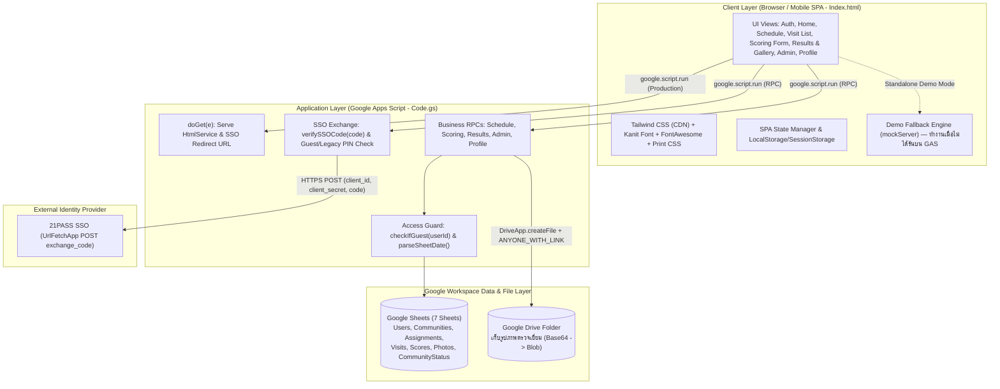
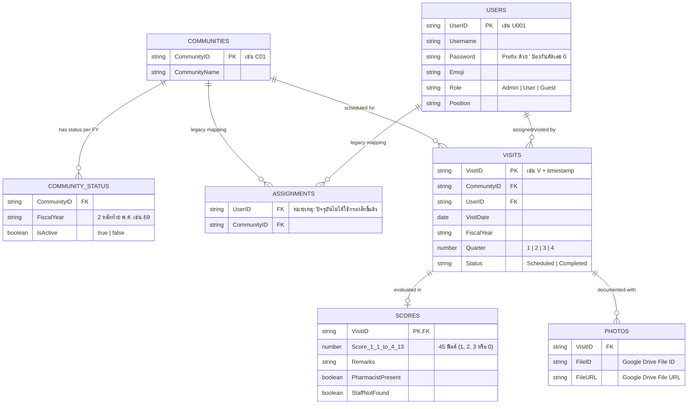

# รายงานข้อมูลเชิงเทคนิคและสถาปัตยกรรมระบบ (IT Technical Response)
## โครงการ: Pro-Health Data BKK South — ระบบประเมินศูนย์สุขภาพชุมชน (miniHHC)

> **จัดทำโดย:** ทีมพัฒนาและเจ้าของนวัตกรรม Pro-Health Data BKK South  
> **วัตถุประสงค์:** ใช้ประกอบการตอบชุดคำถามทีม IT, ส่งต่อทีม UX สำหรับการ Audit หน้าจอ (UX Audit) และประกอบการพิจารณาของผู้บริหาร  
> **ขอบเขตข้อมูล:** สกัดข้อมูลจริงจากซอร์สโค้ดต้นแบบ (`Code.gs` และ `Index.html`) พร้อมสภาพแวดล้อมจำลอง (`Demo_miniHHC/index.html`)  
> **หมายเหตุด้านความปลอดภัย:** เอกสารและ Demo Mock-up นี้ได้ **ตัดและปกปิดข้อมูลสำคัญทั้งหมด** (Google Sheet ID, Google Drive Folder ID, URL จริง, Client Secret และบัญชี/รหัสผ่านใช้งานจริง) โดยใช้บัญชีและข้อมูลจำลองทั้งหมดตามนโยบายความปลอดภัยข้อมูล

---

## บทสรุปผู้บริหารและจุดแข็งของนวัตกรรม (Executive Summary)

ระบบ **miniHHC (ระบบประเมินศูนย์สุขภาพชุมชน / Community Health Audit)** พัฒนาขึ้นเพื่อยกระดับกระบวนการตรวจเยี่ยมและประเมินคุณภาพศูนย์สุขภาพชุมชน (ศสช.) และอาสาสมัครสาธารณสุข (อสส.) ในพื้นที่กรุงเทพมหานคร (BKK South) จากเดิมที่ใช้เอกสารกระดาษและรวบรวมคะแนนด้วยตนเอง ให้เป็นระบบดิจิทัลแบบครบวงจร

### จุดแข็งหลักของนวัตกรรม
1. **Zero-Infrastructure & Low Total Cost of Ownership:** พัฒนาบน Google Apps Script + Google Sheets + Google Drive ทำให้หน่วยงานสามารถเริ่มใช้งานได้ทันทีโดยไม่ต้องจัดซื้อ Server หรือฐานข้อมูลเชิงพาณิชย์
2. **มาตรฐานการประเมิน 4 องค์ประกอบ (45 ตัวชี้วัด):** ครอบคลุมตั้งแต่สถานที่ตั้ง ผู้ให้บริการ (อสส.) การบริหารจัดการ/ครุภัณฑ์ ไปจนถึงคุณภาพการให้บริการ พร้อมระบบคำนวณคะแนนและเกรดอัตโนมัติ
3. **รองรับบริบทราชการไทยอย่างแท้จริง:** แปลงปีงบประมาณไทย (ต.ค.–ก.ย.) และปี พ.ศ./ค.ศ. อัตโนมัติ, บันทึกตัวชี้วัดการลงพื้นที่ร่วมกับเภสัชกร (`💊`), และจัดการกรณีลงพื้นที่แล้วไม่พบ อสส. (`StaffNotFound`) แยกออกจากการคำนวณค่าเฉลี่ยรวม
4. **ความโปร่งใสและพร้อมรายงานผู้บริหาร:** มี Dashboard สรุปสัดส่วนเกรดรายไตรมาส/รายปี, คลังภาพถ่ายหลักฐานการตรวจเยี่ยม, โหมด Guest (Read-only) สำหรับผู้เยี่ยมชมภายนอก และ CSS `@media print` สำหรับพิมพ์รายงานได้ทันที
5. **รองรับการยืนยันตัวตนรวมศูนย์ (21PASS SSO):** ออกแบบโครงสร้าง OAuth2-like Code Exchange เพื่อเชื่อมต่อกับระบบยืนยันตัวตนกลาง `21PASS SSO` พร้อมโหมด Demo Fallback ที่ทำงานได้แบบ Standalone ในเบราว์เซอร์

---

## คำถามข้อ 1: User Manual & Specs (คู่มือการใช้งาน ผังระบบ และรายการฟังก์ชัน)

### 1.1 สถาปัตยกรรมระบบ (System Architecture)

### 1.2 โครงสร้างสิทธิ์ผู้ใช้งาน (Role-Based Access Control - RBAC)

| บทบาท (`Role`) | คำอธิบาย | สิทธิ์การเข้าถึงหน้าจอ (UI Views) | สิทธิ์แก้ไขข้อมูล (Write Access) |
| :--- | :--- | :--- | :--- |
| **`Admin`** | ผู้ดูแลระบบ / หัวหน้าพยาบาล | เข้าถึงได้ทุกหน้า: `home`, `schedule`, `list`, `scoring`, `results`, `admin`, `profile` | อ่าน/เขียนทุกส่วน และเปิด-ปิดสถานะชุมชนรายปีงบประมาณ |
| **`User`** | ผู้ตรวจเยี่ยม (พยาบาล, เภสัชกร, นักสุขศึกษา, นักวิชาการฯ, แพทย์) | เข้าถึงได้ 6 หน้า: `home`, `schedule`, `list`, `scoring`, `results`, `profile` (ซ่อนเมนู `admin` ใน UI) | กำหนดวันตรวจ, บันทึกคะแนน/อัปโหลดภาพ, แก้ไขโปรไฟล์ตนเอง |
| **`Guest`** (`U_GUEST`) | ผู้เยี่ยมชมภายนอก / ผู้บริหารดูผล | เข้าถึงได้เฉพาะ: `home` (ปฏิทิน), `results` (Dashboard + ตารางคะแนน + แกลเลอรี), และดูแบบฟอร์ม `scoring` แบบ Read-only | **ไม่อนุญาตให้แก้ไขข้อมูล** (ป้องกันทั้งใน UI และฝั่ง `Code.gs` ด้วย `checkIfGuest()`) |

### 1.3 รายการฟังก์ชันทั้งหมด (Functional List)

สกัดจากฟังก์ชันจริงใน `Code.gs` และ `Index.html`:

| รหัส | โมดูล (Module) | ชื่อฟังก์ชัน / API (`Code.gs`) | หน้าที่การทำงานหลัก |
| :--- | :--- | :--- | :--- |
| **F-01** | ระบบเข้าสู่ระบบ & SSO | `doGet(e)`, `verifySSOCode(code)`, `authorizeSSOPermissions()` | สร้างหน้า SPA พร้อม URL เชื่อมต่อ 21PASS SSO และแลกเปลี่ยน One-Time `code` เป็นข้อมูลผู้ใช้และ Role |
| **F-02** | ระบบ Guest & Legacy PIN | `guestLogin()`, `getUsersForLogin()`, `verifyPassword()`, `registerUser()` | รองรับการเข้าสู่ระบบแบบ Guest (Read-only) และมีฟังก์ชัน Backend สำรองสำหรับการล็อกอินด้วย PIN 4 หลักและการลงทะเบียนผู้ใช้ใหม่ |
| **F-03** | หน้าหลัก / ปฏิทินตรวจ | `getHomeVisitData(fiscalYear)` | แสดงตารางนัดหมายการตรวจเยี่ยมแยกตามปีงบประมาณและไตรมาส (Q1–Q4) พร้อมสถานะ `Completed` / `Scheduled` |
| **F-04** | กำหนดวันเข้าตรวจ | `getVisitScheduleData(fiscalYear, userId, userRole)`, `saveVisitDate(data)` | กำหนดหรือแก้ไขวันที่เข้าตรวจเยี่ยมของแต่ละชุมชนที่เปิดใช้งาน โดยจำกัดช่วงวันที่ (`minDate`/`maxDate`) ให้ตรงกับไตรมาสของปีงบประมาณไทย |
| **F-05** | รายการตรวจที่ต้องลงคะแนน | `getVisitsForScoring(fiscalYear, userId, userRole)` | แสดงรายการนัดตรวจเยี่ยมแยกตามไตรมาส พร้อมสถานะ `รอลงคะแนน` หรือ `เสร็จสิ้น` |
| **F-06** | แบบลงคะแนนตรวจประเมิน | `getScoringFormData(visitId)`, `saveScoresAndPhotos(formData)` | แสดงแบบประเมิน 4 องค์ประกอบ (45 ตัวชี้วัด), ปุ่มลัด "ให้คะแนนเต็ม", ตัวเลือก "ไม่พบเจ้าหน้าที่ (`StaffNotFound`)", ตัวเลือก "มีเภสัชกรร่วมตรวจ (`PharmacistPresent`)", หมายเหตุ และอัปโหลดภาพถ่ายสูงสุด 10 รูป |
| **F-07** | แดชบอร์ด & สรุปผลคะแนน | `getResultsData(fiscalYear)`, `getGrade(score)` | คำนวณคะแนนรวม รายไตรมาส และค่าเฉลี่ยทั้งปี, จัดเกรดอัตโนมัติ, แสดงสัดส่วนเกรดและอัตราการลงพื้นที่ร่วมกับเภสัชกร (`💊`), ซ่อน/แสดงศูนย์ที่ปิด, และพิมพ์รายงาน (`window.print()`) |
| **F-08** | แกลเลอรีภาพถ่าย | `getResultsData(fiscalYear)` (`photos`) | แสดงคลังภาพถ่ายหลักฐานการตรวจเยี่ยม กรองตามชุมชนและไตรมาส (Q1–Q4) |
| **F-09** | จัดการระบบ (แอดมิน) | `getAdminData(fiscalYear)`, `saveAdminData(data)` | เปิด/ปิดสถานะการให้บริการของแต่ละศูนย์สุขภาพชุมชนแยกตามปีงบประมาณ (`CommunityStatus`) |
| **F-10** | ข้อมูลส่วนตัว | `getUserProfile(userId)`, `updateUserProfile(data)` | แก้ไข Emoji ประจำตัว, ตำแหน่งงาน และเปลี่ยนรหัส PIN 4 หลัก |

### 1.4 คู่มือการใช้งานโดยย่อและเกณฑ์การตัดเกรด (User Manual & Grading Criteria)

#### ขั้นตอนการใช้งานหลัก (Operational Workflow)
1. **เข้าสู่ระบบ:** ผู้ตรวจเยี่ยมกดปุ่ม `เข้าสู่ระบบด้วย 21PASS SSO` (หรือเลือก `Guest` เพื่อดูรายงานอย่างเดียว)
2. **ตั้งค่าศูนย์ที่เปิดให้บริการ (Admin):** ผู้ดูแลระบบไปที่เมนู `จัดการระบบ (แอดมิน)` เลือกปีงบประมาณ และติ๊กเปิด/ปิดศูนย์ฯ ที่เปิดดำเนินการในปีนั้น แล้วกดบันทึก
3. **วางแผนวันตรวจเยี่ยม:** ไปที่เมนู `กำหนดวันเข้าตรวจ` เลือกปีงบประมาณและไตรมาส (Q1–Q4) จากนั้นเลือกวันที่ลงพื้นที่ของแต่ละชุมชน (ระบบจำกัดช่วงวันที่ให้ตรงกับไตรมาสอัตโนมัติ)
4. **ลงพื้นที่และบันทึกคะแนน:** ไปที่เมนู `ลงคะแนนตรวจประเมิน` เลือกชุมชนที่ต้องการประเมิน:
   - กรณีพบเจ้าหน้าที่/อสส.: ให้คะแนนรายข้อทั้ง 45 ข้อ (1–3 คะแนน) หรือกด `ให้คะแนนเต็ม` แล้วปรับแก้เฉพาะข้อที่ไม่ผ่าน, ระบุว่ามีเภสัชกรร่วมตรวจหรือไม่, กรอกหมายเหตุ และแนบภาพถ่าย (รวมสูงสุด 10 รูป)
   - กรณีไม่พบเจ้าหน้าที่/อสส.: ติ๊กช่อง `ไม่พบเจ้าหน้าที่` ระบบจะปิดช่องคะแนนรายข้อและบันทึกผลเป็น `1 คะแนน (ไม่พบ อสส.)` โดยไม่นำไปถ่วงค่าเฉลี่ยรวม
5. **ติดตามผลและพิมพ์รายงาน:** ไปที่เมนู `ผลคะแนนและภาพถ่าย` เพื่อดู Dashboard สรุปภาพรวม, ตารางคะแนนรายไตรมาส, กรองดูภาพถ่าย หรือกด `พิมพ์รายงาน`

#### เกณฑ์การคำนวณคะแนนและระดับคุณภาพ (`getGrade` ใน `Code.gs`)
แบบประเมินมีทั้งหมด **45 ข้อ** (1–3 คะแนนต่อข้อ รวมคะแนนเต็มทางทฤษฎี **135 คะแนน**) โดยแบ่งเกณฑ์การตัดเกรดตามฟังก์ชัน `getGrade(score)` ดังนี้:

| ช่วงคะแนน (`score`) | ระดับผลการประเมิน (`grade`) | สีแสดงผลในระบบ | หมายเหตุ |
| :--- | :--- | :--- | :--- |
| `>= 135` | **ดีเยี่ยม** | เขียวเข้ม (`#10b981`) | คะแนนเต็ม 135 คะแนน |
| `101 – 134` | **ดี** | เขียวอ่อน (`#84cc16`) | — |
| `68 – 100` | **พอใช้** | เหลือง (`#eab308`) | — |
| `35 – 67` | **ควรปรับปรุง** | แดง (`#ef4444`) | — |
| `2 – 34` | **ควรปรับปรุง** | แดง (`#ef4444`) | รองรับกรณีคะแนนต่ำกว่า 35 |
| `1` | **ไม่พบ อสส.** | แดงอ่อน (`#fee2e2`) | เมื่อเลือก `StaffNotFound = true` (ไม่นำมารวมในค่าเฉลี่ย) |
| `0` หรือยังไม่มีผล | `-` / `ไม่เปิดให้บริการ` | เทา / แดงอ่อน | กรณีรอดำเนินการ หรือศูนย์ปิดในปีงบประมาณนั้น |

---

## คำถามข้อ 2: Demo Account & Staging Environment (บัญชีทดสอบและวิธีรันระบบจำลอง)

### 2.1 วิธีรันระบบ Demo Mock-up สำหรับ UX Audit (ไม่ต้องติดตั้ง Server)
ทีม UX และทีม IT สามารถเปิดทดสอบหน้าจอและ Flow การทำงานทั้งหมดได้ทันทีจากไฟล์ Mock-up ในโฟลเดอร์นี้:
1. เปิดไฟล์ **`Demo_miniHHC/index.html`** ด้วยเว็บเบราว์เซอร์สมัยใหม่ (Chrome, Edge, Safari, Firefox) หรือรันผ่าน Local Static Server (เช่น `npx serve Demo_miniHHC`)
2. ข้อมูลจำลองทั้งหมดถูกจัดเก็บไว้ใน `localStorage` ของเบราว์เซอร์ (คีย์ `minihhc_demo_db_v1`) ทำให้สามารถทดลองเพิ่มวันตรวจ ลงคะแนน อัปโหลดรูปตัวอย่าง และเปิด/ปิดศูนย์ในหน้าแอดมินได้เสมือนระบบจริง
3. สามารถกดปุ่ม **"รีเซ็ตข้อมูลจำลอง"** ที่แถบด้านบนได้ตลอดเวลาเพื่อคืนค่า Seed Data เริ่มต้น

### 2.2 บัญชีจำลอง (Mock Credentials — สำหรับ Demo เท่านั้น)

> ⚠️ **คำเตือนด้านความปลอดภัย:** บัญชีและรหัส PIN ด้านล่างเป็น **ข้อมูลจำลอง (Mock Data)** ที่สร้างขึ้นใหม่สำหรับไฟล์ `Demo_miniHHC/index.html` เท่านั้น **ไม่ใช่รหัสผ่านหรือบัญชีใช้งานจริง** ในระบบ Production

| บทบาท (`Role`) | ชื่อผู้ใช้จำลอง (`Username`) | UserID จำลอง | รหัส PIN จำลอง | ตำแหน่งจำลอง | ช่องทางล็อกอินในหน้า Demo |
| :--- | :--- | :--- | :--- | :--- | :--- |
| **`Admin`** | `demo_admin` | `DEMO_U001` | `9999` | หัวหน้าพยาบาล | กดปุ่ม **"เข้าสู่ระบบด้วย 21PASS SSO (จำลอง: Admin)"** หรือกรอก PIN |
| **`User`** | `demo_nurse` | `DEMO_U002` | `1111` | พยาบาล | กดปุ่ม **"เข้าสู่ระบบด้วย 21PASS SSO (จำลอง: ผู้ตรวจเยี่ยม/พยาบาล)"** หรือกรอก PIN |
| **`User`** | `demo_pharm` | `DEMO_U003` | `2222` | เภสัชกร | เลือกจากช่อง PIN จำลอง แล้วกรอก `2222` |
| **`Guest`** | `แขกรับเชิญ (Guest)` | `U_GUEST` | *(ไม่ต้องใช้)* | ผู้เยี่ยมชมภายนอก | กดปุ่ม **"เข้าใช้งานในฐานะแขกรับเชิญ (Guest)"** |

### 2.3 ชุดข้อมูลจำลอง (Seed Data ใน `Demo_miniHHC/index.html`)
- **ศูนย์สุขภาพชุมชนจำลอง (5 ศูนย์ — ปีงบประมาณ 2569):**
  - `DEMO_C01`: ศสช. ชุมชนร่วมใจพัฒนา (เปิดใช้งาน) — มีผลคะแนน Q1 (`135` ดีเยี่ยม 💊) และ Q2 (`132` ดี 💊)
  - `DEMO_C02`: ศสช. ชุมชนบึงใหญ่ (เปิดใช้งาน) — มีผลคะแนน Q1 (`102` ดี) และ Q2 (`1` ไม่พบ อสส.)
  - `DEMO_C03`: ศสช. ชุมชนคลองเตยพัฒนา (เปิดใช้งาน) — มีผลคะแนน Q1 (`85` พอใช้) และนัดรอลงคะแนน Q2 (`DEMO_V07`)
  - `DEMO_C04`: ศสช. ชุมชนวัดไผ่เงิน (เปิดใช้งาน) — มีผลคะแนน Q1 (`50` ควรปรับปรุง 💊) และนัดรอลงคะแนน Q3 (`DEMO_V08`)
  - `DEMO_C05`: ศสช. ชุมชนริมคลอง [ปิด] (ปิดใช้งาน `active: false`) — ใช้ทดสอบการสลับสวิตช์ "ซ่อนศูนย์ที่ปิด" และหน้า Admin
- **คลังภาพถ่ายจำลอง:** ใช้ภาพ SVG Data URI ที่สร้างขึ้นภายในเบราว์เซอร์ (Offline-safe ไม่มีลิงก์ Google Drive จริง)

### 2.4 ข้อมูล Staging Environment (สำหรับเติมข้อมูลเมื่อ Deploy จริง)
*(หมายเหตุ: ในซอร์สโค้ดปัจจุบัน ยังไม่มี URL ของ Staging แยกต่างหาก จึงเว้นช่องด้านล่างไว้ให้ทีม IT/Dev กรอกเมื่อพร้อมส่งมอบสภาพแวดล้อม Staging)*

- **Staging Web App URL:** `[รอทีม IT/Dev กรอก URL ของ GAS Web App / Staging Environment]`
- **Staging 21PASS SSO Endpoint:** `[รอทีม IT/Dev กรอก Endpoint ทดสอบของ 21PASS]`
- **Staging Test Account (SSO):** `[รอออกบัญชี Sandbox จากผู้ดูแลระบบ 21PASS]`

---

## คำถามข้อ 3: Database & Data Dictionary (โครงสร้างฐานข้อมูลและรายการ Form Fields)

ระบบต้นแบบใช้ **Google Sheets** 1 ไฟล์ (อ้างอิงผ่าน `<REDACTED_SPREADSHEET_ID>`) ประกอบด้วย **7 ชีต (Tables)** ที่ระบบตรวจสอบความมีอยู่ตั้งแต่เริ่มต้นทำงาน (`Code.gs` บรรทัด 29–35)

### 3.1 แผนภาพความสัมพันธ์ข้อมูล (Entity Relationship Diagram)

### 3.2 พจนานุกรมข้อมูล (Data Dictionary — 7 Google Sheets)

#### 1) ชีต `Users` (ข้อมูลผู้ใช้งาน)
| ลำดับคอลัมน์ | ชื่อฟิลด์ / Header | ชนิดข้อมูล | ตัวอย่าง / รูปแบบ | คำอธิบาย |
| :--- | :--- | :--- | :--- | :--- |
| Col 1 (0) | `UserID` | String (PK) | `U001`, `SSO_U001` | รหัสประจำตัวผู้ใช้ (สร้างอัตโนมัติใน `registerUser` หรือรับจาก SSO) |
| Col 2 (1) | `Username` | String | `nurse_a` | ชื่อบัญชี / ชื่อแสดงผล |
| Col 3 (2) | `Password` | String | `'0123` | PIN 4 หลัก (เติม `'` นำหน้าเพื่อป้องกัน Sheet ตัดเลข `0`) |
| Col 4 (3) | `Emoji` | String | `👩‍⚕️`, `👑`, `💊` | ไอคอนประจำตัวผู้ใช้ |
| Col 5 (4) | `Role` | String | `Admin`, `User`, `Guest` | บทบาทสิทธิ์การใช้งาน |
| Col 6 (5) | `Position` | String | `พยาบาล`, `เภสัชกร` | ตำแหน่งงาน (ระบบจะสร้าง Header นี้ให้อัตโนมัติหากยังไม่มี) |

#### 2) ชีต `Communities` (ข้อมูลหลักศูนย์สุขภาพชุมชน)
| ลำดับคอลัมน์ | ชื่อฟิลด์ | ชนิดข้อมูล | คำอธิบาย |
| :--- | :--- | :--- | :--- |
| Col 1 (0) | `CommunityID` | String (PK) | รหัสศูนย์สุขภาพชุมชน (เช่น `C01`) |
| Col 2 (1) | `CommunityName` | String | ชื่อศูนย์สุขภาพชุมชน / ชุมชน |

#### 3) ชีต `CommunityStatus` (สถานะเปิด-ปิดศูนย์รายปีงบประมาณ)
| ลำดับคอลัมน์ | ชื่อฟิลด์ | ชนิดข้อมูล | คำอธิบาย |
| :--- | :--- | :--- | :--- |
| Col 1 (0) | `CommunityID` | String (FK) | อ้างอิง `Communities.CommunityID` |
| Col 2 (1) | `FiscalYear` | String | ปีงบประมาณ 2 หลักท้ายของ พ.ศ. (เช่น `68`, `69`) |
| Col 3 (2) | `IsActive` | Boolean | `true` = เปิดให้บริการ, `false` = ไม่เปิดให้บริการ |

#### 4) ชีต `Assignments` (ตารางมอบหมาย — Legacy)
| ลำดับคอลัมน์ | ชื่อฟิลด์ | ชนิดข้อมูล | คำอธิบาย |
| :--- | :--- | :--- | :--- |
| Col 1 (0) | `UserID` | String (FK) | รหัสผู้รับผิดชอบ (หมายเหตุ: โค้ด `Code.gs` ปัจจุบันตรวจสอบว่ามีชีตนี้ตอนเปิดแอป แต่เปิดให้ทุก User เห็นและลงวันตรวจได้ทุกชุมชนที่ Active) |
| Col 2 (1) | `CommunityID` | String (FK) | รหัสชุมชน |

#### 5) ชีต `Visits` (แผนและประวัติการตรวจเยี่ยม)
| ลำดับคอลัมน์ | ชื่อฟิลด์ | ชนิดข้อมูล | คำอธิบาย |
| :--- | :--- | :--- | :--- |
| Col 1 (0) | `VisitID` | String (PK) | รหัสการตรวจเยี่ยม สร้างจาก `"V" + timestamp` |
| Col 2 (1) | `CommunityID` | String (FK) | รหัสศูนย์สุขภาพชุมชน |
| Col 3 (2) | `UserID` | String (FK) | รหัสผู้ลงนัด/ผู้รับผิดชอบการตรวจ |
| Col 4 (3) | `VisitDate` | Date | วันที่กำหนดเข้าตรวจเยี่ยม |
| Col 5 (4) | `FiscalYear` | String/Number | ปีงบประมาณ (2 หลักท้าย เช่น `69`) |
| Col 6 (5) | `Quarter` | Number | ไตรมาส (`1`, `2`, `3`, `4`) |
| Col 7 (6) | `Status` | String | `'Scheduled'` (รอประเมิน) หรือ `'Completed'` (บันทึกคะแนนแล้ว) |

#### 6) ชีต `Scores` (ผลคะแนนการประเมินรายตัวชี้วัด)
ใช้โครงสร้างแบบ Dynamic Header Mapping โดย Col 1 คือ `VisitID` ตามด้วยคอลัมน์คะแนน `Score_*` ทั้ง 45 ข้อ และคอลัมน์ Metadata:
- `VisitID` (String, PK/FK)
- `Score_1_1` – `Score_1_5`, `Score_2_1` – `Score_2_5`, `Score_3_1`, `Score_3_2`, `Score_3_2_1` – `Score_3_2_14`, `Score_3_3` – `Score_3_8`, `Score_4_1` – `Score_4_13` (Number: `1`, `2`, `3` หรือ `0` เมื่อ `StaffNotFound = true`)
- `Remarks` (String): หมายเหตุการประเมิน
- `PharmacistPresent` (Boolean): มีเภสัชกรร่วมลงพื้นที่หรือไม่ (`true`/`false`)
- `StaffNotFound` (Boolean): ไม่พบเจ้าหน้าที่/อสส. (`true`/`false`)

#### 7) ชีต `Photos` (รายการไฟล์ภาพถ่ายประกอบการตรวจเยี่ยม)
| ลำดับคอลัมน์ | ชื่อฟิลด์ | ชนิดข้อมูล | คำอธิบาย |
| :--- | :--- | :--- | :--- |
| Col 1 (0) | `VisitID` | String (FK) | รหัสการตรวจเยี่ยม |
| Col 2 (1) | `FileID` | String | Google Drive File ID ของรูปภาพที่อัปโหลด |
| Col 3 (2) | `FileURL` | String | URL ของไฟล์บน Google Drive (ตั้งชื่อไฟล์เป็น `${communityName}_${dateString}-${seq}`) |

---

### 3.3 รายการ Form Fields ทั้งหมดในระบบ (สกัดจาก `Index.html`)

#### ก. ฟอร์มกำหนดวันเข้าตรวจ (`view-schedule`)
| Field / Element ID | Type | Validation / Constraint | คำอธิบาย |
| :--- | :--- | :--- | :--- |
| `schedule-fiscal-year` | `<select>` | ปี พ.ศ. `2567`–`2580` (value `67`–`80`) | เลือกปีงบประมาณ |
| Date Input (Dynamic per community/quarter) | `<input type="date">` | `min="${qInfo.minDate}"`, `max="${qInfo.maxDate}"`, Disabled เมื่อเป็น Guest | กำหนดวันที่ลงตรวจให้อยู่ภายในช่วงเดือนของไตรมาสนั้นๆ |

#### ข. ฟอร์มจัดการสถานะชุมชน (`view-admin`)
| Field / Element ID | Type | Validation / Constraint | คำอธิบาย |
| :--- | :--- | :--- | :--- |
| `admin-fiscal-year` | `<select>` | ปี พ.ศ. `2567`–`2580` | เลือกปีงบประมาณที่จะตั้งค่า |
| `data-comm-id` Checkboxes | `<input type="checkbox">` | Boolean (`checked`) | เปิด/ปิดการใช้งานของแต่ละชุมชนในปีงบประมาณที่เลือก |

#### ค. ฟอร์มข้อมูลผู้ใช้งาน (`view-profile`)
| Field / Element ID | Type | Validation / Constraint | คำอธิบาย |
| :--- | :--- | :--- | :--- |
| `prof-username` | `<input type="text">` | `readonly` | ชื่อบัญชีผู้ใช้งาน (แก้ไขไม่ได้) |
| `prof-emoji` | `<select>` | Options: `👩‍⚕️`, `👨‍⚕️`, `🩺`, `🦷`, `💊`, `🧑‍⚕️` | ตัวการ์ตูน Emoji ประจำตัว |
| `prof-position` | `<select>` | Options: `พยาบาล`, `นักสุขศึกษา`, `หัวหน้าพยาบาล`, `นักวิชาการสาธารณสุข`, `เภสัชกร`, `แพทย์` | ตำแหน่งงาน |
| `prof-new-pass` | `<input type="password">` | `pattern="\d{4}"`, `maxlength="4"` | รหัส PIN 4 หลักใหม่ (ไม่บังคับกรอกหากไม่เปลี่ยน) |
| `prof-confirm-pass` | `<input type="password">` | ต้องตรงกับ `prof-new-pass` | ยืนยันรหัส PIN 4 หลักใหม่ |

#### ง. ฟอร์มบันทึกคะแนนการตรวจประเมิน (`view-scoring` — 49 ฟิลด์)
**ส่วนหัวและข้อมูลประกอบ (4 ฟิลด์):**
1. `scoring-visit-id` (`hidden`): รหัส `VisitID`
2. `not-found-checkbox` (`name="StaffNotFound"`, `checkbox`): ไม่พบเจ้าหน้าที่/อสส. (หากเลือก จะปิดการกรอกคะแนน `Score_*` ทั้ง 45 ข้อ)
3. `remarks` (`textarea`): หมายเหตุการประเมิน
4. `PharmacistPresent` (`radio`: `true` / `false`, default `false`): มีเภสัชกรร่วมในการลงพื้นที่ด้วยหรือไม่
5. `photo-upload` (`input type="file"`, `multiple`, `accept="image/*"`): อัปโหลดภาพถ่ายประกอบการเยี่ยม (รวมภาพเดิมแล้วสูงสุด 10 รูป)

**รายการตัวชี้วัดคะแนนทั้ง 45 ข้อ (`questionDatabase`):**
- ประเภท `normal`: `1` = ควรปรับปรุง, `2` = พอใช้, `3` = ดี
- ประเภท `equipment`: `1` = ไม่มี, `2` = ไม่พร้อมใช้, `3` = พร้อมใช้

| Field ID | องค์ประกอบ | ประเภท | ข้อคำถาม / รายการประเมิน |
| :--- | :--- | :--- | :--- |
| `Score_1_1` | 1. สถานที่ตั้ง | `normal` | 1. มีป้ายชื่อศูนย์สุขภาพชุมชนติดไว้ชัดเจน |
| `Score_1_2` | 1. สถานที่ตั้ง | `normal` | 2. สภาพแวดล้อมสะอาด เหมาะสมกับการให้บริการด้านสุขภาพ |
| `Score_1_3` | 1. สถานที่ตั้ง | `normal` | 3. สถานที่มีความมั่นคง แข็งแรง มีความปลอดภัย |
| `Score_1_4` | 1. สถานที่ตั้ง | `normal` | 4. ประชาชนสามารถใช้บริการที่ศูนย์สุขภาพชุมชนได้อย่างสะดวก |
| `Score_1_5` | 1. สถานที่ตั้ง | `normal` | 5. เป็นสถานที่เหมาะแก่การให้บริการด้านสุขภาพอนามัย |
| `Score_2_1` | 2. ผู้ให้บริการ | `normal` | 1. ศูนย์สุขภาพชุมชนมี อสส.ไม่น้อยกว่า 3 คน และสามารถทำงานเป็นทีม |
| `Score_2_2` | 2. ผู้ให้บริการ | `normal` | 2. อสส. ได้รับการสอนและฝึกอบรมอย่างต่อเนื่อง |
| `Score_2_3` | 2. ผู้ให้บริการ | `normal` | 3. อสส. มีสุขภาพอนามัย สมบูรณ์แข็งแรงและปฏิบัติตนเป็นตัวอย่างที่ดี |
| `Score_2_4` | 2. ผู้ให้บริการ | `normal` | 4. อสส. ทำหน้าที่เป็นผู้ประสานงานที่ดี |
| `Score_2_5` | 2. ผู้ให้บริการ | `normal` | 5. อสส. มีการติดต่อประสานงานกับศูนย์บริการสาธารณสุขอย่างต่อเนื่อง |
| `Score_3_1` | 3. บริหารจัดการ | `normal` | 1. มีการบริหารจัดการโดยเน้นการมีส่วนร่วมขององค์กรต่างๆ |
| `Score_3_2` | 3. บริหารจัดการ | `normal` | 2. มีการจัดทำบัญชีวัสดุ-ครุภัณฑ์ |
| `Score_3_2_1` | 3. บริหารจัดการ | `equipment` | 2.1 ตู้บานเลื่อนกระจก |
| `Score_3_2_2` | 3. บริหารจัดการ | `equipment` | 2.2 โต๊ะทำงาน |
| `Score_3_2_3` | 3. บริหารจัดการ | `equipment` | 2.3 เก้าอี้ทำงาน |
| `Score_3_2_4` | 3. บริหารจัดการ | `equipment` | 2.4 เก้าอี้เหล็กพับได้ |
| `Score_3_2_5` | 3. บริหารจัดการ | `equipment` | 2.5 เครื่องชั่งน้ำหนัก |
| `Score_3_2_6` | 3. บริหารจัดการ | `equipment` | 2.6 เครื่องวัดความดันโลหิต |
| `Score_3_2_7` | 3. บริหารจัดการ | `equipment` | 2.7 กล่องใส่เครื่องมือสเตนเลส |
| `Score_3_2_8` | 3. บริหารจัดการ | `equipment` | 2.8 อับสำลีสเตนเลส |
| `Score_3_2_9` | 3. บริหารจัดการ | `equipment` | 2.9 ปากคีบสเตนเลสชนิดมีเขี้ยว |
| `Score_3_2_10` | 3. บริหารจัดการ | `equipment` | 2.10 ปากคีบสเตนเลสชนิดไม่มีเขี้ยว |
| `Score_3_2_11` | 3. บริหารจัดการ | `equipment` | 2.11 กรรไกรสเตนเลส |
| `Score_3_2_12` | 3. บริหารจัดการ | `equipment` | 2.12 ปรอทวัดไข้อินฟราเรด |
| `Score_3_2_13` | 3. บริหารจัดการ | `equipment` | 2.13 ป้ายชื่อศูนย์สุขภาพชุมชน |
| `Score_3_2_14` | 3. บริหารจัดการ | `equipment` | 2.14 ป้ายพลาสติกบอกเวลาบริการ |
| `Score_3_3` | 3. บริหารจัดการ | `normal` | 3. มีการจดบันทึกการเบิกจ่ายยาและเวชภัณฑ์ |
| `Score_3_4` | 3. บริหารจัดการ | `normal` | 4. มีการบำรุงรักษา เวชภัณฑ์ ครุภัณฑ์ |
| `Score_3_5` | 3. บริหารจัดการ | `normal` | 5. การตรวจสอบวันหมดอายุของยาและเวชภัณฑ์ |
| `Score_3_6` | 3. บริหารจัดการ | `normal` | 6. มีการเก็บรักษายาที่เหมาะสม |
| `Score_3_7` | 3. บริหารจัดการ | `normal` | 7. มีป้ายกิจกรรม ป้ายบอกเวลา และลงชื่อผู้ปฏิบัติงาน |
| `Score_3_8` | 3. บริหารจัดการ | `normal` | 8. มีการบันทึกข้อมูลการให้บริการอย่างถูกต้อง |
| `Score_4_1` | 4. ด้านการบริการ | `normal` | 1. มีสื่อความรู้ด้านสุขภาพ แผ่นพับ คู่มือ |
| `Score_4_2` | 4. ด้านการบริการ | `normal` | 2. มีบอร์ดประชาสัมพันธ์ข้อมูลข่าวสาร |
| `Score_4_3` | 4. ด้านการบริการ | `normal` | 3. อสส. ให้บริการด้านคำปรึกษา แนะนำ |
| `Score_4_4` | 4. ด้านการบริการ | `normal` | 4. อสส. ให้บริการรักษาพยาบาลเบื้องต้น |
| `Score_4_5` | 4. ด้านการบริการ | `normal` | 5. อสส. ให้บริการสาธารณสุขพื้นฐานด้านการปฐมพยาบาล |
| `Score_4_6` | 4. ด้านการบริการ | `normal` | 6. อสส. สามารถให้บริการชั่งน้ำหนักเด็ก ผู้ใหญ่ |
| `Score_4_7` | 4. ด้านการบริการ | `normal` | 7. อสส. สามารถเฝ้าสังเกตพัฒนาการของเด็กได้ |
| `Score_4_8` | 4. ด้านการบริการ | `normal` | 8. อสส. มีการเฝ้าระวังโรคติดต่อในชุมชน |
| `Score_4_9` | 4. ด้านการบริการ | `normal` | 9. อสส. สามารถช่วยดูแลสุขภาพช่องปากได้ |
| `Score_4_10` | 4. ด้านการบริการ | `normal` | 10. อสส. สามารถให้บริการคัดกรองภาวะความเจ็บป่วย |
| `Score_4_11` | 4. ด้านการบริการ | `normal` | 11. อสส. สามารถส่งต่อผู้ป่วยตามสิทธิ |
| `Score_4_12` | 4. ด้านการบริการ | `normal` | 12. มีการให้บริการอื่นๆตามสภาวการณ์ของชุมชน |
| `Score_4_13` | 4. ด้านการบริการ | `normal` | 13. อสส. มีการจัดกิจกรรมสาธารณสุข |

---

## คำถามข้อ 4: Current Pain Points & Technical Constraints (ข้อจำกัดเชิงเทคนิคและปัญหาที่พบจากการวิเคราะห์โค้ดจริง)

จากการตรวจสอบสถาปัตยกรรมและโค้ดใน `Code.gs` และ `Index.html` พบข้อจำกัดเชิงเทคนิคและจุดที่ควรพัฒนาต่อในระยะถัดไปดังนี้:

### 4.1 ข้อจำกัดเชิงสถาปัตยกรรมและประสิทธิภาพ (Technical Bottlenecks)
1. **Google Apps Script & Google Sheets Concurrency:**
   - Google Sheets ไม่มี Transaction / Row-level Locking; ในฟังก์ชัน `saveAdminData` มีการเรียก `.clearContent()` ทั้งตาราง `CommunityStatus` แล้วเขียนทับใหม่ (`setValues`) พร้อมใช้ `Utilities.sleep(1000)` ซึ่งเสี่ยงต่อ Race Condition หากมีผู้ดูแลหลายคนบันทึกพร้อมกัน
   - การอ่านข้อมูลใน `getResultsData` และ `getHomeVisitData` อ่านข้อมูลทั้งชีตเข้ามาประมวลผลในหน่วยความจำทุกครั้ง ทำให้ช้าลงเมื่อข้อมูลสะสมหลายปีงบประมาณ
2. **การอัปโหลดภาพถ่ายขนาดใหญ่ (Payload & Bandwidth):**
   - ฟังก์ชัน `previewPhotos` อ่านไฟล์ภาพเป็น Base64 ดิบจากเบราว์เซอร์โดย **ยังไม่มีการบีบอัด/ย่อขนาดภาพฝั่ง Client** ก่อนส่งผ่าน `google.script.run` (`saveScoresAndPhotos`) หากผู้ใช้งานถ่ายภาพความละเอียดสูงจากมือถือพร้อมกันหลายรูป อาจชนขีดจำกัดขนาด Payload หรือเกิด Timeout ในพื้นที่สัญญาณอินเทอร์เน็ตอ่อน
3. **การพึ่งพาอินเทอร์เน็ตและ CDN ภายนอก:**
   - หน้า `Index.html` โหลด Tailwind CSS, Google Fonts (`Kanit`) และ FontAwesome จาก CDN ภายนอก และไม่มี Offline Queue/Service Worker ทำให้ไม่สามารถบันทึกข้อมูลขณะลงพื้นที่จุดอับสัญญาณได้

### 4.2 ข้อจำกัดด้านความปลอดภัยและการกำกับดูแลข้อมูล (Security & PDPA)
1. **สิทธิ์การเข้าถึงรูปภาพบน Google Drive:** `saveScoresAndPhotos` ตั้งค่าแชร์ไฟล์รูปเป็น `DriveApp.Access.ANYONE_WITH_LINK` (`VIEW`) เพื่อแสดงผลในแกลเลอรี ซึ่งหากมีภาพถ่ายติดบุคคล/ผู้ป่วย อาจต้องปรับเป็นการเข้าถึงเฉพาะผู้มีสิทธิ์ในองค์กร (Domain-restricted หรือ Signed Proxy) เพื่อให้สอดคล้องกับ PDPA
2. **การตรวจสอบสิทธิ์ฝั่ง Server (`Code.gs`):** ฟังก์ชัน `saveAdminData`, `saveVisitDate`, `saveScoresAndPhotos` ตรวจสอบเพียง `checkIfGuest(userId)` จาก `userId` ที่ส่งมาจากฝั่ง Client แต่ยัง **ไม่ได้ตรวจ Session Token ฝั่ง Server และยังไม่ได้บังคับตรวจ `Role === 'Admin'` ฝั่ง Server** สำหรับ `saveAdminData`
3. **การจัดเก็บ PIN แบบ Plaintext (Legacy Functions):** ฟังก์ชัน `verifyPassword` / `registerUser` ใน `Code.gs` เก็บ PIN 4 หลักแบบไม่เข้ารหัส Hash และ `Index.html` มี Hardcoded URL ของ Google Drive Folder อยู่ใน HTML (ซึ่งควรย้ายมาดึงจาก Server/Config แทน)

### 4.3 บั๊กเชิงเทคนิคที่ตรวจพบในซอร์สโค้ดเดิม (Code Audit Findings — สำหรับวางแผนแก้ไข)
| จุดที่พบ | ตำแหน่งในโค้ดเดิม | ผลกระทบ / อาการที่พบ | แนวทางแก้ไข |
| :--- | :--- | :--- | :--- |
| **คีย์ของรูปภาพในแกลเลอรีไม่ตรงกัน** | `Code.gs` บรรทัด 635 เทียบกับ `Index.html` บรรทัด 1823 | `Code.gs` ส่ง `photosByCommunity` โดยใช้ Key เป็น `communityId` แต่ฝั่ง Frontend ใน `setupCommunityFilter()` ตรวจสอบด้วย `comm.name` ทำให้ตัวกรองชุมชนในแท็บแกลเลอรีบน GAS ไม่แสดงตัวเลือก | ปรับให้ใช้ `communityId` หรือ `comm.name` ให้ตรงกันทั้ง Backend และ Frontend |
| **CSS Selector แท็บไตรมาสหน้า Home ผิด** | `Index.html` บรรทัด 1171 | ใช้ `#view-home border-b button` (ลืมจุดหน้า `.border-b`) ทำให้เส้นขีดสีฟ้าของแท็บไตรมาส 1–4 หน้าหลักไม่เปลี่ยนตามแท็บที่เลือก *(แก้ไขแล้วใน Demo Mock-up)* | เติมจุดเป็น `.border-b` หรือใช้ ID เฉพาะของกลุ่มแท็บ |
| **การเรียงลำดับวันที่ภาษาไทย** | `Code.gs` บรรทัด 820 | `new Date(a.date.split(' ').reverse().join(' '))` ไม่สามารถ Parse ชื่อย่อเดือนภาษาไทย (`ม.ค.`, `ต.ค.`) เป็น `Date` ที่ถูกต้องใน JS ทำให้การเรียงวันที่ในหน้า Home ไม่แม่นยำ | ส่ง `rawDate` (ISO/Timestamp) ไปเรียงลำดับก่อนจัดรูปแบบเป็นวันที่ไทย |
| **การตรวจสอบชีต `Assignments` ที่ไม่ได้ใช้งาน** | `Code.gs` บรรทัด 31 | ระบบบังคับ Throw Error หากไม่มีชีต `Assignments` ทั้งที่ Logic ปัจจุบันเปิดให้ผู้ใช้ทุกคนเข้าตรวจทุกชุมชนที่ Active แล้ว | ถอด Requirement ที่ไม่ใช้หรือกลับมาผูกสิทธิ์ตามเขตพื้นที่อย่างชัดเจน |

---

## คำถามข้อ 5: API & Integration (การเชื่อมต่อ API กับระบบภายนอก เช่น กทม. / สปสช.)

### 5.1 สถานะปัจจุบัน: รองรับแล้ว vs ยังไม่รองรับ

| ระบบภายนอก / มาตรฐาน | สถานะปัจจุบัน | รายละเอียดที่พบในโค้ดจริง (`Code.gs` / `Index.html`) |
| :--- | :--- | :--- |
| **ระบบยืนยันตัวตน 21PASS SSO** | **รองรับในระดับโค้ดแล้ว** *(รอตั้งค่า Credentials จริง)* | มี `doGet(e)` รับ `?code=`, `verifySSOCode(code)` ส่ง `POST` JSON (`action: "exchange_code"`, `client_id`, `client_secret`) ผ่าน `UrlFetchApp.fetch` และมี `authorizeSSOPermissions()` สำหรับขอสิทธิ์ External Request ใน GAS (ค่า `SSO_CONFIG` ยังเป็น Placeholder รอการลงทะเบียนกับแอดมิน 21PASS) |
| **Google Workspace APIs** | **ใช้งานจริงแล้วในต้นแบบ** | เชื่อมต่อ Google Sheets (`SpreadsheetApp`) และ Google Drive (`DriveApp`) |
| **ระบบของ กทม. (เช่น ศบส. / BMA Health Data)** | **ยังไม่รองรับ** | ยังไม่มี REST API Endpoint (`doPost`), Webhook, หรือการ Map รหัสศูนย์บริการสาธารณสุข/รหัสชุมชนมาตรฐานของ กทม. |
| **ระบบของ สปสช. (NHSO)** | **ยังไม่รองรับ** | ยังไม่มีโมดูลส่งข้อมูล/รับข้อมูลมาตรฐาน (เช่น HL7 FHIR, MOPH/NHSO API หรือเลข 13 หลัก/รหัสหน่วยบริการ 5–9 หลัก) |

### 5.2 แนวทางการพัฒนาต่อยอดเพื่อรองรับการเชื่อมต่อ กทม. และ สปสช. (Integration Roadmap)
1. **ระยะที่ 1 — เชื่อมต่อ 21PASS SSO สมบูรณ์และยกระดับ API Layer:**
   - ลงทะเบียน `CLIENT_ID`, `CLIENT_SECRET` และ Redirect URI จริงกับผู้ดูแล 21PASS พร้อมเก็บความลับใน `PropertiesService.getScriptProperties()` แทนการ Hardcode ใน `Code.gs`
   - เพิ่มการตรวจสอบ Server-side Session Token และ Role Guard สำหรับ Admin
2. **ระยะที่ 2 — กำหนดรหัสอ้างอิงมาตรฐาน (Master Data Alignment):**
   - เพิ่มคอลัมน์รหัสอ้างอิงมาตรฐานของ กทม. (รหัสศูนย์บริการสาธารณสุข ศบส. / รหัสชุมชน) และรหัสหน่วยบริการ/เครือข่ายของ สปสช. ลงในตาราง `Communities`
3. **ระยะที่ 3 — เปิด API กลางและย้ายฐานข้อมูลสู่ระดับองค์กร (Scalable Integration):**
   - แยก Backend ออกจาก Google Sheets ไปสู่ฐานข้อมูลเชิงสัมพันธ์ (เช่น PostgreSQL / Cloud SQL) และให้บริการ RESTful API (JSON / OpenAPI) เพื่อรองรับการ Export/Sync ผลประเมิน 45 ตัวชี้วัด และภาพถ่ายตรวจเยี่ยมไปยังแดชบอร์ดกลางของ **Pro-Health Data BKK South**, **กทม.** และ **สปสช.** แบบอัตโนมัติได้ในอนาคต

---

## ภาคผนวก: รายการไฟล์ในโฟลเดอร์ส่งมอบ (`Demo_miniHHC/`)

| ชื่อไฟล์ | วัตถุประสงค์ |
| :--- | :--- |
| `index.html` | ตัวอย่างโปรแกรมจำลอง (Interactive Demo Mock-up) ทำงานได้ทันทีบนเบราว์เซอร์โดยไม่ต้องใช้ Backend จริง และไม่มีข้อมูลลับ/ลิงก์จริงของระบบ |
| `REPORT_IT_RESPONSE.md` | เอกสารรายงานฉบับนี้สำหรับตอบคำถามทีม IT, ส่งต่อทีม UX Audit และใช้อ้างอิงร่วมกับผู้บริหาร (สามารถอัปเดตเพิ่มเติมได้ในหัวข้อ Staging และข้อมูลจากทีมงาน) |
