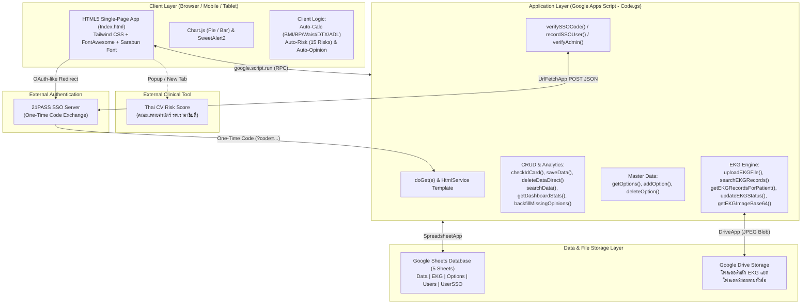
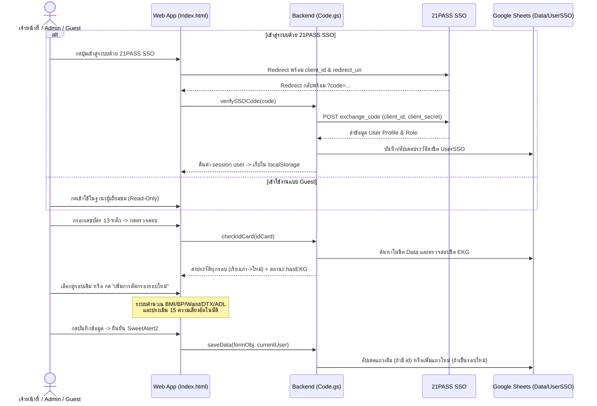

# รายงานชี้แจงข้อมูลทางเทคนิคและคู่มือระบบ (IT & UX Audit Response)
## โครงการ: ระบบข้อมูลสุขภาพชุมชนและคัดกรองสุขภาพ (Pro-Health Data BKK South)

> **จัดทำโดย:** ทีมพัฒนาและเจ้าของนวัตกรรม **Pro-Health Data BKK South**  
> **สถานะเอกสาร:** ฉบับสมบูรณ์สำหรับส่งต่อทีม UX / ทีม IT / ผู้บริหาร และใช้เป็นเอกสารกลางในการรวมโปรเจกต์  
> **ชุดทดสอบประกอบ:** Demo Mock-up แบบ Standalone ในโฟลเดอร์เดียวกัน (`index.html` และ `mock-backend.js`)

---

> [!IMPORTANT]
> **ประกาศด้านความปลอดภัยและการปกป้องข้อมูลสำคัญ (Security & Sanitization Notice)**  
> เอกสารฉบับนี้และชุด **Demo Mock-up** ได้รับการคัดกรองและตัดข้อมูลความลับทางโครงสร้างพื้นฐานออกทั้งหมดแล้ว **ไม่มี** การเปิดเผย Google Sheet ID, Google Drive Folder ID, Web App URL จริง, Client ID / Client Secret, API Key หรือบัญชีและรหัสผ่านที่ใช้งานจริงในระบบ Production  
> บัญชีผู้ใช้งานและรหัสผ่านที่ระบุในเอกสารข้อ 2 และในตัว Demo Mock-up เป็น **ข้อมูลจำลอง (Mock-up Credentials)** และข้อมูลประชาชนทั้งหมดเป็น **ข้อมูลสมมติ (Synthetic Seed Data)** เพื่อการตรวจสอบ UX/UI และโครงสร้างระบบเท่านั้น

---

## บทสรุปผู้บริหารและจุดแข็งของนวัตกรรม (Innovation Highlights)

**ระบบข้อมูลสุขภาพ / ระบบคัดกรอง (Pro-Health Data BKK South)** พัฒนาขึ้นเพื่อยกระดับการคัดกรองสุขภาพเชิงรุกในชุมชน (เช่น พื้นที่เขตวัฒนา และชุมชนโดยรอบ) จากแบบบันทึกกระดาษหรือสเปรดชีตแยกส่วน ให้กลายเป็นเว็บแอปพลิเคชันแบบรวมศูนย์ที่ใช้งานง่ายบนอุปกรณ์พกพาและคอมพิวเตอร์ โดยมีจุดเด่นเชิงนวัตกรรม 5 ด้าน ได้แก่:

1. **Clinical Auto-Calculation & Risk Engine (ระบบคำนวณและคัดกรองความเสี่ยงอัตโนมัติ):** ลดความผิดพลาดของเจ้าหน้าที่ภาคสนามด้วยการคำนวณค่าทางคลินิกทันทีที่กรอกข้อมูล (BMI, ความดันโลหิต BP Stage, รอบเอวตามเพศ, DTX NPO/Post, Thai CV Risk, ADL Score กลุ่มติดสังคม/ติดบ้าน/ติดเตียง) พร้อมเชื่อมโยงเข้าสู่กฎประเมินความเสี่ยง 15 รายการ และสรุปความเห็น (`ปกติ` / `เสี่ยง` / `ป่วย`) อัตโนมัติ
2. **Multi-Round Longitudinal Screening (ประวัติการคัดกรองรายบุคคลแบบหลายรอบ):** รองรับการค้นหาด้วยเลขบัตรประชาชน 13 หลัก เพื่อดูประวัติย้อนหลังแบบ Timeline (รอบที่ 1, 2, 3...) และกด **"เพิ่มการคัดกรองรอบใหม่"** โดยดึงข้อมูลพื้นฐานจากรอบล่าสุดมาเติมให้อัตโนมัติ ลดเวลาบันทึกซ้ำ
3. **Dual-Mode Executive Dashboard (สถิติทั้งรายครั้งและรายบุคคลไม่ซ้ำคน):** สลับโหมดคำนวณระหว่าง **Total Services** (จำนวนครั้งรับบริการทั้งหมด) และ **Unique Patients** (นับเฉพาะจำนวนคน โดยยึดผลรอบล่าสุด) พร้อมตัวกรองขั้นสูง 13 หมวด
4. **Integrated EKG Management & Dual-Pane Compare (ระบบจัดการและเปรียบเทียบผลคลื่นหัวใจ EKG):** รองรับการอัปโหลดภาพผล EKG แบบ Batch (สูงสุด 100 ไฟล์/ครั้ง) พร้อมถอดรหัสเลขบัตรและวันที่จากชื่อไฟล์อัตโนมัติ (`CM_[เลขบัตร13หลัก]_[วันเวลา14หลัก]`) และหน้าจอเปรียบเทียบผล 2 ช่องเคียงข้างกัน (Dual-Pane) ที่หมุนภาพ ซูม และบันทึกผลแปลความหมายได้ทันที
5. **Centralized SSO & Dynamic Master Data:** รองรับการยืนยันตัวตนผ่าน **21PASS SSO** พร้อมระบบจัดการรายชื่อชุมชนและประเภทการคัดกรองแบบ Dynamic โดยผู้ดูแลระบบไม่ต้องแก้ไขโค้ด

---

## คำถามข้อที่ 1: User Manual & Specs (คู่มือการใช้งาน ผังระบบ และรายการฟังก์ชัน)

### 1.1 ผังสถาปัตยกรรมระบบ (System Architecture)

ระบบพัฒนาบนสถาปัตยกรรม **Serverless Web Application** บนแพลตฟอร์ม Google Apps Script (V8 Runtime, Timezone `Asia/Bangkok`) แบ่งชั้นการทำงานออกเป็น 4 ส่วนหลักดังแผนภาพด้านล่าง:

### 1.2 แผนภาพลำดับการทำงานหลัก (Authentication & Screening Workflow)

### 1.3 รายการฟังก์ชันทั้งหมด (Functional List)

| รหัส | โมดูล (Module) | ฟังก์ชันการทำงานหลัก | สิทธิ์การใช้งาน | แหล่งอ้างอิงในโค้ด |
| :--- | :--- | :--- | :--- | :--- |
| **F-01** | **ยืนยันตัวตน & สิทธิ์ (Auth & RBAC)** | • เข้าสู่ระบบผ่าน 21PASS SSO (แลก One-Time Code) • บันทึกประวัติเข้าใช้งานลงชีต `UserSSO` • โหมดผู้เยี่ยมชม (Guest Read-Only) • สลับธีม Dark / Light Mode และรีเฟรชข้อมูลทั้งระบบ | ทุกคน (แยกสิทธิ์ Guest / User / Admin) | `doGet`, `verifySSOCode`, `recordSSOUser`, `applyScreeningUserRole` |
| **F-02** | **สรุปผลข้อมูล (Dashboard)** | • คำนวณสถิติ 2 โหมด: **Total Services** (รายครั้ง) และ **Unique Patients** (รายคนยึดรอบล่าสุด) • ตัวกรองขั้นสูง 13 หมวด (ปีงบฯ, ช่วงวันที่, ชุมชน, ผลตรวจ, พฤติกรรม ฯลฯ) • การ์ดสรุป 4 สถานะ (ทั้งหมด / ปกติ / เสี่ยง / ป่วย) • กราฟ Chart.js: สัดส่วนเพศ (Pie) และช่วงอายุ (Bar) • อันดับความเสี่ยงทั้ง 15 รายการ และ 5 อันดับโรคประจำตัว (U/D) • พิมพ์รายงานแดชบอร์ด (`window.print()`) | Guest / User / Admin | `getDashboardStats`, `resolveRecordOpinion`, `renderAdvancedFilter`, `loadDashboard` |
| **F-03** | **ลงทะเบียนและคัดกรองสุขภาพ (Screening Form)** | • ตรวจสอบเลขบัตรประชาชน 13 หลัก (หรือ `0` กรณีไม่มีเลขบัตร) • แสดงแถบประวัติรอบการคัดกรอง (Round Tabs) และปุ่ม **เพิ่มการคัดกรองรอบใหม่** (คัดลอกข้อมูลจากรอบล่าสุด) • ปุ่มลัดกระโดดไปดูผล EKG ของผู้รับบริการรายนั้น (`hasEKG`) • ฟอร์มบันทึกข้อมูลสุขภาพครอบคลุม **13 หมวด** (138 คอลัมน์) • คำนวณอัตโนมัติ: ปีงบประมาณไทย (ตัดรอบ ต.ค.), อายุ/ช่วงอายุ/>60 ปี จากวันเกิด พ.ศ., ช่วงรายได้, BMI + ผล, BP Stage, รอบเอว + ตัวนับ, DTX NPO/Post, ผล CVD, รสชาติที่ชอบ, ADL Score & กลุ่ม • เชื่อมเครื่องมือคำนวณ **Thai CV Risk Score** (หน้าต่างลอย/แท็บใหม่) • **Auto-Risk & Auto-Opinion Engine**: ประเมินความเสี่ยง 15 ข้อ และสรุปความเห็น (`ปกติ`/`เสี่ยง`/`ป่วย`) อัตโนมัติ พร้อมล็อกช่องความเสี่ยงเมื่อป่วย | User / Admin (Guest อ่านได้อย่างเดียว) | `checkIdCard`, `saveData`, `startNewScreeningRound`, `evaluateAutoRiskAndOpinion`, `calcBMI/BP/Waist/DTX/CVD/ADL/Fiscal/Age` |
| **F-04** | **ค้นหาและจัดการข้อมูล (Search & Manage)** | • ค้นหาข้อมูลด้วยตัวกรองขั้นสูง 13 หมวด (แสดงผลล่าสุดสูงสุด 50 รายการต่อครั้ง) • เปิดดู/แก้ไขข้อมูลรายบุคคลในหน้าลงทะเบียน • ลบรายการข้อมูลพร้อมหน้าต่างยืนยัน | User / Admin (Guest ดูได้อย่างเดียว) | `searchData`, `matchesFilter`, `deleteDataDirect`, `editItem` |
| **F-05** | **ระบบข้อมูลผล EKG (EKG Management)** | • **แท็บค้นหาและเปรียบเทียบ:** ค้นหาตามเลขบัตร, หัวข้อ, สถานะผล (`รอแปลผล`/`ปกติ`/`ผิดปกติ`), ช่วงวันที่; แสดงยอดคนสะสม vs จำนวนครั้งทั้งหมด; ตัวเลือกไม่นับซ้ำวันเดียวกัน (1 คน/วัน); แบ่งหน้า (Pagination 10–100 แถว) • **Dual-Pane Compare:** เปรียบเทียบภาพ EKG ชุดข้อมูล A และ B เคียงข้างกัน, หมุนภาพ ±90°, ซูมขยายเต็มจอ, อัปเดตสถานะแปลผลรายภาพ, ปุ่มลัด "ดูข้อมูลสุขภาพ" • **แท็บอัปโหลดไฟล์:** Drag & Drop ไฟล์ `.jpg/.jpeg` สูงสุด 100 ไฟล์/ครั้ง, แยกเลขบัตรและวันเวลาจากชื่อไฟล์ `CM_[13หลัก]_[14หลัก]`, ตรวจจับไฟล์ซ้ำอัตโนมัติ, แสดง Progress Bar และตาราง Log ผลลัพธ์ | User / Admin | `uploadEKGFile`, `getEKGTopics`, `searchEKGRecords`, `getEKGRecordsForPatient`, `updateEKGStatus`, `getEKGImageBase64` |
| **F-06** | **จัดการชุมชนและประเภท (Options Management)** | • เพิ่ม/ค้นหา/ลบ รายชื่อชุมชน (ค่าเริ่มต้น 31 ชุมชน) • เพิ่ม/ลบ ประเภทการคัดกรอง (ค่าเริ่มต้น 3 ประเภท) • ซิงค์เข้า Dropdown ของฟอร์มและตัวกรองอัตโนมัติ | Admin Only | `getOptions`, `addOption`, `deleteOption`, `renderOptionsPage` |
| **F-07** | **จัดการระบบ (Admin Panel)** | • ตรวจสอบรายชื่อผู้ใช้งานในระบบเดิม (`Users`) • อนุมัติหรือลบผู้ใช้งานโดยต้องยืนยันรหัสผ่านแอดมินซ้ำ (`verifyAdmin`) • ฟังก์ชันซ่อมแซมข้อมูลย้อนหลังระดับ Backend (`backfillMissingOpinions`) | Admin Only | `getAdminData`, `adminAction`, `verifyAdmin`, `backfillMissingOpinions` |

### 1.4 แนวทางการใช้งานระบบโดยย่อ (User Manual Summary)

1. **การเข้าสู่ระบบ:** เปิดเว็บแอป -> เลือก **"เข้าสู่ระบบด้วย 21PASS SSO"** (สำหรับเจ้าหน้าที่/แอดมิน) หรือเลือก **"เข้าใช้ในฐานะผู้เยี่ยมชม (Guest)"** (สำหรับดูรายงานสรุปผลแบบอ่านอย่างเดียว)
2. **การคัดกรองผู้รับบริการ:**
   - ไปที่เมนู **ลงทะเบียนข้อมูล** -> กรอกเลขบัตรประชาชน 13 หลัก (หรือ `0`) -> กด **ตรวจสอบ**
   - หากเป็น **ผู้รับบริการรายใหม่** ระบบจะเปิดฟอร์มรอบที่ 1 ให้กรอกตั้งแต่หมวด 1–13
   - หากเป็น **ผู้รับบริการรายเดิม** ระบบจะแสดงแท็บประวัติทุกรอบ สามารถเลือกแก้ไขรอบเดิม หรือกด **"➕ เพิ่มการคัดกรองรอบใหม่"** เพื่อคัดลอกประวัติพื้นฐานจากรอบล่าสุดและกรอกผลตรวจรอบใหม่ได้ทันที
   - ตรวจสอบค่าที่ระบบคำนวณให้อัตโนมัติ (หมวด 4, 11, 13) แล้วกด **บันทึกข้อมูล**
3. **การนำเข้าและแปลผล EKG:**
   - ตั้งชื่อไฟล์ภาพตามมาตรฐาน `CM_[เลขบัตร13หลัก]_[YYYYMMDDHHMMSS].jpg`
   - ไปที่เมนู **ผล EKG** -> แท็บ **อัปโหลดไฟล์** -> ระบุหัวข้อการตรวจและลากไฟล์วาง (สูงสุด 100 ไฟล์) -> กด **เริ่มอัปโหลดไฟล์ EKG**
   - แพทย์/พยาบาลเปิดแท็บ **ค้นหาและเปรียบเทียบ** -> กด **ดูผลและเปรียบเทียบ** เพื่อดูคลื่นหัวใจเทียบกัน 2 ช่วงเวลา (A vs B), หมุน/ขยายภาพ และเปลี่ยนสถานะผลเป็น `ปกติ` หรือ `ผิดปกติ`
4. **การวิเคราะห์ข้อมูลผู้บริหาร:** ไปที่เมนู **สรุปผลข้อมูล** -> เลือกโหมดนับสถิติ (`Total Services` หรือ `Unique Patients`) -> กาง **ตัวกรองขั้นสูง (13 หัวข้อ)** เพื่อเจาะลึกตามชุมชน ปีงบประมาณ หรือกลุ่มเสี่ยง แล้วกด **ประมวลผล** หรือ **พิมพ์**

---

## คำถามข้อที่ 2: Demo Account & Sandbox Guide (บัญชีทดสอบและข้อมูลจำลอง)

ทีมพัฒนาได้จัดทำ **ชุดระบบทดสอบจำลองแบบ Standalone (Demo Mock-up)** ไว้ในโฟลเดอร์นี้แล้ว (`index.html` + `mock-backend.js`) โดยจำลองการทำงานของทั้ง 6 โมดูล, กฎคำนวณทางคลินิก, Multi-Round Screening และ Dual-Pane EKG Viewer ให้ทีม UX และ IT ทดลองใช้งานได้ทันทีโดยไม่ต้องพึ่งพา Google Apps Script หรือฐานข้อมูลจริง

### 2.1 บัญชีทดสอบจำลอง (Mock-up Demo Accounts)

> [!NOTE]
> บัญชีและรหัสผ่านในตารางด้านล่างเป็น **บัญชีจำลอง (Mock-up Credentials)** ที่ทำงานเฉพาะในชุด Demo Mock-up (`mock-backend.js`) เท่านั้น **ไม่ใช่** รหัสผ่านของระบบ Production หรือ 21PASS SSO จริง

| บทบาท (Role) | Username (จำลอง) | Password (จำลอง) | สิทธิ์การเข้าถึงใน Demo | หมายเหตุ |
| :--- | :--- | :--- | :--- | :--- |
| **ผู้ดูแลระบบ (Admin)** | `admin_demo` | `DemoPass@2026` | เข้าถึงทุกเมนู (รวม `เพิ่ม-ลด ชุมชนและประเภท` และ `จัดการระบบ`) | ใช้รหัส `DemoPass@2026` ยืนยันเมื่อลบผู้ใช้ในหน้าจัดการระบบ |
| **เจ้าหน้าที่คัดกรอง (Staff)** | `staff_demo` | `Staff@2026` | Dashboard, ลงทะเบียน, ค้นหา/แก้ไข/ลบ, อัปโหลดและแปลผล EKG | ไม่เห็นเมนู Admin และ Options |
| **พยาบาลวิชาชีพ (Nurse)** | `nurse_demo` | `Nurse@2026` | เหมือน Staff (จำลองผู้บันทึกอีกท่านเพื่อทดสอบ Multi-recorder) | ทดสอบเปลี่ยนชื่อผู้บันทึกล่าสุด |
| **ผู้เยี่ยมชม (Guest)** | *(กดปุ่ม Guest)* | *(ไม่ต้องใช้รหัส)* | ดู Dashboard และดูรายการค้นหาแบบ Read-Only เท่านั้น | ซ่อนปุ่มแก้ไข/ลบ และล็อกปุ่มบันทึก |

### 2.2 ชุดข้อมูลจำลองที่เตรียมไว้ (Seed / Mock Data)

ในชุด Demo Mock-up มีข้อมูลจำลองตั้งต้น **5 บุคคล (รวม 7 ประวัติการคัดกรอง)** และ **ผลตรวจ EKG จำลอง 5 รายการ (ภาพกราฟคลื่นหัวใจ SVG)** ดังนี้:

| เลขบัตรจำลอง (13 หลัก) | ชื่อ-สกุล (สมมติ) | ชุมชน | จำนวนรอบ | สถานะความเห็น | ผล EKG | จุดเด่นสำหรับทดสอบ UX |
| :--- | :--- | :--- | :--- | :--- | :--- | :--- |
| `1100100000001` | นายสมศักดิ์ รักสุขภาพ | วัดธาตุทอง | **2 รอบ** (2568, 2569) | เสี่ยง | มี 2 ใบ (`ปกติ`, `รอแปลผล`) | ทดสอบ Multi-Round Tabs + เพิ่มรอบ 3 + Dual-Pane Compare A vs B |
| `1100100000002` | นางสมหญิง ใจสะอาด | สุเหร่าบ้านดอน | **2 รอบ** (2568, 2569) | ป่วย | มี 2 ใบ (`ผิดปกติ` ทั้งคู่) | ทดสอบผู้สูงอายุ >60 ปี + ADL (กลุ่มติดบ้าน) + หมวด 12 Immobility + ล็อกความเสี่ยงเมื่อป่วย |
| `1100100000003` | นายกิตติพงษ์ แข็งแรง | นวลจิตเหนือ | 1 รอบ (2569) | ปกติ | ไม่มี | ทดสอบผลตรวจปกติ + Cholesterol ปกติ |
| `1100100000004` | นางสาวนภาพร สุขใจ | มีสุวรรณ 2 | 1 รอบ (2569) | เสี่ยง | ไม่มี | ทดสอบ Auto-Risk หลายปัจจัย (BMI อ้วน1, รสหวาน/มัน, 2Q เสี่ยง) |
| `1100100000005` | นายวีระชัย มั่นคง | ตลาดพระโขนง | 1 รอบ (2569) | ป่วย | มี 1 ใบ (`รอแปลผล`) | ทดสอบโรคประจำตัว U/D + BP Stage2 + เชื่อมดู EKG |
| `1100199999999` | *(กรอกใหม่)* | - | 0 รอบ | - | - | ใช้ทดสอบการลงทะเบียนผู้รับบริการรายใหม่ (รอบที่ 1) |

### 2.3 วิธีรันระบบทดสอบ (Demo Mock-up & Staging Placeholder)

#### ก. วิธีรันชุด Demo Mock-up แบบ Standalone (ใช้งานได้ทันที)
1. เปิดโฟลเดอร์ `Demo_ระบบข้อมูลสุขภาพและคัดกรอง_ProHealthData`
2. ดับเบิลคลิกเปิดไฟล์ `index.html` ด้วยเว็บเบราว์เซอร์ (Chrome / Edge / Safari) หรือรันผ่าน Local HTTP Server เช่น `npx serve .` หรือ `python3 -m http.server 8080`
3. เลือกปุ่มลัด **⚡ เข้าใช้แบบ Admin** หรือ **⚡ เข้าใช้แบบ Staff** (หรือกรอกบัญชีจำลองในตาราง 2.1)
4. ข้อมูลที่แก้ไข/เพิ่ม/ลบ จะถูกเก็บใน `localStorage` ของเบราว์เซอร์ และสามารถกดปุ่ม **"รีเซ็ตข้อมูลจำลอง"** ที่แถบด้านบนเพื่อคืนค่าตั้งต้นได้ตลอดเวลา
5. ในหน้า **ผล EKG -> อัปโหลดไฟล์** มีปุ่ม **"จำลองเลือกไฟล์ EKG (2 ไฟล์)"** ให้กดสร้างไฟล์มาตรฐาน `CM_...` จำลองเพื่อทดสอบ Batch Upload ได้ทันที

#### ข. ช่องกรอกข้อมูล Staging Environment (กรณี Deploy ระบบ Staging จริงภายหลัง)

| รายการ Staging | ค่าปัจจุบัน / สถานะ | ช่องสำหรับกรอกเมื่อ Deploy Staging จริง |
| :--- | :--- | :--- |
| **Staging Web App URL** | ยังไม่ได้ระบุ (ใช้ Standalone Demo แทนชั่วคราว) | `[กรอก Staging URL ที่นี่ เมื่อ Deploy แล้ว]` |
| **21PASS SSO Staging Endpoint** | แยกจาก Production (รอเชื่อมสิทธิ์ทีม UX) | `[กรอก Staging SSO URL / Test Client ID ที่นี่]` |
| **Staging Account (Admin / Staff)** | ใช้ Mock-up Account ในหัวข้อ 2.1 ชั่วคราว | `[กรอก Staging Test User / Temp Password ที่นี่]` |

---

## คำถามข้อที่ 3: Database & Data Dictionary (โครงสร้างฐานข้อมูลและรายการ Form Fields)

ระบบจัดเก็บข้อมูลใน Google Sheets จำนวน **5 ชีต (Tables)** และเก็บไฟล์ภาพใน Google Drive โดยมีรายละเอียดโครงสร้างจากโค้ดจริง (`Code.gs` และ `Index.html`) ดังนี้:

### 3.1 ภาพรวมตารางข้อมูลทั้ง 5 ชีต

| ชื่อชีต (Table) | วัตถุประสงค์ | Primary Key / Foreign Key | จำนวนคอลัมน์ |
| :--- | :--- | :--- | :--- |
| `Data` | เก็บประวัติการคัดกรองสุขภาพรายครั้ง (1 แถว = 1 รอบการคัดกรอง) | PK: `id` (UUID) / FK เชิงตรรกะ: `idCard` | **138 คอลัมน์** |
| `EKG` | เก็บ Metadata ของภาพคลื่นหัวใจ EKG ที่เชื่อมโยงกับไฟล์ใน Google Drive | PK: `id` (UUID) / FK: `idCard`, `fileId` | **11 คอลัมน์** |
| `Options` | เก็บ Master Data แบบ Key-Value สำหรับ Dropdown (`community`, `screeningType`) | Composite: `Category` + `Value` | **2 คอลัมน์** |
| `Users` | บัญชีผู้ใช้ระบบเดิม (Legacy Auth & Admin Verification) | PK: `ID` (UUID) | **6 คอลัมน์** |
| `UserSSO` | บันทึกโปรไฟล์และเวลาเข้าใช้งานล่าสุดจาก 21PASS SSO | PK: `ID` (UUID), `Username` | **6 คอลัมน์** |

### 3.2 Data Dictionary: ตาราง `Data` (138 คอลัมน์ — 13 หมวดแบบฟอร์ม + Metadata)

#### ก. ฟิลด์ระบบและข้อมูลบุคคล (System Metadata & หมวดที่ 1: ข้อมูลบุคคล)
| ลำดับ | Field Name (Column) | ชื่อแสดงผลบน UI | ชนิดข้อมูล / Input | ค่าที่รองรับ / เงื่อนไข |
| :--- | :--- | :--- | :--- | :--- |
| 1 | `id` | *(Hidden)* | UUID (String) | สร้างอัตโนมัติด้วย `Utilities.getUuid()` เมื่อสร้างรอบใหม่ |
| 2 | `fiscalYear` | ปีงบประมาณ | String (พ.ศ. 4 หลัก) | Readonly; คำนวณจาก `screeningDate` (ตั้งแต่ 1 ต.ค. นับเป็นปีงบฯ ถัดไป) |
| 3 | `idCard` | เลขบัตรประชาชน | String (13 หลัก หรือ `0`) | ใช้ตรวจสอบประวัติเดิมและเชื่อมกับตาราง `EKG` |
| 4 | `recorder` | ผู้บันทึก | String | Readonly; ดึงจากชื่อผู้ใช้งานที่ล็อกอิน และอัปเดตเป็นผู้บันทึกล่าสุดเสมอ |
| 5 | `prefix` | คำนำหน้า | Select | `นาย`, `นาง`, `นางสาว`, `เด็กชาย`, `เด็กหญิง`, `พระ`, `อื่นๆ` |
| 6 | `firstName` | ชื่อ | Text (Required) | ชื่อจริง |
| 7 | `lastName` | นามสกุล | Text (Required) | นามสกุล |
| 138 | `updated_at` | *(System)* | Date (`yyyy-MM-dd`) | วันที่บันทึก/อัปเดตล่าสุด (Timezone GMT+7) |

#### ข. หมวดที่ 2: ข้อมูลคัดกรองเบื้องต้น (14 ฟิลด์)
| ลำดับ | Field Name | ชื่อแสดงผลบน UI | ชนิดข้อมูล / Input | ค่าที่รองรับ / สูตรคำนวณ |
| :--- | :--- | :--- | :--- | :--- |
| 8 | `screeningType` | ประเภท | Select (Dynamic) | ดึงจากชีต `Options` (`คัดกรองล้านคน`, `แสกน`, `จุดคัดกรอง`, ...) |
| 9 | `community` | ชุมชน | Select (Dynamic) | ดึงจากชีต `Options` (ค่าเริ่มต้น 31 ชุมชน) |
| 10 | `screeningDate` | วันที่คัดกรอง | Date (`yyyy-MM-dd`) | ค่าเริ่มต้นวันปัจจุบัน; เปลี่ยนแล้วคำนวณ `fiscalYear` ใหม่ทันที |
| 11 | `birthDate` | วันเดือนปีเกิด (พ.ศ.) | Text (`DD/MM/BBBB`) | เช่น `01/01/2500` ใช้คำนวณอายุเมื่อ blur |
| 12 | `age` | อายุ | Number (Readonly) | คำนวณจาก `birthDate` เทียบวันปัจจุบัน |
| 13 | `ageRange` | ช่วงอายุ | Text (Readonly) | `1-20 ปี`, `21-34 ปี`, `35-59 ปี`, `>60 ปี` |
| 14 | `over60` | อายุ > 60 | Text (Readonly) | `ใช่` (age ≥ 60) / `ไม่ใช่` (age < 60) |
| 15 | `gender` | เพศ | Select | `ชาย`, `หญิง`, `ไม่ระบุ` (มีผลต่อการคำนวณรอบเอว) |
| 16 | `phone` | เบอร์โทร | Text (maxlength 10) | หมายเลขโทรศัพท์ |
| 17 | `bloodGroup` | กรุ๊ปเลือด | Select | `ไม่ทราบ`, `A`, `B`, `O`, `AB` |
| 18 | `occupation` | อาชีพ | Select | 26 อาชีพ (เช่น `แม่บ้าน`, `ค้าขาย`, `อสส.ศูนย์ 21 วัดธาตุทอง`, `บุคลากร กทม.`, `Rider`, ...) |
| 19 | `religion` | ศาสนา | Select | `พุทธ`, `คริสต์`, `อิสลาม`, `พราหมณ์-ฮินดู`, `ซิกส์`, `ไม่ระบุ/ไมทราบ` |

#### ค. หมวดที่ 3: ประวัติเบื้องต้น & สภาพแวดล้อม (27 ฟิลด์)
| ลำดับ | Field Name | ชื่อแสดงผลบน UI | ชนิดข้อมูล / Input | ค่าที่รองรับ / สูตรคำนวณ |
| :--- | :--- | :--- | :--- | :--- |
| 20 | `addressType` | ที่อยู่ตามบัตรฯ | Select | `กทม.ในเขตวัฒนา`, `กทม.นอกเขตวัฒนา`, `ต่างจังหวัด` |
| 21 | `healthPrivilege` | สิทธิสุขภาพ | Select | 19 สิทธิ (เช่น `บัตรทอง`, `ประกันสังคม`, `UC/ศบส.21/ร.พ.ตำรวจ`, ...) |
| 22 | `treatmentHistory` | รักษา (ถ้ามี) | Text | สถานพยาบาลหรือประวัติรักษาเพิ่มเติม |
| 23 | `status` | สถานะ | Select | `โสด`, `สมรส/คู่`, `หม้าย`, `หย่าร้าง`, `แยกกันอยู่` |
| 24 | `address` | ที่อยู่ | Text | ที่อยู่ปัจจุบัน |
| 25 | `education` | การศึกษา | Select | 12 ระดับ (`ไม่ได้รับการศึกษา` ถึง `สูงกว่าปริญญาตรี`) |
| 26 | `houseType` | ลักษณะบ้าน | Select | 10 ลักษณะ (`บ้านเดี่ยว`, `ทาวเฮ้าส์`, `คอนโดมิเนียม`, `ชุมชนแออัด`, ...) |
| 27 | `yearsLiving` | อาศัยมากี่ปี | Number | จำนวนปี |
| 28 | `occupants` | ผู้อาศัย (คน) | Number | จำนวนคนในครัวเรือน |
| 29 | `residenceType` | ประเภทที่อยู่อาศัย | Select | `ของตนเอง`, `เช่าซื้อ`, `เช่าที่ดิน/บ้าน`, `อาศัยผู้อื่น`, `หน่วยงานจัดให้` |
| 30 | `income` | รายได้ครอบครัว | Number | บาท/เดือน |
| 31 | `incomeRange` | ช่วงรายได้ | Text (Readonly) | `ไม่มีรายได้`, `ต่ำกว่า5,000บาท`, `5,000-10,000บาท`, `10,001-15,000บาท`, `15,001-20,000บาท`, `มากกว่า20,000บาท` |
| 32 | `financialStatus` | การเงิน | Select | `ไม่ทราบ`, `เหลือเก็บ`, `เพียงพอ`, `ไม่เพียงพอ` |
| 33–40 | `pet_dog`, `pet_cat`, `pet_squirrel`, `pet_fish`, `pet_bird`, `pet_turtle`, `pet_chicken`, `pet_sterilized` | สัตว์เลี้ยง (ระบุจำนวน) & ต้องการทำหมัน | Number (8 ฟิลด์) | ค่าเริ่มต้น `0` |
| 41 | `diseaseVector` | สัตว์นำโรค | Select | `ไม่มี`, `มี` (หากเลือก `มี` จะเปิดช่องเลือกชนิดสัตว์นำโรค) |
| 42–46 | `vector_rat`, `vector_mos`, `vector_cock`, `vector_fly`, `vector_snake` | ชนิดสัตว์นำโรค | Checkbox (5 ฟิลด์) | หนู (`rat`), ยุง (`mos`), แมลงสาบ (`cock`), แมลงวัน (`fly`), งู (`snake`) |

#### ง. หมวดที่ 4: ผลการตรวจร่างกาย (15 ฟิลด์)
| ลำดับ | Field Name | ชื่อแสดงผลบน UI | ชนิดข้อมูล / Input | เกณฑ์การประเมินอัตโนมัติ |
| :--- | :--- | :--- | :--- | :--- |
| 47, 48 | `weight`, `height` | น้ำหนัก (กก.), ส่วนสูง (ซม.) | Number | ใช้คำนวณ BMI แบบ Real-time |
| 49, 50 | `bmi`, `bmiResult` | ค่า BMI, ผล BMI | Hidden/Auto | `<18.5`=ผอม, `18.5-23.09`=ปกติ, `23.1-24.99`=ท้วม, `25-29.99`=อ้วน1, `≥30`=อ้วน2 |
| 51, 52 | `bp`, `bpResult` | BP (`Sys/Dia`), ผล BP | Text, Auto | `>180/>110`=Stage3, `>160/>100`=Stage2, `>140/>90`=Stage1, `>120/>84`=PreHT, นอกนั้น=ปกติ |
| 53–55 | `waist`, `waistResult`, `waistCount` | รอบเอว, ผลรอบเอว, ตัวนับ | Number, Auto | เกินเมื่อ ชาย `>90` (Count: 2/1) หรือ หญิง `>80` (Count: 4/3) |
| 56, 57 | `dtxNpo`, `npoResult` | DTX NPO, ผล NPO | Number, Readonly | `≥126`=DM, `100-125`=IFG, `<100`=ปกติ |
| 58, 59 | `dtxPost`, `postResult` | DTX หลังทาน, ผลหลังทาน | Number, Readonly | `≥200`=DM, `140-199`=IFG, `<140`=ปกติ |
| 60, 61 | `cvd`, `cvdResult` | CVD (%), ผล CVD | Number (step 0.1), Readonly | `≥30`=สูงมาก, `≥20`=สูง, `≥10`=ปานกลาง, `<10`=เสี่ยงน้อย |

#### จ. หมวดที่ 5: พันธุกรรม (16 ฟิลด์)
| ลำดับ | Field Name | ชื่อแสดงผลบน UI | ชนิดข้อมูล / Input | ค่าที่รองรับ |
| :--- | :--- | :--- | :--- | :--- |
| 62 | `gm_heartDeath` | พ่อแม่โรคหัวใจ | Select | `ไม่ใช่`, `ใช่` |
| 63 | `gm_history` | ประวัติครอบครัว | Select | `ไม่มีโรคประจำตัว/...`, `มีโรคประจำตัว/...`, `ไม่ทราบ` |
| 64–75 | `gm_dm`, `gm_ht`, `gm_gout`, `gm_kidney`, `gm_stroke`, `gm_heart`, `gm_lipid`, `gm_emphysema`, `gm_cancer`, `gm_thalassemia`, `gm_g6pd`, `gm_colorBlind` | โรคทางพันธุกรรม 12 โรค | Select (12 ฟิลด์) | `ไม่มี`, `มี` |
| 76, 77 | `gm_other`, `gm_otherDetail` | อื่นๆ & ระบุรายละเอียด | Select, Text | `ไม่มี`/`มี` (แสดงช่องระบุเมื่อเลือก `มี`) |

#### ฉ. หมวดที่ 6: ประวัติการพบแพทย์ U/D (9 ฟิลด์)
| ลำดับ | Field Name | ชื่อแสดงผลบน UI | ชนิดข้อมูล / Input | ค่าที่รองรับ (มีผลล็อกสถานะ `ป่วย`) |
| :--- | :--- | :--- | :--- | :--- |
| 78–83 | `ud_dm`, `ud_ht`, `ud_liver`, `ud_stroke`, `ud_heart`, `ud_lipid` | เบาหวาน, ความดัน, โรคตับ, อัมพาต, โรคหัวใจ, ไขมันในเลือด | Select (6 ฟิลด์) | `ไม่มี`, `ไม่เคยตรวจ`, `รับการรักษาอยู่`*, `รับการรักษาไม่สม่ำเสมอ`*, `เคยรักษา/กินยาเอง`* (*นับเป็น `ป่วย`) |
| 84 | `ud_foot` | แผลที่เท้า/ตัดขา (จากเบาหวาน) | Select | `ไม่มี`, `มี`* |
| 85, 86 | `ud_other`, `ud_otherDetail` | โรคประจำตัวอื่นๆ & ระบุ | Select, Text | `ไม่มี`, `มี`* |

#### ช. หมวดที่ 7: ประเมินความเสี่ยงการเกิดโรคเบาหวาน (10 ฟิลด์)
| ลำดับ | Field Name | ชื่อแสดงผลบน UI | ชนิดข้อมูล | ค่าที่รองรับ |
| :--- | :--- | :--- | :--- | :--- |
| 87–96 | `symptom_birthWeight`, `symptom_thirst`, `symptom_nocturia`, `symptom_weightLoss`, `symptom_fatigue`, `symptom_soreMouth`, `symptom_itchy`, `symptom_blurryVision`, `symptom_numbness`, `symptom_respiratory` | อาการเสี่ยงเบาหวาน 10 ข้อ | Select (10 ฟิลด์) | `ไม่มี`, `มี` (หากมี ≥1 ข้อ ระบบเพิ่มความเสี่ยง `เบาหวาน` อัตโนมัติ) |

#### ซ. หมวดที่ 8: ข้อมูลการแพทย์ (9 ฟิลด์)
| ลำดับ | Field Name | ชื่อแสดงผลบน UI | ชนิดข้อมูล | ค่าที่รองรับ |
| :--- | :--- | :--- | :--- | :--- |
| 97–99 | `allergyMed`, `allergyMedDetail`, `allergyMedSymptom` | แพ้ยา, ระบุยา, อาการแพ้ยา | Select, Text, Text | `ไม่แพ้` / `แพ้` |
| 100–102 | `allergyFood`, `allergyFoodDetail`, `allergyFoodSymptom` | แพ้อาหาร, ระบุอาหาร, อาการ | Select, Text, Text | `ไม่แพ้` / `แพ้` |
| 103 | `fluVaccine` | ฉีดวัคซีนไข้หวัดใหญ่ | Select | `ฉีด`, `ไม่ฉีด` |
| 104 | `dentalCheck` | ตรวจสุขภาพช่องปาก | Select | `ตรวจ`, `ไม่ตรวจ` |
| 105 | `treatmentBehavior` | การปฏิบัติตัวเมื่อเจ็บป่วย | Select | 9 ตัวเลือก (`ไม่มี`, `ซื้อยาจากร้านขายยา`, `รักษาที่ศูนย์บริการสาธารณสุข`, ...) |

#### ฌ. หมวดที่ 9: กิจกรรมและพฤติกรรมสุขภาพ (15 ฟิลด์)
| ลำดับ | Field Name | ชื่อแสดงผลบน UI | ชนิดข้อมูล | ค่าที่รองรับ |
| :--- | :--- | :--- | :--- | :--- |
| 106, 107 | `communityActivity`, `activityDetail` | กิจกรรมชุมชน & ระบุ | Select, Text | `ไม่เคย`, `เคยเข้าร่วมกิจกรรม/แก้ไขปัญหาชุมชน`, `ไม่ทราบว่ามีที่ไหน` |
| 108, 109 | `disabled`, `disabledReg` | เป็นผู้พิการ, ขึ้นทะเบียน | Select, Select | `ไม่เป็นผู้พิการ` หรือ 7 ประเภทความพิการ + สถานะขึ้นทะเบียน |
| 110 | `smoking` | การสูบบุหรี่ | Select | `ไม่สูบบุหรี่`, `สูบบุหรี่`, `สูบเลิกแล้ว` |
| 111 | `drinking` | การดื่มสุรา | Select | `ไม่ดื่ม`, `ดื่ม`, `เคยดื่มแต่เลิกแล้ว`, `ดื่มบ้างเล็กน้อย` |
| 112 | `exercise` | การออกกำลังกาย | Select | `ออกกำลังกายทุกวัน`, `สัปดาห์ละน้อยกว่า3วัน`, `สัปดาห์ละ3ครั้ง`, `ไม่ออกกำลังกาย` |
| 113–116 | `tasteHasPreference`, `taste_sweet`, `taste_fat`, `taste_salty` | มีรสชาติที่ชอบ, หวาน, มัน, เค็ม | Readonly + Select (3) | `ชอบ`/`ไม่ชอบ` -> คำนวณ `tasteHasPreference` (`มี`/`ไม่มี`) |
| 117 | `breakfast` | มื้อเช้า | Select | `กิน`, `ไม่กิน`, `บางครั้ง` |
| 118 | `cervicalCancer` | ตรวจมะเร็งปากมดลูก | Select | `ไม่ตรวจ`, `ตรวจปีละ1ครั้ง`, `นานๆครั้ง`, `ผ่าตัดเอามดลูกออก` |
| 119 | `breastCancer` | ตรวจมะเร็งเต้านม | Select | `ไม่ตรวจ`, `ตรวจปีละ1ครั้ง`, `ตรวจด้วยตัวเองเดือนละครั้ง`, `นานๆครั้ง` |
| 120 | `annualCheck` | ตรวจสุขภาพประจำปี | Select | `ไม่ตรวจ`, `ตรวจ`, `ไม่ทราบว่าที่ไหนมีตรวจ` |

#### ญ. หมวดที่ 10–13: ข้อเสนอแนะ, การตรวจอื่นๆ, Immobility และสรุปความเห็น (17 ฟิลด์)
| หมวด | ลำดับ | Field Name | ชื่อแสดงผลบน UI | ชนิดข้อมูล | ค่าที่รองรับ / หมายเหตุ |
| :--- | :--- | :--- | :--- | :--- | :--- |
| **10** | 121, 122 | `satisfaction`, `suggestion` | ความพึงพอใจ, ข้อเสนอแนะ | Select, Textarea | `พึงพอใจมาก`, `พอใจ`, `เฉยๆ` |
| **11** | 123, 124 | `cholesterolCheck`, `cholesterolResult` | ตรวจ Total Cholesterol & ผล | Select, Checkbox (Comma-separated) | `ไม่ตรวจ`/`ตรวจ`; ผล: `ปกติ`, `ผิดปกติ`, `รอผลLAB`, `Cholesterrol สูง`, `Triglyceride สูง/ต่ำ`, `HDL-Chol สูง/ต่ำ` |
| **11** | 125–127 | `eval2Q`, `eval9Q`, `evalST5` | ประเมิน 2Q, 9Q, ST-5 | Select (3 ฟิลด์) | `2Q` (`เสี่ยง`/`ไม่เสี่ยง`), `9Q` (`ไม่ตรวจ`, `<7`, `7-12`, `3-18`, `≥19`), `ST-5` (`ไม่ตรวจ`, `0-4`, `5-7`, `8-9`, `10-15`) |
| **11** | 128, 129 | `scoreADL`, `evalADL` | คะแนน ADL (≥60 ปี), ผล ADL | Select (0–20), Readonly | `12-20`=กลุ่มติดสังคม, `5-11`=กลุ่มติดบ้าน, `0-4`=กลุ่มติดเตียง |
| **12** | 130 | `selfReliance` | การช่วยเหลือตนเอง | Select | `ช่วยเหลือตนเองได้ดี`, `ได้บางส่วน`, `ไม่ได้` |
| **12** | 131–133 | `disabilityStatus`, `hasDisabilityCard`, `disabilityType` | ความพิการ, บัตรผู้พิการ, ประเภท | Select (3 ฟิลด์) | แสดง `hasDisabilityCard` เฉพาะเมื่อเลือก `มีความพิการ` |
| **12** | 134, 135 | `caregiverStatus`, `caregiverPhone` | ผู้ดูแล & เบอร์ติดต่อผู้ดูแล | Select, Tel | เติม `'` นำหน้าใน Sheet เพื่อกัน Excel/Sheet ตัดเลข `0` นำหน้า |
| **13** | 136 | `riskSummary` | สรุปความเสี่ยง (15 รายการ) | Checkbox -> Comma String | เบาหวาน, ความดัน, โรคเกาท์, ไตวายเรื้อรัง, หัวใจ, เส้นเลือดสมอง, ถุงลมโป่งพอง, ไขมันในเลือด, โรคอ้วน, พฤติกรรม, มะเร็ง, โลหิตจาง, เส้นเลือดหัวใจและหลอดเลือด, โรคเครียด, `อื่นๆ(...)` |
| **13** | 137 | `opinion` | สรุปความเห็น | Select | `ปกติ`, `เสี่ยง`, `ป่วย` (คำนวณอัตโนมัติ + ผู้ใช้ปรับได้ ยกเว้นเมื่อเข้าเกณฑ์ U/D ป่วย) |

### 3.3 Data Dictionary: ตาราง `EKG`, `Options`, `Users` และ `UserSSO`

| ตาราง | คอลัมน์ทั้งหมด (เรียงตามลำดับใน Google Sheets) | คำอธิบายเพิ่มเติม |
| :--- | :--- | :--- |
| **`EKG`** | `id`, `idCard`, `topic`, `fileName`, `fileId`, `date`, `time`, `fiscalYear`, `status`, `recorder`, `created_at` | ชื่อไฟล์บังคับรูปแบบ `CM_[13หลัก]_[YYYYMMDDHHMMSS]`; สถานะเริ่มต้นคือ `รอแปลผล` และอัปเดตเป็น `ปกติ` / `ผิดปกติ` ได้ |
| **`Options`** | `Category`, `Value` | `Category` ใช้ค่า `community` และ `screeningType` (Auto-seed หากตารางว่าง) |
| **`Users`** | `ID`, `Username`, `Password`, `Role`, `Name`, `Status` | ใช้ตรวจสอบสิทธิ์ Admin Password (`verifyAdmin`) และรายชื่อผู้ใช้เดิม |
| **`UserSSO`** | `ID`, `Username`, `Name`, `Position`, `Role`, `LastLogin` | ซิงค์อัตโนมัติทุกครั้งที่มีการเข้าสู่ระบบผ่าน 21PASS SSO (`yyyy-MM-dd HH:mm:ss`) |

---

## คำถามข้อที่ 4: Current Pain Points & Technical Constraints (ข้อจำกัดเชิงเทคนิคและจุดที่ควรพัฒนาต่อ)

จากการวิเคราะห์โค้ดจริงของระบบ (`Code.gs`, `Index.html` และ `appsscript.json`) ระบบปัจจุบันตอบโจทย์การใช้งานภาคสนามได้ดีและไม่เสียค่า Infrastructure แต่มีข้อจำกัดเชิงสถาปัตยกรรมที่ทีม IT ควรรับทราบเพื่อวางแผนยกระดับในระยะถัดไป ดังนี้:

| ด้าน | ข้อจำกัดเชิงเทคนิคที่พบในโค้ดจริง (Technical Bottleneck) | ผลกระทบเมื่อขยายสเกล | สถานะใน Demo / แนวทางแก้ไขระยะถัดไป |
| :--- | :--- | :--- | :--- |
| **1. Database Scalability & Performance** | `Code.gs` ใช้ `getDataRange().getDisplayValues()` โหลดข้อมูลทั้งชีตมาวนลูปกรองในหน่วยความจำแบบ $O(N)$ ทุกครั้งที่เรียก `searchData`, `getDashboardStats`, `checkIdCard` และ `searchEKGRecords` | เมื่อข้อมูลเกิน 10,000–30,000 แถว เวลาประมวลผลจะช้าลงอย่างเห็นได้ชัด เสี่ยงชนเพดาน **GAS Execution Limit (6 นาที/ครั้ง)** และข้อจำกัด 10 ล้านเซลล์ของ Google Sheets | **ใน Demo:** จำลองผลลัพธ์ได้ทันทีบน Local Array **ระยะถัดไป:** ย้ายฐานข้อมูลหลักสู่ PostgreSQL / Cloud SQL หรือ Firestore พร้อม Indexed Query และ Server-side Pagination |
| **2. Concurrency & Locking** | `saveData` อ่านแถวทั้งหมดแล้วเขียนทับหรือ `appendRow` โดยไม่มี `LockService.getScriptLock()` หรือ Optimistic Concurrency Control | หากเจ้าหน้าที่หลายคนบันทึกหรือสร้างชีต/แก้ไขแถวพร้อมกัน อาจเกิด Race Condition หรือแถวคลาดเคลื่อนได้ | **ระยะถัดไป:** ใช้ `LockService` ในช่วงเปลี่ยนผ่าน GAS หรือใช้ DB Transaction ใน RDBMS |
| **3. Security & Session Hardening** | • Frontend เก็บ Session ไว้ใน `localStorage` (`screening_user_session`) และส่ง `userObj` จากฝั่ง Client ไปให้ `Code.gs` (`saveData`, `deleteDataDirect`, `updateEKGStatus`) โดย Backend ไม่ได้ตรวจ Signed Token ซ้ำทุก Request • ชีต `Users` เดิมเก็บรหัสผ่าน Plaintext และ `verifyAdmin` เทียบ String ตรงๆ | เสี่ยงต่อการปลอมแปลงบทบาทฝั่ง Client (Client-side Role Spoofing) หากผู้ไม่หวังดีเรียก GAS endpoint โดยตรง และไม่ผ่านเกณฑ์มาตรฐานความปลอดภัยข้อมูลสุขภาพ (PDPA / ISO 27001) | **ใน Demo:** แสดงให้เห็น flow การแยกสิทธิ์ชัดเจนโดยใช้บัญชีจำลอง **ระยะถัดไป:** ออก Server-side Signed Session Token (JWT/HMAC) พร้อมตรวจสิทธิ์ใน Backend ทุก API และเข้ารหัส Password ด้วย Bcrypt/Argon2 |
| **4. Google Drive Policy & EKG Image Loading** | • `uploadEKGFile` พยายามตั้งค่าแชร์ `ANYONE_WITH_LINK` (แม้จะมี `try/catch` รองรับกรณีติดนโยบายองค์กรแล้ว) • ฝั่ง `Index.html` ยังโหลดภาพผ่าน URL ภายนอกของ Drive แทนการเรียก `getEKGImageBase64(fileId)` ที่มีเตรียมไว้ใน `Code.gs` • จำกัดอัปโหลดครั้งละ 100 ไฟล์แบบส่ง Base64 ทีละไฟล์เพื่อเลี่ยง Payload Limit | หากบัญชี Google Workspace ของหน่วยงานปิดการแชร์ลิงก์สาธารณะ ภาพ EKG ใน Dual-Pane Viewer จะโหลดไม่ขึ้นในเบราว์เซอร์ที่ไม่ได้ล็อกอิน Google เดียวกัน | **ใน Demo:** ใช้ Vector SVG Data URL ทำงานได้ 100% ไม่อาศัย Drive **ระยะถัดไป:** เปลี่ยนไปเรียก `getEKGImageBase64` หรือย้ายไฟล์ภาพไป Object Storage (เช่น Cloud Storage / S3) ที่ออก Signed URL แบบหมดอายุอัตโนมัติ |
| **5. Code Maintainability & Global Shadowing** | • ไฟล์ `Index.html` มีขนาด ~260 KB (3,334 บรรทัด) รวม HTML/CSS/JS ไว้ไฟล์เดียวและพึ่งพา CDN ภายนอกทั้งหมด (Tailwind CDN, Chart.js, SweetAlert2, FontAwesome) • ใน `Code.gs` พบฟังก์ชัน `recordSSOUser` ประกาศซ้ำ 2 จุด (บรรทัด 90 และ 260) ซึ่งใน GAS ตัวหลังจะเขียนทับตัวแรก | แก้ไขโค้ดร่วมกันหลายคนยาก ไม่รองรับ Offline Mode หากหน้างานสัญญาณอ่อน และการประกาศฟังก์ชันซ้ำอาจทำให้สับสนเรื่องรูปแบบ field ของ SSO | **ระยะถัดไป:** แยก Frontend เป็น Modular Framework (เช่น Vue/React + Vite + Local Bundled Assets/PWA) และทำความสะอาด `recordSSOUser` ให้เหลือจุดเดียว |
| **6. Data Standardization** | พบความต่างของตัวสะกดในตัวเลือกบางรายการ เช่น `"Cholesterrol สูง"` (ใน Input) เทียบกับ `"Cholesterol สูง"` (ใน `Code.gs` filter map), `">60 ปี"` เทียบกับ `"มากกว่า 60 ปี"` ใน Filter และตัวเลือก `9Q` แสดง `"3-18"` | อาจทำให้การกรองข้อมูลเฉพาะช่องนั้นไม่ตรง 100% หรือสับสนเวลา Mapping ออกรายงาน | **ระยะถัดไป:** ทำ Master Enum Normalization และสคริปต์ Cleanse ข้อมูลย้อนหลังก่อน Export เข้าระบบกลาง |

---

## คำถามข้อที่ 5: API & Integration (การเชื่อมต่อกับระบบ กทม. / สปสช. และระบบภายนอก)

จากการตรวจสอบไฟล์ `appsscript.json`, `Code.gs` และ `Index.html` สามารถจำแนกสถานะการรองรับ API และแนวทางการเชื่อมต่อกับหน่วยงานภายนอกอย่างชัดเจน ดังนี้:

### 5.1 ส่วนที่รองรับและใช้งานอยู่แล้วในโค้ดปัจจุบัน / Demo

| ความสามารถ (Integration Capability) | สถานะปัจจุบัน | รายละเอียดจากโค้ดจริง |
| :--- | :---: | :--- |
| **Outbound HTTP REST / JSON (`UrlFetchApp`)** | **รองรับแล้ว** | เปิดสิทธิ์ `https://www.googleapis.com/auth/script.external_request` ใน `appsscript.json` และเรียกใช้งาน REST POST JSON ได้จริงใน `Code.gs` |
| **21PASS SSO (Single Sign-On)** | **รองรับแล้ว** | เชื่อมต่อระบบยืนยันตัวตนกลางผ่าน Authorization Code Flow (`verifySSOCode` ส่ง `action: "exchange_code"` ไปยัง Endpoint ของ 21PASS และรับโปรไฟล์ผู้ใช้กลับมาซิงค์ลงชีต `UserSSO`) |
| **Thai CV Risk Score (รพ.รามาธิบดี)** | **รองรับระดับ Link/Popup** | เปิดเครื่องมือคำนวณความเสี่ยงโรคหัวใจและหลอดเลือดผ่าน Popup / Tab เพื่อให้เจ้าหน้าที่นำค่า `%` มากรอกลงระบบ (`openCVDRiskPopup`) |
| **Inbound HTTP API (`doGet` Web App)** | **รองรับพื้นฐาน (HTML View)** | ปัจจุบัน `doGet(e)` คืนค่าเป็นหน้าเว็บ (`HtmlService`) ยังไม่ได้เปิด JSON REST Endpoint (`ContentService`) ให้ระบบอื่นดึงข้อมูลออก |

### 5.2 ส่วนที่ยังไม่รองรับโดยตรง (การเชื่อม กทม. และ สปสช.) และแนวทางพัฒนาต่อ

ปัจจุบันในโค้ด **ยังไม่มี API Connector หรือ Endpoint เฉพาะสำหรับส่งข้อมูลเข้าสู่ระบบของกรุงเทพมหานคร (เช่น ระบบข้อมูลสุขภาพ ศบส. / BKK Health) หรือ สปสช. (NHSO / 43 แฟ้ม / MOPH Claim / FDH)** โดยตรง เนื่องจากระบบต้นแบบถูกออกแบบให้เก็บข้อมูลใน Google Sheets ภายในศูนย์บริการสาธารณสุขก่อน

อย่างไรก็ตาม โครงสร้างข้อมูล **138 คอลัมน์** ในระบบมีข้อมูลหลักที่สอดคล้องกับมาตรฐานข้อมูลสุขภาพระดับประเทศอยู่แล้ว จึงสามารถต่อยอดการเชื่อมต่อได้ใน **3 ระยะ** ดังนี้:

1. **ระยะที่ 1 — Data Mapping & Standard Export (ทำได้ทันทีบนฐานโค้ดเดิม):**
   - สร้างฟังก์ชันแปลงตาราง `Data` (138 คอลัมน์) ให้อยู่ในรูปแบบมาตรฐาน **43 แฟ้ม** (เฉพาะแฟ้มที่เกี่ยวข้อง เช่น `PERSON`, `SERVICE`, `NCDSCREEN`, `CHRONIC`, `DISABILITY`) หรือ Excel/CSV Template ตามแบบฟอร์มนำเข้าของ กทม. / สปสช. พร้อมระบบ Validate เลขบัตรประชาชน 13 หลัก (Check Digit)
2. **ระยะที่ 2 — Outbound API Gateway & Webhook (`UrlFetchApp` / Cloud Middleware):**
   - เนื่องจาก API ของ สปสช./สธ. มักใช้มาตรฐานความปลอดภัย **OAuth 2.0, Provider ID / ThaID หรือ Mutual TLS (mTLS)** ซึ่ง GAS `UrlFetchApp` มีข้อจำกัดเรื่องการถือ Client Certificate จึงแนะนำให้สร้าง **API Gateway Middleware** (เช่น Node.js / Python บน Cloud Run หรือ Server ของ กทม.) เป็นตัวกลางในการส่งข้อมูลเข้าสู่ระบบปลายทางแบบ Asynchronous Queue
3. **ระยะที่ 3 — Governance, PDPA & FHIR Interoperability:**
   - เพิ่มฟิลด์บันทึกความยินยอมเปิดเผยข้อมูลสุขภาพ (**PDPA Consent Timestamp & Version**) ในขั้นตอนลงทะเบียนรอบแรก
   - เพิ่ม **Audit Log** บันทึกว่าใคร ดึง/แก้ไข/ส่งต่อข้อมูลของเลขบัตรใด เมื่อไร
   - รองรับมาตรฐาน **HL7 FHIR** (Resource: `Patient`, `Observation`, `Condition`, `DiagnosticReport` สำหรับ EKG) เพื่อเชื่อมต่อกับระบบข้อมูลสุขภาพกลางของ กทม. ในอนาคตอย่างยั่งยืน

---

## ภาคผนวก: รายการไฟล์ในชุดส่งมอบ (`Demo_ระบบข้อมูลสุขภาพและคัดกรอง_ProHealthData`)

| ชื่อไฟล์ | หน้าที่ / การใช้งาน |
| :--- | :--- |
| `REPORT_IT_RESPONSE.md` | เอกสารรายงานชี้แจงคำถามทีม IT ทั้ง 5 ข้อฉบับสมบูรณ์ (ไฟล์นี้) |
| `index.html` | หน้าเว็บ **Demo Mock-up** ครบทุกหน้าจอ (Login, Dashboard, 13-Section Form, Search, Dual-Pane EKG, Options, Admin) |
| `mock-backend.js` | เครื่องยนต์จำลอง Backend (`google.script.run` shim), บัญชีจำลอง, ข้อมูลประชาชนจำลอง และตัวสร้างกราฟคลื่นหัวใจ EKG แบบ SVG |
