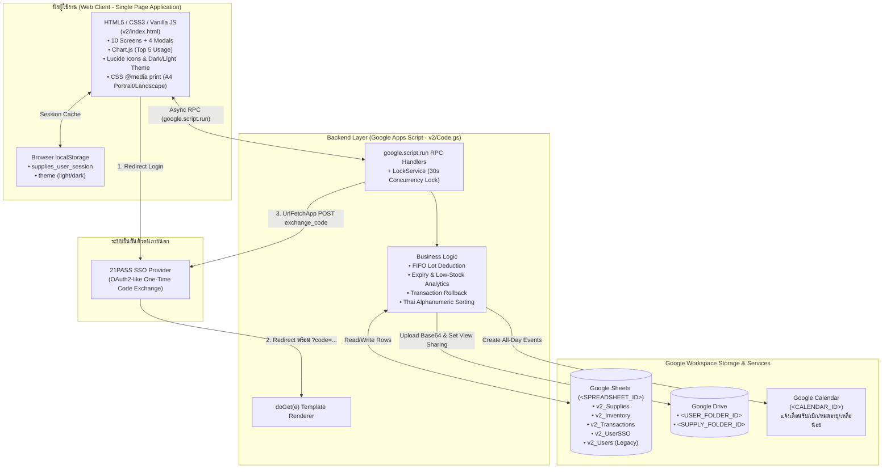
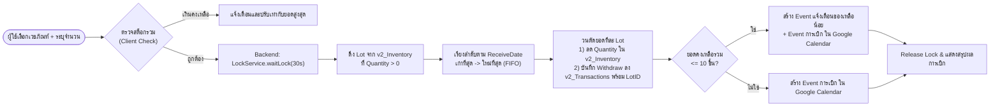
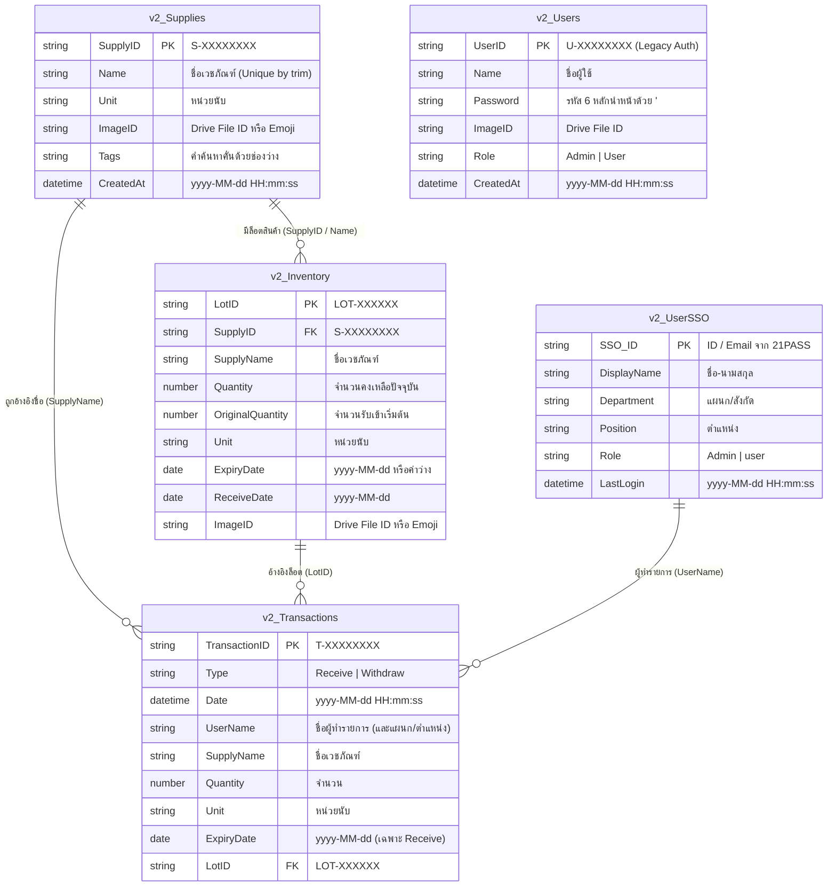

# เอกสารตอบชุดคำถามทีม IT และส่งมอบข้อมูลระบบ (Pro-Health Data BKK South)

**ชื่อระบบ:** ระบบเวชภัณฑ์และอนามัยชุมชน v2 (`ระบบครุภัณฑ์อนามัยชุมชน`)  
**จัดทำโดย:** ทีมพัฒนาและเจ้าของนวัตกรรม **Pro-Health Data BKK South**  
**วัตถุประสงค์:** ใช้ประกอบการส่งมอบข้อมูลเชิงเทคนิคให้ทีม UX, ทีม IT และผู้บริหาร สำหรับการ UX Audit, การประเมินสถาปัตยกรรม และการวางแผนเชื่อมต่อระบบในระดับองค์กร  
**สถานะเอกสาร:** สกัดข้อมูลจริงจากซอร์สโค้ดระบบ (`v2/Code.gs`, `v2/index.html` และประวัติเวอร์ชัน v1 `Code.gs`, `index.html`) พร้อมตัว **Demo Mock-up** แบบ Standalone สำหรับทดลองใช้งานได้ทันที

> [!IMPORTANT]
> **นโยบายความปลอดภัยและการปกปิดข้อมูลสำคัญ (Security & Redaction Notice)**  
> เอกสารฉบับนี้และไฟล์ในโฟลเดอร์ `Demo_ระบบครุภัณฑ์อนามัยชุมชน/` **ได้ตัดทอนและไม่รวมข้อมูลจริงใดๆ** ที่เป็น API Key, Client ID/Secret, URL ของระบบ Production, Google Spreadsheet ID, Google Calendar ID, Google Drive Folder ID และรหัสผ่าน/PIN ที่ใช้งานจริง  
> บัญชีผู้ใช้ รหัสผ่าน และรหัส PIN ทั้งหมดที่ระบุในส่วน Demo Mock-up เป็น **ข้อมูลจำลอง (MOCK)** สำหรับการทดสอบและ UX Audit เท่านั้น

---

## สรุปจุดแข็งของนวัตกรรม (Innovation Highlights)

1. **Zero-Infrastructure Deployment:** พัฒนาบน Google Apps Script + Google Workspace (Sheets, Drive, Calendar) ทำให้หน่วยงานระดับศูนย์บริการสาธารณสุข/อนามัยชุมชนสามารถเปิดใช้งานได้ทันทีโดยไม่มีค่าใช้จ่ายด้าน Server และ Database รายเดือน
2. **Lot-Based Inventory & FIFO Automation:** บริหารสต็อกแบบแยก Lot (`LotID`) พร้อมระบบ **ตัดจ่ายอัตโนมัติตามลำดับรับเข้าก่อน-หลัง (FIFO - First-In, First-Out)** ลดปัญหาเวชภัณฑ์ค้างสต็อกจนหมดอายุ
3. **Proactive Expiry & Low-Stock Alerting:** แจ้งเตือนเวชภัณฑ์ใกล้หมดอายุ (< 30 วัน / วิกฤต < 10 วัน) และของเหลือน้อย (< 10 หน่วย) บนแดชบอร์ด พร้อม **ซิงค์กิจกรรมแจ้งเตือนเข้า Google Calendar อัตโนมัติ** (วันรับเข้า, วันหมดอายุ, ล่วงหน้า 30 วัน และแจ้งเตือนของเหลือน้อย)
4. **Tag-Based Smart Search & Visual Preview:** ค้นหาเวชภัณฑ์ได้ทั้งจากชื่อและแท็กคำค้นหาภาษาไทย/อังกฤษ/ชื่อสามัญ (เช่น `para ยาแก้ปวด`) รองรับรูปภาพจาก Google Drive หรือ Emoji พร้อม Modal ขยายดูรูปก่อนกดเบิกเพื่อลดความผิดพลาดในการหยิบจ่าย
5. **Print-Ready A4 Reporting & Transaction Rollback:** รองรับการสั่งพิมพ์รายงาน PDF ขนาด A4 ทั้งแนวตั้งและแนวนอน (Dashboard, สรุปภาพรวม, ประวัติการเบิกใช้) และมีระบบ **ลบประวัติธุรกรรมที่คีย์ผิดพร้อมคืนยอดสต็อก (Rollback) กลับเข้า Lot เดิมโดยอัตโนมัติ**

---

## คำถามข้อที่ 1: User Manual & Specs (คู่มือการใช้งาน ผังระบบ และรายการฟังก์ชัน)

### 1.1 ผังสถาปัตยกรรมระบบ (System Architecture)



### 1.2 ผังการทำงานหลัก (Core Process Flows)

#### ก. ขั้นตอนการยืนยันตัวตนและกำหนดสิทธิ์ (Authentication & RBAC Flow)
```mermaid
sequenceDiagram
    actor U as ผู้ใช้งาน (เจ้าหน้าที่ / Admin / Guest)
    participant FE as Frontend (v2/index.html)
    participant BE as GAS Backend (v2/Code.gs)
    participant SSO as 21PASS SSO
    participant Sheet as Sheet: v2_UserSSO

    U->>FE: เปิดเว็บแอปพลิเคชัน
    alt มี Session ใน localStorage
        FE->>BE: getSSOUserProfile(loggedInUser)
        BE->>Sheet: ค้นหาแผนก/ตำแหน่ง/Role ล่าสุด
        BE-->>FE: ส่ง Profile กลับและอัปเดตสิทธิ์
    else กดเข้าใช้งานแบบ Guest
        U->>FE: คลิก "ตรวจสอบคลังเวชภัณฑ์ (Guest)"
        FE->>FE: สร้าง Guest Session (Role: guest)
        FE-->>U: แสดงหน้ายอดคงคลัง (Read-Only)
    else กดปุ่มเข้าสู่ระบบด้วย 21PASS SSO
        U->>FE: คลิกปุ่ม 21PASS SSO
        FE->>SSO: Redirect ไปยัง &lt;SSO_URL&gt;?client_id=...&redirect_uri=...
        SSO-->>BE: Redirect กลับพร้อม ?code=... (doGet)
        FE->>BE: verifySSOCode(code)
        BE->>SSO: POST exchange_code (UrlFetchApp)
        SSO-->>BE: คืนค่า User Profile (ID, DisplayName, Dept, Pos, Role)
        BE->>Sheet: logSSOUser(user) บันทึก/อัปเดต LastLogin
        BE-->>FE: คืนค่า user และเปิดหน้า Main Hub
    end
```

#### ข. ขั้นตอนการเบิกเวชภัณฑ์แบบ FIFO และการคืนยอดเมื่อลบธุรกรรม


### 1.3 รายการฟังก์ชันการทำงานทั้งหมด (Functional List)

| รหัส | หน้าจอ / โมดูล | ฟังก์ชัน Client / Backend | คำอธิบายการทำงาน | สิทธิ์การเข้าถึง |
| :--- | :--- | :--- | :--- | :--- |
| **F-01** | เข้าสู่ระบบ (`screen-login`) | `checkSSOSession()`, `verifySSOCode()`, `loginAsGuest()` | รองรับ Login ผ่าน 21PASS SSO (แลก One-Time Code), โหลด Session เดิมจาก `localStorage` และเข้าใช้งานแบบ Guest (ดูสต็อกอย่างเดียว) | All / Guest |
| **F-02** | เมนูหลัก (`screen-hub`) | `updateHubUI()`, `triggerAdminOverride()`, `toggleTheme()` | แสดงการ์ดเมนูตาม Role, ปุ่มสลับ Light/Dark Theme, ปุ่มปลดล็อกสิทธิ์ Admin ชั่วคราวด้วย PIN 6 หลักสำหรับ User และปุ่มออกจากระบบ | User / Admin |
| **F-03** | รับของเข้า (`screen-receive`) | `handleReceiveNameInput()`, `addNewSupplyItem()`, `submitReceiveForm()` / `receiveSupply()` | ค้นหาเวชภัณฑ์เดิมแบบ Autocomplete (ชื่อ/แท็ก) หรือเพิ่มเวชภัณฑ์ใหม่, ระบุจำนวน (รองรับกรณีลงทะเบียนรายการใหม่ด้วยยอด `0`), หน่วยนับ, วันหมดอายุ (หรือ "ไม่ระบุ"), อัปโหลดรูปภาพเข้า Drive หรือเลือก Emoji, สร้าง Lot (`LOT-xxxxxx`) และซิงค์ Google Calendar | Admin |
| **F-04** | เบิกของออก (`screen-withdraw`) | `populateRequesterInfo()`, `addWithdrawRow()`, `confirmWithdrawPopup()` / `withdrawSupplies()` | แสดงข้อมูลผู้เบิกอัตโนมัติ (ชื่อ, แผนก, ตำแหน่ง จาก `v2_UserSSO`), เพิ่มรายการเบิกหลายแถวพร้อมกัน (Multi-line), แสดงรูป/Emoji และคลิกขยายดูรูปได้, ตรวจสอบจำนวนไม่ให้เกินคงเหลือ, ตัดยอดแบบ FIFO และซิงค์ Google Calendar | User / Admin |
| **F-05** | แดชบอร์ดผู้ดูแล (`screen-admin`) | `refreshAdminDashboard()`, `renderUsageChart()`, `printDashboard()` / `getAdminDashboardData()` | กรองช่วงวันที่, ตารางแจ้งเตือนเวชภัณฑ์ใกล้หมดอายุ (< 30 วัน พร้อมไฮไลต์ < 10 วัน และปุ่มแก้ไข Lot), ตารางของเหลือน้อย (< 10 ชิ้น), แผนภูมิแท่ง Top 5 เวชภัณฑ์ที่ใช้มากสุด (Chart.js) และปุ่มพิมพ์ A4 แนวตั้ง/แนวนอน | Admin |
| **F-06** | รายงานสรุปภาพรวม (`screen-report-overview`) | `refreshOverviewReport()`, `printReportPage()` / `getOverviewSummary()` | สรุปยอด `รับเข้า`, `เบิกใช้`, `คงเหลือ` และ `วันหมดอายุใกล้ที่สุด` ของเวชภัณฑ์ทุกรายการ เรียงตามตัวเลข -> A-Z -> ก-ฮ พร้อมพิมพ์ PDF A4 | Admin |
| **F-07** | รายงานประวัติการเบิกใช้ (`screen-report-withdrawal`) | `refreshWithdrawalReport()` / `getWithdrawalSummary()` | สรุปยอดรวมการเบิกออกแยกตามรายการเวชภัณฑ์ เรียงจากเบิกมากสุดไปน้อยสุด ตามช่วงวันที่ที่กำหนด พร้อมพิมพ์ PDF A4 | Admin |
| **F-08** | จัดการรายการเวชภัณฑ์ (`screen-admin-manage-supplies`) | `openEditSupplyImageModal()`, `openLotManagementModal()`, `promptEditUnit()`, `promptEditTags()`, `confirmDeleteSupply()` | แก้ไขรูปภาพ/Emoji (`updateSupplyImage`), จัดการวันหมดอายุราย Lot และล้างวันหมดอายุทุกล็อต (`updateLotExpiry`, `clearAllLotsExpiryForSupply`), แก้ไขหน่วยนับแบบ Cascade (`updateSupplyUnit`), แก้ไขคำค้นหา/แท็ก (`updateSupplyTags`) และลบเวชภัณฑ์พร้อม Lot ทั้งหมด (`deleteSupply`) | Admin |
| **F-09** | จัดการประวัติธุรกรรม (`screen-admin-manage-transactions`) | `refreshManageTransactionsList()`, `filterManageTransactions()`, `confirmDeleteTransaction()` / `deleteTransaction()` | แสดงประวัติ Receive/Withdraw ล่าสุดขึ้นก่อน, กรองตามประเภท (`ALL`, `Receive`, `Withdraw`) และลบธุรกรรมที่คีย์ผิดพร้อม **ปรับปรุง/คืนยอดสต็อกใน `v2_Inventory` อัตโนมัติ** | Admin |
| **F-10** | ตรวจสอบคลังสำหรับผู้เยี่ยมชม (`screen-guest-stock`) | `refreshGuestStockList()` / `getSuppliesWithStock()` | แสดงตารางรายการเวชภัณฑ์ รูปภาพ หน่วยนับ และยอดคงเหลือรวมแบบอ่านอย่างเดียว (ติดป้ายแดงเมื่อ `<= 10`) | Guest |
| **F-11** | ระบบอัตโนมัติหลังบ้าน (Sheet Setup & Migration) | `onOpen()`, `datasetup()`, `checkAndMigrateTagsColumn()`, `forceCalendarAuth()` | เมนูใน Google Sheets สำหรับสร้างชีตทั้ง 5 อัตโนมัติ, Migrate คอลัมน์ `Tags` สำหรับฐานข้อมูลเดิม และกระตุ้นการขอสิทธิ์ Google Calendar | Admin / IT |

### 1.4 แนวทางการใช้งานระบบเบื้องต้น (Quick User Guide)
1. **การเข้าสู่ระบบ:** ผู้ใช้งานเลือกกดเข้าสู่ระบบผ่าน **21PASS SSO** (ระบบจะดึงชื่อ แผนก ตำแหน่ง และ Role มาให้อัตโนมัติ) หรือกด **ตรวจสอบคลังเวชภัณฑ์ (Guest)** เพื่อดูยอดคงเหลือโดยไม่ต้องล็อกอิน
2. **การรับเวชภัณฑ์เข้าคลัง (Admin):** เข้าเมนู `รับของเข้า` -> พิมพ์ค้นหาเวชภัณฑ์เดิม หรือพิมพ์ชื่อใหม่แล้วกดปุ่ม `+` -> กรอกจำนวนรับเข้า, หน่วยนับ, วันหมดอายุ (หรือติ๊ก `ไม่ระบุ`) และเลือกรูป/Emoji -> กดยืนยัน ระบบจะออกรหัส Lot และสร้างกิจกรรมแจ้งเตือนในปฏิทินให้อัตโนมัติ
3. **การเบิกเวชภัณฑ์ (เจ้าหน้าที่/Admin):** เข้าเมนู `เบิกของออก` -> ตรวจสอบข้อมูลผู้เบิก -> คลิกเลือกเวชภัณฑ์จากรายการ (ค้นหาจากชื่อหรือแท็กได้) -> ระบุจำนวนและกด `+ เพิ่มรายการเวชภัณฑ์` หากต้องการเบิกหลายรายการพร้อมกัน -> กดยืนยัน ระบบจะตัดสต็อกจาก Lot ที่รับเข้าก่อน (FIFO)
4. **การติดตามและออกรายงาน (Admin):** เข้าเมนู `ระบบ Admin` เพื่อดูรายการใกล้หมดอายุ, รายการเหลือน้อย, กราฟ Top 5, แก้ไขวันหมดอายุราย Lot, แก้ไขประวัติที่คีย์ผิด หรือสั่งพิมพ์รายงาน A4 (แนวตั้ง/แนวนอน)

---

## คำถามข้อที่ 2: Demo Account & วิธีการเข้าใช้งานระบบทดสอบ

### 2.1 วิธีรัน Demo Mock-up แบบ Standalone (ใช้งานได้ทันที ไม่ต้องเชื่อมต่อเซิร์ฟเวอร์)
ทีมพัฒนาได้จัดทำตัว **Demo Mock-up** ไว้ภายในโฟลเดอร์นี้เพื่อให้ทีม UX และผู้บริหารสามารถทดลองคลิกใช้งานจริงครบทุกหน้าจอ (10 หน้าจอ + Modals + Chart + Print A4) โดยจำลองการทำงานของ `google.script.run` และเก็บข้อมูลชั่วคราวใน `localStorage` ของเบราว์เซอร์

- **ไฟล์หลัก:** [`index.html`](./index.html) และ [`mock-backend.js`](./mock-backend.js)
- **วิธีเปิดใช้งาน:**
  1. ดับเบิลคลิกเปิดไฟล์ `Demo_ระบบครุภัณฑ์อนามัยชุมชน/index.html` ด้วยเบราว์เซอร์ (Chrome / Edge / Safari) **หรือ**
  2. รันเว็บเซิร์ฟเวอร์จำลองในโฟลเดอร์ Demo เช่น `python3 -m http.server 8080` แล้วเปิด `http://localhost:8080`
- **เครื่องมือช่วยทดสอบในแถบ Demo Banner ด้านบน:**
  - ปุ่ม **📅 Log ปฏิทินจำลอง:** ใช้ตรวจสอบข้อความแจ้งเตือนที่ระบบจะส่งไปยัง Google Calendar ในสภาพแวดล้อมจริง
  - ปุ่ม **🔄 รีเซ็ตข้อมูล Demo:** ใช้ล้างข้อมูลที่ทดสอบแก้ไขแล้วให้กลับสู่ชุดข้อมูลตั้งต้น (Seed Data)

### 2.2 บัญชีทดสอบจำลอง (Mock Accounts สำหรับ Demo Mock-up)

> [!NOTE]
> บัญชี รหัสพนักงาน และ PIN ด้านล่างเป็น **ข้อมูลจำลอง (MOCK)** ที่สร้างขึ้นเพื่อใช้ใน Demo Mock-up เท่านั้น **ไม่ใช่บัญชีและรหัสผ่านจริงใน Production**

| ลำดับ | บทบาท (Role) | รหัสจำลอง (Mock ID) | ชื่อ-สกุลจำลอง | แผนก / ตำแหน่งจำลอง | ข้อมูลการเข้าสู่ระบบ (MOCK) | สิทธิ์ที่ทดสอบได้ |
| :---: | :--- | :--- | :--- | :--- | :--- | :--- |
| 1 | **Admin** | `MOCK-ADMIN-01` | พว.สมหญิง รักษ์ชุมชน (MOCK) | กลุ่มงานอนามัยชุมชน (จำลอง) / พยาบาลวิชาชีพชำนาญการ | เลือกผ่านหน้าต่าง "จำลอง 21PASS SSO" (`demo.admin@mock.local`) | ทุกเมนู: รับของเข้า, เบิกของออก, Admin Dashboard, รายงาน, จัดการรายการ/Lot/ธุรกรรม |
| 2 | **Staff (`user`)** | `MOCK-STAFF-01` | นายสมชาย ใจดี (MOCK) | ศูนย์บริการสาธารณสุขโซนใต้ (จำลอง) / นักวิชาการสาธารณสุขปฏิบัติการ | เลือกผ่านหน้าต่าง "จำลอง 21PASS SSO" (`demo.staff@mock.local`) | หน้า Hub (เบิกของออก) และทดสอบปุ่ม **เปิดเมนู Admin** ด้วย **MOCK PIN: `999999`** |
| 3 | **Guest** | `-` | ผู้เยี่ยมชม (Guest) | - | กดปุ่ม `ตรวจสอบคลังเวชภัณฑ์ (Guest)` | หน้าตารางยอดคงเหลือแบบ Read-Only (`screen-guest-stock`) |

### 2.3 ข้อมูลจำลองตั้งต้นในระบบ Demo (Seed Data)
ใน `mock-backend.js` มีข้อมูลตั้งต้น **เวชภัณฑ์ 11 รายการ, Lot สินค้า 12 ล็อต และประวัติธุรกรรม 13 รายการ** ที่ออกแบบให้ครอบคลุมทุกสถานะการแจ้งเตือน:
- **ใกล้หมดอายุวิกฤต (< 10 วัน):** `Paracetamol 500 mg` (`LOT-M101`, อีก 7 วันหมดอายุ), `Povidone-Iodine 10%` (`LOT-M701`, อีก 5 วันหมดอายุ)
- **ใกล้หมดอายุ (< 30 วัน):** `ชุดตรวจ ATK` (อีก 19 วัน), `Gluco Strips` (อีก 24 วัน)
- **ของเหลือน้อย (< 10 ชิ้น) / หมดคลัง:** `ถุงมือตรวจโรค Size M` (`0 กล่อง`), `ปรอทวัดไข้ดิจิทัล` (`4 ชิ้น`), `Povidone-Iodine` (`5 ขวด`), `แอลกอฮอล์ 70%` (`6 ขวด`), `ชุดตรวจ ATK` (`8 ชุด`)
- **รายการไม่ระบุวันหมดอายุ:** `หน้ากากอนามัยทางการแพทย์`, `ปรอทวัดไข้ดิจิทัล`

### 2.4 ช่องทางระบบ Staging / Google Apps Script Test Deployment (สำหรับทีม Deploy)
> สำหรับทีม IT / ผู้ดูแลระบบที่ต้องการแนบลิงก์และบัญชีของสภาพแวดล้อม Staging จริง ให้กรอกข้อมูลลงในช่องว่างด้านล่าง (ห้ามใส่ข้อมูล Production Secrets ลงใน Repository สาธารณะ):
- **Staging Web App URL:** `[รอระบุจากทีม Deploy / ทีม IT]`
- **Staging 21PASS SSO Test Account:** `[รอระบุจากทีม Deploy / ทีม IT]`
- **Staging Admin Override PIN:** `[รอระบุจากทีม Deploy / ทีม IT — ห้ามใช้รหัสเดียวกับ Production]`

---

## คำถามข้อที่ 3: Database & Data Dictionary (โครงสร้างฐานข้อมูลและ Form Fields)

### 3.1 ผังความสัมพันธ์ของข้อมูล (Entity-Relationship Diagram)



### 3.2 Data Dictionary (โครงสร้างชีตฐานข้อมูล Google Sheets ในเวอร์ชัน v2)

#### ตารางที่ 1: `v2_Supplies` (ทะเบียนรายการเวชภัณฑ์หลัก)
| คอลัมน์ | ชื่อฟิลด์ (Header) | ชนิดข้อมูล | รูปแบบ / ตัวอย่าง | คำอธิบาย |
| :---: | :--- | :--- | :--- | :--- |
| A | `SupplyID` | String (PK) | `S-A1B2C3D4` | รหัสเวชภัณฑ์สร้างจาก UUID 8 ตัวแรก |
| B | `Name` | String | `Paracetamol 500 mg` | ชื่อรายการเวชภัณฑ์ (ใช้จับคู่ค้นหาและเชื่อมโยงข้ามตาราง) |
| C | `Unit` | String | `แผง`, `ขวด`, `กล่อง` | หน่วยนับมาตรฐานของเวชภัณฑ์ |
| D | `ImageID` | String | `<DriveFileID>` หรือ `💊` | รหัสไฟล์รูปใน Google Drive หรือตัวอักษร Emoji |
| E | `Tags` | String | `para ยาแก้ปวด ลดไข้` | คำค้นหาเพิ่มเติม (Migrate เพิ่มอัตโนมัติด้วย `checkAndMigrateTagsColumn()`) |
| F | `CreatedAt` | Datetime (String) | `yyyy-MM-dd HH:mm:ss` (GMT+7) | วันเวลาที่สร้างรายการครั้งแรก |

#### ตารางที่ 2: `v2_Inventory` (คลังสินค้าคงเหลือรายล็อต)
| คอลัมน์ | ชื่อฟิลด์ (Header) | ชนิดข้อมูล | รูปแบบ / ตัวอย่าง | คำอธิบาย |
| :---: | :--- | :--- | :--- | :--- |
| A | `LotID` | String (PK) | `LOT-1A2B3C` | รหัสล็อตที่รับเข้า สร้างจาก UUID 6 ตัวแรก |
| B | `SupplyID` | String (FK) | `S-A1B2C3D4` | อ้างอิงรหัสเวชภัณฑ์จาก `v2_Supplies` |
| C | `SupplyName` | String | `Paracetamol 500 mg` | ชื่อเวชภัณฑ์ (Denormalized) |
| D | `Quantity` | Number | `25` | ยอดคงเหลือปัจจุบันของล็อตนี้ (ถูกหักแบบ FIFO เมื่อมีการเบิก) |
| E | `OriginalQuantity` | Number | `100` | ยอดรับเข้าครั้งแรกของล็อตนี้ (ใช้อ้างอิงตอน Rollback) |
| F | `Unit` | String | `แผง` | หน่วยนับ |
| G | `ExpiryDate` | Date / String | `yyyy-MM-dd` หรือ `""` | วันหมดอายุของล็อต (ค่าว่างหมายถึงไม่ระบุวันหมดอายุ) |
| H | `ReceiveDate` | Date (String) | `yyyy-MM-dd` | วันที่รับเข้า (ใช้เรียงลำดับ FIFO เก่าสุดก่อน) |
| I | `ImageID` | String | `<DriveFileID>` หรือ `💊` | รหัสภาพหรือ Emoji (Sync กับ `v2_Supplies`) |

#### ตารางที่ 3: `v2_Transactions` (ประวัติธุรกรรมการรับ-เบิก)
| คอลัมน์ | ชื่อฟิลด์ (Header) | ชนิดข้อมูล | รูปแบบ / ตัวอย่าง | คำอธิบาย |
| :---: | :--- | :--- | :--- | :--- |
| A | `TransactionID` | String (PK) | `T-9F8E7D6C` | รหัสธุรกรรม สร้างจาก UUID 8 ตัวแรก |
| B | `Type` | Enum (String) | `Receive` \| `Withdraw` | ประเภทรายการ (รับเข้า หรือ เบิกออก) |
| C | `Date` | Datetime (String) | `yyyy-MM-dd HH:mm:ss` | วันเวลาที่ทำรายการ (GMT+7) |
| D | `UserName` | String | `ชื่อ (แผนก - ตำแหน่ง)` | ชื่อผู้บันทึกรับเข้า หรือผู้เบิกออกพร้อมสังกัด/ตำแหน่ง |
| E | `SupplyName` | String | `Paracetamol 500 mg` | ชื่อเวชภัณฑ์ |
| F | `Quantity` | Number | `10` | จำนวนที่รับเข้าหรือเบิกออกในธุรกรรมนั้น (แยกตาม Lot ที่ถูกตัด) |
| G | `Unit` | String | `แผง` | หน่วยนับ |
| H | `ExpiryDate` | Date / String | `yyyy-MM-dd` หรือ `""` | วันหมดอายุ (บันทึกเฉพาะ `Receive`) |
| I | `LotID` | String (FK) | `LOT-1A2B3C` | รหัสล็อตที่เกี่ยวข้อง (ใช้คืนสต็อกเมื่อลบธุรกรรม) |

#### ตารางที่ 4: `v2_UserSSO` (ข้อมูลผู้ใช้ที่เข้าสู่ระบบผ่าน 21PASS SSO)
| คอลัมน์ | ชื่อฟิลด์ (Header) | ชนิดข้อมูล | รูปแบบ / ตัวอย่าง | คำอธิบาย |
| :---: | :--- | :--- | :--- | :--- |
| A | `SSO_ID` | String (PK) | ID / Email จาก 21PASS | รหัสอ้างอิงผู้ใช้จากระบบ SSO |
| B | `DisplayName` | String | ชื่อ-สกุล | ชื่อที่แสดงผลและใช้ระบุตัวตนผู้ทำรายการ |
| C | `Department` | String | กลุ่มงาน/แผนก | แผนกที่สังกัด (แสดง Auto-fill ในหน้าเบิกของ) |
| D | `Position` | String | ตำแหน่งงาน | ตำแหน่งของผู้ใช้งาน |
| E | `Role` | String | `Admin` \| `user` | บทบาทสิทธิ์การใช้งานในระบบ |
| F | `LastLogin` | Datetime (String) | `yyyy-MM-dd HH:mm:ss` | วันเวลาที่ล็อกอินครั้งล่าสุด |

#### ตารางที่ 5: `v2_Users` (ตารางผู้ใช้แบบ Legacy Local PIN ที่ยังหลงเหลือใน Backend)
| คอลัมน์ | ชื่อฟิลด์ (Header) | ชนิดข้อมูล | คำอธิบาย |
| :---: | :--- | :--- | :--- |
| A-F | `UserID`, `Name`, `Password`, `ImageID`, `Role`, `CreatedAt` | String / Datetime | ใช้กับฟังก์ชัน `datasetup()`, `login()`, `registerUser()`, `getAllUsers()` ใน `v2/Code.gs` แต่หน้าจอ `v2/index.html` ปัจจุบันเปลี่ยนไปใช้ 21PASS SSO แล้ว |

> **หมายเหตุ (ข้อมูลเวอร์ชัน v1 เดิมใน `Code.gs`):** เวอร์ชัน v1 ใช้ 4 ชีต คือ `Users`, `Supplies` (มีคอลัมน์ `ReqQty`, `RecQty`, `UnrecQty`, `Receiver`, `Date`, `Balance`), `Transactions` (มีคอลัมน์ `FiscalYear` ปีงบประมาณไทย) และ `Settings` (`UnitName`) ซึ่งไม่ได้ถูกเรียกใช้ใน v2 แต่ยังมีโครงสร้างอยู่ในไฟล์เดิมของ Workspace

---

### 3.3 รายการ Form Fields ทั้งหมดที่ระบบใช้อยู่ในปัจจุบัน (`v2/index.html`)

| หน้าจอ / Modal | ชื่อ Field (Label) | Element ID / Class | ชนิด Input | Validation / พฤติกรรมในโค้ด |
| :--- | :--- | :--- | :--- | :--- |
| **รับของเข้า (`screen-receive`)** | ชื่อเวชภัณฑ์ | `#receive-name` | `text` + Autocomplete | บังคับกรอก; พิมพ์ค้นหาจาก Name/Tags; เลือกรายการเดิมหรือกด `+` เพื่อสร้างใหม่แล้วจะล็อก `disabled` |
| | ไม่ได้รับของ (เท่ากับ 0) | `#receive-qty-zero` | `checkbox` | เมื่อติ๊ก จะบังคับ `#receive-qty = 0` (`disabled`) และติ๊ก `#receive-expiry-none` ให้อัตโนมัติ |
| | จำนวนรับเข้า | `#receive-qty` | `number` (`min=1`) | บังคับกรอกจำนวน `> 0` ยกเว้นเมื่อติ๊ก `#receive-qty-zero` |
| | หน่วยนับ | `#receive-unit` | `text` | ล็อกอัตโนมัติถ้าเลือกของเดิม; ปลดล็อกให้กรอกเมื่อกดปุ่ม `+` เพิ่มรายการใหม่ |
| | ไม่ระบุวันหมดอายุ | `#receive-expiry-none` | `checkbox` | เมื่อติ๊ก จะล้างค่าและปิดการใช้งาน `#receive-expiry` |
| | วันหมดอายุ (Expiry Date) | `#receive-expiry` | `date` | Optional; ส่งค่าว่างหากไม่ได้ระบุ |
| | อัปโหลดไฟล์รูปภาพ | `#receive-image` + `#receive-image-base64` | `file` (`image/*`) | แปลงเป็น Base64 ผ่าน `FileReader` ส่งอัปโหลดขึ้น Google Drive |
| | ป้อนอิโมจิเอง / เลือกด่วน | `#receive-custom-emoji` | `text` (`maxlength=2`) | ค่าเริ่มต้นคือ `💊`; ใช้แทนรูปภาพเมื่อไม่มีการอัปโหลดไฟล์ |
| **เบิกของออก (`screen-withdraw`)** | ชื่อผู้เบิก | `#requester-name-input` | `text` (`readonly`) | Auto-fill จาก `loggedInUser.displayName` |
| | แผนกที่ขอเบิก | `#requester-dept-input` | `text` (`readonly`) | Auto-fill จาก `v2_UserSSO.Department` |
| | ตำแหน่งผู้ขอเบิก | `#requester-pos-input` | `text` (`readonly`) | Auto-fill จาก `v2_UserSSO.Position` |
| | รายการเวชภัณฑ์ (ต่อแถว) | `.withdraw-name` | `text` + Autocomplete | เพิ่มได้หลายแถว; เลือกรายการแล้วจะล็อกชื่อและแสดงรูปตัวอย่าง |
| | จำนวนที่เบิก (ต่อแถว) | `.withdraw-qty` | `number` (`min=1`) | ตรวจไม่ให้เกิน `dataset.maxStock` แบบ Real-time (เกินจะปรับลงเท่าสต็อกสูงสุด) |
| | หน่วยนับ (ต่อแถว) | `.withdraw-unit` | `text` (`disabled`) | แสดงอัตโนมัติตามเวชภัณฑ์ที่เลือก |
| **Admin Override** | รหัสผ่าน 6 หลัก | `window.prompt()` | Native Prompt | ตรวจสอบรหัสผ่านในฝั่ง Client สำหรับสิทธิ์ `user` เพื่อเปิดเมนู Admin ชั่วคราว |
| **ตัวกรองแดชบอร์ด & รายงาน** | จากวันที่ / ถึงวันที่ | `#admin-filter-start/end`, `#overview-filter-start/end`, `#withdrawal-filter-start/end` | `date` | ใช้กรองช่วงเวลาของประวัติ `v2_Transactions` |
| **จัดการประวัติธุรกรรม** | ประเภทรายการ | `#manage-trans-filter-type` | `select` | ตัวเลือก: `ALL` (ทั้งหมด), `Receive` (รับของเข้า), `Withdraw` (เบิกของออก) |
| **Modal จัดการล็อต (`dialog-manage-lots`)** | วันหมดอายุราย Lot | `#lot-exp-input-<LotID>` | `date` | แก้ไขวันหมดอายุเฉพาะ Lot หรือกดปุ่มล้างวันหมดอายุ (ราย Lot / ทุกล็อต) |
| **Modal แก้ไขรูป (`dialog-edit-supply-image`)** | ไฟล์รูปภาพใหม่ | `#edit-supply-image-file` + `#edit-supply-image-base64` | `file` (`image/*`) | ตรวจสอบขนาดไฟล์ไม่เกิน `5MB` บน Client |
| | ป้อนอิโมจิ | `#edit-supply-custom-emoji` | `text` (`maxlength=2`) | เลือกจากปุ่มลัด 10 แบบหรือพิมพ์เอง |
| **Modal แก้ไขหน่วยนับ / แท็ก** | หน่วยนับใหม่ / แท็กคำค้นหา | `window.prompt()` | Native Prompt | แก้ไขหน่วยนับแบบ Cascade ทุกตาราง หรือแก้ไข `Tags` คั่นด้วยช่องว่าง |

---

## คำถามข้อที่ 4: Current Pain Points / Tech Constraints (ข้อจำกัดเชิงเทคนิคและปัญหาที่พบ)

จากการตรวจสอบซอร์สโค้ดและสถาปัตยกรรมจริงของระบบ `v2/Code.gs` และ `v2/index.html` พบข้อจำกัดเชิงเทคนิคและจุดที่ส่งผลต่อประสบการณ์ผู้ใช้ (UX) และความปลอดภัย ดังนี้

### 4.1 ข้อจำกัดเชิงสถาปัตยกรรมและประสิทธิภาพ (Technical Bottlenecks)
1. **การอ่าน/เขียน Google Sheets แบบ Full-Table Scan และ Cell-by-Cell Update:**
   - ฟังก์ชันหลักอย่าง `getOverviewSummary()`, `getAdminDashboardData()`, `withdrawSupplies()` และ `updateSupplyUnit()` เรียก `getDataRange().getValues()` ดึงข้อมูลทั้งชีตทุกครั้ง และแก้ไขข้อมูลแบบวนลูปเรียก `sheet.getRange(...).setValue(...)` ทีละแถว (เช่น ตอนหัก Lot แบบ FIFO หรือแก้หน่วยนับย้อนหลังใน `v2_Inventory` และ `v2_Transactions`) ซึ่งมีแนวโน้มช้าลงแบบเชิงเส้น ($O(N)$ API calls) เมื่อประวัติธุรกรรมสะสมเกินหลักพัน-หมื่นแถว และเสี่ยงชน **Google Apps Script 6-minute execution limit** หรือโควตา Spreadsheet Service
2. **การล็อกคิวแบบ Global Lock (`LockService.getScriptLock().waitLock(30000)`):**
   - การรับเข้า, เบิกออก, แก้ไข Lot, ลบธุรกรรม และเปลี่ยนรูปภาพ ใช้ Script Lock ตัวเดียวกันทั้งหมด ทำให้ผู้ใช้งานพร้อมกันหลายคน (Concurrent Users) ต้องเข้าคิวรอทีละคน สูงสุด 30 วินาที
3. **การผูกความสัมพันธ์ข้อมูลด้วยชื่อเวชภัณฑ์ (`SupplyName`) แทน Primary Key ในบางจุด:**
   - ใน `withdrawSupplies()`, `getSupplyLots()`, `getOverviewSummary()` และ `updateSupplyUnit()` มีการเทียบจับคู่ด้วยข้อความ `SupplyName` (เช่น `rowName.toLowerCase() === targetName`) ซึ่งหากชื่อเวชภัณฑ์มีช่องว่างเกิน หรือมีชื่อคล้ายกัน/เปลี่ยนชื่อในอนาคต อาจทำให้ข้อมูลข้ามตารางไม่เชื่อมโยงกัน (ไม่มีฟังก์ชัน Rename `SupplyName` ใน v2)
4. **ความเปราะบางของ `deleteRow()` กับอ้างอิง Lot และไม่มี Soft Delete / Audit Trail:**
   - เมื่อลบเวชภัณฑ์ (`deleteSupply`) หรือลบธุรกรรม (`deleteTransaction`) ระบบลบแถวออกจาก Google Sheets ถาวร (Hard Delete) โดยไม่เก็บ Log ผู้ลบหรือเหตุผลการลบ และหาก `withdrawSupplies()` ตัดยอดข้ามหลาย Lot (`LOT-1`, `LOT-2`) แต่ลบธุรกรรมไม่ครบทุกแถว หรือเคยลบ Lot ไปแล้ว ยอดคงเหลืออาจคลาดเคลื่อนได้
5. **ข้อจำกัดการแชร์รูปภาพบน Google Drive ในโดเมนองค์กร:**
   - `uploadImageToDrive()` พยายามตั้งค่า `DriveApp.Access.ANYONE_WITH_LINK` ซึ่งโค้ดเองระบุ Catch Warning ไว้ว่าอาจติดนโยบาย Google Workspace ขององค์กร (Domain Policy) ทำให้รูปภาพที่แสดงผ่าน `lh3.googleusercontent.com/d/<ID>` ไม่แสดงผลในเบราว์เซอร์ของผู้ใช้บางราย
6. **ไม่รองรับการทำงานแบบ Offline / Bad Network:**
   - ทุก Action ต้องรอ `google.script.run` ตอบกลับแบบ Synchronous-like พร้อม Overlay โหลดทั้งหน้าจอ หากเจ้าหน้าที่อนามัยชุมชนออกหน่วยภาคสนามในจุดอับสัญญาณ จะไม่สามารถบันทึกหรือเบิกจ่ายได้

### 4.2 ประเด็นด้านความปลอดภัยและการควบคุมสิทธิ์ (Security & RBAC Constraints)
1. **ไม่มีการตรวจสอบสิทธิ์ (Authorization Check) ฝั่ง Server-Side:**
   - ฟังก์ชัน Backend ใน `v2/Code.gs` (เช่น `receiveSupply`, `deleteSupply`, `deleteTransaction`, `updateLotExpiry`) ไม่มีการตรวจสอบ Session Token หรือ Role ของผู้เรียกใช้ อาศัยการซ่อนปุ่ม `.admin-only` บนหน้าเว็บและพึ่งพากลไกของ Google Apps Script Web App เท่านั้น
2. **Client-Side Hardcoded Admin Override PIN:**
   - ฟังก์ชัน `triggerAdminOverride()` ใน `v2/index.html` ตรวจสอบรหัส PIN 6 หลักอยู่ในโค้ด JavaScript ฝั่ง Client (`if (pin === "...")`) ซึ่งผู้ใช้งานทั่วไปสามารถเปิด DevTools ดูโค้ดได้ และรหัส Override ถูกเก็บสถานะไว้ใน `localStorage` (`isAdminOverride: true`)
3. **การเก็บข้อมูล Session ฝั่ง Client และการผสานระบบเดิม:**
   - Session ผู้ใช้เก็บเป็น Plain JSON ใน `localStorage` (`supplies_user_session`) ทำให้แก้ไข Role ฝั่ง Client ได้หากไม่มี Server Token Verification นอกจากนี้ยังมีฟังก์ชัน Legacy (`v2_Users` ที่เก็บรหัสผ่าน Plaintext นำหน้าด้วย `'`) หลงเหลืออยู่ใน `v2/Code.gs`

### 4.3 จุดติดขัดด้าน UX / UI ที่พบจากโค้ดจริง (จุดที่ผู้ใช้งานมักสับสนหรือติดปัญหา)
1. **ปุ่มยืนยัน (Confirm Dialog) ใน `v2/index.html` ขาดปุ่ม "ยกเลิก":**
   - ฟังก์ชัน `showConfirmDialog()` เรียกหา Element `#dialog-confirm` ซึ่งถูกลบออกจาก HTML ในเวอร์ชัน v2 ทำให้โค้ด Fallback ไปเรียก `showAlertDialog()` ที่มีเฉพาะปุ่ม "ตกลง" ปุ่มเดียว ผู้ใช้ไม่สามารถกดยกเลิกจากหน้าต่างยืนยันการเบิกหรือยืนยันการลบข้อมูลได้ *(หมายเหตุ: ใน Demo Mock-up ได้เพิ่ม `#dialog-confirm` กลับมาให้ทดสอบ flow การกดยืนยัน/ยกเลิกได้อย่างสมบูรณ์)*
2. **ช่องกรอกชื่อเวชภัณฑ์ถูกล็อก (`disabled = true`) หลังเลือกแล้วแก้ไขไม่ได้ทันที:**
   - ในหน้า `รับของเข้า` (`selectReceiveItem`, `addNewSupplyItem`) และ `เบิกของออก` (`selectWithdrawItem`) เมื่อเลือกเวชภัณฑ์แล้ว ช่อง input จะถูกตั้งค่า `disabled = true` โดยหน้า `รับของเข้า` ไม่มีปุ่ม "ล้าง/เปลี่ยนรายการ" (ต้องบันทึกหรือออกจากหน้าแล้วเข้าใหม่) ส่วนหน้า `เบิกของออก` ต้องกดลบทั้งแถวแล้วเพิ่มแถวใหม่
3. **การใช้ Browser Native `prompt()` ในหน้าจัดการเวชภัณฑ์:**
   - การแก้ไข `หน่วยนับ` (`promptEditUnit`), `แท็ก` (`promptEditTags`) และ `Admin Override PIN` ยังใช้ `window.prompt()` ของเบราว์เซอร์ ซึ่งไม่สอดคล้องกับ Design System ของ Modal อื่นๆ และใช้งานไม่สะดวกบนมือถือ
4. **เกณฑ์แจ้งเตือน "ของเหลือน้อย" ไม่สอดคล้องกันเล็กน้อยใน 3 จุด:**
   - หน้า Admin Dashboard (`getAdminDashboardData`) ใช้เงื่อนไข `< 10` (น้อยกว่า 10)
   - การแจ้งเตือนลง Google Calendar (`syncWithdrawToCalendar`) และหน้า Guest (`refreshGuestStockList`) ใช้เงื่อนไข `<= 10` (น้อยกว่าหรือเท่ากับ 10)
5. **การตรวจสอบขนาดไฟล์รูปภาพไม่เท่ากันทุกหน้าจอ:**
   - หน้า `แก้ไขรูปภาพ` (`previewNewSupplyImage`) ตรวจขนาดไฟล์ไม่เกิน `5MB` แต่หน้า `รับของเข้า` (`previewImage`) ไม่ได้ตรวจขนาดไฟล์ก่อนแปลง Base64 ซึ่งอาจทำให้ส่ง Payload เกินขีดจำกัดของ `google.script.run`
6. **ยังไม่มี Search / Pagination ในหน้ารายงานและตารางจัดการ:**
   - หน้าจัดการรายการเวชภัณฑ์, หน้าประวัติธุรกรรม และหน้ารายงานภาพรวม โหลดและแสดงผลทุกแถวใน DOM พร้อมกัน ไม่มีช่องค้นหาหรือแบ่งหน้า (Pagination)

---

## คำถามข้อที่ 5: API & Integration (การเชื่อมต่อกับระบบของ กทม. / สปสช. และระบบภายนอก)

### 5.1 สิ่งที่ระบบรองรับแล้วในโค้ดปัจจุบัน (Currently Supported)
1. **การยืนยันตัวตนแบบ SSO กับระบบภายนอก (`21PASS SSO`):**
   - ระบบ v2 รองรับการเชื่อมต่อผ่าน `UrlFetchApp.fetch()` (HTTP POST JSON) กับ **21PASS SSO** โดยส่ง `action: "exchange_code"`, `code`, `client_id`, `client_secret` เพื่อรับข้อมูลโปรไฟล์ผู้ใช้งาน (`id`, `displayName`, `department`, `position`, `role`) และบันทึกประวัติลง `v2_UserSSO`
   - *สถานะใน Demo Mock-up:* จำลองการเลือกบัญชี SSO ใน Client (`mock-backend.js`) โดยไม่ได้เรียก URL จริง
2. **การเชื่อมต่อ Google Workspace APIs (Built-in GAS Services):**
   - เชื่อมต่อ **Google Sheets**, **Google Drive** และ **Google Calendar** ผ่าน Apps Script Native Services (`SpreadsheetApp`, `DriveApp`, `CalendarApp`)
3. **การเชื่อมต่อแบบ Web RPC ภายใน Google Apps Script:**
   - ระหว่าง Frontend (`index.html`) กับ Backend (`Code.gs`) สื่อสารผ่าน `google.script.run` (เฉพาะภายใน Web App ของ GAS เท่านั้น)

### 5.2 สิ่งที่ยังไม่รองรับและช่องว่างสำหรับการเชื่อมต่อ กทม. / สปสช. (Gaps & Roadmap)
**สรุปคำตอบสั้น:** ระบบปัจจุบัน **ยังไม่รองรับการเชื่อมต่อ API กับระบบส่วนกลางของ กทม. (BMA) หรือ สปสช. (NHSO)** โดยตรง เนื่องจากยังไม่มี RESTful API Endpoint และมาตรฐานรหัสเวชภัณฑ์/ข้อมูลสุขภาพกลาง

| มิติการเชื่อมต่อ | สถานะปัจจุบันในโค้ด | ช่องว่างและสิ่งที่ต้องพัฒนาต่อเพื่อเชื่อม กทม. / สปสช. |
| :--- | :--- | :--- |
| **1. RESTful API / Webhook** | มีเฉพาะ `doGet(e)` สำหรับเสิร์ฟหน้า HTML; ไม่มี `doPost(e)` หรือ JSON API Endpoint ที่เปิดให้ระบบภายนอกเรียก | ต้องสร้าง API Gateway / REST API (`doPost` / `doGet` JSON หรือย้าย Backend ไป Cloud Run / Node.js / FastAPI) พร้อม API Key / OAuth2 Bearer Token และ Rate Limiting |
| **2. มาตรฐานรหัสเวชภัณฑ์และยา** | ใช้รหัสภายในที่สุ่มเอง (`S-XXXXXXXX`, `LOT-XXXXXX`) และชื่อเวชภัณฑ์แบบ Free-text | ยังไม่มีฟิลด์รองรับรหัสมาตรฐานกลาง เช่น **TMT (Thai Medical Terminology)**, **TPU**, **รหัสยา 24 หลักของ สปสช.**, **รหัสครุภัณฑ์/พัสดุของ กทม.**, หรือ **GTIN / Barcode** |
| **3. การเชื่อมโยงข้อมูลผู้รับบริการ / HIS** | บันทึกเฉพาะผู้ขอเบิก (เจ้าหน้าที่/แผนก) ไม่มีข้อมูลผู้ป่วย/HN/เลขบัตรประชาชน 13 หลัก หรือรหัสหน่วยบริการ (HCode 5 หลัก) | หากต้องส่งข้อมูลเบิกจ่ายเชื่อมกับระบบบริการปฐมภูมิ (เช่น JHCIS, HOSxP, Bangkok Health Data, หรือระบบเคลม สปสช.) ต้องเพิ่มโมเดลข้อมูล HCode, ประเภทสิทธิการรักษา และมาตรฐาน **HL7 FHIR (Medication / SupplyDelivery)** |
| **4. การส่งออก/แลกเปลี่ยนข้อมูล (Batch / Export)** | รองรับการพิมพ์เป็น PDF ผ่าน Browser (`window.print()`) และดูข้อมูลดิบใน Google Sheets | ยังไม่มีปุ่ม Export มาตรฐาน **CSV / Excel / JSON / XML** ที่จัดรูปแบบตาม Template ของกองเภสัชกรรม/สำนักอนามัย กทม. หรือ สปสช. |
| **5. การควบคุมสิทธิ์ระดับหลายหน่วยงาน (Multi-Tenancy)** | ออกแบบมาสำหรับคลังเดียว (Single Spreadsheet ID) แยกแผนกเป็นข้อความใน `v2_UserSSO` เท่านั้น | หากขยายใช้งานหลายศูนย์บริการสาธารณสุขในโซนใต้ (BKK South) ต้องเพิ่ม `UnitID / FacilityID` เพื่อแยกสต็อกรายศูนย์และการโอนย้ายระหว่างคลัง |

---

## ภาคผนวก: รายการไฟล์ในโฟลเดอร์ Demo

| ชื่อไฟล์ | หน้าที่ | หมายเหตุ |
| :--- | :--- | :--- |
| [`index.html`](./index.html) | หน้าเว็บแอปพลิเคชัน Demo Mock-up (10 Screens + Modals) | รันได้ทันทีบนเบราว์เซอร์, รองรับ Dark/Light Mode และพิมพ์ A4 |
| [`mock-backend.js`](./mock-backend.js) | ตัวจำลอง Backend (`google.script.run`) + Seed Data + FIFO Engine | ใช้ข้อมูลจำลอง 100% เก็บใน `localStorage` |
| [`REPORT_IT_RESPONSE.md`](./REPORT_IT_RESPONSE.md) | รายงานตอบชุดคำถามทีม IT ทั้ง 5 ข้อ (ไฟล์นี้) | ปลอดข้อมูลลับ/ID/URL/รหัสผ่านจริง |
