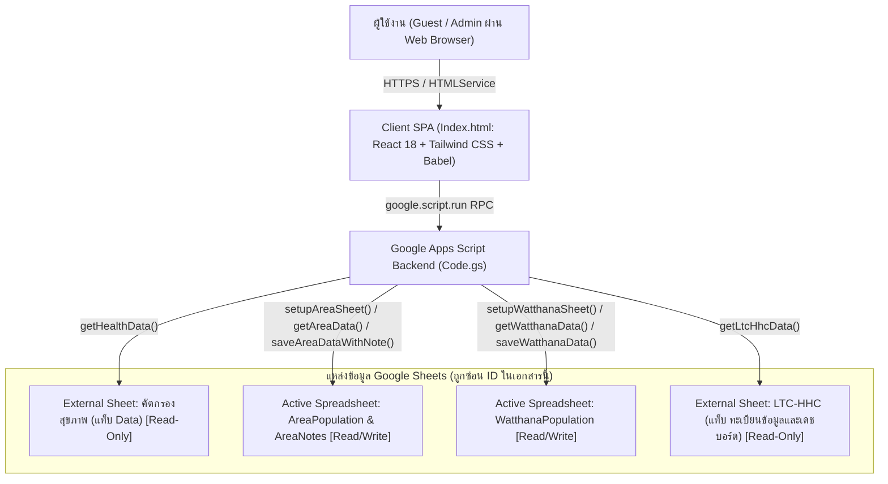
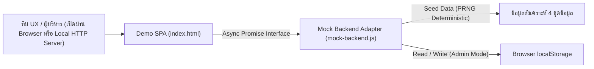
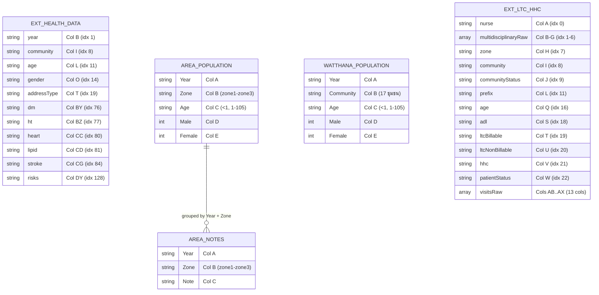

# รายงานข้อมูลเชิงเทคนิคและคำชี้แจงต่อทีม IT / UX / ผู้บริหาร
**โครงการ:** Pro-Health Data BKK South — ระบบย่อย: **ระบบพีระมิดประชากร (ประชากร Data Center)**  
**จัดทำโดย:** ทีมพัฒนาและเจ้าของนวัตกรรม Pro-Health Data BKK South  
**สถานะเอกสาร:** ฉบับส่งมอบพร้อมระบบ Demo Mock-up (อ้างอิงข้อมูลจากซอร์สโค้ดจริงและชุดข้อมูลจำลอง)

> [!IMPORTANT]
> **นโยบายความปลอดภัยของเอกสารและชุด Demo**  
> เพื่อความปลอดภัยของข้อมูลราชการและข้อมูลสุขภาพส่วนบุคคล ชุด Demo Mock-up และรายงานฉบับนี้ **ไม่มีการแนบ Google Sheet ID จริง, ลิงก์ Google Drive, API Key, หรือรหัสผ่านใช้งานจริงของระบบ Production** แต่อย่างใด ข้อมูลที่แสดงในระบบ Demo ทั้งหมดเป็นชุดข้อมูลสังเคราะห์ (Synthetic Seed Data) และใช้รหัสผ่านจำลองเฉพาะสำหรับสภาพแวดล้อมทดสอบเท่านั้น

---

## บทสรุปผู้บริหารและจุดเด่นของนวัตกรรม

**ระบบพีระมิดประชากร (ประชากร Data Center)** ภายใต้โครงการ **Pro-Health Data BKK South** เป็นเว็บแอปพลิเคชันวิเคราะห์โครงสร้างประชากรและข้อมูลสุขภาพเชิงพื้นที่แบบหลายมิติ (Multi-dimensional Population & Health Pyramid Analytics) ออกแบบมาเพื่อช่วยให้ทีมสาธารณสุข ผู้บริหารศูนย์บริการสาธารณสุข และนักวางแผนชุมชน เห็นภาพรวมโครงสร้างอายุ-เพศของประชากรควบคู่กับภาระโรคเรื้อรัง กลุ่มเสี่ยง และผู้ป่วยดูแลระยะยาว (LTC-HHC) ได้แบบเรียลไทม์

### จุดแข็งหลักของนวัตกรรม (Extracted from Codebase)
1. **การจำลองโครงสร้างประชากรข้ามเวลา (Population Aging Projection ±100 ปี พ.ศ.):**  
   ผู้ใช้งานสามารถปรับปี พ.ศ. เป้าหมายได้ตั้งแต่ `-100 ปี` ถึง `+100 ปี` จากปีปัจจุบัน เพื่อจำลองการขยับโครงสร้างอายุประชากร (Cohort Aging Shift) สำหรับวางแผนรองรับสังคมผู้สูงอายุล่วงหน้า
2. **การวิเคราะห์เชิงลึกเฉพาะกลุ่มสุขภาพ (Multi-dimensional Health & LTC-HHC Filtering):**  
   - **ด้านคัดกรองสุขภาพ:** กรองร่วมกันได้ทั้งปีงบประมาณ, ชุมชน, ประเภทที่อยู่, กลุ่มโรคเรื้อรัง 5 โรคหลัก และปัจจัยเสี่ยง 14 รายการ
   - **ด้าน LTC-HHC:** กรองได้ถึง 8 มิติ พร้อมคำนวณ **ค่าเฉลี่ยคะแนน ADL** ของกลุ่มที่เลือกโดยอัตโนมัติ และตรวจจับข้อมูลที่ไม่สามารถระบุเพศจากคำนำหน้าได้
3. **การปรับมุมมองกราฟพีระมิดอย่างยืดหยุ่นและพร้อมพิมพ์รายงาน (Flexible Visualization & Print-ready):**  
   รองรับการจัดกลุ่มอายุ 4 รูปแบบ (รายปี `<1`–`105+`, กลุ่ม 5 ปี, กลุ่ม 10 ปี, กลุ่มช่วงวัย 5 ช่วง), โหมดรวมแท่งชาย-หญิง, ซ่อนช่วงอายุที่ไม่มีข้อมูล, การซูมสเกล 9 ระดับ (`ย่อ 5x` ถึง `ขยาย 5x`) และการจัดหน้าพิมพ์รายงานขนาด A4 แนวตั้งอัตโนมัติ
4. **สถาปัตยกรรมไร้เซิร์ฟเวอร์ (Zero-Infrastructure Serverless Architecture):**  
   ระบบจริงพัฒนาบน Google Apps Script + Google Sheets ทำให้หน่วยงานไม่มีค่าใช้จ่ายด้าน Server Hosting และบุคลากรสาธารณสุขสามารถใช้งานร่วมกับฐานข้อมูล Google Sheets ที่คุ้นเคยได้ทันที

---

## คำตอบข้อ 1: User Manual & Specs (คู่มือการใช้งาน ผังระบบ และรายการฟังก์ชัน)

### 1.1 ผังสถาปัตยกรรมระบบ (System Architecture)

#### ก. สถาปัตยกรรมระบบ Production (Google Apps Script)


#### ข. สถาปัตยกรรมชุด Demo Mock-up (Standalone สำหรับ UX Audit)


### 1.2 รายการฟังก์ชันการทำงาน (Functional List)

| รหัส | โมดูล / ฟังก์ชัน | บทบาทที่เข้าถึงได้ | รายละเอียดการทำงานที่สกัดจากโค้ดจริง |
| :--- | :--- | :--- | :--- |
| **F-01** | **Role Gate (ระบบเข้าสู่ระบบ)** | Guest, Admin | หน้าจอเลือกสิทธิ์เข้าใช้งานแบบ 2 บทบาท ได้แก่ `ผู้เยี่ยมชม (guest)` และ `ผู้ดูแลระบบ (admin)` (แสดงเมนูจัดการข้อมูลเฉพาะ Admin) |
| **F-02** | **ข้อมูลคัดกรองสุขภาพ** (`HealthScreeningView`) | Guest, Admin | แสดงพีระมิดจากทะเบียนคัดกรองสุขภาพ พร้อมตัวกรอง 5 มิติ: ปีงบประมาณ, ชุมชน (Multi-select), ประเภทที่อยู่, โรคประจำตัว 5 โรค, และความเสี่ยง 14 รายการ (มี Logic ระงับการเลือกความเสี่ยงและโรคประจำตัวพร้อมกัน) |
| **F-03** | **ประชากรพื้นที่รับผิดชอบ** (`AreaPopulationView`) | Guest, Admin | แสดงพีระมิดแยกตาม 3 เขตพื้นที่รับผิดชอบ (`พระโขนงเหนือ`, `คลองตันเหนือ`, `คลองเตยเหนือ`) หรือดู `รวมทุกเขต` เลือกปี พ.ศ. และแสดงกล่องหมายเหตุ (`AreaNotes`) ประจำเขต/ปี |
| **F-04** | **สถิติประชากรเขตวัฒนา** (`WatthanaPopulationView`) | Guest, Admin | แสดงพีระมิดแยกรายชุมชนในเขตวัฒนาครบ 17 ชุมชน (`1.ไม่กำหนดชุมชน` ถึง `17.สุเหร่าบางมะเขือ`) พร้อมตัวเลือกปี พ.ศ. |
| **F-05** | **ผู้ป่วย LTC-HHC** (`LtcHhcView`) | Guest, Admin | แสดงพีระมิดผู้ป่วย LTC/HHC พร้อมตัวกรอง 8 มิติ (เขต, ชุมชน, สถานะชุมชน, สหวิชาชีพ, กลุ่มผู้ป่วย 14 กลุ่มย่อย, สถานะผู้ป่วย, ผลการเยี่ยม, ช่วงคะแนน ADL 0–20), คำนวณ **ค่าเฉลี่ย ADL**, อนุมานเพศจากคำนำหน้า และแจ้งเตือนกรณีไม่ระบุเพศ |
| **F-06** | **จัดการข้อมูล** (`DataManagementView`) | Admin เท่านั้น | สลับจัดการได้ 2 โหมด (`พื้นที่รับผิดชอบ` และ `เขตวัฒนา`), สร้างโครงสร้างตารางปี พ.ศ. ใหม่ (`setupAreaSheet` / `setupWatthanaSheet`), แก้ไขจำนวนชาย/หญิงรายอายุ `<1`–`105`, บันทึกหมายเหตุรายเขต |
| **F-07** | **เครื่องมือกราฟและพิมพ์รายงาน** (`PyramidDisplay`) | Guest, Admin | สลับโหมดรวมชายหญิง (แท่งเดียว), ซ่อนแถวว่าง, จัดกลุ่มอายุ (รายปี / 5 ปี / 10 ปี / ช่วงวัย `0-5`, `6-24`, `25-34`, `35-59`, `60+`), ซูมสเกล 9 ระดับ (`0.2x`–`5x`), จำลองปี พ.ศ. (±100 ปี), พิมพ์ A4 (`window.print()`) |

### 1.3 คู่มือการใช้งานเบื้องต้น (User Manual)

1. **การเข้าสู่ระบบ:**
   - เลือก **"เข้าสู่ระบบ ผู้เยี่ยมชม"** เพื่อดู Dashboard และรายงานทั้ง 4 เมนูหลัก
   - เลือก **"เข้าสู่ระบบ ผู้ดูแลระบบ (Admin)"** และกรอกรหัสผ่าน เพื่อเข้าถึงเมนู **"จัดการข้อมูล (Admin)"** เพิ่มเติม
2. **การวิเคราะห์ข้อมูลพีระมิด (ทุกเมนู Dashboard):**
   - เลือกเงื่อนไขตัวกรองด้านบน (รองรับการเลือกหลายรายการพร้อมกันในช่อง Multi-select และกด "ล้างการเลือกทั้งหมด" ได้)
   - ปรับรูปแบบกราฟจากแถบเครื่องมือเหนือกราฟ เช่น ติ๊กเลือก `กลุ่ม 5 ปี` หรือ `กลุ่มช่วงวัย`, กด `+` / `-` เพื่อขยายหรือย่อแกนสเกลเมื่อข้อมูลบางช่วงอายุมีจำนวนมากหรือน้อยเกินไป
   - เลื่อนลงด้านล่างในกรอบ **"พีระมิดประชากรเมื่ออยู่ในปี พ.ศ."** เพื่อจำลองโครงสร้างประชากรในอนาคตหรืออดีต
   - กดปุ่ม **"พิมพ์รายงาน"** มุมขวาบน ระบบจะซ่อนเมนูและแถบตัวกรองอัตโนมัติ พร้อมพิมพ์สรุปเงื่อนไขที่เลือกไว้บนหัวกระดาษ A4
3. **การบันทึกและสร้างฐานข้อมูลรายปี (สำหรับ Admin):**
   - เข้าเมนู **"จัดการข้อมูล (Admin)"** → เลือกโหมด `จัดการพื้นที่รับผิดชอบ` หรือ `จัดการประชากรเขตวัฒนา`
   - เลือก **ปี พ.ศ.** ที่ต้องการ → หากเป็นปีใหม่ให้กดปุ่ม **"Setup โครงสร้างตารางปีนี้"** ก่อน 1 ครั้ง เพื่อให้ระบบสร้างแถวอายุ `<1` ถึง `105` อัตโนมัติ
   - กรอกจำนวนประชากร `ชาย` / `หญิง` (และ `หมายเหตุ` กรณีพื้นที่รับผิดชอบ) จากนั้นกด **"บันทึกข้อมูล"**

---

## คำตอบข้อ 2: Demo Account & Staging (บัญชีทดสอบ ข้อมูลจำลอง และวิธีรันระบบ)

### 2.1 บัญชีทดสอบระบบ Demo Mock-up (Mock Credentials)

> [!NOTE]
> ข้อมูลบัญชีด้านล่างเป็น **บัญชีจำลอง (Mock Credentials)** ที่สร้างขึ้นเฉพาะในชุด Demo Mock-up นี้เพื่อให้ทีม UX เข้าตรวจสอบ UI/UX ได้ครบทุกหน้าจอ **ไม่ใช่รหัสผ่านใช้งานจริงของระบบ Production**

| บทบาท (Role) | ชื่อผู้ใช้ / วิธีเข้าสู่ระบบ | รหัสผ่านจำลอง (Mock Password) | สิทธิ์การเข้าถึง |
| :--- | :--- | :--- | :--- |
| **ผู้เยี่ยมชม (Guest)** | กดปุ่ม `เข้าสู่ระบบ ผู้เยี่ยมชม (Guest)` | *(ไม่ต้องใช้รหัสผ่าน)* | ดูรายงานและกรองข้อมูล 4 เมนู (สุขภาพ, พื้นที่รับผิดชอบ, เขตวัฒนา, LTC-HHC) |
| **ผู้ดูแลระบบ (Admin)** | กดปุ่ม `เข้าสู่ระบบ ผู้ดูแลระบบ (Admin)` | `demo-admin` *(มีปุ่มเติมรหัส Demo ในหน้าจอ)* | สิทธิ์ทั้งหมดของ Guest + เมนู `จัดการข้อมูล (Admin)` (Setup ปีใหม่, แก้ไขตัวเลข, บันทึก Note ลง `localStorage`) |

### 2.2 ข้อมูลจำลอง (Seed / Mock Data) ในชุด Demo
ไฟล์ `mock-backend.js` สร้างข้อมูลสังเคราะห์แบบ Deterministic (ค่าคงที่ทุกครั้งที่เปิดด้วย Mulberry32 PRNG) ครอบคลุมทุกกรณีทดสอบ:
1. **ข้อมูลคัดกรองสุขภาพ:** จำนวน 420 รายการ ครอบคลุมปีงบประมาณ `2567`–`2569`, ชุมชนเขตวัฒนา 16 ชุมชน, ประเภทที่อยู่ 3 แบบ, สถานะโรคเรื้อรัง 5 โรค และความเสี่ยง 14 รายการ
2. **ข้อมูลพื้นที่รับผิดชอบ & หมายเหตุ:** ครอบคลุมปี `2567`–`2569` ครบทั้ง 3 เขต (`zone1`, `zone2`, `zone3`) ช่วงอายุ `<1`–`105` ปี พร้อมหมายเหตุประจำเขต
3. **ข้อมูลสถิติเขตวัฒนา:** ครอบคลุมปี `2568`–`2569` ครบทั้ง 17 ชุมชน ช่วงอายุ `<1`–`105` ปี
4. **ข้อมูล LTC-HHC:** จำนวน 120 รายการ ครอบคลุม 3 เขต, สถานะชุมชน 3 แบบ, กลุ่มผู้ป่วย LTC เบิกได้/เบิกไม่ได้ และ HHC กลุ่ม 1–6, คะแนน ADL `0`–`20`, ทีมสหวิชาชีพ, ผลการเยี่ยม และ **มีกรณีทดสอบคำนำหน้าไม่ระบุเพศ (5 รายการ)** เพื่อให้ Alert Box แสดงผลให้ทีม UX ตรวจสอบได้จริง
5. **การทดสอบบันทึกข้อมูล:** เมื่อเข้าสู่โหมด Admin และแก้ไขข้อมูล ระบบ Demo จะบันทึกลงใน `localStorage` ของเบราว์เซอร์ สามารถกดปุ่ม **"รีเซ็ตข้อมูลจำลอง"** ในแถบด้านซ้ายเพื่อล้างค่ากลับสู่สภาพเริ่มต้นได้ตลอดเวลา

### 2.3 วิธีรันระบบทดสอบ (Demo Mock-up)
- **วิธีที่ 1 (เปิดทันที):** เปิดไฟล์ `Demo_ระบบพีระมิดประชากร/index.html` ด้วยเบราว์เซอร์สมัยใหม่ (Chrome, Edge, Safari) ได้โดยตรง *(ต้องเชื่อมต่ออินเทอร์เน็ตเพื่อให้เบราว์เซอร์โหลด Tailwind CSS, Font Awesome, React 18 และ Babel CDN)*
- **วิธีที่ 2 (รันผ่าน Local Web Server):**
  ```bash
  cd "Demo_ระบบพีระมิดประชากร"
  python3 -m http.server 8080
  ```
  จากนั้นเปิดเบราว์เซอร์ไปที่ `http://localhost:8080`

### 2.4 ข้อมูลระบบ Staging บน Google Apps Script (สำหรับเติมเมื่อ Deploy Staging แล้ว)
| รายการ | ค่าสำหรับ Staging Environment | หมายเหตุ |
| :--- | :--- | :--- |
| **Staging Web App URL** | `[รอระบุ URL หลังทีม IT/เจ้าของระบบ Deploy Staging แยกจาก Production]` | แนะนำให้ Deploy แยก Script Project และใช้สำเนา Google Sheet ทดสอบ |
| **Staging Admin Credential** | `[รอระบุรหัสผ่านเฉพาะ Staging]` | ห้ามใช้รหัสผ่านเดียวกับ Production |
| **Access Permission** | `[รอระบุ เช่น Anyone within organization / Specific test accounts]` | กำหนดตามนโยบาย Google Workspace ของหน่วยงาน |

---

## คำตอบข้อ 3: Database & Data Dictionary (โครงสร้างฐานข้อมูลและ Form Fields)

ระบบ Production ใช้ **Google Sheets** เป็นฐานข้อมูลรวม 5 แท็บ (Sheets) แบ่งเป็นแหล่งข้อมูลภายใน Active Spreadsheet (อ่าน/เขียน) 3 แท็บ และแหล่งข้อมูลภายนอกผ่าน `SpreadsheetApp.openById` (อ่านอย่างเดียว) 2 แท็บ

### 3.1 แผนภาพความสัมพันธ์ข้อมูล (Entity / Sheet Model)


### 3.2 Data Dictionary ระดับฐานข้อมูล (สกัดจาก `Code.gs`)

#### ตารางที่ 1: แท็บ `Data` (External Health Screening Sheet — Read-Only)
| ลำดับ | Property (JSON) | คอลัมน์ (0-based Index) | ชนิดข้อมูล | เงื่อนไข / การประมวลผลในระบบ |
| :--- | :--- | :--- | :--- | :--- |
| 1 | `year` | Col B (`index 1`) | String | ปีงบประมาณ; ใช้กรองและสร้างรายการปีใน Dropdown |
| 2 | `community` | Col I (`index 8`) | String | ชื่อชุมชน; ใช้กรองแบบ Multi-select |
| 3 | `age` | Col L (`index 11`) | String | **Required** (ข้ามแถวหากว่าง); รองรับค่า `'<1'` หรือตัวเลข |
| 4 | `gender` | Col O (`index 14`) | String | ยอมรับค่า `'ชาย'`, `'M'`, `'หญิง'`, `'F'` |
| 5 | `addressType` | Col T (`index 19`) | String | ประเภทที่อยู่; ใช้กรองแบบ Single-select |
| 6 | `dm` | Col BY (`index 76`) | String | เบาหวาน; ถือว่าป่วยเมื่อค่าเป็น `"รับการรักษาอยู่"`, `"รับการรักษาไม่สม่ำเสมอ"`, `"เคยรักษา / กินยาเอง"` |
| 7 | `ht` | Col BZ (`index 77`) | String | ความดันโลหิตสูง; ใช้เกณฑ์ตรวจสอบเดียวกับ `dm` |
| 8 | `heart` | Col CC (`index 80`) | String | โรคหัวใจ; ใช้เกณฑ์ตรวจสอบเดียวกับ `dm` |
| 9 | `lipid` | Col CD (`index 81`) | String | ไขมันในเลือดสูง; ใช้เกณฑ์ตรวจสอบเดียวกับ `dm` |
| 10 | `stroke` | Col CG (`index 84`) | String | หลอดเลือดสมอง; ตรวจคำค้น (`includes`) เช่น `"หลอดเลือดสมอง"`, `"เส้นเลือดสมองตีบ"`, `"เส้นเลือดในสมองอักเสบ"` |
| 11 | `risks` | Col DY (`index 128`) | String (CSV) | รายการความเสี่ยงคั่นด้วยเครื่องหมาย `,` (Comma-separated) เทียบกับรายการ `CONST_RISKS` 14 รายการ |

#### ตารางที่ 2: แท็บ `AreaPopulation` (Active Spreadsheet — Read/Write)
| ลำดับ | ชื่อคอลัมน์ใน Sheet | Property (JSON) | ชนิดข้อมูล | ค่าที่เป็นไปได้ / Validation |
| :--- | :--- | :--- | :--- | :--- |
| 1 | `Year` | Key ชั้นที่ 1 | String | ปี พ.ศ. (เช่น `2569`) |
| 2 | `Zone` | Key ชั้นที่ 2 | String | รหัสเขต: `zone1` (พระโขนงเหนือ), `zone2` (คลองตันเหนือ), `zone3` (คลองเตยเหนือ) |
| 3 | `Age` | Key ชั้นที่ 3 | String | `'<1'` และ `'1'` ถึง `'105'` (106 แถวต่อเขตต่อปี) |
| 4 | `Male` | `male` | Integer | จำนวนประชากรชาย (`>= 0`, แปลงด้วย `parseInt` ค่าเริ่มต้น `0`) |
| 5 | `Female` | `female` | Integer | จำนวนประชากรหญิง (`>= 0`, แปลงด้วย `parseInt` ค่าเริ่มต้น `0`) |

#### ตารางที่ 3: แท็บ `AreaNotes` (Active Spreadsheet — Read/Write)
| ลำดับ | ชื่อคอลัมน์ใน Sheet | Property (JSON) | ชนิดข้อมูล | คำอธิบาย |
| :--- | :--- | :--- | :--- | :--- |
| 1 | `Year` | Key ชั้นที่ 1 | String | ปี พ.ศ. |
| 2 | `Zone` | Key ชั้นที่ 2 | String | รหัสเขต (`zone1`, `zone2`, `zone3`) |
| 3 | `Note` | String value | String | ข้อความหมายเหตุประกอบเขตพื้นที่และปีที่เลือก |

#### ตารางที่ 4: แท็บ `WatthanaPopulation` (Active Spreadsheet — Read/Write)
| ลำดับ | ชื่อคอลัมน์ใน Sheet | Property (JSON) | ชนิดข้อมูล | ค่าที่เป็นไปได้ / Validation |
| :--- | :--- | :--- | :--- | :--- |
| 1 | `Year` | Key ชั้นที่ 1 | String | ปี พ.ศ. |
| 2 | `Community` | Key ชั้นที่ 2 | String | ชื่อชุมชนในเขตวัฒนา 17 ชุมชน (`1.ไม่กำหนดชุมชน` ถึง `17.สุเหร่าบางมะเขือ`) |
| 3 | `Age` | Key ชั้นที่ 3 | String | `'<1'` และ `'1'` ถึง `'105'` (106 แถวต่อชุมชนต่อปี) |
| 4 | `Male` | `male` | Integer | จำนวนประชากรชาย (`>= 0`) |
| 5 | `Female` | `female` | Integer | จำนวนประชากรหญิง (`>= 0`) |

#### ตารางที่ 5: แท็บ `ทะเบียนข้อมูลและเดชบอร์ด` (External LTC-HHC Sheet — Read-Only, อ่านตั้งแต่แถวที่ 27 เป็นต้นไป `i >= 26`)
| ลำดับ | Property (JSON) | คอลัมน์ (0-based Index) | ชนิดข้อมูล | เงื่อนไข / การประมวลผลในระบบ |
| :--- | :--- | :--- | :--- | :--- |
| 1 | `nurse` | Col A (`index 0`) | String | พยาบาลผู้รับผิดชอบ (ดึงค่าไว้ใน payload แต่ยังไม่แสดงเป็นตัวกรองบน UI) |
| 2 | `multidisciplinaryRaw` | Col B–G (`index 1–6`) | Array[6] of String | ข้อมูลสหวิชาชีพ 6 ช่อง; ถือว่า "มีสหวิชาชีพเยี่ยม" หากมีอย่างน้อย 1 ช่องที่ไม่ใช่ `''`, `'-'`, `'0'` |
| 3 | `zone` | Col H (`index 7`) | String | เขตพื้นที่ |
| 4 | `community` | Col I (`index 8`) | String | ชื่อชุมชน |
| 5 | `communityStatus` | Col J (`index 9`) | String | สถานะชุมชน |
| 6 | `prefix` | Col L (`index 11`) | String | คำนำหน้า; ใช้แปลงเป็นเพศ (`นาย, พระ, เด็กชาย` = ชาย / `นาง, นางสาว, เด็กหญิง` = หญิง / อื่นๆ = ไม่ระบุ) |
| 7 | `age` | Col Q (`index 16`) | String | **Required** (ข้ามแถวหากว่าง); อายุเป็นตัวเลขจำนวนเต็ม |
| 8 | `adl` | Col S (`index 18`) | String | คะแนน ADL (`0`–`20`); ใช้กรองช่วงและคำนวณค่าเฉลี่ย |
| 9 | `ltcBillable` | Col T (`index 19`) | String | กลุ่ม LTC เบิกได้ (`1`–`4`) |
| 10 | `ltcNonBillable` | Col U (`index 20`) | String | กลุ่ม LTC เบิกไม่ได้ (`1`–`4`) |
| 11 | `hhc` | Col V (`index 21`) | String | กลุ่ม HHC (`1`–`6`, ตรวจด้วย `startsWith` เลขกลุ่ม) |
| 12 | `patientStatus` | Col W (`index 22`) | String | สถานะผู้ป่วย (`รายเก่า`, `รายใหม่`) |
| 13 | `visitsRaw` | Cols `AB, AD, AF, AG, AH, AJ, AL, AN, AP, AR, AT, AV, AX` (`27, 29, 31, 32, 33, 35, 37, 39, 41, 43, 45, 47, 49`) | Array[13] of String | ผลการเยี่ยม 13 ช่อง; ตรวจ `includes` คำว่า `ดีขึ้น`, `คงเดิม`, `แย่ลง`, `เสียชีวิต`, `ย้ายที่อยู่` (เยี่ยมซ้ำนับผู้ป่วย 1 ราย) |

### 3.3 รายการ Form Fields และ Input Controls ทั้งหมดในระบบ (สกัดจาก `Index.html`)

| หน้าจอ / โมดูล | ชื่อ Field / Label บนหน้าจอ | ประเภท Control | ตัวเลือก / Validation |
| :--- | :--- | :--- | :--- |
| **Login Gate** | รหัสผ่านแอดมิน | Prompt / Password Input | ตรวจสอบรหัสผ่านเข้าสู่สิทธิ์ `admin` |
| **คัดกรองสุขภาพ** | ปีงบประมาณ | Select (Single) | `แสดงทั้งหมด` หรือรายปีที่มีในข้อมูล |
| **คัดกรองสุขภาพ** | ชุมชน | Multi-select Checkbox | รายชื่อชุมชนทั้งหมดที่มีในข้อมูล |
| **คัดกรองสุขภาพ** | ประเภทที่อยู่ | Select (Single) | `แสดงทั้งหมด` หรือประเภทที่อยู่ที่มีในข้อมูล |
| **คัดกรองสุขภาพ** | โรคประจำตัว | Multi-select Checkbox | 5 โรค (`เบาหวาน`, `ความดัน`, `หัวใจ`, `ไขมัน`, `หลอดเลือดสมอง`) — ปิดใช้งานเมื่อเลือกความเสี่ยง |
| **คัดกรองสุขภาพ** | ความเสี่ยง | Multi-select Checkbox | 14 ความเสี่ยง — ปิดใช้งานเมื่อเลือกโรคประจำตัว |
| **พื้นที่รับผิดชอบ** | เขตพื้นที่ | Button Group | `เขตที่ 1 พระโขนงเหนือ`, `เขตที่ 2 คลองตันเหนือ`, `เขตที่ 3 คลองเตยเหนือ`, `รวมทุกเขต` |
| **พื้นที่รับผิดชอบ** | ปี พ.ศ. | Select (Single) | ปีที่มีในตาราง `AreaPopulation` |
| **เขตวัฒนา** | เลือกชุมชน | Select (Single) | 17 ชุมชนในเขตวัฒนา |
| **เขตวัฒนา** | ปี พ.ศ. | Select (Single) | ปีที่มีในตาราง `WatthanaPopulation` |
| **LTC-HHC** | เขต (H) | Multi-select Checkbox | รายชื่อเขตจากข้อมูล |
| **LTC-HHC** | ชุมชน (I) | Multi-select Checkbox | รายชื่อชุมชนจากข้อมูล |
| **LTC-HHC** | สถานะชุมชน (J) | Multi-select Checkbox | สถานะชุมชนจากข้อมูล |
| **LTC-HHC** | สหวิชาชีพเยี่ยม | Select (Single) | `แสดงทั้งหมด`, `มีสหวิชาชีพเยี่ยม`, `ไม่มีสหวิชาชีพเยี่ยม` |
| **LTC-HHC** | กลุ่มผู้ป่วย HHC & LTC (T, U, V) | Multi-select Checkbox | 14 กลุ่ม (LTC เบิกได้ 1–4, LTC เบิกไม่ได้ 1–4, HHC 1–6) |
| **LTC-HHC** | สถานะผู้ป่วย (W) | Multi-select Checkbox | `รายเก่า`, `รายใหม่` |
| **LTC-HHC** | ผลการเยี่ยม (เยี่ยมซ้ำนับ 1) | Multi-select Checkbox | `ดีขึ้น`, `คงเดิม`, `แย่ลง`, `เสียชีวิต`, `ย้ายที่อยู่` |
| **LTC-HHC** | คะแนน ADL (S) | Range Select (Min–Max) | `0` ถึง `20` (ป้องกันการเลือก Min > Max หรือ Max < Min) |
| **Pyramid Display** | รวมชายหญิง (แท่งเดียว) | Checkbox | สลับแสดงผลแท่งซ้าย-ขวา (ชาย/หญิง) กับแท่งรวม |
| **Pyramid Display** | แสดงเฉพาะที่มีข้อมูล | Checkbox | ซ่อนช่วงอายุที่จำนวน `ชาย + หญิง == 0` |
| **Pyramid Display** | กลุ่ม 5 ปี / 10 ปี / ช่วงวัย | Mutual-Exclusive Checkboxes | เลือกได้ทีละ 1 โหมดการจัดกลุ่มอายุ |
| **Pyramid Display** | Zoom Level | Stepper (`-` / `+`) | 9 ระดับ (`ย่อ 5x` ถึง `ขยาย 5x`, ค่าเริ่มต้น `ปกติ 1x`) |
| **Pyramid Display** | พีระมิดประชากรเมื่ออยู่ในปี พ.ศ. | Select (Single) | `ปีปัจจุบัน - 100` ถึง `ปีปัจจุบัน + 100` |
| **จัดการข้อมูล (Admin)** | โหมดจัดการ | Tab Toggle | `จัดการพื้นที่รับผิดชอบ` / `จัดการประชากรเขตวัฒนา` |
| **จัดการข้อมูล (Admin)** | ปี พ.ศ. (และปุ่ม Setup) | Select + Action Button | `ปีปัจจุบัน ±100` + ปุ่มสร้างแถวข้อมูลเริ่มต้นของปีที่เลือก |
| **จัดการข้อมูล (Admin)** | เขต / ชุมชนที่จัดการ | Tab / Select | 3 เขต (โหมดพื้นที่) หรือ 17 ชุมชน (โหมดเขตวัฒนา) |
| **จัดการข้อมูล (Admin)** | หมายเหตุ / Note | Textarea (2 rows) | เฉพาะโหมดพื้นที่รับผิดชอบ (บันทึกผูกกับปีและเขต) |
| **จัดการข้อมูล (Admin)** | ตารางจำนวน ชาย / หญิง | Number Input (`min="0"`) x 106 แถว | แถวอายุ `<1` และ `1`–`105` ปี (รวม 212 ช่องกรอกต่อหน้า) |

---

## คำตอบข้อ 4: Current Pain Points / Tech Constraints (ข้อจำกัดเชิงเทคนิคที่พบในโค้ดจริง)

จากการวิเคราะห์ซอร์สโค้ด `Code.gs` และ `Index.html` พบข้อจำกัดเชิงเทคนิคและประเด็นที่ควรปรับปรุงในระยะถัดไปดังนี้:

| ด้าน | ข้อจำกัดเชิงเทคนิคที่พบในโค้ดจริง | ผลกระทบต่อระบบ / ผู้ใช้งาน | แนวทางแก้ไขที่แนะนำ |
| :--- | :--- | :--- | :--- |
| **1. ความปลอดภัยและการยืนยันตัวตน** | การตรวจสอบรหัสผ่านแอดมินในระบบ Production ถูกเขียนไว้ฝั่ง Client (`Index.html`) ด้วย `window.prompt` และฝั่ง Server (`Code.gs`) ไม่มี Token/Session Validation ในฟังก์ชันเขียนข้อมูล (`saveAreaDataWithNote`, `saveWatthanaData`) | ผู้มีความรู้ด้านเทคนิคสามารถดูโค้ดฝั่ง Client หรือเรียก `google.script.run` ได้โดยตรงหากไม่ตรวจสิทธิ์ฝั่ง Server | ย้ายการตรวจสอบสิทธิ์ไปที่ Server-side (`Session.getActiveUser()` หรือ Google Workspace Role Allowlist / Token) |
| **2. ความเร็วและ Concurrency ของ Google Sheets** | ฟังก์ชัน `saveAreaDataWithNote` และ `saveWatthanaData` อ่านข้อมูลทั้งชีตแล้วเขียนทับทั้งช่วง (`sheet.getRange(2, 1, data.length - 1, 5).setValues(...)`) | 1) หาก Admin 2 คนบันทึกพร้อมกันอาจเกิด **Last-Write-Wins** ทับข้อมูลกัน<br>2) เมื่อข้อมูลสะสมหลายปี การอ่าน-เขียนทั้งชีตจะช้าลง | เปลี่ยนเป็นอัปเดตเฉพาะแถวที่แก้ไข หรือใช้ Google Sheets API BatchUpdate / ย้ายข้อมูลโครงสร้างตารางไปยังฐานข้อมูลจริง (เช่น Cloud SQL / Firestore) |
| **3. การผูกติดตำแหน่งคอลัมน์ (Hardcoded Column Index)** | `getHealthData()` และ `getLtcHhcData()` อ่านคอลัมน์ด้วย index คงที่ (เช่น `row[76]`, `row[128]`, เริ่มอ่านแถว `i = 26`, คอลัมน์ผลเยี่ยม `[27, 29, ..., 49]`) | หากเจ้าของไฟล์ Google Sheet ต้นทางแทรก ลบ หรือสลับตำแหน่งคอลัมน์เพียง 1 คอลัมน์ ข้อมูลบนกราฟจะผิดพลาดทันทีโดยไม่มี Error แจ้งเตือน | เปลี่ยนเป็น **Header-name Mapping** (อ่านแถวหัวตารางแล้วหาตำแหน่งคอลัมน์จากชื่อ) และเพิ่ม Schema Validation แจ้งเตือนเมื่อหาคอลัมน์ไม่พบ |
| **4. การประมวลผลและหน่วยความจำฝั่ง Client** | `AreaPopulationView` และ `WatthanaPopulationView` แตกจำนวนประชากรแบบ Aggregated เป็น Array รายบุคคล (`for (let i = 0; i < m; i++) rawData.push(...)`) นอกจากนี้หลังล็อกอินระบบโหลดข้อมูลทั้ง 4 แหล่งพร้อมกันทันที | 1) หากประชากรในเขตรวมหลักแสนคน เบราว์เซอร์ต้องสร้าง Object หลักแสนชิ้นใน RAM ทำให้ UI กระตุก<br>2) Google Apps Script มีข้อจำกัดขนาด Payload และ Runtime 6 นาที | แก้ฟังก์ชัน `processPyramidData` ให้รับค่าจำนวน `{age, male, female}` มาบวกสะสมโดยตรงแทนการแตก Array รายบุคคล และเปลี่ยนเป็น Lazy Load เฉพาะเมนูที่เปิดดู |
| **5. ความสมบูรณ์ของข้อมูลต้นทาง (Data Hygiene) และ Logic การกรอง** | 1) ทะเบียน LTC-HHC ไม่มีคอลัมน์เพศ ต้องอนุมานจากคำนำหน้านาม (`นาย/พระ/เด็กชาย`, `นาง/นางสาว/เด็กหญิง`) ทำให้คำนำหน้าย่อเช่น `ด.ช.` หรือ `น.ส.` หลุดเป็น "ไม่ระบุเพศ"<br>2) ตัวกรองโรคประจำตัวใช้เงื่อนไข `AND` (`every`) และปิดไม่ให้กรองความเสี่ยงร่วมกับโรค | ผู้ป่วยบางส่วนไม่แสดงบนแถบกราฟพีระมิดในเมนู LTC-HHC และผู้ใช้ไม่สามารถกรองแบบ `OR` (เช่น เป็นเบาหวาน *หรือ* ความดัน) ได้ | เพิ่มกติกา Mapping คำนำหน้าย่อ (`ด.ช.`, `ด.ญ.`, `น.ส.`) หรือเพิ่มคอลัมน์เพศในต้นทาง และเพิ่มสวิตช์สลับเงื่อนไข `AND / OR` ในตัวกรองโรค |
| **6. การพึ่งพา CDN และ Transpile JSX บนเบราว์เซอร์** | `Index.html` โหลด Tailwind, React 18, Font Awesome และ `@babel/standalone` จาก CDN และแปลง JSX แบบ Runtime ทุกครั้งที่เปิดหน้า | หน้าเว็บเปิดช้าลงในเครือข่ายที่จำกัดอินเทอร์เน็ตภายนอก และไม่รองรับการใช้งาน Offline | Build โค้ด Frontend ล่วงหน้า (Vite / Pre-compiled bundle) สำหรับระบบระยะยาว |

---

## คำตอบข้อ 5: API & Integration (สถานะการเชื่อมต่อระบบ กทม. / สปสช.)

### 5.1 สรุปสถานะปัจจุบัน (จากการตรวจสอบโค้ดจริง)

| ประเด็นการเชื่อมต่อ | สถานะปัจจุบัน | รายละเอียดเชิงเทคนิค |
| :--- | :--- | :--- |
| **REST API Endpoints / Webhook (`doPost`)** | **ยังไม่รองรับ** | ใน `Code.gs` มีเฉพาะ `doGet()` สำหรับเสิร์ฟหน้าเว็บ `Index.html` และฟังก์ชันภายในที่เรียกผ่าน `google.script.run` เท่านั้น ยังไม่มี REST API (JSON) ให้ระบบภายนอกเรียกใช้งาน |
| **การเชื่อมต่อระบบ กทม. (BMA) โดยตรง** | **ยังไม่รองรับ API อัตโนมัติ** | ปัจจุบันใช้การนำเข้า/กรอกข้อมูลสถิติประชากรรายเขตและ 17 ชุมชนเขตวัฒนาผ่านหน้าจอ Admin หรือ Sync ผ่าน Google Sheets |
| **การเชื่อมต่อระบบ สปสช. (NHSO) โดยตรง** | **ยังไม่รองรับ API อัตโนมัติ** | ข้อมูลคัดกรองสุขภาพและข้อมูลผู้ป่วย LTC-HHC ดึงแบบ **Read-Only Cross-Spreadsheet Sync** (`SpreadsheetApp.openById`) จากไฟล์ Google Sheets ที่ทีมงานรวบรวมไว้ภายใน |
| **สิ่งที่รองรับแล้วใน Demo Mock-up** | **รองรับ Data Adapter Pattern** | ในชุด Demo ได้แยกชั้นการเชื่อมต่อข้อมูลออกมาเป็น `window.DemoBackend` (Promise-based) ทำให้ทีมพัฒนาสามารถสลับไปเชื่อมต่อ REST API ของ กทม./สปสช. ในอนาคตได้โดยไม่ต้องรื้อโค้ด UI |

### 5.2 แนวทางต่อยอดการเชื่อมต่อในระยะถัดไป (Integration Roadmap)
1. **ระยะสั้น (Automated Data Pipeline บน Google Workspace):**  
   พัฒนาฟังก์ชัน Sync ข้อมูลจากระบบรายงานของ กทม. / สปสช. (CSV/Excel Export หรือ Google Forms) เข้าสู่ชีตกลางพร้อมตรวจสอบ Header อัตโนมัติ และเพิ่ม `doGet(e)` แบบมีพารามิเตอร์/API Key หากต้องการ Export สรุปข้อมูลสถิติแบบ Non-PII (Aggregate JSON) ไปยังระบบรวมศูนย์ของโครงการ **Pro-Health Data BKK South**
2. **ระยะกลาง–ยาว (Standardized Healthcare API Gateway):**  
   สร้าง Middleware API (เช่น Cloud Run / Node.js / FastAPI) เพื่อเชื่อมต่อกับระบบฐานข้อมูลกลางของสำนักอนามัย กทม. หรือ API ของ สปสช. โดยใช้มาตรฐานการยืนยันตัวตน OAuth 2.0 / mTLS, ส่งต่อเฉพาะข้อมูลที่ผ่านการ De-identification สำหรับงานวิเคราะห์พีระมิดประชากร และรองรับโครงสร้างข้อมูลมาตรฐานสาธารณสุข (เช่น มาตรฐาน 43 แฟ้ม / HL7 FHIR / API รายงานผล LTC)

---

*จัดทำข้อมูลทางเทคนิคจากซอร์สโค้ดจริง (`Code.gs`, `Index.html`) และจัดเตรียมชุด Demo Mock-up ในโฟลเดอร์ `Demo_ระบบพีระมิดประชากร` เรียบร้อยแล้ว*
