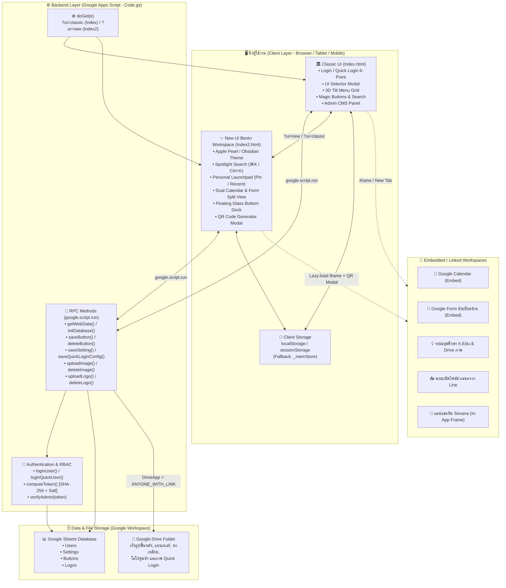
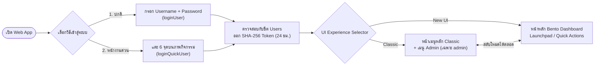
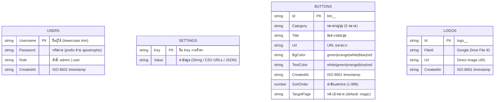
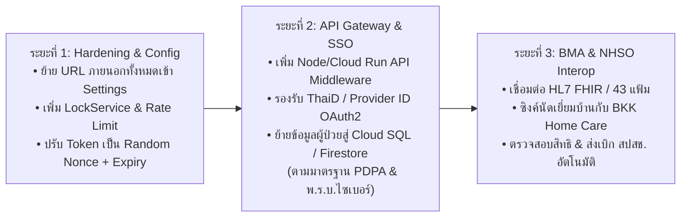

# 📋 เอกสารชี้แจงข้อมูลทางเทคนิคและนวัตกรรม (IT Technical & UX Audit Response)
**โครงการ:** ระบบบริการสาธารณสุข 21 วัดธาตุทอง — *Home Health Care (HHC) Spatial Workspace*  
**หน่วยงาน / ทีมพัฒนา:** ทีมพัฒนาและเจ้าของนวัตกรรม **Pro-Health Data BKK South** (ศูนย์บริการสาธารณสุข 21 วัดธาตุทอง)  
**วัตถุประสงค์:** เอกสารตอบกลับชุดคำถามทีม IT / ทีม UX / ผู้บริหาร สำหรับการประเมิน UX Audit, สถาปัตยกรรมระบบ และแผนบูรณาการข้อมูลระดับองค์กร (กทม. / สปสช.)  
**สถานะเอกสาร:** ฉบับสมบูรณ์จากโค้ดต้นฉบับและชุด Demo Mock-up (ปรับข้อมูลความลับ/Credentials เป็นค่าจำลองตามนโยบายความปลอดภัย)

---

> [!IMPORTANT]
> **นโยบายความปลอดภัยข้อมูล (Security & Redaction Notice):**  
> เพื่อความปลอดภัยทางสารสนเทศ เอกสารฉบับนี้และชุดไฟล์ Demo Mock-up ได้ **ตัดทอนและแทนที่ข้อมูลสำคัญทั้งหมด** ได้แก่ `SPREADSHEET_ID`, `DRIVE_FOLDER_ID`, `SECURITY_SALT`, ลิงก์ Google Apps Script `/exec`, ลิงก์ Google Drive / Google Form / Google Calendar เฉพาะของหน่วยงาน, ลิงก์แอปแชตภายใน รวมถึงชื่อผู้ใช้และรหัสผ่านใช้งานจริง **โดยใช้บัญชีจำลอง (Simulated Mock Credentials) และข้อมูลจำลองแทนทั้งหมด**

---

## สารบัญ
1. [ข้อ 1: คู่มือการใช้งาน ผังสถาปัตยกรรมระบบ และรายการฟังก์ชัน (User Manual & Specs)](#ข้อ-1-คู่มือการใช้งาน-ผังสถาปัตยกรรมระบบ-และรายการฟังก์ชัน-user-manual--specs)
2. [ข้อ 2: บัญชีทดสอบ ข้อมูลจำลอง และวิธีรันระบบ Demo / Staging](#ข้อ-2-บัญชีทดสอบ-ข้อมูลจำลอง-และวิธีรันระบบ-demo--staging)
3. [ข้อ 3: โครงสร้างฐานข้อมูล Data Dictionary และรายการ Form Fields ทั้งหมด](#ข้อ-3-โครงสร้างฐานข้อมูล-data-dictionary-และรายการ-form-fields-ทั้งหมด)
4. [ข้อ 4: ข้อจำกัดเชิงเทคนิคและปัญหาที่พบจากการวิเคราะห์โค้ดจริง (Pain Points & Tech Constraints)](#ข้อ-4-ข้อจำกัดเชิงเทคนิคและปัญหาที่พบจากการวิเคราะห์โค้ดจริง-pain-points--tech-constraints)
5. [ข้อ 5: สถานะการเชื่อมต่อ API และแผนบูรณาการกับ กทม. / สปสช. (API & Integration)](#ข้อ-5-สถานะการเชื่อมต่อ-api-และแผนบูรณาการกับ-กทม--สปสช-api--integration)

---

## จุดแข็งของนวัตกรรม (Innovation Highlights)
ก่อนเข้าสู่รายละเอียดเชิงเทคนิค ทีมพัฒนาขอนำเสนอจุดแข็งหลักของระบบ **Home Health Care Spatial Workspace** ที่ออกแบบมาเพื่อลดภาระงานเจ้าหน้าที่สาธารณสุขหน้างานและทีมสหวิชาชีพ:
1. **Dual-UI Seamless Transition (2 ประสบการณ์ในระบบเดียว):** รองรับทั้ง **Classic UI (`Index.html`)** ที่บุคลากรคุ้นเคย และ **New UI (`Index2.html` • Bento Workspace)** โทนขาวมุก *Apple Pearl* / ดำ *Obsidian* ที่ออกแบบให้ใช้งานสะดวกบนทั้งแท็บเล็ตและสมาร์ตโฟน พร้อมสลับโหมดได้ทันที
2. **Quick Graphic 6-Point Login (ล็อกอินด้วยรหัสภาพ 6 จุด):** นวัตกรรมการยืนยันตัวตนหน้างานโดยแตะจุดพิกัด 6 จุดตามลำดับบนภาพกิจกรรม (คำนวณระยะห่าง Euclidean Distance ภายในรัศมี tolerance `20%` บนฝั่งเซิร์ฟเวอร์) ช่วยให้เจ้าหน้าที่สวมถุงมือหรือถือแท็บเล็ตลงชุมชนเข้าสู่ระบบได้รวดเร็วโดยไม่ต้องพิมพ์รหัสผ่าน
3. **Spotlight Command Palette (`⌘K` / `Ctrl+K`) & Personal Launchpad:** ค้นหาแบบฟอร์ม ระบบงาน หรือคำสั่งนำทางได้จากทุกหน้าจอ พร้อมระบบปักหมุดรายการโปรด (`⭐`) และประวัติเปิดล่าสุด (`🕒`) 8 รายการบนเครื่องผู้ใช้
4. **Mobile Handoff via QR Code (`📲`):** สร้าง QR Code ให้ผู้ป่วย ญาติ หรือทีมงานสแกนเปิดแบบฟอร์ม/สื่อสุขศึกษาข้ามไปยังสมาร์ตโฟนได้ทันทีขณะลงพื้นที่เยี่ยมบ้าน
5. **Persistent In-App Workspaces:** ฝังระบบ **ปฏิทิน + ฟอร์มลงนัดแบบ Split View**, **ระบบนำเสนอไฟล์จาก Line**, และ **ระบบแชตทีม Sevana** ไว้ในหน้าเดียว สลับไปมาระหว่างดูปฏิทินและคุยงานได้โดยเซสชันแชตไม่ถูกรีเฟรชหาย

---

## ข้อ 1: คู่มือการใช้งาน ผังสถาปัตยกรรมระบบ และรายการฟังก์ชัน (User Manual & Specs)

ระบบพัฒนาบนแพลตฟอร์ม **Google Apps Script (GAS) Web App** (`Code.gs`) ทำหน้าที่เป็น Backend API/HTML Router เชื่อมต่อกับ **Google Sheets** (ฐานข้อมูล 4 แท็บ) และ **Google Drive** (คลังจัดเก็บไฟล์ภาพ/โลโก้) โดยให้บริการ Frontend แบบ Single-Page Application (SPA) 2 รูปแบบ ควบคู่กับ **คู่มือการใช้งานฉบับสมบูรณ์ (`MANUAL.md`, `Manual.html`, `Manual.pdf`)**

### 1.1 ผังสถาปัตยกรรมระบบ (System Architecture)



### 1.2 ผังขั้นตอนการใช้งานของผู้ใช้ (User Journey)



### 1.3 รายการฟังก์ชันการทำงานทั้งหมด (Functional List)

| รหัส | โมดูล (Module) | ฟังก์ชัน / ไฟล์ที่รับผิดชอบ | สิทธิ์การใช้งาน | รายละเอียดการทำงานจริงจากโค้ด |
| :--- | :--- | :--- | :--- | :--- |
| **F-01** | **ระบบยืนยันตัวตนปกติ** | `loginUser()` ใน `Code.gs` / `handleLogin()` ใน `Index.html` | ทุกคน (`user`, `admin`) | ตรวจสอบ Username/Password เทียบกับชีต `Users` และสร้าง SHA-256 Token เก็บใน `localStorage` อายุ 24 ชม. |
| **F-02** | **Quick Login (รหัสภาพ 6 จุด)** | `loginQuickUser()` ใน `Code.gs` / `handleUserQlClick()` ใน `Index.html` | ผู้ใช้ทั่วไป (`user`) | สุ่มภาพที่ตั้งค่าไว้ (1–3 ภาพ) ผู้ใช้แตะ 6 จุดตามลำดับ ส่งพิกัด `(x%, y%)` ไปตรวจระยะห่าง `<= 20.0` |
| **F-03** | **UI Experience Selector** | `openUISelectorModal()`, `selectUIMode()` ใน `Index.html` | ทุกคนหลัง Login | หน้าต่างเลือกเข้าใช้งาน Classic UI (`?ui=classic`) หรือ New UI (`?ui=new`) พร้อมบันทึกโหมดใน session |
| **F-04** | **หน้าเมนูหลัก Classic & 3D Tilt** | `view-main`, `init3DTilt()`, `updateWelcomeCard()` ใน `Index.html` | ทุกคน | การ์ดเมนู 6 ช่องพร้อมเอฟเฟกต์ 3D Parallax Tilt และการ์ดทักทายตามช่วงเวลา |
| **F-05** | **Bento Dashboard & Launchpad** | `nui-view-home`, `renderNewUILaunchpad()` ใน `Index2.html` | ทุกคน | แสดงสไลด์แบนเนอร์ นาฬิกา UTC+7 สถิติจำนวนปุ่ม/ปักหมุด/โลโก้ แท็บ **ปักหมุดของฉัน (`⭐`)** และ **เปิดล่าสุด (`🕒` 8 รายการ)** |
| **F-06** | **คลังปุ่มวิเศษ (Magic Hub)** | `renderMagicButtons()` (`Index.html`), `renderNewUIMagic()` (`Index2.html`) | ทุกคน (หมวด `Dev` เฉพาะ `admin`) | แสดงปุ่มจากชีต `Buttons` แยก 5 หมวด (`ระบบงาน`, `Hyper link`, `แบบฟอร์มต่างๆที่ใช้บ่อย`, `ไฟล์อื่นๆ`, `Dev`) เรียงตาม `SortOrder` ค้นหาได้ทันที |
| **F-07** | **Spotlight Command Palette** | `openNuiSpotlight()`, `renderNuiSpotlightResults()` (`Index2.html`) | ทุกคนใน New UI | กด `⌘K` / `Ctrl+K` เพื่อค้นหาทุกปุ่มและคำสั่งนำทาง ใช้ลูกศรขึ้น/ลง + `Enter` เปิดงานได้ทันที |
| **F-08** | **Mobile Handoff QR Code** | `openNuiQrModal()` (`Index2.html`) | ทุกคนใน New UI | สร้าง QR Code พร้อมปุ่มคัดลอกลิงก์และเปิดแท็บใหม่สำหรับส่งต่อข้ามอุปกรณ์หน้างาน |
| **F-09** | **ปฏิทินเยี่ยมบ้าน & ฟอร์มลงนัด** | `view-calendar` (`Index.html`), `nui-view-calendar` (`Index2.html`) | ทุกคน | ฝัง Google Calendar + Google Form (New UI รองรับ Split View / เฉพาะปฏิทิน / เฉพาะฟอร์ม พร้อม Lazy-load iframe) |
| **F-10** | **ศูนย์สุขศึกษา (Health Edu)** | `view-edu` (`Index.html`), `nui-view-edu` (`Index2.html`) | ทุกคน | รวมทางเข้า **h.Edu เฮ็ดอีดูว์** และคลังภาพกิจกรรมปี 67–68 และ 69+ (New UI มีปุ่มสร้าง QR ประจำการ์ด) |
| **F-11** | **ระบบนำเสนอจาก Line & แชต Sevana** | `nui-view-line`, `nui-view-sevana` (`Index2.html`) | ทุกคน | Classic เปิดแท็บใหม่; New UI ฝังใน In-App Persistent Iframe ทำให้สลับเมนูอื่นแล้วแชตไม่หลุด |
| **F-12** | **Admin CMS: จัดการปุ่มวิเศษ** | `saveButton()`, `deleteButton()` (`Code.gs`), `view-admin` (`Index.html`) | เฉพาะ `admin` | สร้าง/แก้ไข/ลบปุ่ม กำหนดหมวดหมู่ ลำดับเรียง (`SortOrder` เติมอัตโนมัติ) สีพื้นหลัง/ตัวอักษร 5 สี พร้อม Live Preview |
| **F-13** | **Admin CMS: สื่อภาพ, โลโก้, ความโปร่งแสง & Quick Login** | `uploadImage()`, `deleteImage()`, `uploadLogo()`, `deleteLogo()`, `saveSetting()`, `saveQuickLoginConfig()` | เฉพาะ `admin` | อัปโหลดสไลด์ (สูงสุด 5 ภาพ/ตำแหน่ง), โลโก้ศูนย์ (สูงสุด 5 รูป), รูปหกเหลี่ยมหน้า Login (3 รูป), Slider ปรับความโปร่งแสง Login (40%–95%) และตัวคลิกกำหนดจุด 6 จุดสำหรับ Quick Login (สูงสุด 3 ภาพ) |

### 1.4 แนวทางการใช้งานสรุป (Quick Operational Guide)
1. **เข้าสู่ระบบ:** เลือกกรอก Username/Password หรือกด **เข้าสู่ระบบด่วน (Quick Login)** เพื่อแตะ 6 จุดบนภาพ
2. **เลือกโหมดหน้าจอ:** เจ้าหน้าที่ทั่วไปบนมือถือ/แท็บเล็ตแนะนำเลือก **New UI (Bento Workspace)** เพื่อใช้ Launchpad ปักหมุด, ค้นหา `⌘K`, สแกน QR และ Split View ปฏิทิน/ฟอร์ม; ผู้ดูแลระบบที่ต้องการเพิ่ม/แก้ปุ่มหรือภาพสไลด์กดเข้า **ตั้งค่า Admin** (ระบบจะสลับเข้าหน้า Admin ของ Classic UI อัตโนมัติ)
3. **การซิงค์ข้อมูล:** หากผู้ดูแลระบบมีการแก้ไขปุ่มหรือแบนเนอร์ใหม่ ผู้ใช้งานสามารถกดปุ่ม **🔄 รีเฟรช** บนแถบด้านบนเพื่อดึงข้อมูลล่าสุดจาก Google Sheets โดยไม่ต้องล็อกอินใหม่

---

## ข้อ 2: บัญชีทดสอบ ข้อมูลจำลอง และวิธีรันระบบ Demo / Staging

### 2.1 บัญชีทดสอบจำลองสำหรับทีม UX Audit (Mock Credentials)
> [!NOTE]
> บัญชีด้านล่างเป็น **บัญชีจำลอง (Simulated Mock Credentials)** ที่สร้างขึ้นในชุด Demo Sandbox (`Demo_ระบบเยี่ยมบ้าน_ศบส21/mock-data.js`) เพื่อความปลอดภัยสูงสุด **ไม่มีการใช้รหัสผ่านหรือบัญชี Production จริง**

| บทบาท (Role) | Username (จำลอง) | Password (จำลอง) | สิทธิ์การเข้าถึงในระบบ Demo |
| :--- | :--- | :--- | :--- |
| **เจ้าหน้าที่หน้างาน (General Staff)** | `demo_staff` | `DemoStaff@2026` | เข้าดู Home, Bento Dashboard, Magic Hub (ไม่รวมหมวด Dev), Calendar & Mock Form, Health Edu, Line Presentation Mock, Sevana Chat Mock |
| **ผู้ดูแลระบบ (Administrator)** | `demo_admin` | `DemoAdmin@2026` | สิทธิ์ทั้งหมดของ Staff **+** มองเห็นหมวด `Dev` **+** เข้าใช้งาน **Admin CMS (`view-admin`)** สร้าง/แก้ไข/ลบปุ่ม, จัดการสไลด์, โลโก้, ความโปร่งแสง และตั้งค่า Quick Login |
| **Quick Login (6-Point Pattern)** | *(ไม่ต้องพิมพ์)* | แตะไอคอน **1 → 2 → 3 → 4 → 5 → 6** ตามลำดับบนภาพ | ล็อกอินเข้าสู่ระบบอัตโนมัติในบทบาท `user` (`demo_staff`) |

### 2.2 ข้อมูลจำลอง (Seed / Mock Data) ที่มีให้ทดสอบ
1. **ปุ่มวิเศษจำลอง (13 รายการ):** ครอบคลุมครบทั้ง 5 หมวดหมู่ (`ระบบงาน`, `Hyper link`, `แบบฟอร์มต่างๆที่ใช้บ่อย`, `ไฟล์อื่นๆ`, และ `Dev`) พร้อมจัดเรียงตาม `SortOrder`
2. **คิวนัดเยี่ยมบ้านและแบบฟอร์มจำลอง (3 รายการเริ่มต้น + บันทึกเพิ่มได้):** สามารถทดลองกรอกฟอร์มลงนัดเยี่ยมบ้านและเห็นรายการเพิ่มเข้าตารางทันที
3. **โลโก้และภาพแบนเนอร์ SVG แบบ Offline:** แสดงผลได้ครบถ้วนโดยไม่ต้องต่ออินเทอร์เน็ตหรือ Google Drive จริง
4. **ห้องแชต Sevana จำลอง & สไลด์นำเสนอ Line จำลอง:** ทดลองพิมพ์ส่งข้อความแชตและกดเลื่อนสไลด์ในโหมด New UI ได้ทันที

### 2.3 วิธีรันระบบทดสอบ (Demo Mock-up Local Execution)
ชุด Demo Mock-up ถูกจัดเตรียมไว้ในโฟลเดอร์ `Demo_ระบบเยี่ยมบ้าน_ศบส21/` สามารถรันได้ทันที 2 วิธี:
* **วิธีที่ 1 (เปิดไฟล์โดยตรง):** ดับเบิลคลิกเปิดไฟล์ [`index.html`](./index.html) ด้วย Google Chrome / Safari / Edge (บนหน้า Login มีปุ่ม **"⚡ กรอก Staff"** และ **"👑 กรอก Admin"** ให้กดทดสอบได้ทันที และมีปุ่ม **"🔄 รีเซ็ตข้อมูล Demo เริ่มต้น"** ที่แถบบนสุด)
* **วิธีที่ 2 (รันผ่าน Local Web Server):**
  ```bash
  cd Demo_ระบบเยี่ยมบ้าน_ศบส21
  python3 -m http.server 8080
  # จากนั้นเปิดเบราว์เซอร์ไปที่ http://localhost:8080/index.html
  ```

### 2.4 ข้อมูลสภาพแวดล้อม Staging (สำหรับกรอกเมื่อ Deploy Google Apps Script Sandbox จริง)
หากทีมงานต้องการให้ทีม UX เข้าทดสอบบน Google Apps Script Staging Environment ที่มี Backend Google Sheets จริง กรุณาระบุข้อมูลด้านล่างเพิ่มเติม:
* **Staging Web App URL:** `[กรอก URL ของ GAS Web App Staging เมื่อ Deploy จริง]`
* **Staging Test Account (Staff):** `[กรอก Username / Password สำหรับ Staging]`
* **Staging Test Account (Admin):** `[กรอก Username / Password สำหรับ Staging]`

---

## ข้อ 3: โครงสร้างฐานข้อมูล Data Dictionary และรายการ Form Fields ทั้งหมด

ระบบต้นฉบับใช้ **Google Sheets เป็นฐานข้อมูลเชิงตาราง 4 แท็บ** (สร้างโครงสร้างอัตโนมัติผ่านฟังก์ชัน `initDatabase()` ใน `Code.gs`) ร่วมกับ **Client-side Storage** สำหรับจัดเก็บเซสชันและการตั้งค่าส่วนบุคคล

### 3.1 แผนภาพโครงสร้างข้อมูล (Entity-Relationship Diagram)



### 3.2 พจนานุกรมข้อมูล (Data Dictionary — Google Sheets Tables)

#### ตารางที่ 1: `Users` (บัญชีผู้ใช้งานและสิทธิ์)
| คอลัมน์ | Data Type | ข้อกำหนด / Default | คำอธิบาย |
| :--- | :--- | :--- | :--- |
| `Username` | String | Primary Key, lowercase | ชื่อบัญชีเข้าสู่ระบบ |
| `Password` | String | Plaintext (เก็บนำหน้าด้วย `'` ในชีต) | รหัสผ่านสำหรับสร้าง SHA-256 Token (`computeToken`) |
| `Role` | String | `admin` หรือ `user` | บทบาทควบคุมการเข้าถึง Admin CMS และหมวด `Dev` |
| `CreatedAt` | String | ISO-8601 Timestamp | วันเวลาที่สร้างบัญชี |

#### ตารางที่ 2: `Settings` (ค่าการตั้งค่าระบบและสื่อภาพแบบ Key-Value)
| `Key` | รูปแบบ `Value` | ข้อจำกัด | คำอธิบาย |
| :--- | :--- | :--- | :--- |
| `bg_login` | Comma-separated URLs | สูงสุด 5 ภาพ | ภาพสไลด์พื้นหลังหน้า Login |
| `banner_home` | Comma-separated URLs | สูงสุด 5 ภาพ | ภาพสไลด์แบนเนอร์หน้าหลัก |
| `banner_magic` | Comma-separated URLs | สูงสุด 5 ภาพ | ภาพสไลด์แบนเนอร์หน้าปุ่มวิเศษ |
| `banner_edu` | Comma-separated URLs | สูงสุด 5 ภาพ | ภาพสไลด์แบนเนอร์หน้าสุขศึกษา |
| `hex_image_1` | Single URL | Overwrite แทนที่ไฟล์เดิม | ภาพกรอบหกเหลี่ยมที่ 1 (บน) หน้า Login |
| `hex_image_2` | Single URL | Overwrite แทนที่ไฟล์เดิม | ภาพกรอบหกเหลี่ยมที่ 2 (ล่างซ้าย) หน้า Login |
| `hex_image_3` | Single URL | Overwrite แทนที่ไฟล์เดิม | ภาพกรอบหกเหลี่ยมที่ 3 (ล่างขวา) หน้า Login |
| `login_card_opacity` | Decimal String (`0.40`–`0.95`) | Default `"0.85"` | ระดับความเข้ม/ความโปร่งแสงของกรอบ Login |
| `quick_login_data` | JSON Array `[{url, points:[{x,y}]}]` | 1–3 ภาพ, ภาพละ 6 จุด (`x,y` เป็น `%`) | เก็บพิกัดลับ Quick Login (**ถูก `delete` ออกก่อนส่งให้ Client ใน `getWebData()`**) |
| `quick_login_enabled` | Boolean String (`"true"`/`"false"`) | Computed / Saved | สถานะเปิดใช้งาน Quick Login |

#### ตารางที่ 3: `Buttons` (คลังปุ่มวิเศษและระบบงาน)
| คอลัมน์ | Data Type | ข้อกำหนด / Default | คำอธิบาย |
| :--- | :--- | :--- | :--- |
| `Id` | String | `btn_<ms>_<rand>` | รหัสอ้างอิงเฉพาะของปุ่ม |
| `Category` | Enum String | `ระบบงาน`, `Hyper link`, `แบบฟอร์มต่างๆที่ใช้บ่อย`, `ไฟล์อื่นๆ`, `Dev` | หมวดหมู่แสดงผล (`Dev` เห็นเฉพาะ `admin`) |
| `Title` | String | Required | ชื่อปุ่มที่แสดงบนหน้าจอ |
| `Url` | URL String | Required | ลิงก์ปลายทางของระบบงานหรือแบบฟอร์ม |
| `BgColor` | Enum String | `green`, `orange`, `white`, `blue`, `red` | สีพื้นหลังปุ่ม (Classic UI) |
| `TextColor` | Enum String | `white`, `green`, `orange`, `blue`, `red` | สีตัวอักษรปุ่ม (Classic UI) |
| `CreatedAt` | String | ISO-8601 Timestamp | วันเวลาที่สร้างรายการ |
| `SortOrder` | Number | `1`–`999` (Default `999`) | ลำดับการเรียงจากน้อยไปมากภายในหมวด |
| `TargetPage` | String | Default `"magic"` | หน้าที่นำปุ่มไปแสดงผล |

#### ตารางที่ 4: `Logos` (โลโก้ประจำศูนย์ฯ)
| คอลัมน์ | Data Type | ข้อกำหนด | คำอธิบาย |
| :--- | :--- | :--- | :--- |
| `Id` | String | `logo_<ms>_<rand>` | รหัสอ้างอิงโลโก้ |
| `FileId` | String | Drive File ID | ใช้อ้างอิงเพื่อลบไฟล์ออกจาก Google Drive (`setTrashed(true)`) |
| `Url` | URL String | Direct Google image link | URL สำหรับแสดงผลบน Header และหน้าคลังโลโก้ (สูงสุด 5 รูป) |
| `CreatedAt` | String | ISO-8601 Timestamp | วันเวลาที่อัปโหลด |

#### โครงสร้างข้อมูลฝั่ง Client (`localStorage` / `sessionStorage`)
| Storage Key | ประเภทข้อมูล | หน้าที่ |
| :--- | :--- | :--- |
| `hhc_user_role`, `hhc_session_token`, `hhc_session_time` | String / Timestamp | เก็บสถานะเซสชันผู้ใช้ (อายุ 24 ชั่วโมง) |
| `hhc_app_url` | String | แคช Web App URL สำหรับลิงก์ข้ามระหว่าง `Index.html` และ `Index2.html` |
| `hhc_ui_mode`, `hhc_nui_view`, `hhc_target_view` | String | จดจำโหมด UI (`classic`/`new`) และหน้าย่อยล่าสุด |
| `hhc_pinned_buttons` / `hhc_recent_buttons` | JSON Array of Button IDs | เก็บปุ่มที่ผู้ใช้ปักหมุด (`⭐`) และประวัติเปิดล่าสุด 8 รายการใน New UI |

### 3.3 รายการ Form Fields ทั้งหมดในระบบ (สกัดจาก `Index.html` & `Index2.html`)

| หน้าจอ / ฟอร์ม | Element ID | Label / ชื่อฟิลด์ | Input Type | Validation / หมายเหตุ |
| :--- | :--- | :--- | :--- | :--- |
| **1. ฟอร์ม Login ปกติ** | `login-username` | ชื่อผู้ใช้งาน (Username) | `text` | `required`, `autocomplete="username"` |
| | `login-password` | รหัสผ่าน (Password) | `password` | `required`, `autocomplete="current-password"` |
| **2. Quick Login (User)** | `ql-user-img-wrapper` | พื้นที่แตะพิกัดภาพ 6 จุด | Click Coordinate `(x%, y%)` | ต้องครบ 6 จุด (Tolerance รัศมี `20.0%`) |
| **3. ค้นหาคลังปุ่มวิเศษ** | `magic-search-input` / `nui-magic-search` | ค้นหาชื่อปุ่มวิเศษ | `text` | กรองข้อมูลแบบ Real-time (`oninput`) |
| **4. Spotlight Search (⌘K)** | `nui-spotlight-input` | ค้นหาปุ่ม, ระบบ, คำสั่ง | `text` | รองรับคีย์ลัด `⌘K`/`Ctrl+K`, `↑`/`↓`, `Enter`, `ESC` |
| **5. Admin: สร้าง/แก้ไขปุ่ม** | `manage-btn-id` | รหัสปุ่ม (Hidden) | `hidden` | ว่าง = สร้างใหม่, มีค่า = แก้ไข |
| | `manage-btn-category` | หมวดหมู่ปุ่ม | `select` | 5 หมวด; เลือกแล้วคำนวณ `SortOrder` ถัดไปอัตโนมัติ |
| | `manage-btn-title` | ข้อความบนปุ่ม (Title) | `text` | `required`, อัปเดต Live Preview ทันที |
| | `manage-btn-url` | ลิงก์ปลายทาง (URL) | `url` | `required` |
| | `manage-btn-sort` | ลำดับการเรียง (ตัวเลข) | `number` | `min="1"`, `max="999"`, `required` |
| | `manage-btn-bgcolor` | สีพื้นหลังปุ่ม (BgColor) | `select` | `green`, `orange`, `white`, `blue`, `red` |
| | `manage-btn-textcolor` | สีตัวอักษรปุ่ม (TextColor) | `select` | `white`, `green`, `orange`, `blue`, `red` |
| **6. Admin: ค้นหา/กรองปุ่ม** | `admin-search-button` | ค้นหาปุ่มเพื่อแก้ไข/ลบ | `text` | กรองตามชื่อหรือหมวดหมู่ |
| | `admin-filter-category` | ตัวกรองหมวดหมู่ | `select` | `ทั้งหมด` หรือ 5 หมวดหมู่ |
| **7. Admin: จัดการไฟล์ภาพ** | `file-bg_login`, `file-banner_home`, `file-banner_magic`, `file-banner_edu` | อัปโหลดภาพสไลด์โชว์ | `file` (`image/*`) | แปลง Base64, จำกัด 5 ภาพ/ตำแหน่ง |
| | `upload-logo-file` | อัปโหลดโลโก้ศูนย์ใหม่ | `file` (`image/*`) | แปลง Base64, จำกัด 5 รูป |
| | `file-hex_image_1..3` | เปลี่ยนรูปหกเหลี่ยม Login | `file` (`image/*`) | Overwrite รูปเดิมและลบไฟล์เก่าบน Drive |
| **8. Admin: ปรับความโปร่งแสง** | `admin-login-opacity` | ระดับความเข้มกรอบ Login | `range` (`40`–`95`) | แปลงเป็นทศนิยม `0.40`–`0.95` บันทึกลง `Settings` |
| **9. Admin: ตั้งค่า Quick Login** | `ql-img-url-input`, `file-ql-image` | URL หรือไฟล์รูปภาพ (3 Slots) | `text` / `file` (`image/*`) | ตั้งค่าได้ 1–3 ภาพ |
| | `ql-admin-img-wrapper` | คลิกกำหนดจุด 6 จุดบนภาพ | Click Coordinate `(x%, y%)` | บังคับครบ 6 จุดต่อภาพที่มี URL |
| **10. ฟอร์มนัดเยี่ยมบ้าน (Embed)** | *(ฝัง Google Form ภายนอก)* | ฟอร์มลงข้อมูลวันเยี่ยมบ้าน | `iframe` (`Google Forms`) | ข้อมูลถูกส่งเข้า Google Form Response ของหน่วยงานโดยตรง (ไม่ผ่าน `Code.gs`) |

---

## ข้อ 4: ข้อจำกัดเชิงเทคนิคและปัญหาที่พบจากการวิเคราะห์โค้ดจริง (Pain Points & Tech Constraints)

จากการตรวจสอบซอร์สโค้ดระดับบรรทัด (`Code.gs`, `Index.html`, `Index2.html`) และคู่มือ `MANUAL.md` พบข้อจำกัดเชิงเทคนิคและจุดคอขวดสำคัญที่ทีม IT และ UX ควรทราบเพื่อวางแผนยกระดับระบบในระยะถัดไป ดังนี้:

1. **ความปลอดภัยของรหัสผ่านและ Token (Authentication & Security Constraints):**
   * **การเก็บรหัสผ่านแบบ Plaintext ใน Google Sheets (`Code.gs` L69–75):** ตาราง `Users` เก็บรหัสผ่านในรูปข้อความปกติ (prefix ด้วย `'`) ไม่ได้ทำ Salted Password Hashing (เช่น bcrypt/Argon2) ดังนั้นผู้ที่มีสิทธิ์เปิดดู Google Sheet จะมองเห็นรหัสผ่านได้
   * **Deterministic Static Token (`computeToken` L43–55):** Token ถูกสร้างจาก `SHA-256(username + ":" + password + ":" + SECURITY_SALT)` ซึ่งได้ค่าเดิมตลอดเวลาและไม่มีการเก็บ Expiration Time บนฝั่งเซิร์ฟเวอร์ (การหมดอายุ 24 ชั่วโมงตรวจสอบผ่าน `localStorage` ฝั่ง Client เท่านั้น)
   * **Quick Login ผูกบัญชีเดียวแบบ Hardcoded (`Code.gs` L678):** เมื่อผ่าน 6-Point Quick Login ระบบจะล็อกอินเข้าเป็นบัญชีผู้ใช้ทั่วไปบัญชีเดียวที่กำหนดไว้ในโค้ด (`<DEFAULT_STAFF_USER>`, บทบาท `user`) เสมอ จึงยังไม่รองรับการแยก Audit Log รายบุคคลว่าเจ้าหน้าที่คนใดเป็นผู้ใช้งาน

2. **ข้อจำกัดของ Google Apps Script (GAS) Runtime & Iframe Sandbox:**
   * **Cross-Origin & Session Storage Restrictions:** เว็บแอปที่รันบน GAS ถูกครอบด้วย iframe ของ Google (`googleusercontent.com`) ทำให้ `localStorage`/`sessionStorage` อาจถูกบล็อกในเบราว์เซอร์บางรุ่น (เช่น Safari Mobile / Incognito) โค้ดจึงต้องมี `_memStore` เป็น Fallback ซึ่งทำให้สถานะที่ปักหมุด (`hhc_pinned_buttons`) หายเมื่อรีเฟรชหาก Storage ถูกบล็อก
   * **Execution Time & Cold Start:** GAS มีเพดานเวลาทำงาน 6 นาที/Request และมีจังหวะ Cold Start ช่วงเรียก `getWebData()` ครั้งแรก (โหลด 3 แท็บพร้อมกันแบบ Full Scan `getDataRange().getValues()`)
   * **การสลับหน้า Classic ↔ New UI:** ปัจจุบันแยกเป็น 2 ไฟล์ (`Index.html` และ `Index2.html`) และส่งต่อ `role` กับ `token` ผ่าน Query String (`?ui=new&role=...&token=...`) กับ `target="_top"` ซึ่งต้องดูแลโค้ดบางส่วนซ้ำซ้อนกัน (เช่น `startSlideshow`, `safeLocalGet`, `simulateMockData`)

3. **ปัญหา Concurrency เมื่อ Admin แก้ไขพร้อมกัน (`No LockService`):**
   * ฟังก์ชัน `saveSetting()`, `saveButton()`, `deleteButton()`, `uploadImage()`, `uploadLogo()` ยังไม่ได้ใช้ `LockService.getScriptLock()` ของ GAS หากมี Admin มากกว่า 1 คนแก้ไข/ลบแถวพร้อมกัน อาจเกิด Race Condition ในการอ้างอิง `rowIndex` ได้

4. **สิทธิ์การเข้าถึงไฟล์สื่อบน Google Drive (`ANYONE_WITH_LINK`):**
   * ฟังก์ชัน `saveFileToDrive()` (`Code.gs` L402) ตั้งค่าไฟล์ที่อัปโหลดเป็น `DriveApp.Access.ANYONE_WITH_LINK` เพื่อให้แสดงผลผ่าน URL รูปภาพได้โดยไม่ติดสิทธิ์ ซึ่งเหมาะกับโลโก้/แบนเนอร์ประชาสัมพันธ์ แต่ **ไม่เหมาะกับการนำไปใช้เก็บภาพถ่ายผู้ป่วยหรือข้อมูลส่วนบุคคล (PDPA)**

5. **การ Hardcode ลิงก์ระบบภายนอกในไฟล์ HTML:**
   * ลิงก์ของ Google Calendar, Google Form, ระบบสุขศึกษา h.Edu, โฟลเดอร์ Drive รูปภาพ, ระบบนำเสนอ Line และแชต Sevana ถูกกำหนดไว้ในโค้ด HTML ของ `Index.html` และ `Index2.html` โดยตรง (ไม่ได้ดึงจากตาราง `Settings`) หากมีการเปลี่ยนลิงก์หรือฟอร์มประจำปีงบประมาณต้องแก้ไขโค้ดและ Deploy GAS Web App ใหม่

6. **ข้อจำกัดของการฝัง Iframe บนมือถือและป๊อปอัปเบราว์เซอร์ (UX Field Bottlenecks จาก `MANUAL.md` FAQ):**
   * **Third-party Cookie / Google Account Session (FAQ Q3):** เมื่อเจ้าหน้าที่เปิดดู Google Calendar หรือ Google Form แบบ Embedded Iframe บนสมาร์ตโฟน อาจพบปัญหา *"ปฏิเสธการเชื่อมต่อ"* หรือ *"ต้องขอสิทธิ์เข้าถึง"* หากเบราว์เซอร์ปิดกั้น Cross-site Cookies หรือยังไม่ได้ล็อกอินบัญชี Google ของหน่วยงานในเบราว์เซอร์นั้น (ต้องกดปุ่ม **"เปิดแท็บใหม่ ↗"** เพื่อหลีกเลี่ยง)
   * **Pop-up Blocker (FAQ Q1):** การกดเปิดปุ่มวิเศษในแท็บใหม่อาจถูกเบราว์เซอร์บล็อกป๊อปอัปหากผู้ใช้ไม่ได้อนุญาตไว้ล่วงหน้า

---

## ข้อ 5: สถานะการเชื่อมต่อ API และแผนบูรณาการกับ กทม. / สปสช. (API & Integration)

### 5.1 สถานะปัจจุบัน (What is Supported Today vs. Gaps)

| ด้านการเชื่อมต่อ | สถานะในโค้ดปัจจุบัน (และชุด Demo) | รายละเอียดทางเทคนิคจากซอร์สโค้ด |
| :--- | :--- | :--- |
| **1. Internal RPC (Frontend ↔ GAS)** | ✅ **รองรับแล้ว** | ใช้ `google.script.run` เชื่อมต่อระหว่าง `Index.html`/`Index2.html` กับ `Code.gs` (และจำลองผ่าน `HhcDemoStore` ในชุด Demo Offline) |
| **2. Google Workspace Services** | ✅ **รองรับแล้ว** | เชื่อมต่อ Native API ภายใน GAS ได้แก่ `SpreadsheetApp` (4 ชีต), `DriveApp` (อัปโหลด/ลบไฟล์สื่อ), `Utilities` (SHA-256 / Base64) |
| **3. External Web Apps / Embedded Modules** | ✅ **รองรับระดับ UI Integration (Iframe / Deep Link / QR)** | เชื่อมต่อแบบ Embedded Iframe และลิงก์เปิดหน้าต่างใหม่กับ Google Calendar, Google Form, h.Edu, Line Presentation, แอปแชต Sevana และระบบในหมวด `Hyper link` (เช่น BKK Home Care, HDC, Health Link) |
| **4. RESTful API / Webhook (`doPost`)** | ❌ **ยังไม่รองรับ** | `Code.gs` มีเฉพาะ `doGet(e)` สำหรับเสิร์ฟหน้าเว็บ ยังไม่มี REST Endpoint (`doPost`), API Key/OAuth Verification หรือ JSON Schema สำหรับให้ระบบภายนอกเรียกเข้า |
| **5. Outbound API Sync (`UrlFetchApp`) ไปยัง กทม. / สปสช.** | ❌ **ยังไม่รองรับ** | ยังไม่มีโมดูล `UrlFetchApp` สำหรับส่ง-รับข้อมูลผู้ป่วย, สิทธิการรักษา, หรือผลการเยี่ยมบ้านกับระบบของ **สำนักอนามัย กทม. (เช่น BKK Home Care / HDC)** หรือ **สปสช. (เช่น NHSO Authen / e-Claim / 43 แฟ้ม / HL7 FHIR)** โดยตรง — ปัจจุบันเป็นการเปิดลิงก์เข้าไปกรอกในแต่ละระบบแยกกัน |
| **6. Single Sign-On (ThaiD / Provider ID / BMA SSO)** | ❌ **ยังไม่รองรับ** | ระบบยังใช้บัญชีภายในชีต `Users` ไม่ได้เชื่อม OAuth 2.0 / OIDC กับ Provider ID หรือระบบยืนยันตัวตนกลางของ กทม. |

### 5.2 แผนสถาปัตยกรรมการพัฒนาต่อเพื่อเชื่อมต่อ กทม. และ สปสช. (Integration Roadmap)

เนื่องจากระบบปัจจุบันทำหน้าที่เป็น **Operational Command Hub & Spatial Workspace** ได้อย่างยอดเยี่ยม การต่อยอดเพื่อเชื่อมต่อ API กับ กทม. และ สปสช. แนะนำให้ดำเนินการเป็น 3 ระยะ ดังนี้:



1. **ระยะที่ 1 (Quick Win — ภายใน GAS เดิม):** ย้ายลิงก์ Embedded (Calendar, Form, h.Edu, Line, Sevana) จาก HTML ไปเก็บในชีต `Settings` เพื่อให้ Admin แก้ไขได้โดยไม่ต้องแก้โค้ด, เพิ่ม `LockService`, และปรับให้ Token มีวันหมดอายุจริงบนฝั่งเซิร์ฟเวอร์
2. **ระยะที่ 2 (PDPA & API Middleware):** หากต้องการรับ-ส่งข้อมูลเวชระเบียนหรือข้อมูลผู้ป่วยรายบุคคล (PII/PHI) ควรแยก Backend ออกจาก Google Sheets ไปยังฐานข้อมูลเชิงสัมพันธ์/NoSQL ที่มี Encryption-at-Rest และ Audit Trail ครบถ้วน พร้อมเชื่อม **Provider ID / BMA SSO** เพื่อระบุตัวตนเจ้าหน้าที่รายบุคคล
3. **ระยะที่ 3 (BMA & NHSO API Integration):** พัฒนา Connector ตามมาตรฐาน **HL7 FHIR** หรือโครงสร้างข้อมูล **43 แฟ้ม / API ของสำนักอนามัย กทม. และ สปสช.** เพื่อให้การบันทึกนัดและรายงานเยี่ยมบ้านในหน้าเดียวสามารถซิงค์ข้อมูลเข้าสู่ระบบกลางของ กทม. และ สปสช. ได้โดยไม่ต้องคีย์ซ้ำซ้อน

---
*จัดทำโดย: ทีมพัฒนาและเจ้าของนวัตกรรม Pro-Health Data BKK South (ศูนย์บริการสาธารณสุข 21 วัดธาตุทอง)*  
*ไฟล์ประกอบในโฟลเดอร์นี้: [`index.html`](./index.html) (Classic UI & Admin Demo) • [`new-ui.html`](./new-ui.html) (New UI Bento Demo) • [`mock-data.js`](./mock-data.js) • [`README.md`](./README.md)*
